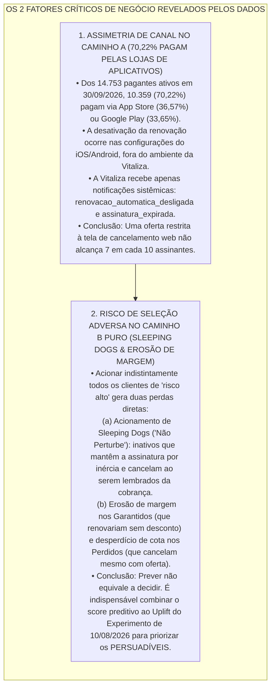

# 📋 Resumo Executivo: O Desafio de Retenção da Vitaliza

> **Módulo 2:** Inteligência de Mercado e Modelagem Preditiva para Crescimento (Inteli MBA)  
> **Equipe de Trabalho:** Equipe de Projetos MBA Inteli  
> **Arquivo:** `01_RESUMO_EXECUTIVO_DO_CASE.md`

[🔰 Comece por Aqui](./README.md) / Resumo Executivo

> **🎯 DECISÃO CENTRAL DO CASE:**  
> **Em quais assinantes investir (e para quais preservar a abstenção de contato) a fim de conter a elevação do churn da Vitaliza e maximizar o lucro incremental líquido em reais, respeitando o teto orçamentário de R$ 40.000/mês e os limites operacionais de 1.500 mensagens de WhatsApp e 300 atendimentos de Customer Success por mês?**

<p align="center">
  <b>🎧 Síntese Executiva do Projeto (5 min):</b><br>
  📜 <a href="../documentos/midia_e_audios/TRANSCRICAO_AUDIO_SINTESE_EXECUTIVA.md"><b>Ler Transcrição Completa em Texto</b></a>
</p>

---

## 🧭 1. O Problema Central & O Dilema Executivo (Exhibit / Enunciado)

A **Vitaliza** é um aplicativo brasileiro de assinatura para quem treina (registro de corrida, caminhada e pedal com GPS; aulas guiadas em vídeo de funcional, força e yoga; e rede social integrada com conexão a relógios Garmin e Apple Watch). O modelo é *Freemium*, com assinatura Premium **Mensal (R$ 39,90/mês, reajustada em 01/03/2026 sobre R$ 34,90)** ou **Anual (R$ 299,90/ano)**.

Em 2026, o cancelamento acelerou: o **churn mensal médio subiu de 5,6% (2025) para 6,6% (jan–set 2026)**, atingindo um **pico crítico de 8,1% em abril de 2026** (1.154 assinaturas perdidas sobre 14.237 ativos no início do mês).

### ⚖️ O Conflito de Interesses dos Stakeholders (C-Level)

Às vésperas da captação da **Série B** e sob a pressão do anúncio do concorrente **Strava Premium** (que está lançando modelos preditivos individuais de risco de desengajamento no Brasil), a nova VP de Crescimento e Retenção (**Camila Ferraz**) precisa levar uma recomendação ao Conselho diante de uma diretoria dividida entre visões distintas:

```text
               ┌─────────────────────────────────────────────────────────┐
               │       DILEMA ESTRATÉGICO DA DIRETORIA DA VITALIZA       │
               └──────────────────────────┬──────────────────────────────┘
                                          │
    ┌─────────────────────────┬───────────┴─────────────┬────────────────────────┐
    ▼                         ▼                         ▼                        ▼
[HEAD DE CS - PATRÍCIA]  [HEAD PRODUTO - MARCELO]  [CTO - DIEGO ALMEIDA]   [CFO - RITA FONTES]
Defende o Caminho A:     Defende o Caminho B:      Alerta para o esforço   Exige retorno financeiro
Win-Back reativo no      Score preditivo diário    de engenharia nas 13    comprovado dentro do
clique em "Cancelar"     de queda de engajamento   fontes desconectadas    orçamento de R$ 40k/mês
(MVP em 4 semanas).      semanas antes da saída.   e fusos distintos.      (1.500 WA e 300 CS).
```

---

## 🔍 2. Os Dois Fatores Críticos de Negócio (Por Que Caminho A ou Caminho B Isolados São Insuficientes)

Os dados do case revelam **dois fatos estruturais** que desmontam qualquer solução simplista e guiam o projeto inteiro:



### 📌 Como Conciliar as Duas Fontes do Case (Slide 27 da Aula 1)
* **O Deck de Negócios (Narrativa de Camila Ferraz):** Traz o contexto político, os personagens (Camila, Patrícia, Marcelo, Diego, Rita) e números da narrativa ilustrativa de setembro/2025 (27.901 pagantes, churn 10,2%, R$ 113,5k MRR perdido, LTV/CAC 2,02).
* **O Enunciado Oficial + Data Room (`documentos/exhibits-m2/`):** Trazem o retrato real auditado em **`30/09/2026`** (**14.813 ativas = 14.753 pagantes + 60 cortesias**, churn subindo de **5,6% em 2025 para 6,6% em 2026**, orçamento de **R$ 40.000/mês**, **1.500 WhatsApps/mês** e **300 atendimentos CS/mês**).
* **Regra de Ouro:** No trabalho de dados, modelos e contas financeiras, **vale o Data Room**; na construção executiva dos artefatos de negócios, respondemos diretamente ao dilema de Camila Ferraz perante o Board.

---

## 📦 3. O Que Temos Que Entregar na Semana 5 (A1) e na Semana 10 (A2)?

O módulo percorre dois movimentos (**1º Movimento: ENTENDER** até a Semana 5 | **2º Movimento: AGIR** até a Semana 10), totalizando **4 entregáveis oficiais**:

| Ciclo e Datas Oficiais | 📊 Artefato de Negócios (`artefatos_negocios/`) | 💻 Artefato de Tecnologia (`artefatos_tecnologia/`) |
| :--- | :--- | :--- |
| **SEMANA 5 — Artefato 1 (A1)**<br>🗓️ **Entrega: `13/11/2026`**<br>*(1º Movimento: ENTENDER — Formativa)* | **[Customer Segmentation Analysis Report](../artefatos_negocios/semana_5_A1/ARTEFATO_NEGOCIOS_SEMANA5_A1.md)**<br>Construído sobre os **3 Pilares Oficiais**:<br>1. **Segmentação Estratégica:** 3 a 4 clusters comportamentais interpretados e nomeados com intenção estratégica (tamanho, *churn rate*, receita).<br>2. **Criação de Personas de Dados:** Quem é, o que faz, por que sai e custo da perda (frequência, ticket, *tenure*, produto).<br>3. **Valor Estratégico & Priorização:** Teste das hipóteses da alta de 2026, **Valor em Risco (`churn rate × receita média`)**, matriz *Impacto × Acionabilidade* (intervenção imediata vs. monitoramento) e **limitações da análise**. | **[Pipeline do Data Room, EDA, Clusterização & Baseline](../artefatos_tecnologia/semana_5_A1/ARTEFATO_TECH_SEMANA5_A1.md)**<br>Cobrindo os **Objetivos 1, 2, 3 e 4 (Baseline)**:<br>1. **Saneamento e Reconstrução:** Limpeza das 13 bases, reconciliação dos `14.753` pagantes (excluindo 60 cortesias), normalização de fuso `UTC`/`BRT` em `eventos_assinatura.csv` e separação de falha de cobrança (`pagamentos.csv`).<br>2. **EDA Diagnóstica de 2026:** Cruzamentos bivariados sobre reajuste de março (R$ 34,90 $\rightarrow$ R$ 39,90), canal, safra e frequência.<br>3. **Clusterização & Baseline:** Engenharia de variáveis em `atividades.parquet` (1,25M treinos) e `amizades.csv`, clusterização sem vazamento de churn e **Regressão Logística** baseline. |
| **SEMANA 10 — Artefato 2 (A2)**<br>🗓️ **Previsão 60d: `08/12/2026`**<br>🗓️ **Revelação: `10/12/2026`**<br>🗓️ **Entrega Final: `18/12/2026`**<br>*(2º Movimento: AGIR — Somativa)* | **[Board Recommendation Deck: Plano de Inteligência de Retenção (6 Slides)](../artefatos_negocios/semana_10_A2/ARTEFATO_NEGOCIOS_SEMANA10_A2.md)**<br>Simulação da apresentação de Camila ao Conselho em **6 Slides Executivos**:<br>1. **Diagnóstico do Problema** (churn, margem em risco e vieses).<br>2. **O Que os Dados Dizem Sobre Quem Cancela** (clusters, *Sleeping Dogs* e cegueira de 70% nas lojas).<br>3. **As Duas Apostas (Caminho A vs. B)** e posicionamento frente ao Strava.<br>4. **A Recomendação Prescritiva (Uplift)** unindo o Teste A/B de 10/08 (`campanha_ago26.csv`) ao score preditivo para focar nos **Persuadíveis**.<br>5. **Plano de Ação (10 Semanas), Playbooks GenAI & ROI Líquido** dentro dos **R$ 40.000/mês** (**1.500 WA** e **300 CS**).<br>6. **Riscos e Contingências**. | **[Modelos Supervisionados (60d), Extração Multimodal GenAI/Visão & Copywriter](../artefatos_tecnologia/semana_10_A2/ARTEFATO_TECH_SEMANA10_A2.md)**<br>Cobrindo os **Objetivos 4 (Final), 5, 6, 7 e 8**:<br>1. **Extração Multimodal (Obj. 5):** LLMs e Visão transformando `onboarding`, `pesquisa_saida`, `feed`, `tickets_suporte` e `heatmaps_90d/` (pixels por cor vs. visão) em variáveis auditadas contra amostra manual e medidas por custo.<br>2. **Modelos de Churn 60d até `29/11/2026` (Obj. 4):** Comparação temporal sem *Data Leakage* entre **Regressão Logística, Árvores de Decisão, Bagging e Boosting** (com e sem texto/imagem) avaliados pelo lucro.<br>3. **Deploy & Redator Generativo de CRM (Obj. 8):** Sistema final que recebe o assinante e devolve risco, decisão e mensagem personalizada. |

---

## 💰 4. Quadro Rápido das Regras Econômicas e de CRM (Seção 03 do Enunciado)

| Dimensão | Regra Oficial do Case | Impacto na Decisão |
| :--- | :--- | :--- |
| **Preços e Planos** | **Mensal:** R$ 39,90/mês (era R$ 34,90 até 28/02/2026; 42,53% da base paga)<br>**Anual:** R$ 299,90/ano (ou R$ 239,90 no 1º ano via influenciador; 57,47% da base paga) | O mensal sofreu reajuste de +14,3% em março; o anual só renova a cada 12 meses. |
| **Receita Líquida (*Take Rate*)** | **Lojas (App Store / Google Play — 15% taxa):** Mensal deixa **R$ 33,92** \| Anual deixa **R$ 254,92**<br>**Site Cartão (3,5% taxa):** Mensal deixa **R$ 38,50**<br>**Site Pix (0,99% taxa):** Mensal deixa **R$ 39,50** | Como 70,22% contratam pelas lojas, a taxa de 15% da Apple/Google reduz significativamente a receita líquida unitária. |
| **Custo de Servir & CAC** | **Custo de Servir:** **R$ 4,20/mês** por assinante ativo \| **CAC 2026:** **R$ 118,00** por novo cliente | Repor um assinante mensal de loja exige ~3,5 mensalidades de receita líquida. |
| **Canais e Tetos Mensais** | **WhatsApp:** R$ 0,40/msg (**teto: 1.500/mês** = R$ 600)<br>**Time de CS:** R$ 18,00/atendimento (**teto: 300/mês** = R$ 5.400)<br>**E-mail:** R$ 0,01/envio (sem limite) \| **Push:** R$ 0,00 (máx. 1/semana) | WhatsApp alcança só ~10% da base paga e CS apenas ~2%. Escolher quem recebe é obrigatório. |
| **Ofertas Permitidas** | **Mensal:** 30% off por 3 meses (**R$ 35,91** de desconto total)<br>**Anual:** 1 mês grátis no fim do ciclo (**R$ 25,00** abatidos)<br>**Ambos:** Pausa de até 60 dias (receita adiada) ou **Treino/Conteúdo personalizado (R$ 0)** | Conceder desconto a quem renovaria organicamente (*Garantidos*) ou a quem cancelará independentemente da oferta (*Perdidos*) gera erosão direta de margem. |
| **Orçamento Global** | **Teto rígido de R$ 40.000,00 / mês** | Soma de **canais + descontos concedidos + tokens de IA Generativa** (extração, visão e redação). |

---

## 📚 5. Onde Ir Agora?

* **Para ver os achados reais nos dados:** [🔍 Dossiê Auditado dos Exhibits M2](./05_DOSSIE_EXHIBITS_M2.md).
* **Para revisar os conceitos da Aula 1 (Negócios + Tech):** [🎓 Guia Integrado da Aula 1](./03_GUIA_AULA_01_NEGOCIOS_E_TECNOLOGIA.md).
* **Para escolher sua trilha e tarefa:** [🗺️ Mapa das Trilhas](./02_MAPA_DAS_TRILHAS.md) e [📋 Matriz de Tarefas & Especificações](../01_gerenciamento_de_tarefas/MATRIZ_DE_TAREFAS_E_ESPECIFICACOES.md).
