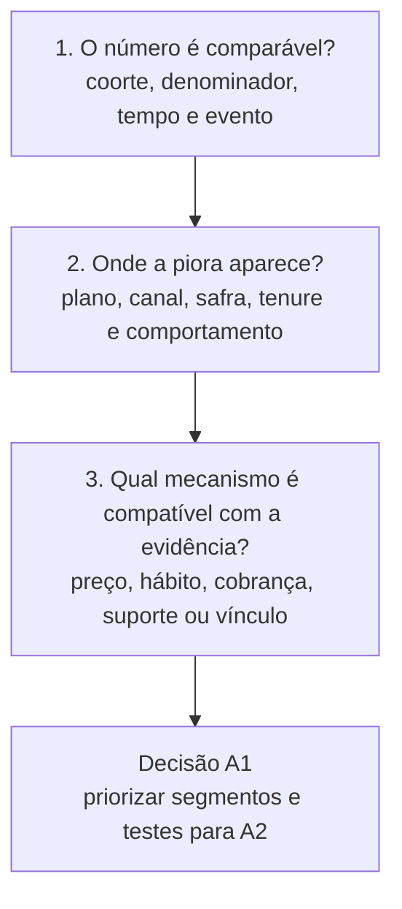
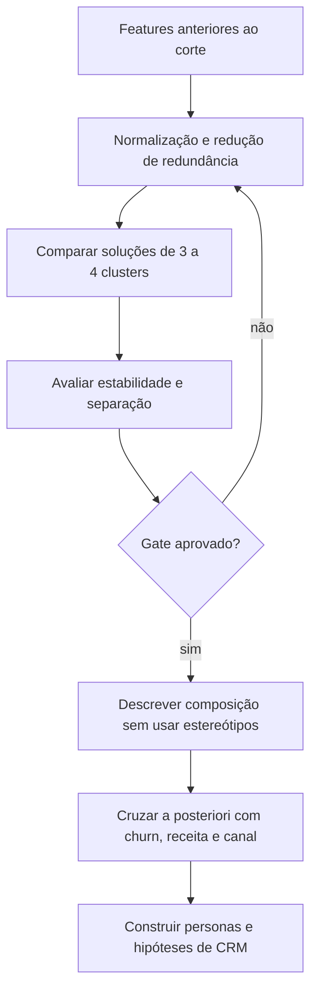

# 📊 Diagnóstico estratégico A1 — churn, segmentação e personas

> **Módulo 2:** Inteligência de Mercado e Modelagem Preditiva para Crescimento
> **Case:** Vitaliza — retenção de assinantes
> **Entrega:** Semana 5, Artefato 1 de Negócios
> **Escopo:** objetivos 1, 2 e 3 do case
> **Estado:** plano executivo de análise; hipóteses, clusters e personas finais ainda não foram executados e validados

[Trilha de Negócios, Growth e CRM](./README.md) / Diagnóstico A1

---

## 🎯 1. Decisão que o A1 precisa preparar

O A1 deve responder ao Conselho:

> **Onde a deterioração de retenção se concentra, quais mecanismos merecem teste e quais segmentos comportamentais justificam uma estratégia distinta?**

O case informa que o churn médio mensal passou de **5,6% em 2025 para 6,6% entre janeiro e setembro de 2026**, com pico de **8,1% em abril de 2026**. Esses valores justificam investigação, mas não identificam a causa. O aumento de preço do plano mensal em 1º de março, a composição das safras, o canal de cobrança, a queda de uso, falhas de pagamento e fricções de suporte podem ter ocorrido ao mesmo tempo.

A entrega deve terminar com uma decisão de portfólio analítico, não com uma causalidade improvisada: quais grupos monitorar, quais grupos levar para testes de retenção e quais análises precisam continuar antes do A2.

---

## 🗄️ 2. Base factual de partida

Os itens abaixo são evidências disponíveis na auditoria local ou premissas do enunciado. Eles podem entrar no A1 antes das análises novas, desde que mantenham a referência.

| Fato ou regra | Valor disponível | Classificação | Uso no A1 |
| :--- | ---: | :--- | :--- |
| assinaturas ativas no retrato | 14.813 | evidência auditada | reconciliação do corte |
| pagantes ativos | 14.753 | evidência auditada | população de referência |
| cortesias internas | 60 | evidência auditada | exclusão obrigatória |
| plano anual | 8.478 (57,47%) | evidência auditada | composição da base |
| plano mensal | 6.275 (42,53%) | evidência auditada | composição da base |
| App Store + Google Play | 10.359 (70,22%) | evidência auditada | restrição de canal e motivo de saída |
| campanha de agosto | 14.120 sorteados | evidência auditada | ponte futura para A2 |
| respostas de saída | 643 respostas de 641 contas | evidência auditada | hipótese declarada, com viés de cobertura |
| preço do mensal | R$ 34,90 até 28/02/2026; R$ 39,90 depois | premissa do case | exposição para H-PRICE-01 |
| corte de features | 30/09/2026 | contrato analítico | prevenção de vazamento |
| horizonte final do modelo | 60 dias, até 29/11/2026 | contrato analítico | definição posterior do label |

A auditoria também encontrou registros posteriores ao corte, categorias duplicadas por grafia, valores monetários lidos como texto e diferença entre o retrato atual da assinatura e seu histórico. Esses achados são restrições metodológicas, não notas de rodapé.

---

## 🧭 3. Tese de diagnóstico

A piora do churn deve ser decomposta em três perguntas, nesta ordem:



Se a primeira pergunta falhar, as demais não têm validade. Uma mudança de denominador, um evento posterior ao corte ou a confusão entre renovação desligada e expiração efetiva pode fabricar uma tendência.

---

## 📐 4. Contrato de população, tempo e churn

### 4.1 População principal

- unidade: `user_id` pagante;
- corte: 30/09/2026 em referência temporal definida pelo pipeline;
- inclusão: assinatura paga ativa no corte;
- exclusão: 60 cortesias e registros sem elegibilidade definida;
- reconciliação obrigatória: `N = 14.753`.

Subanálises podem ter populações diferentes. Cada tabela deve mostrar o seu próprio `N` e explicar por que contas foram excluídas.

### 4.2 Estados que não podem ser misturados

| Estado | Interpretação | Pode ser chamado de churn? |
| :--- | :--- | :---: |
| renovação automática desligada | intenção ou perda contratada para o fim do ciclo | não, isoladamente |
| assinatura expirada | acesso terminou ao fim do período pago | sim, conforme a regra do label |
| cancelamento no site | solicitação registrada no canal próprio | depende da data de término |
| cobrança recusada | tentativa falhou | não, se houver recuperação ou carência |
| reembolso ou chargeback | reversão financeira | precisa de regra específica |
| ausência de uso | comportamento | não; é possível feature ou exposição |

### 4.3 Definição operacional proposta

Para a série histórica, o time deve definir uma regra mensal que mantenha numerador e denominador comparáveis:

```text
taxa_de_saida_mes =
    assinaturas pagantes que encerraram no mês
    ÷ assinaturas pagantes ativas no início do mês
```

A implementação deve registrar quais eventos contam como encerramento e como trata reativação, sobreposição de assinatura, carência e mudança de plano. Para o modelo supervisionado de 60 dias, o label final só existe quando a janela inteira estiver observada.

---

## 🧪 5. Plano de análise do A1

### 5.1 Gate 1 — saneamento e reconciliação

| Teste | Método | Critério de aceite | Se falhar |
| :--- | :--- | :--- | :--- |
| população no corte | reconstruir estado por eventos e conferir o retrato | 14.753 pagantes e 60 cortesias explicados | bloquear indicadores de churn |
| integridade temporal | converter timestamps e filtrar após 30/09 | nenhum dado futuro em features | corrigir pipeline e reexecutar |
| categorias | preservar original e criar campo normalizado | regras versionadas para sistema e atividade | impedir agregações por categoria |
| pagamentos | converter valor com validação explícita | zero conversão silenciosa ou valor inválido não tratado | bloquear conta econômica |
| chaves | validar unicidade e cardinalidade de joins | duplicação explicada antes da agregação | corrigir granularidade |

### 5.2 Gate 2 — fotografia e série histórica

O A1 deve apresentar, no mínimo:

1. população pagante no corte por plano e canal;
2. churn mensal com numerador e denominador;
3. comparação 2025 versus 2026 pela mesma regra;
4. churn por plano, canal, safra e tempo de assinatura;
5. distinção entre intenção de saída, término efetivo e perda de receita;
6. distribuição de uso, cobrança, suporte e vínculo social antes do desfecho.

Cada gráfico deve informar população, período, fonte e regra de exclusão.

### 5.3 Gate 3 — hipóteses que mudam decisão

| ID | Hipótese | Comparação mínima | Decisão afetada | Critério de conclusão | Limite principal |
| :--- | :--- | :--- | :--- | :--- | :--- |
| `H-PRICE-01` | o reajuste elevou a saída do mensal | mensal vs. anual antes/depois, controlando tendência, canal, coorte e tenure | oferta de preço e foco no mensal | efeito diferencial persistente, com incerteza e sensibilidade | março também pode coincidir com sazonalidade e mudança de composição |
| `H-ENGAGEMENT-01` | queda recente de uso antecede a saída | trajetória de 30/60/90 dias entre quem sai e quem permanece | alerta antecipado e conteúdo | ganho fora do tempo sobre baseline cadastral | falha de captura pode parecer inatividade |
| `H-CHANNEL-01` | canal altera risco e capacidade de intervir | curvas de saída por canal, plano e tenure | desenho de canais e janela de contato | diferença estável após ajuste observável | canal se associa a sistema e aquisição |
| `H-SOCIAL-01` | vínculo social acompanha retenção | grau, reciprocidade, posts e treino acompanhado por nível de uso | comunidade e desafios | associação estável e útil fora do tempo | vínculo pode ser consequência do hábito |
| `H-SUPPORT-01` | fricção técnica ou cobrança antecede saída | tickets e recusas anteriores ao desfecho | suporte antes de desconto | associação temporal e ganho de decisão | status do ticket pode ser atualizado depois |
| `H-COHORT-01` | safras recentes retêm menos | curvas por mês desde primeira cobrança | onboarding e aquisição | diferença entre safras no mesmo tempo de vida | censura desigual entre safras |

Os IDs existentes devem permanecer alinhados ao [Caderno de Hipóteses](../06_CADERNO_DE_HIPOTESES_ANALITICAS.md). `H-COHORT-01` deve ser registrado no caderno antes da execução para evitar um teste sem contrato.

### 5.4 Linguagem permitida após o teste

| Resultado do teste | Formulação correta |
| :--- | :--- |
| evidência consistente com a hipótese | "A associação observada é compatível com o mecanismo proposto sob o método adotado." |
| efeito instável ou impreciso | "O teste é inconclusivo; não sustenta mudança de política." |
| ausência de diferença relevante | "A hipótese foi enfraquecida no recorte analisado." |
| desenho observacional | "Não há identificação causal; permanecem explicações alternativas." |

Termos como "causou", "comprovou" ou "principal driver" exigem desenho e evidência compatíveis. A proximidade entre reajuste e pico de churn, por si só, não atende esse padrão.

---

## 🧩 6. Segmentação comportamental

### 6.1 Objetivo

A segmentação deve formar **3 a 4 grupos acionáveis** a partir de comportamento, contexto comercial e relação com o produto. Churn ou renovação desligada não entram na formação dos clusters; podem ser usados depois para descrever diferenças.

### 6.2 Famílias de variáveis candidatas

| Família | Exemplos | Fonte principal | Cuidado |
| :--- | :--- | :--- | :--- |
| frequência e recência | treinos, dias ativos, sessões, tendência | `uso_mensal.csv`, `atividades.parquet` | cobertura temporal desigual |
| modalidade e intensidade | corrida, caminhada, força, yoga, minutos e distância | `atividades.parquet` | normalizar português/inglês |
| produto conectado | Garmin, Apple Watch, nenhum | `usuarios.csv` | `nenhum` não é nulo |
| social | seguidores, seguidos, reciprocidade, posts e curtidas | `amizades.csv`, `feed_posts.csv` | filtrar relações e posts após o corte |
| comercial | plano, canal, tenure e renovação | `assinaturas.csv`, `eventos_assinatura.csv` | evitar que estado posterior contamine o cluster |
| onboarding | objetivo e preferência declarada | `onboarding.csv` | intenção declarada pode estar desatualizada |
| suporte | categoria, recência e resolução | `tickets_suporte.csv` | texto livre requer proteção e validação |

### 6.3 Critérios de qualidade do cluster

- estabilidade sob diferentes sementes e amostras;
- separação suficiente sem depender de uma única variável trivial;
- tamanho que permita gestão e análise;
- interpretação pós-modelo baseada em medidas reais;
- ausência de vazamento de churn;
- utilidade para decisões, sem forçar um grupo a receber tratamento antes do experimento.



---

## 👤 7. Personas baseadas em dados

As personas só devem ser nomeadas depois que a solução de clusterização for executada. Nomes como "desmotivado", "persuadível" ou "sleeping dog" atribuem intenção ou efeito que o cluster não mede diretamente e, portanto, não são nomes aceitáveis sem evidência específica.

### 7.1 Template obrigatório

| Campo | Conteúdo |
| :--- | :--- |
| nome descritivo | característica observada que diferencia o grupo |
| tamanho | quantidade e participação na população modelada |
| comportamento | frequência, recência, modalidade e intensidade |
| contexto | plano, canal, tenure e dispositivo |
| vínculo com produto | relógio, social, conteúdo e suporte |
| resultado a posteriori | churn, receita ou renovação, sem uso na formação |
| necessidade sugerida | interpretação claramente marcada como hipótese |
| ação candidata | tratamento a testar, não benefício presumido |
| risco de contato | desconto desnecessário, fadiga, dano ou inelegibilidade |
| limitação | heterogeneidade interna e estabilidade |

### 7.2 Critério executivo de priorização

A1 pode classificar cada persona em uma matriz **impacto × acionabilidade**, desde que não atribua uplift ainda não medido.

| Dimensão | Medida proposta |
| :--- | :--- |
| impacto | população, receita líquida ou margem exposta, com horizonte declarado |
| acionabilidade | existência de canal, janela, oferta elegível e mecanismo plausível |
| confiança | qualidade das fontes e estabilidade do segmento |
| risco | possibilidade de dano, custo de desconto ou viés |

O resultado do A1 é uma fila de testes para A2, não uma política de contato em produção.

---

## 🔍 8. Evidências disponíveis e lacunas

| Evidência disponível | O que permite afirmar | O que não permite afirmar |
| :--- | :--- | :--- |
| preço é o motivo mais selecionado entre 643 respostas | preço merece teste no recorte dos respondentes | preço explica todo o churn ou representa usuários das lojas |
| 70,22% da base paga por lojas | win-back apenas no site tem baixa cobertura estrutural | clientes de loja respondem melhor a qualquer contato antecipado |
| campanha tem quatro grupos próximos em tamanho | o arquivo contém um desenho experimental útil | qualquer tratamento reteve mais antes de reconstruir o desfecho |
| uso, atividades e rede têm grande volume | há matéria-prima para segmentação comportamental | os grupos finais ou a direção de sua relação com churn |
| tickets e pagamentos têm eventos operacionais | fricção pode ser investigada antes da saída | suporte ou cobrança causaram o aumento sem teste temporal |

---

## 📁 9. Estrutura recomendada para o artefato final A1

1. **Resumo executivo:** problema, população, três achados validados e decisão proposta.
2. **Contrato da análise:** corte, população, churn, fontes e privacidade.
3. **Fotografia e tendência:** base, receita, churn e composição.
4. **Teste das hipóteses:** resultado, efeito, incerteza e explicações alternativas.
5. **Segmentação:** método, escolha do número de grupos e estabilidade.
6. **Personas:** descrição observada, valor e riscos.
7. **Matriz impacto × acionabilidade:** ordem dos testes de CRM.
8. **Limitações:** cobertura, tempo, viés, causalidade e generalização.
9. **Decisão para A2:** tratamentos e públicos que merecem avaliação experimental.

---

## ✅ 10. Critérios de conclusão do A1

O A1 pode ser declarado concluído somente quando:

- [ ] a coorte reconcilia 14.753 pagantes e exclui 60 cortesias;
- [ ] a definição de churn é reproduzível e separa intenção, expiração e falha de cobrança;
- [ ] não existem features posteriores ao corte;
- [ ] série e comparações mostram numerador, denominador e intervalo temporal;
- [ ] cada hipótese tem resultado, incerteza, explicação alternativa e decisão afetada;
- [ ] a clusterização não usa churn e apresenta estabilidade;
- [ ] as personas correspondem aos clusters executados, sem números ou perfis inventados;
- [ ] impacto econômico usa receita ou margem com horizonte declarado;
- [ ] a recomendação para A2 é formulada como teste ou prioridade, não como efeito comprovado;
- [ ] tabelas e gráficos podem ser reproduzidos por outra pessoa.

**Destino editorial:** [Artefato de Negócios A1](../../artefatos_negocios/semana_5_A1/ARTEFATO_NEGOCIOS_SEMANA5_A1.md).
**Próxima etapa:** [Estratégia de uplift, alocação e ROI A2](./02_ESTRATEGIA_UPLIFT_E_ROI_A2_SEMANA10.md).
