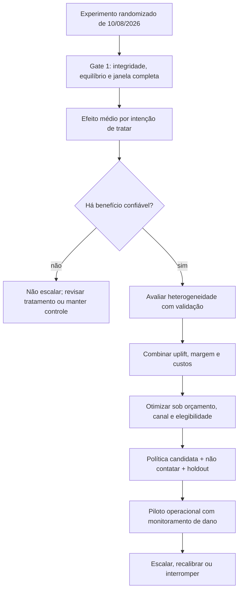
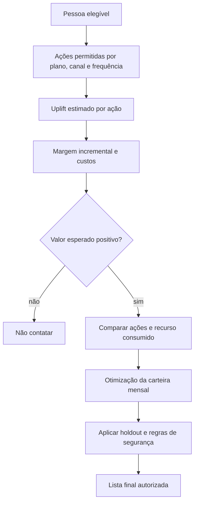

# 💰 Estratégia A2 — uplift, política de CRM e retorno incremental

> **Módulo 2:** Inteligência de Mercado e Modelagem Preditiva para Crescimento
> **Case:** Vitaliza — decisão prescritiva de retenção
> **Entrega:** Semana 10, Artefato 2 de Negócios
> **Escopo:** objetivos 6, 7 e briefing de negócio para o objetivo 8
> **Estado:** estrutura de decisão e método; uplift, política ótima, lucro incremental e ROI ainda não foram estimados e validados

[Trilha de Negócios, Growth e CRM](./README.md) / Estratégia A2

---

## 🎯 1. Decisão que o A2 precisa sustentar

O A2 deve responder:

> **Qual combinação de público, tratamento, canal e oferta gera o maior lucro incremental esperado, dentro do orçamento e sem aumentar cancelamentos por contato indevido?**

Essa pergunta exige separar quatro objetos:

| Objeto | Pergunta | Unidade de decisão |
| :--- | :--- | :--- |
| risco de churn | quem provavelmente sairá? | pessoa |
| efeito do tratamento | para quem o contato muda o desfecho? | pessoa × tratamento |
| valor incremental | o benefício esperado paga contato, oferta e custo de servir? | pessoa × tratamento × horizonte |
| política | quais ações cabem simultaneamente no orçamento e nas capacidades? | carteira mensal |

Alto risco não implica alto efeito. Alto efeito não implica lucro. Uma ação lucrativa isolada pode deixar de ser executável quando compete por WhatsApp, CS, frequência ou orçamento.

---

## 🔍 2. Base de decisão e estado das evidências

### 2.1 Evidências já disponíveis

- `campanha_ago26.csv` contém **14.120 participantes sorteados** entre controle, desafio, cupom e conteúdo;
- os grupos têm tamanhos próximos: 3.579 no controle, 3.515 em desafio, 3.472 em cupom e 3.554 em conteúdo;
- abertura e clique estão disponíveis, e cupom tem o maior clique bruto, 16,45%;
- preços, taxas, custo de servir, CAC, canais, ofertas e limites constam no case;
- a auditoria identificou 14.753 pagantes no corte e 70,22% em lojas.

### 2.2 Resultados ainda pendentes

- retenção ou churn de cada grupo em uma janela comum;
- diferença de tratamento versus controle e intervalos de confiança;
- multiplicidade das três comparações;
- efeito por plano, canal, cluster ou faixa de uso;
- probabilidade individual de resposta ao tratamento;
- lucro incremental da política;
- ROI, payback ou receita retida;
- segurança de extrapolar push + e-mail para WhatsApp ou CS.

Nenhum desses resultados deve aparecer como realizado antes da execução reproduzível e da revisão da equipe.

---

## 📐 3. Arquitetura da decisão



A ordem importa. Segmentos não devem ser chamados de persuadíveis, garantidos ou não perturbe com base apenas em comportamento. Esses tipos são contrafactuais: cada pessoa só revela o desfecho sob a ação que recebeu.

---

## 🧪 4. Protocolo do experimento de agosto

### 4.1 Pergunta causal

Para cada tratamento `a`:

```text
uplift_retencao(a) =
    P(retido na janela | sorteado para a)
    − P(retido na janela | sorteado para controle)
```

Se o desfecho for churn, a diferença deve ser orientada para que valor positivo continue significando benefício:

```text
uplift_retencao(a) =
    P(churn | controle)
    − P(churn | tratamento a)
```

### 4.2 Unidade e estimando

- unidade: participante originalmente sorteado;
- estimando principal: efeito por intenção de tratar;
- referência: grupo controle;
- tratamentos: desafio, cupom e conteúdo;
- desfecho: retenção ou churn definido antes da análise;
- janela: período comum completamente observado para todos os grupos;
- população: todos os sorteados elegíveis, independentemente de abertura ou clique.

Analisar somente quem abriu ou clicou quebra o sorteio, pois abertura e clique acontecem depois do tratamento.

### 4.3 Gates de validade

| Gate | Verificação | Critério |
| :--- | :--- | :--- |
| integridade | uma linha por participante e grupo válido | duplicidade ou troca de grupo explicada |
| pré-tratamento | atributos usados são anteriores a 10/08/2026 | nenhum vazamento |
| equilíbrio | plano, canal, tenure, uso e outras variáveis antes do sorteio | desequilíbrios reportados e, se necessário, ajuste pré-especificado |
| desfecho | mesma regra e janela para todos | perdas e censura declaradas |
| intenção de tratar | todos permanecem no grupo sorteado | nenhuma seleção por engajamento posterior |
| incerteza | diferença, intervalo e tamanho de grupo | estimativa não apresentada sem precisão |
| multiplicidade | três tratamentos contra o mesmo controle | correção ou interpretação conservadora explícita |

Um horizonte de 60 dias após 10/08 termina em 09/10/2026. Se o pacote observado terminar em 30/09, essa janela não está completa. O A2 deve usar uma janela menor completamente observada ou aguardar dados adicionais; não deve tratar o período faltante como ausência de churn.

### 4.4 Tabela de resultado a preencher

| Tratamento | N sorteado | Retenção na janela | Diferença vs. controle | IC | Custo médio | Decisão |
| :--- | ---: | ---: | ---: | :--- | ---: | :--- |
| controle | `[executar]` | `[executar]` | referência | — | R$ 0 | baseline |
| desafio | `[executar]` | `[executar]` | `[executar]` | `[executar]` | `[apurar]` | escalar / revisar / parar |
| cupom | `[executar]` | `[executar]` | `[executar]` | `[executar]` | `[apurar]` | escalar / revisar / parar |
| conteúdo | `[executar]` | `[executar]` | `[executar]` | `[executar]` | `[apurar]` | escalar / revisar / parar |

---

## 🧩 5. Do efeito médio à heterogeneidade

### 5.1 Quadrantes de interpretação

| Tipo conceitual | Sem contato | Com contato | Implicação |
| :--- | :--- | :--- | :--- |
| persuadível | sairia | ficaria | contato pode criar retenção |
| garantido | ficaria | ficaria | oferta pode consumir margem sem benefício |
| perdido | sairia | sairia | ação consome recurso sem alterar desfecho |
| não perturbe | ficaria | sairia | contato produz dano |

Não é possível observar os dois resultados potenciais na mesma pessoa. A política usa estimativas de efeito, não rótulos comprovados individualmente.

### 5.2 Regra para investigar subgrupos

A heterogeneidade só avança se:

1. o efeito médio ou a pergunta de segurança justificar análise;
2. as variáveis forem anteriores ao tratamento;
3. o tamanho das subamostras for suficiente;
4. a segmentação não for escolhida apenas por encontrar o maior efeito na amostra;
5. houver validação, regularização ou amostra separada;
6. o resultado for traduzido em decisão e valor, não apenas significância.

Subgrupos candidatos incluem plano, canal, tenure, cluster comportamental, tendência de uso e fricção recente. O A2 deve limitar o número de recortes e distinguir análise confirmatória de exploração.

### 5.3 Extrapolação de canal

O sorteio testou pacotes de push + e-mail. Ele não identifica automaticamente o efeito de WhatsApp, atendimento de CS ou mensagens geradas por IA. Uma política nesses canais precisa de:

- hipótese explícita de transporte do efeito;
- piloto com holdout próprio;
- limite inicial de exposição;
- monitoramento de desligamento de renovação após contato;
- decisão de escala baseada no efeito observado no novo canal.

---

## 💰 6. Modelo econômico

### 6.1 Valor incremental por pessoa e ação

```text
valor_incremental_esperado(i, a) =
    uplift_retencao_estimado(i, a)
    × margem_contribuicao_adicional(i, horizonte)
    − custo_canal(i, a)
    − custo_oferta_esperado(i, a)
    − custo_IA_alocado(i, a)
    − custo_operacional_incremental(i, a)
```

A política considera apenas ações elegíveis e pode escolher `não_contatar`, cujo custo e efeito incremental operacional são zero.

### 6.2 Premissas econômicas do case

| Componente | Regra | Tratamento no cálculo |
| :--- | :--- | :--- |
| mensal | R$ 39,90/mês | aplicar taxa do canal e custo de servir |
| anual | R$ 299,90/ano; condição promocional específica quando aplicável | mensalizar apenas para comparação, sem confundir caixa e competência |
| App Store / Google Play | taxa de 15% | deduzir da receita bruta |
| cartão no site | taxa de 3,5% | deduzir da receita bruta |
| Pix no site | taxa de 0,99% | deduzir da receita bruta |
| custo de servir | R$ 4,20 por mês ativo | aplicar aos meses incrementais retidos |
| CAC | R$ 118 | usar como contexto; só reconhecer economia se a reposição evitada for demonstrada |
| WhatsApp | R$ 0,40 por mensagem | contar envios e recontatos |
| CS | R$ 18 por atendimento | contar capacidade e custo |
| e-mail | R$ 0,01 por envio | incluir todos os envios |
| push | custo direto informado como zero; máximo de um por semana | controlar frequência |
| desconto mensal | 30% por três meses, compromisso máximo de R$ 35,91 | cobrar de todo beneficiário elegível que utilizar a oferta |
| desconto anual | R$ 25 no fim do ciclo | alinhar ao horizonte e probabilidade de uso |
| pausa | até 60 dias | modelar adiamento de receita e retorno posterior |
| IA | extração, visão, geração e reprocessamento | alocar por regra documentada |

Se o desconto já estiver refletido na receita líquida, não deve ser subtraído novamente. Receita retida, margem incremental e CAC evitado são medidas diferentes e não podem ser somadas sem demonstrar que não há dupla contagem.

### 6.3 Métricas financeiras

```text
lucro_incremental = margem_incremental − custo_total_da_politica

ROI = lucro_incremental ÷ custo_total_da_politica
```

O A2 deve declarar o horizonte e o denominador. Uma projeção de seis meses não é receita realizada. O cenário central deve vir acompanhado de sensibilidade conservadora.

---

## ⚖️ 7. Política de CRM sob restrições

### 7.1 Restrições duras

| Restrição | Limite do case | Regra de validação |
| :--- | ---: | :--- |
| orçamento | R$ 40.000/mês | canais + descontos + IA + custos incrementais |
| WhatsApp | 1.500 mensagens/mês | somar primeira abordagem e recontato |
| CS | 300 atendimentos/mês | capacidade não pode ser excedida |
| push | 1 por pessoa/semana | controlar histórico individual |
| oferta | compatível com plano e canal | bloquear antes da geração de mensagem |
| privacidade | uso mínimo de dados | mensagem não expõe inferências sensíveis |

### 7.2 Regra de decisão proposta

Para cada pessoa elegível:

1. calcular valor esperado de cada ação permitida;
2. excluir ações com valor esperado não positivo no cenário conservador, quando essa for a regra aprovada;
3. comparar ação versus não contatar;
4. ordenar combinações pessoa × ação pelo valor incremental ajustado ao recurso escasso;
5. resolver conflitos de orçamento, canal e frequência;
6. reservar holdout para mensuração;
7. gerar lista autorizada e briefing fechado.



### 7.3 Estrutura da política a preencher

| Prioridade | Público elegível | Ação | Canal | Volume | Custo | Retenções incrementais | Lucro incremental | Confiança |
| :---: | :--- | :--- | :--- | ---: | ---: | ---: | ---: | :--- |
| 1 | `[resultado pendente]` | `[resultado pendente]` | `[resultado pendente]` | `[otimizar]` | `[calcular]` | `[estimar]` | `[calcular]` | `[avaliar]` |
| 2 | `[resultado pendente]` | `[resultado pendente]` | `[resultado pendente]` | `[otimizar]` | `[calcular]` | `[estimar]` | `[calcular]` | `[avaliar]` |
| silêncio | grupos com dano ou valor não positivo | não contatar | nenhum | `[calcular]` | R$ 0 | benefício de evitar dano, se estimado | `[calcular]` | `[avaliar]` |
| holdout | amostra de públicos elegíveis | sem contato | nenhum | `[definir]` | R$ 0 | referência | referência | obrigatória |

---

## 📊 8. Cenários para o Conselho

Todos os cenários devem usar a mesma população, janela e convenção econômica.

| Cenário | Regra | Pergunta respondida |
| :--- | :--- | :--- |
| sem contato | nenhuma intervenção | qual é o baseline econômico? |
| ranking por risco | contato dos maiores scores | quanto se perde ao confundir risco com efeito? |
| efeito médio | melhor tratamento médio para elegíveis | uma regra simples já cria valor? |
| efeito heterogêneo | tratamento escolhido por efeito individual ou de segmento | personalizar melhora a alocação? |
| conservador | menor efeito plausível e custos maiores | a recomendação resiste à incerteza? |
| capacidade reduzida | limites menores de WA/CS | qual recurso tem maior valor marginal? |

A comparação deve reportar população acionada, distribuição de tratamentos, custos, retenções incrementais esperadas, margem, lucro, ROI e incerteza.

---

## ✍️ 9. Briefing fechado para IA generativa

A camada de redação recebe uma decisão já tomada. O contrato mínimo contém:

| Campo | Origem | Regra |
| :--- | :--- | :--- |
| identificador interno | política | nunca expor na mensagem |
| canal | política | não alterar |
| tratamento e oferta | política | não criar benefício novo |
| elegibilidade | motor de regras | validação obrigatória |
| tom e objetivo | playbook aprovado | linguagem não manipulativa |
| contexto permitido | dados minimizados | excluir atributos sensíveis e inferências frágeis |
| validade | regra comercial | informar quando aplicável |
| fallback | template homologado | usar se o schema falhar |

O gerador não escolhe desconto, não aumenta a lista de destinatários e não remove o holdout. Consulte o [guia de IA generativa e copywriting](../03_trilha_ia_generativa_e_multimodal/01_EXTRACAO_MULTIMODAL_E_COPYWRITING_CRM.md).

---

## 🛡️ 10. Riscos, gatilhos e contingências

| Risco | Sinal de monitoramento | Decisão automática ou humana |
| :--- | :--- | :--- |
| contato aumenta saída | aumento de cancelamento ou renovação desligada após envio vs. holdout | pausar segmento e investigar |
| cupom canibaliza margem | adesão acima da premissa sem aumento proporcional de retenção | reduzir oferta ou substituir por ação sem desconto |
| extrapolação de canal falha | WhatsApp/CS não reproduzem benefício de push + e-mail | manter escala limitada e recalibrar |
| modelo perde calibração | diferença entre uplift previsto e observado | reestimar antes de nova safra |
| frequência excessiva | reclamações, opt-out e queda de resposta | bloquear recontato |
| mensagem incorreta | schema inválido, oferta ou dado não autorizado | usar template determinístico |
| custo de IA supera ganho | custo por decisão cresce sem lucro adicional | retirar fonte ou simplificar pipeline |

---

## 📁 11. Estrutura recomendada para o artefato final A2

1. **Decisão pedida ao Conselho.**
2. **Evidência da A1:** população, segmentos e riscos relevantes.
3. **Validade do experimento:** desenho, janela, integridade e desfecho.
4. **Efeito incremental:** estimativas, intervalos e multiplicidade.
5. **Política:** ação, público, canal, silêncio e holdout.
6. **Economia:** premissas, custos, lucro, ROI e sensibilidade.
7. **Operação:** orçamento, capacidade, frequência e briefing de mensagem.
8. **Riscos e governança:** danos, privacidade, monitoramento e kill-switch.
9. **Recomendação:** escalar, pilotar, revisar ou não implementar.

---

## ✅ 12. Critérios de conclusão do A2

O A2 estará concluído quando:

- [ ] o desfecho do experimento usar janela comum e completamente observada;
- [ ] a análise preservar o grupo originalmente sorteado;
- [ ] efeito de retenção estiver separado de abertura, clique e score de churn;
- [ ] as três comparações com controle tratarem multiplicidade e incerteza;
- [ ] qualquer heterogeneidade tiver validação e variáveis pré-tratamento;
- [ ] o transporte para WhatsApp ou CS estiver identificado como hipótese ou medido em piloto próprio;
- [ ] margem, taxas, custo de servir, canal, oferta e IA usarem a mesma convenção temporal;
- [ ] não houver dupla contagem entre receita retida, margem e CAC;
- [ ] a política respeitar R$ 40.000, 1.500 WhatsApps, 300 atendimentos e frequência;
- [ ] existir ação `não contatar`, holdout e kill-switch;
- [ ] lucro e ROI forem rotulados como estimados ou observados;
- [ ] a lista autorizada e as mensagens puderem ser auditadas.

**Destino editorial:** [Artefato de Negócios A2](../../artefatos_negocios/semana_10_A2/ARTEFATO_NEGOCIOS_SEMANA10_A2.md).
**Fonte principal:** [enunciado do case, seções 02 e 03](<../../documentos/enunciado_e_guias/Vitaliza - Enunciado do case.pdf>).
