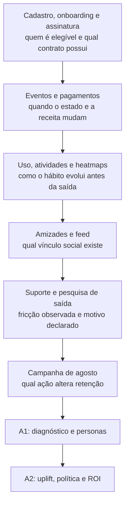
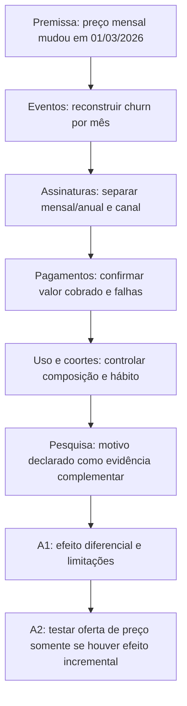
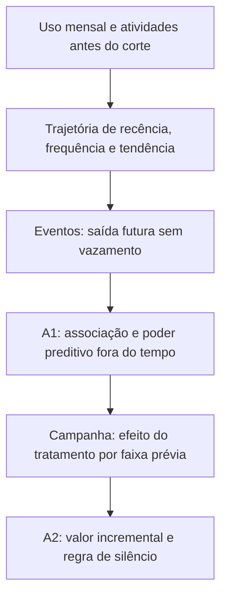
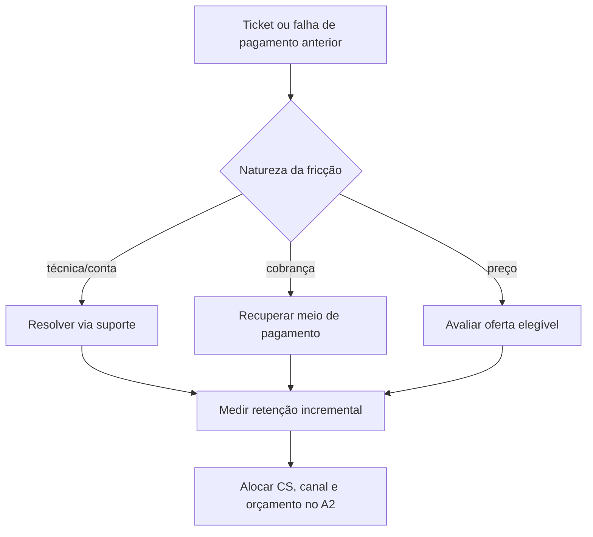

# 🗄️ Análise integrada dos 13 exhibits do Módulo 2

> **Módulo 2:** Inteligência de Mercado e Modelagem Preditiva para Crescimento
> **Case:** Vitaliza — retenção e decisão prescritiva de CRM
> **Escopo:** conectar cada fonte à decisão de negócio, ao A1 e ao A2
> **Base de controle:** auditoria local de 24/10/2026, registrada em [`relatorios/auditoria_exhibits.json`](../../relatorios/auditoria_exhibits.json)
> **Estado:** inventário e achados de qualidade auditados; análises de churn, clusterização, uplift e ROI permanecem pendentes

[Trilha de Negócios, Growth e CRM](./README.md) / Análise dos exhibits

---

## 🎯 1. Por que os exhibits precisam ser lidos como sistema

Os 13 exhibits não são treze respostas isoladas. Eles formam uma cadeia de evidência:

Nenhuma fonte, sozinha, responde quem deve ser contatado. A decisão exige:

- reconstruir a população e o desfecho;
- observar comportamento anterior ao desfecho;
- distinguir descrição, predição e causalidade;
- estimar efeito incremental de uma ação;
- converter efeito em margem sob restrições.

O pacote físico inclui arquivos separados e dois ZIPs de heatmaps. Para a decisão, os heatmaps são tratados como uma única fonte multimodal em dois cortes, chegando aos **13 domínios analíticos** do case.

---

## 🔍 2. Estado da evidência

| Camada | Já disponível | Ainda depende de execução |
| :--- | :--- | :--- |
| inventário | contagens de linhas, chaves testadas e arquivos presentes | cobertura por campo e qualidade semântica completa |
| população | 14.813 ativas, sendo 14.753 pagantes e 60 cortesias | reconstrução histórica em cada corte |
| qualidade | registros futuros, grafias inconsistentes e valor monetário como texto | regras finais de saneamento e impacto nas métricas |
| comportamento | volumes de uso, atividades, rede, posts e suporte | associações temporais e clusters finais |
| motivo declarado | 643 respostas; preço é o item mais selecionado | representatividade e relação com desfecho |
| experimento | 14.120 sorteados e métricas brutas de engajamento | retenção, uplift, incerteza e efeito heterogêneo |
| economia | preços, taxas, custo de servir, ofertas e capacidades | lucro incremental, ROI e política ótima |

---

## 📚 3. Matriz executiva das 13 fontes

| # | Fonte | Granularidade / volume auditado | Pergunta de negócio | Papel no A1 | Papel no A2 | Risco de uso indevido |
| :---: | :--- | :--- | :--- | :--- | :--- | :--- |
| 1 | `usuarios.csv` | conta; 64.948 linhas | quem é o usuário, por onde chegou e qual ecossistema usa? | contexto de aquisição, sistema e relógio para descrição de segmentos | elegibilidade e análise de transporte por sistema/canal | tratar `nenhum` como relógio conectado ou usar cadastro posterior ao corte |
| 2 | `assinaturas.csv` | assinatura atual; 32.643 linhas | qual plano, canal e estado aparecem no retrato de exportação? | reconciliar 14.753 pagantes e composição por plano/canal | aplicar elegibilidade comercial e calcular margem | reescrever o passado com um retrato atual |
| 3 | `eventos_assinatura.csv` | evento; 275.565 linhas | quando cada assinatura mudou de estado? | reconstruir churn, coortes, tenure e intenção versus término | construir desfecho do experimento e janelas de previsão | escolher evento inadequado como churn ou usar evento após o corte |
| 4 | `pagamentos.csv` | tentativa; 165.548 linhas | quanto foi cobrado e houve recusa, recuperação ou reversão? | separar churn voluntário de falha de pagamento e calcular receita | margem incremental, custo de desconto e elegibilidade | ler `valor` como texto, contar tentativa recusada como saída ou duplicar receita |
| 5 | `uso_mensal.csv` | usuário-mês; 591.662 linhas | como frequência, recência e sessões evoluem? | diagnosticar queda de hábito e formar features de segmentação | estimar heterogeneidade e regras de timing | usar mês posterior, confundir ausência de registro com zero real |
| 6 | `atividades.parquet` | treino; 1.254.475 linhas | quais modalidades, duração, distância e contexto compõem o hábito? | detalhar segmentos comportamentais | personalizar tratamento e testar ganho sobre agregados | não normalizar idiomas ou incluir 34 atividades após o corte sem revisão de fuso |
| 7 | `onboarding.csv` | resposta inicial; 63.929 linhas | qual objetivo e preferência foram declarados na entrada? | enriquecer a interpretação de personas | selecionar conteúdo permitido e avaliar heterogeneidade pré-tratamento | assumir que intenção antiga ainda descreve comportamento atual |
| 8 | `amizades.csv` | relação direcionada; 113.480 linhas | existe vínculo social que acompanhe uso e retenção? | medir grau, reciprocidade e estrutura social | testar desafios sociais e efeito por vínculo | incluir 273 relações posteriores ao corte ou confundir correlação com proteção causal |
| 9 | `feed_posts.csv` | post; 119.309 linhas | que participação social e temas aparecem no feed? | medir produção e engajamento social | avaliar valor incremental de texto e contexto de copy | expor texto individual, incluir 122 posts futuros ou confiar em extração sem amostra humana |
| 10 | `tickets_suporte.csv` | ticket; 4.422 linhas | quais fricções técnicas, de conta e cobrança antecedem a saída? | testar suporte como mecanismo e separar necessidade de desconto | priorizar resolução por CS e evitar oferta errada | usar status atualizado depois do período ou inferir causa pelo texto sem validação |
| 11 | `pesquisa_saida.csv` | resposta; 643 linhas, 641 contas | o que parte dos cancelantes do site declara? | gerar e priorizar hipóteses, sobretudo preço e não uso | orientar ofertas e mensagens em recortes compatíveis | extrapolar respondentes do site para toda a base ou para as lojas |
| 12 | `campanha_ago26.csv` | participante sorteado; 14.120 linhas | desafio, cupom ou conteúdo mudam retenção frente ao controle? | contextualizar quais tratamentos seguirão para A2 | estimar efeito causal, heterogeneidade e valor | usar clique como retenção, filtrar por abertura ou analisar janela incompleta |
| 13 | heatmaps de julho e setembro | imagem usuário-data; 12.426 e 13.047 esperadas | padrões espaciais acrescentam informação útil e acionável? | hipótese multimodal e possível descrição de modalidade | testar ganho de uplift/valor líquido do custo de visão | publicar imagem individual, inferir saúde/localização ou pagar inferência sem ganho |

---

## 🧭 4. Leitura decisória por bloco de fontes

### 4.1 Cadastro, assinatura e eventos: quem entra na decisão

`usuarios.csv`, `assinaturas.csv` e `eventos_assinatura.csv` definem a população, a exposição comercial e a linha do tempo. A auditoria encontrou **14.813 assinaturas ativas no retrato**, mas apenas **14.753 são pagantes**; as outras 60 são cortesias internas. Essa diferença muda denominadores, receita e capacidade.

A decisão de negócio que nasce desse bloco é simples e obrigatória: **nenhum indicador ou modelo avança até a população ser reconciliada**. `assinaturas.csv` informa o estado atual, enquanto `eventos_assinatura.csv` deve reconstruir estados anteriores. Usar o retrato para calcular churn histórico introduz informação futura e pode alterar coortes inteiras.

**Conexão com o A1:** população, churn mensal, coortes, plano, canal e tenure.
**Conexão com o A2:** elegibilidade, janela do experimento, bloqueio de ofertas incompatíveis e desfecho de retenção.

### 4.2 Pagamentos: saída, receita e fricção não são a mesma coisa

`pagamentos.csv` é o elo entre assinatura e economia. Uma recusa pode ser recuperada; uma assinatura pode permanecer em carência; reembolso e chargeback têm natureza distinta. O valor monetário foi inferido como texto pelo leitor automático, então a conversão deve ser explícita e validada.

A decisão associada é separar três filas:

1. risco de saída voluntária, que pode receber tratamento de retenção;
2. falha de cobrança, que pede recuperação de pagamento;
3. perda financeira já realizada, que exige tratamento contábil próprio.

Oferecer cupom a alguém que só precisa atualizar o cartão reduz margem sem resolver o problema correto.

### 4.3 Uso e atividades: observar a trajetória, não um retrato conveniente

`uso_mensal.csv` e `atividades.parquet` permitem medir recência, frequência, intensidade, modalidade e tendência. O Parquet contém 1.254.475 treinos de 36.551 usuários, com modalidades duplicadas em português e inglês. Há também 34 atividades na primeira hora de 01/10, potencialmente ligadas a fuso.

A decisão do A1 é avaliar se mudanças no hábito antecedem a saída e se formam segmentos estáveis. A decisão do A2 é testar se tratamentos diferentes funcionam melhor conforme trajetória ou modalidade. Nenhuma delas autoriza declarar que baixa frequência causa churn antes do teste adequado.

### 4.4 Onboarding: intenção declarada como contexto, não identidade permanente

`onboarding.csv` registra objetivo inicial e preferências. Ele pode diferenciar pessoas com comportamento semelhante, por exemplo, alguém que entrou para correr 5 km versus alguém que buscava força em casa. Seu valor é maior quando combinado com comportamento recente.

No A1, ajuda a interpretar clusters. No A2, pode selecionar conteúdo aderente, desde que a informação seja anterior ao tratamento e ainda seja apropriada para uso. Uma resposta antiga não deve ser tratada como verdade atual sem verificar estabilidade.

### 4.5 Rede social e feed: vínculo, engajamento e privacidade

`amizades.csv` e `feed_posts.csv` sustentam medidas de grau, reciprocidade, produção social e engajamento. A auditoria encontrou 273 relações e 122 posts após o corte, o que obriga filtro temporal.

Essas fontes podem mostrar se vínculo social melhora descrição ou predição, mas não provam que criar conexões causará retenção. Textos do feed exigem amostra humana, schema de extração, métricas por campo e publicação apenas agregada.

A decisão de produção é condicional: a fonte só entra se melhorar a decisão fora do tempo e se o ganho econômico superar custo, complexidade e risco de privacidade.

### 4.6 Suporte e pesquisa de saída: sinais distintos

`tickets_suporte.csv` contém fricções observadas durante o relacionamento. Entre 4.422 tickets, 34,03% estavam abertos ou sem resposta na exportação. Isso justifica investigar se problema técnico, cobrança ou demora antecedem a saída, mas o status pode ter sido alterado depois da janela analisada.

`pesquisa_saida.csv` registra motivo declarado por parte dos usuários do site. Preço representa 264 das 643 respostas, ou 41,06%. O dado sustenta `H-PRICE-01`, porém não representa automaticamente cancelamentos de App Store e Google Play. O enunciado e a base também usam recortes diferentes de respondentes e términos; a cobertura deve ser descrita em cada análise.

A decisão correta é usar suporte para identificar fricção operacional e pesquisa para formular hipóteses. Nenhuma das duas fontes, sem desenho adicional, identifica causa geral do churn.

### 4.7 Campanha de agosto: a fonte que muda a natureza da decisão

`campanha_ago26.csv` é a ponte entre predição e prescrição. O sorteio cria uma comparação para estimar o efeito de desafio, cupom e conteúdo frente ao controle. Métricas de abertura e clique descrevem engajamento com a comunicação, não retenção.

A análise deve preservar intenção de tratar e usar uma janela comum. Como 60 dias após 10/08 terminam depois do corte de 30/09, um efeito de 60 dias não pode ser afirmado sem dados adicionais. A decisão é usar uma janela menor completa ou esperar a observação necessária.

No A2, esta fonte sustenta:

- efeito médio de cada tratamento;
- investigação validada de heterogeneidade;
- opção de não contatar;
- estimativa de margem incremental;
- desenho de holdout para novos canais.

### 4.8 Heatmaps: valor apenas se mudarem a decisão

Os ZIPs de julho e setembro contêm 12.426 e 13.047 imagens esperadas. A auditoria verificou inventário, não uma avaliação visual completa. Heatmaps podem representar padrão espacial de treino, mas também carregam risco de localização e inferências sensíveis.

O uso precisa passar por quatro gates:

1. schema de atributos permitido;
2. amostra humana rotulada e avaliação de qualidade;
3. ganho fora do tempo sobre features tabulares;
4. lucro incremental líquido do custo de visão.

Se o ganho estatístico ou financeiro falhar, a fonte não entra na política.

---

## 📐 5. Cadeias de evidência para as decisões centrais

### 5.1 O reajuste elevou o churn mensal?

A pesquisa de saída não encerra a questão. Ela orienta o teste. Mesmo que preço se associe à saída, o cupom só entra na política se o experimento mostrar benefício líquido.

### 5.2 Queda de uso deve disparar contato?

Uma boa feature de churn pode ser uma péssima regra de contato. A passagem pelo experimento é o que evita confundir previsão com ação.

### 5.3 Suporte ou desconto?

A triagem evita gastar desconto onde uma correção operacional teria maior chance de resolver a causa observada.

---

## 🔗 6. Matriz fonte → decisão → artefato

| Decisão | Fontes mínimas | Entrega no A1 | Entrega no A2 |
| :--- | :--- | :--- | :--- |
| população e receita exposta | assinaturas, eventos, pagamentos | fotografia reconciliada e série | população elegível e margem |
| reajuste e plano | eventos, assinaturas, pagamentos, pesquisa, uso | teste de `H-PRICE-01` | elegibilidade e economia do cupom |
| queda de hábito | uso, atividades, eventos | trajetória e clusterização | efeito do tratamento por comportamento |
| vínculo social | amizades, feed, atividades | descrição e hipótese | desafio social, se validado |
| fricção operacional | tickets, pagamentos, eventos | teste temporal e segmentação de causa | priorização de CS e recuperação |
| intenção e conteúdo | onboarding, uso, atividades | persona baseada em dados | tratamento e copy autorizados |
| efeito incremental | campanha, eventos | definição dos testes futuros | ITT, uplift, heterogeneidade e holdout |
| valor multimodal | feed, tickets, onboarding, pesquisa, heatmaps | hipótese e protocolo de validação | ganho econômico líquido do custo de IA |

---

## ⚠️ 7. Limitações que precisam aparecer nos artefatos

1. **Corte temporal:** existem registros após 30/09 em quatro fontes auditadas.
2. **Estado atual versus histórico:** `assinaturas.csv` não substitui a reconstrução por eventos.
3. **Cobertura desigual:** atividades granulares cobrem 2026; outras fontes começam em períodos distintos.
4. **Motivo declarado parcial:** a pesquisa de saída cobre um recorte do site e depende de resposta voluntária.
5. **Categorias inconsistentes:** sistema operacional e modalidade precisam de normalização auditável.
6. **Valor monetário:** pagamentos exigem parsing explícito.
7. **Contrafactual individual:** tipos de uplift não são diretamente observáveis por pessoa.
8. **Janela experimental:** 60 dias após 10/08 excedem o corte disponível de 30/09.
9. **Transporte de canal:** efeito de push + e-mail não prova efeito de WhatsApp ou CS.
10. **Privacidade:** textos e imagens não devem ser publicados ou usados sem minimização e avaliação.

---

## ✅ 8. Critérios de conclusão da análise dos exhibits

A conexão dos exhibits com A1/A2 estará concluída quando:

- [ ] cada indicador publicar fonte, população, período e regra;
- [ ] a população histórica for reconstruída por eventos;
- [ ] os dados posteriores ao corte forem removidos ou justificados;
- [ ] pagamentos forem convertidos e reconciliados com receita;
- [ ] categorias normalizadas preservarem os valores originais;
- [ ] clusters usarem apenas variáveis anteriores ao corte e não incluírem churn;
- [ ] texto e imagem passarem por avaliação humana e análise de custo-benefício;
- [ ] o experimento preservar o sorteio e uma janela completa;
- [ ] a política A2 derivar de uplift e margem, não de clique ou risco isolado;
- [ ] resultados pendentes continuarem marcados como pendentes até execução e revisão.

**Referências complementares:** [Dossiê auditado dos exhibits](../05_DOSSIE_EXHIBITS_M2.md) · [Dicionário comentado](../05_DOSSIE_DICIONARIO_DE_DADOS_M2.md) · [Caderno de hipóteses](../06_CADERNO_DE_HIPOTESES_ANALITICAS.md) · [A1](./01_DIAGNOSTICO_ESTRATEGICO_A1_SEMANA5.md) · [A2](./02_ESTRATEGIA_UPLIFT_E_ROI_A2_SEMANA10.md).
