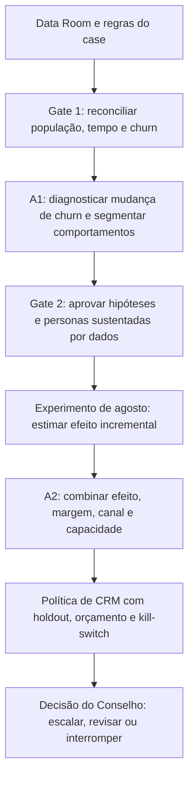

# 📊 Trilha 1: Negócios, Growth e CRM

> **Módulo 2:** Inteligência de Mercado e Modelagem Preditiva para Crescimento
> **Case:** Vitaliza — retenção de assinantes e decisão prescritiva de CRM
> **Responsabilidade da trilha:** transformar evidências do Data Room em decisões de segmentação, experimentação, alocação de canais e retorno incremental
> **Estado:** estrutura executiva para A1 (Semana 5) e A2 (Semana 10); resultados analíticos pendentes devem permanecer identificados como plano

[Comece por aqui](../README.md) / [Mapa das trilhas](../02_MAPA_DAS_TRILHAS.md) / Negócios, Growth e CRM

---

## 👋 Bem-vindos à Trilha de Negócios, Growth e CRM!

Esta trilha transforma os dados da Vitaliza em **decisões de retenção economicamente justificáveis**. Aqui a equipe investiga por que o churn aumentou, interpreta os perfis de assinantes, mede o efeito das intervenções e define quem contatar, por qual canal e com qual investimento.

| Movimento | O que a equipe faz | O que precisa entregar |
| :--- | :--- | :--- |
| **Diagnosticar** | investigar churn por plano, canal, coorte, uso e relacionamento | hipóteses priorizadas, evidências, limitações e impacto para a decisão |
| **Interpretar segmentos** | traduzir clusters validados em perfis úteis para o negócio | personas apoiadas nos dados, sem inventar motivações não observadas |
| **Medir intervenção** | comparar os grupos sorteados da campanha com o controle | efeito incremental, incerteza e limites da análise |
| **Calcular valor** | combinar efeito, margem, oferta, canal e custo de IA | cenários de lucro incremental e sensibilidade |
| **Definir a política** | priorizar ação ou não contato dentro das capacidades | regra reproduzível de público, canal, oferta, orçamento e holdout |
| **Consolidar entregas** | integrar evidências de Negócios e Tecnologia | A1 com diagnóstico/personas e A2 com recomendação de CRM/retorno |

> 🧭 **Comece por:** [Análise dos 13 exhibits](./03_ANALISE_EXHIBITS_M2.md) → [Diagnóstico estratégico A1](./01_DIAGNOSTICO_ESTRATEGICO_A1_SEMANA5.md) → [Estratégia de uplift e ROI A2](./02_ESTRATEGIA_UPLIFT_E_ROI_A2_SEMANA10.md).

---

## 🎯 1. Mandato executivo

A Vitaliza precisa decidir **quem deve receber uma intervenção de retenção, qual intervenção usar e quanto investir**, sem confundir risco de churn com resposta ao tratamento. A decisão está submetida a quatro restrições do case:

- orçamento total de CRM de **R$ 40.000 por mês**;
- capacidade de **1.500 mensagens de WhatsApp por mês**;
- capacidade de **300 atendimentos de Customer Success por mês**;
- necessidade de preservar margem, frequência de contato, elegibilidade e privacidade.

O problema não se resolve com uma campanha geral. O Data Room mostra que **10.359 dos 14.753 pagantes ativos no corte, ou 70,22%, pagam por App Store ou Google Play**. Uma régua restrita à tela de cancelamento do site não alcança a maior parte da base. No outro extremo, contatar todos os clientes de alto risco pode conceder desconto a quem ficaria, consumir capacidade com quem não responderia ou provocar uma saída que não ocorreria sem o contato.

Esta trilha organiza a passagem de diagnóstico para decisão:

---

## 🔍 2. O que já é evidência e o que ainda depende de execução

A documentação separa três estados para evitar conclusões fictícias:

| Estado | Significado | Exemplos nesta trilha |
| :--- | :--- | :--- |
| **Evidência disponível** | valor publicado no enunciado ou apurado pela auditoria local reproduzível | 14.753 pagantes; 60 cortesias; contagens dos arquivos; 70,22% da base nas lojas; 643 respostas de saída; 14.120 participantes na campanha |
| **Premissa do case** | regra econômica, operacional ou temporal fornecida para modelar a decisão | preços, taxas dos canais, custo de servir, CAC, limites de WhatsApp/CS, ofertas permitidas, horizonte de 60 dias |
| **Resultado pendente** | depende de análise, modelo ou experimento ainda não concluído e revisado | causa da alta de churn, clusters finais, personas finais, uplift, heterogeneidade de efeito, lucro incremental e ROI |

Contagens de abertura, clique ou motivo declarado não substituem efeito de retenção. Associação entre uso e saída não prova causalidade. Cluster não é persona até que a composição do grupo seja observada e revisada.

---

## 📚 3. Percurso editorial e artefatos

| Ordem | Documento | Decisão que prepara | Saída esperada |
| :---: | :--- | :--- | :--- |
| 1 | [Resumo executivo do case](../01_RESUMO_EXECUTIVO_DO_CASE.md) | enquadrar o dilema entre win-back reativo e atuação antecipada | contexto, metas e restrições |
| 2 | [Análise dos 13 exhibits](./03_ANALISE_EXHIBITS_M2.md) | definir o papel de cada fonte e impedir uso indevido | mapa fonte → evidência → decisão → artefato |
| 3 | [Diagnóstico estratégico A1](./01_DIAGNOSTICO_ESTRATEGICO_A1_SEMANA5.md) | determinar onde o churn piorou, quais hipóteses testar e como interpretar segmentos | plano executivo da Semana 5 |
| 4 | [Estratégia de uplift e ROI A2](./02_ESTRATEGIA_UPLIFT_E_ROI_A2_SEMANA10.md) | escolher público, tratamento, canal e gasto com base em efeito incremental | plano executivo da Semana 10 |
| Consulta | [Caderno de hipóteses](../06_CADERNO_DE_HIPOTESES_ANALITICAS.md) | manter perguntas, testes, critérios e limitações rastreáveis | registro analítico comum |
| Consulta | [Dossiê auditado](../05_DOSSIE_EXHIBITS_M2.md) | conferir inventário, qualidade e reconciliação | evidência de auditoria local |

Os documentos desta pasta são guias executivos e metodológicos. As entregas finais recebem os resultados revisados em:

- [Artefato de Negócios A1](../../artefatos_negocios/semana_5_A1/ARTEFATO_NEGOCIOS_SEMANA5_A1.md);
- [Artefato de Negócios A2](../../artefatos_negocios/semana_10_A2/ARTEFATO_NEGOCIOS_SEMANA10_A2.md).

---

## ⚖️ 4. Decisões sob responsabilidade da trilha

| Decisão | Pergunta operacional | Evidência mínima | Saída |
| :--- | :--- | :--- | :--- |
| Definição de churn | qual evento representa intenção, saída efetiva ou perda de receita? | eventos de assinatura, pagamentos e regra temporal | contrato de label e denominadores |
| Prioridade diagnóstica | em qual plano, canal, coorte e faixa de uso a piora se concentra? | série histórica comparável e análise por exposição | hipóteses priorizadas, sem alegação causal indevida |
| Segmentação | quais comportamentos formam grupos úteis para gestão? | clusterização sem churn, estabilidade e descrição pós-modelo | 3 a 4 personas baseadas em dados |
| Tratamento | qual pacote gera retenção adicional frente ao controle? | intenção de tratar, janela completa e incerteza | efeito médio por tratamento |
| Personalização | o efeito varia de forma estável entre perfis? | amostra suficiente, validação e proteção contra sobreajuste | regras candidatas de heterogeneidade |
| Alocação | qual ação maximiza valor incremental sob as restrições? | uplift, margem, custo, elegibilidade e capacidade | política mensal reproduzível |
| Escala | a política deve ser ampliada? | holdout, lucro observado, danos e qualidade operacional | decisão de escalar, revisar ou interromper |

---

## 🔗 5. Contrato de integração com as outras trilhas

| A trilha recebe | Responsável principal | A trilha entrega |
| :--- | :--- | :--- |
| população reconciliada, features temporais e label | Ciência de Dados e ML | definições de métricas, hipóteses e leitura de negócio |
| clusters, estabilidade e perfis das variáveis | Ciência de Dados e ML | nomes descritivos, personas e implicações de CRM |
| risco calibrado e avaliação fora do tempo | Ciência de Dados e ML | regra de uso do score, limites e custo de erro |
| avaliação de extrações de texto e imagem | IA Generativa e Multimodal | campos permitidos, valor econômico e critérios de exclusão |
| efeito do experimento e incerteza | Growth/Experimentação | priorização econômica e desenho da política |
| política autorizada e contexto permitido | Negócios/Growth | briefing fechado para redação de mensagens |

O gerador de mensagem não escolhe público, oferta ou orçamento. O score de churn não autoriza contato. A decisão de CRM nasce da combinação de **efeito esperado, valor econômico e restrições operacionais**.

---

## 🛡️ 6. Governança da evidência

Toda afirmação que entrar nos artefatos A1 ou A2 deve informar:

1. fonte e campos utilizados;
2. população e período;
3. regra de inclusão e exclusão;
4. método ou consulta reproduzível;
5. tamanho do efeito e incerteza, quando aplicável;
6. explicações alternativas;
7. estado da afirmação: premissa, evidência observada, estimativa ou resultado validado.

Dados brutos não devem ser publicados. E-mails, identificadores completos, textos livres e imagens individuais permanecem no ambiente local. Resultados saem apenas de forma agregada, conforme o [dossiê dos exhibits](../05_DOSSIE_EXHIBITS_M2.md).

---

## ✅ 7. Definição de pronto da trilha

A trilha estará concluída quando:

- [ ] a população pagante estiver reconciliada com 14.753 contas e as 60 cortesias estiverem excluídas;
- [ ] churn, intenção de cancelar, expiração e falha de cobrança estiverem separados;
- [ ] cada hipótese da A1 tiver método, comparação, limitação e decisão associada;
- [ ] os clusters finais tiverem estabilidade e descrição baseada nas variáveis observadas;
- [ ] o experimento de agosto estiver analisado por intenção de tratar, com janela completa e incerteza;
- [ ] risco, uplift e valor econômico estiverem separados;
- [ ] a política couber no orçamento, nos canais, na elegibilidade e na frequência;
- [ ] existir opção explícita de não contatar e um holdout para medir dano e benefício;
- [ ] ROI e lucro incremental forem apresentados como estimativa ou resultado observado, conforme o caso;
- [ ] outra pessoa conseguir refazer as contas a partir das referências publicadas.

👉 **Próximo passo:** [ler a análise integrada dos 13 exhibits](./03_ANALISE_EXHIBITS_M2.md) e, em seguida, executar o [plano do A1](./01_DIAGNOSTICO_ESTRATEGICO_A1_SEMANA5.md).
