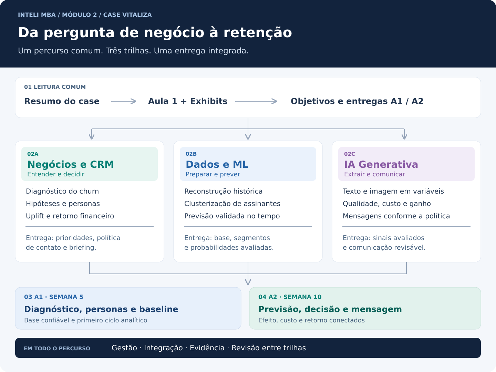

# 🗺️ Mapa das Trilhas de Conhecimento — Módulo 2

> **Descubra qual pasta é ideal para o seu perfil e área de conhecimento.**  
> **Business Case:** Vitaliza — Retenção de Assinantes & Decisão de CRM  
> **Organização:** 3 trilhas de conhecimento + gestão do trabalho + dossiês de aprofundamento  
> **Entregas:** Semana 5 (A1 — `13/11/2026`) e Semana 10 (A2 — `18/12/2026`)

[🔰 Comece por Aqui](./README.md) · [📋 Resumo Executivo](./01_RESUMO_EXECUTIVO_DO_CASE.md) · [🏠 Página Principal](../README.md)

  

---

## 🧭 Primeiro Acesso: O Percurso Comum da Equipe

Antes de escolher uma trilha, conheça a pergunta de negócio e as regras que todas as áreas vão utilizar:

1. **[📋 Resumo Executivo da Vitaliza](./01_RESUMO_EXECUTIVO_DO_CASE.md)** — O negócio, a alta do churn, os dois aspectos vitais, os oito objetivos e os limites do CRM.
2. **[🎓 Guia Integrado da Aula 1](./03_GUIA_AULA_01_NEGOCIOS_E_TECNOLOGIA.md)** — Como análise descritiva, diagnóstica, preditiva e prescritiva se conectam ao projeto.
3. **[🔍 Dossiê dos Exhibits](./05_DOSSIE_EXHIBITS_M2.md)** — O que já foi observado nos arquivos e quais problemas afetam as análises.
4. **[🗓️ Visão Detalhada de A1 e A2](./04_contexto_extra/01_VISAO_DETALHADA_SEMANA5_VS_SEMANA10.md)** — O que construir em cada etapa e como as entregas se integram.

> 💡 **Não precisa dominar todas as áreas para contribuir.** Escolha uma trilha principal e use as demais para entender de onde vêm suas entradas e quem vai utilizar suas entregas.

---

## 📊 Trilha 1: Negócios, Growth, CRM & Uplift

👉 **Diretório:** [`01_trilha_negocios_e_crm/`](./01_trilha_negocios_e_crm/README.md)  
👉 **Baselines Oficiais de Entrega:** [`ARTEFATO_NEGOCIOS_SEMANA5_A1.md`](../artefatos_negocios/semana_5_A1/ARTEFATO_NEGOCIOS_SEMANA5_A1.md) e [`ARTEFATO_NEGOCIOS_SEMANA10_A2.md`](../artefatos_negocios/semana_10_A2/ARTEFATO_NEGOCIOS_SEMANA10_A2.md)

* **Indicado para:** Estratégia, Marketing, Growth, Produto, Finanças, Customer Success e Gestão de Negócios.
* **Pergunta da trilha:** Por que perdemos assinantes e em quem vale a pena investir para aumentar a retenção?
* **O que você vai encontrar:**
  * **[Diagnóstico Estratégico A1](./01_trilha_negocios_e_crm/01_DIAGNOSTICO_ESTRATEGICO_A1_SEMANA5.md):** leitura da base, evolução do churn, hipóteses sobre preço e engajamento e interpretação das personas.
  * **[Estratégia de Uplift & Retorno A2](./01_trilha_negocios_e_crm/02_ESTRATEGIA_UPLIFT_E_ROI_A2_SEMANA10.md):** experimento de agosto, efeito incremental, política de contato, capacidade dos canais e orçamento de R$ 40 mil/mês.
  * **[Análise Integrada dos 13 Exhibits](./01_trilha_negocios_e_crm/03_ANALISE_EXHIBITS_M2.md):** conexão entre fontes, evidências, decisões e entregas A1/A2.
  * **[Caderno de Hipóteses Analíticas](./06_CADERNO_DE_HIPOTESES_ANALITICAS.md):** perguntas, fontes, comparações, critérios de evidência e limitações.
* **Primeira contribuição:** escolher uma hipótese e explicitar qual decisão muda se ela for sustentada ou enfraquecida pelos dados.
* **Entrega esperada:** *Customer Segmentation Analysis Report* (3 Pilares) na A1; *Board Recommendation Deck* (6 Slides) com política de CRM e avaliação econômica na A2.

> **Conexão com as outras trilhas:** recebe indicadores, segmentos e probabilidades da trilha de Dados; define elegibilidade, valor econômico e briefing de mensagem para a trilha de IA.

**Ordem sugerida:** visão da trilha → diagnóstico A1 → experimento, política e retorno A2.

---

## 💻 Trilha 2: Engenharia de Dados, Ciência de Dados & Machine Learning

👉 **Diretórios:** [`02_trilha_ciencia_de_dados_e_ml/`](./02_trilha_ciencia_de_dados_e_ml/README.md) e [`src/`](../src/)  
👉 **Baselines Oficiais de Entrega:** [`ARTEFATO_TECH_SEMANA5_A1.md`](../artefatos_tecnologia/semana_5_A1/ARTEFATO_TECH_SEMANA5_A1.md) e [`ARTEFATO_TECH_SEMANA10_A2.md`](../artefatos_tecnologia/semana_10_A2/ARTEFATO_TECH_SEMANA10_A2.md)

* **Indicado para:** BI, Analytics, Engenharia de Dados, Estatística, Ciência de Dados e Machine Learning.
* **Pergunta da trilha:** Como reconstruir uma base confiável, conhecer os perfis dos assinantes e prever saída em 60 dias?
* **O que você vai encontrar:**
  * **[Saneamento & Reconstrução Histórica](./02_trilha_ciencia_de_dados_e_ml/01_SANEAMENTO_E_RECONSTRUCAO_HISTORICA.md):** fusos, categorias, episódios de assinatura, reconciliação e agregação por pessoa e corte.
  * **[Clusterização & Churn Supervisionado](./02_trilha_ciencia_de_dados_e_ml/02_CLUSTERIZACAO_E_CHURN_SUPERVISIONADO.md):** personas sem uso do alvo, regressão logística, árvores, bagging, boosting e avaliação temporal.
  * **[Dicionário Comentado das Fontes](./05_DOSSIE_DICIONARIO_DE_DADOS_M2.md):** chaves, campos, granularidade e cuidados de integração.
  * **[Script de Auditoria do Data Room](../src/01_auditoria_data_room.py):** ponto de partida reproduzível para conferir os arquivos locais.
* **Primeira contribuição:** revisar uma regra de preparação, documentando entrada, transformação e um caso que poderia gerar erro.
* **Entrega esperada:** base temporal reconciliada, segmentos interpretáveis, probabilidades avaliadas e código reproduzível.

> **Conexão com as outras trilhas:** recebe perguntas e premissas de Negócios e extrações validadas de IA; devolve evidências que sustentam o diagnóstico e a política de contato.

**Ordem sugerida:** dicionário e auditoria → reconstrução histórica → variáveis → clusterização e previsão.

---

## 🤖 Trilha 3: IA Generativa, Extração Multimodal & Copywriting

👉 **Diretório:** [`03_trilha_ia_generativa_e_multimodal/`](./03_trilha_ia_generativa_e_multimodal/README.md)

* **Indicado para:** Engenharia de IA, NLP, Visão Computacional, Prompt Engineering, Automação e Avaliação de Conteúdo.
* **Pergunta da trilha:** Texto e imagem melhoram a decisão o suficiente para justificar o custo? Como redigir a mensagem adequada à ação escolhida?
* **O que você vai encontrar:**
  * **[Guia de Extração Multimodal & Copywriting](./03_trilha_ia_generativa_e_multimodal/01_EXTRACAO_MULTIMODAL_E_COPYWRITING_CRM.md):** contratos de saída, exemplos de schema, rotulagem humana, avaliação e briefing de CRM.
  * **[Arquitetura & Contratos Multimodais](./03_trilha_ia_generativa_e_multimodal/02_ARQUITETURA_E_CONTRATOS_MULTIMODAIS.md):** componentes, sequências, schemas, idempotência e separação entre extração, decisão e redação.
  * **[Avaliação, Segurança & Governança](./03_trilha_ia_generativa_e_multimodal/03_AVALIACAO_SEGURANCA_E_GOVERNANCA.md):** gold standard, comparação pixels versus visão, prompt injection, custo, fallback e critérios de promoção.
  * **Extração de texto:** objetivos declarados no onboarding, temas do suporte, contexto do feed e diagnóstico das respostas de saída.
  * **Extração de imagem:** comparação entre contagem de pixels e modelos de visão nos heatmaps, com avaliação nas mesmas amostras.
  * **Qualidade & Custo:** métricas por campo, comparação preditiva com e sem as variáveis e custo por assinante.
  * **Redação de CRM:** mensagens condicionadas ao canal, à oferta elegível e ao contexto permitido.
* **Primeira contribuição:** propor um campo de extração com definição, valores permitidos, exemplos e regra para ausência de informação.
* **Entrega esperada:** variáveis avaliadas, custo conhecido e mensagens revisáveis para a A2.

> **Conexão com as outras trilhas:** recebe população e cortes de Dados e briefing de Negócios; entrega sinais para a previsão e textos para a política de CRM.

**Ordem sugerida:** fontes e cobertura → schema e amostra humana → extração e avaliação → ganho e custo → mensagens.

---

## 📋 Gestão do Trabalho, Tarefas & Integração

👉 **Diretório:** [`01_gerenciamento_de_tarefas/`](../01_gerenciamento_de_tarefas/)

* **Indicado para:** Todos os integrantes, especialmente quem coordena atividades, revisa documentos e prepara a apresentação do grupo.
* **Foco:** organizar dependências e garantir que negócios e tecnologia utilizem os mesmos conceitos e evidências.
* **O que você vai encontrar:**
  * **[Mapa Geral das Frentes de Atuação](../01_gerenciamento_de_tarefas/00_MAPA_GERAL_FRENTES_DE_ATUACAO.md):** quatro frentes conectadas aos oito objetivos do case.
  * **[Matriz de Tarefas & Especificações](../01_gerenciamento_de_tarefas/MATRIZ_DE_TAREFAS_E_ESPECIFICACOES.md):** detalhamento do trabalho a distribuir e acompanhar.
  * **[Guia de Contribuição](./00_para_nao_tecnicos/01_GUIA_DE_CONTRIBUICAO_E_COMMITS.md):** como registrar e revisar alterações.
* **Primeira contribuição:** associar uma tarefa, sua dependência, a evidência necessária e o artefato de destino.
* **Entrega esperada:** trabalho integrado, referências verificáveis e revisão entre áreas.

---

## 📚 Dossiês de Contexto, Aulas & Aprofundamento

👉 **Diretórios:** [`04_contexto_extra/`](./04_contexto_extra/) e [`documentos/`](../documentos/README.md)

* **Indicado para:** Quem quer aprofundar o case, preparar a apresentação ou conferir a origem de uma premissa.
* **O que você vai encontrar:**
  * **[Visão Detalhada — Semana 5 vs. Semana 10](./04_contexto_extra/01_VISAO_DETALHADA_SEMANA5_VS_SEMANA10.md):** evolução dos oito objetivos e contratos compartilhados entre as entregas.
  * **[Guia Integrado da Aula 1](./03_GUIA_AULA_01_NEGOCIOS_E_TECNOLOGIA.md):** conceitos, exemplos e aplicação no projeto.
  * **[Dossiê do Dicionário de Dados](./05_DOSSIE_DICIONARIO_DE_DADOS_M2.md):** leitura comentada das 13 fontes.
  * **[Dossiê dos Exhibits](./05_DOSSIE_EXHIBITS_M2.md):** contagens, reconciliação e achados de qualidade.
  * **[Enunciado Oficial](<../documentos/enunciado_e_guias/Vitaliza - Enunciado do case.pdf>):** contexto, objetivos e premissas de negócio.
* **Primeira contribuição:** conferir uma premissa usada pelo grupo e registrar sua fonte e seu limite de aplicação.

---

## 🔗 Integração das Trilhas & Frentes de Execução

As três trilhas não correspondem a três equipes isoladas. O [mapa de gestão](../01_gerenciamento_de_tarefas/00_MAPA_GERAL_FRENTES_DE_ATUACAO.md) divide a execução em quatro frentes:

| Frente de execução | Objetivos do case | Trilhas envolvidas | Ponto de integração |
| :--- | :--- | :--- | :--- |
| **[Frente 01 · Dados & Diagnóstico](../01_gerenciamento_de_tarefas/FRENTE_01_DADOS_E_DIAGNOSTICO_CHURN.md)** | Objetivos 1 e 2 | Dados & ML + Negócios & CRM | Reconciliação dos 14.753 pagantes e validação das hipóteses da alta de 2026 |
| **[Frente 02 · Clusterização & Predição](../01_gerenciamento_de_tarefas/FRENTE_02_CLUSTERIZACAO_E_PREDICAO_ML.md)** | Objetivos 3 e 4 | Dados & ML + Negócios & CRM | Tradução dos 4 clusters em Personas e ranking de risco em 60 dias |
| **[Frente 03 · IA Generativa & Visão](../01_gerenciamento_de_tarefas/FRENTE_03_IA_GENERATIVA_TEXTO_E_IMAGEM.md)** | Objetivos 5 e 8 | IA Generativa + Dados & ML + CRM | Ablação das features de texto/imagem e geração das mensagens de retenção |
| **[Frente 04 · Growth, Uplift & Orçamento](../01_gerenciamento_de_tarefas/FRENTE_04_GROWTH_UPLIFT_E_ORCAMENTO_CRM.md)** | Objetivos 6 e 7 | Negócios & CRM + Dados & ML | Efeito causal da campanha de 10/08, bloqueio de *Sleeping Dogs* e alocação dos R$ 40k/mês |
