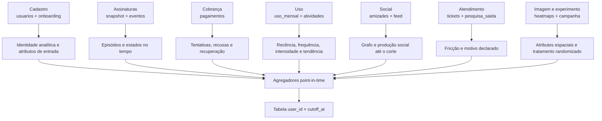
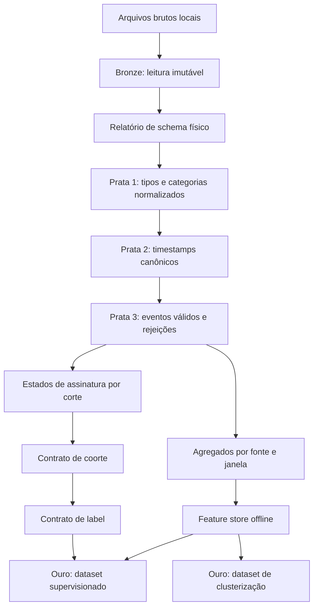
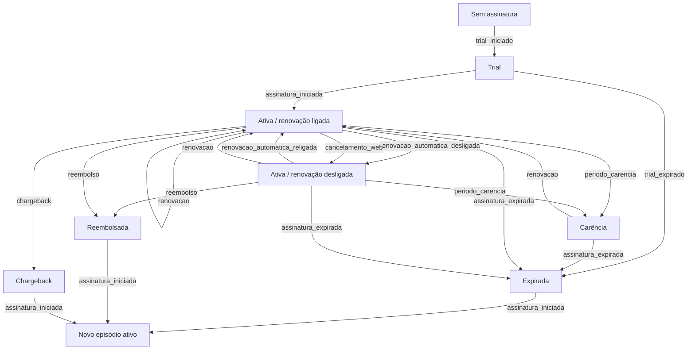
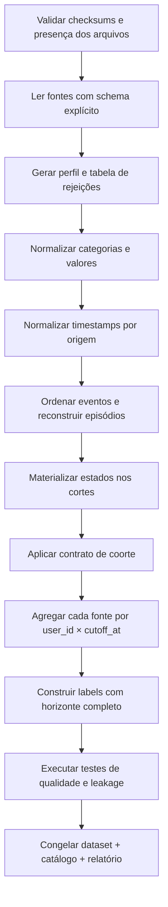

# 🛠️ Saneamento do Data Room e reconstrução histórica

> **Módulo 2:** IA e Dados para Negócios — Case Vitaliza
>
> **Trilha:** Ciência de Dados e Machine Learning
>
> **Escopo:** qualidade, normalização temporal, estados de assinatura, coortes, labels e tabela analítica

[Trilha de Ciência de Dados e ML](./README.md) / Saneamento e reconstrução histórica

---

## 🎯 1. Objetivo e limite deste documento

Este guia especifica como transformar as fontes locais do case em uma base point-in-time, isto é, uma base em que cada linha contém somente informação disponível na data de decisão simulada.

O objetivo técnico é materializar uma tabela com uma linha por `user_id × cutoff_at`, acompanhada de:

- estado da assinatura no corte;
- motivo de inclusão ou exclusão da coorte;
- features agregadas em janelas anteriores;
- label de saída nos 60 dias seguintes, quando o horizonte estiver completamente observado;
- indicadores de cobertura e qualidade;
- lineage da fonte até a coluna final.

### Status de execução

**Auditado:** inventário, volumes, chaves primárias selecionadas, reconciliação do retrato ativo, registros pós-corte e algumas inconsistências de categoria. As evidências estão no [dossiê](../05_DOSSIE_EXHIBITS_M2.md) e no [JSON de auditoria](../../relatorios/auditoria_exhibits.json).

**Ainda será implementado:** camadas bronze/prata/ouro, parser de fuso por origem, máquina de estados, coortes históricas, labels, catálogo de features, testes de integração e relatório final de qualidade.

Este documento não afirma que a base analítica já foi produzida.

---

## 🧭 2. Princípios de construção

1. **Preservar a fonte:** o pipeline não altera os arquivos brutos.
2. **Separar ocorrência de disponibilidade:** uma data de evento não garante que o valor já estivesse disponível para decisão.
3. **Reconstruir, não retroprojetar:** o estado atual não pode preencher o passado sem evidência temporal.
4. **Agregar antes de juntar:** fontes com muitas linhas por pessoa são reduzidas à chave de destino antes do `JOIN`.
5. **Falhar de forma explícita:** tipo inválido, categoria desconhecida e sequência impossível viram rejeição ou alerta, nunca correção silenciosa.
6. **Distinguir zero, nulo e ausência de cobertura:** são estados analíticos diferentes.
7. **Versionar contratos:** mudanças na coorte, label ou regra temporal alteram a versão do dataset.
8. **Publicar somente agregados:** dados individuais, e-mails e textos livres permanecem locais.

---

## 🗄️ 3. Topologia das fontes



### 3.1 Granularidade e chave de integração

| Fonte | Granularidade | Chave nativa | Restrição antes da integração |
| :--- | :--- | :--- | :--- |
| `usuarios.csv` | uma conta | `user_id` | filtrar cadastro conhecido no corte |
| `assinaturas.csv` | uma assinatura | `assinatura_id` | usar como retrato e reconciliação, não como histórico completo |
| `eventos_assinatura.csv` | um evento | chave composta a definir | normalizar fuso, ordenar e associar ao episódio |
| `pagamentos.csv` | uma tentativa | `pagamento_id` | converter valor e agregar por janela |
| `uso_mensal.csv` | usuário-mês | `user_id, mes` | usar apenas competências fechadas e disponíveis |
| `atividades.parquet` | um treino | `atividade_id` | filtrar `inicio < cutoff_at` após regra de fuso |
| `amizades.csv` | relação direcionada | `seguidor_id, seguido_id, desde` | filtrar `desde < cutoff_at` e calcular graus |
| `feed_posts.csv` | um post | `post_id` | filtrar publicação; curtidas exigem cautela por serem acumuladas |
| `tickets_suporte.csv` | um ticket | `ticket_id` | atributos de abertura são mais seguros que estado final |
| `onboarding.csv` | uma resposta | `onboarding_id` | resposta precisa anteceder o corte |
| `pesquisa_saida.csv` | uma resposta | `resposta_id` | excluir da previsão do próprio evento de saída |
| `campanha_ago26.csv` | um participante | `user_id` | não misturar tratamento com features pré-campanha |
| heatmaps | usuário-data | nome do arquivo + data | só usar a fotografia disponível até o corte |

---

## 🏗️ 4. Arquitetura de dados proposta



### 4.1 Camada bronze

A camada bronze deve acrescentar metadados sem alterar o conteúdo:

```text
source_file
source_row_number
ingested_at
source_checksum
raw_payload ou colunas originais
```

O checksum e a contagem de linhas permitem demonstrar qual versão do Data Room originou cada resultado.

### 4.2 Camada prata

A camada prata deve manter pares `raw` e `normalized` quando houver limpeza relevante:

```text
sistema_raw = "iOS"
sistema_normalized = "ios"

tipo_atividade_raw = "run"
tipo_atividade_normalized = "corrida"

valor_raw = "39,90"
valor_brl = 39.90
valor_parse_status = "valid"
```

Categorias não mapeadas entram em uma tabela de rejeições com fonte, coluna, valor, contagem e versão da regra. Não devem ser forçadas para `outros` sem decisão explícita.

---

## 📐 5. Contrato de schema e qualidade

### 5.1 Regras gerais

| Dimensão | Regra | Resposta à falha |
| :--- | :--- | :--- |
| Presença | arquivo e colunas obrigatórias existem | interromper pipeline |
| Tipo | valores podem ser convertidos sem perda indevida | rejeitar linha ou coluna conforme criticidade |
| Chave | chave primária não é nula nem duplicada | interromper para fontes críticas |
| Domínio | categorias pertencem ao vocabulário versionado | registrar desconhecidos e bloquear se afetar contrato |
| Faixa | duração, distância, valor e datas têm limites plausíveis | marcar outlier; não excluir automaticamente |
| Relação | chaves estrangeiras encontram conta correspondente | contabilizar órfãos e definir tolerância |
| Temporal | evento não viola cobertura ou corte | excluir da janela e registrar contagem |
| Cardinalidade | `JOIN` preserva a população esperada | interromper em multiplicação não prevista |
| Completude | taxa de nulos e cobertura por corte conhecida | gerar perfil e indicador de cobertura |

### 5.2 Evidência auditada que orienta os testes

| Achado já medido | Teste que deve entrar no pipeline |
| :--- | :--- |
| 14.813 ativas = 14.753 pagantes + 60 cortesias | asserção de reconciliação do retrato final |
| 119 cadastros posteriores ao corte | teste de `data_cadastro < cutoff_at` |
| 122 posts posteriores ao corte | filtro temporal obrigatório no feed |
| 273 amizades posteriores ao corte | grafo point-in-time por `desde` |
| 34 atividades na primeira hora de 01/10 | teste específico de convenção de fuso |
| variações de `android` e `iOS` | domínio normalizado e preservação do valor bruto |
| modalidades PT/EN | mapa versionado de equivalências |
| `relogio_conectado = nenhum` | regra semântica, não simples teste de nulo |
| valor de pagamento inferido como texto | parser decimal com rejeição explícita |

### 5.3 Relatório esperado de data quality

Para cada fonte e execução:

```text
run_id
source_checksum
rows_read
rows_valid
rows_rejected
primary_key_duplicates
foreign_key_orphans
post_cutoff_rows
unknown_categories
null_rate_by_column
min_max_timestamp
rule_version
executed_at
```

O relatório deve separar erro bloqueante de aviso. Um pipeline que termina com avisos precisa listar quais dados foram afetados.

---

## 🕒 6. Normalização temporal

### 6.1 Instante de corte

Use intervalos semiabertos e um timestamp explícito:

```text
reference_date = 2026-09-30
cutoff_at = 2026-10-01 00:00:00 America/Sao_Paulo
feature elegível se available_at < cutoff_at
label elegível se cutoff_at <= event_at < cutoff_at + 60 dias
```

`cutoff_at` é o limite exclusivo das features. Assim, o corte de referência de 30/09 usa dados anteriores a 01/10 00:00, e a janela de label cobre 01/10 a 29/11 inclusive.

### 6.2 Regra por origem

- eventos de App Store e Google Play terminados em `Z`: interpretar como UTC e converter para `America/Sao_Paulo`;
- eventos do site registrados sem fuso: localizar em `America/Sao_Paulo`, conforme o dicionário do case;
- datas sem horário, como competências mensais: tratar como período, não como instante arbitrário;
- qualquer coluna cuja convenção não esteja documentada: marcar como `timezone_assumption = unresolved` até validação.

### 6.3 Pseudocódigo do parser

```python
def normalize_event_time(raw_timestamp, billing_channel):
    if billing_channel in {"app_store", "google_play"}:
        parsed = parse_utc_required(raw_timestamp)
        return parsed.to_timezone("America/Sao_Paulo")

    if billing_channel in {"web_cartao", "web_pix"}:
        parsed = parse_naive_required(raw_timestamp)
        return localize(parsed, "America/Sao_Paulo")

    raise UnknownTimezoneConvention(billing_channel)
```

### 6.4 Testes de fronteira

```text
Caso A: 2026-10-01T01:30:00Z -> 2026-09-30 22:30:00-03:00 -> elegível no corte
Caso B: 2026-10-01 00:30:00 do site -> 2026-10-01 00:30:00-03:00 -> não elegível
Caso C: timestamp UTC sem Z em canal de loja -> rejeição, não suposição silenciosa
Caso D: timestamp com offset contraditório ao canal -> alerta bloqueante
```

A auditoria detectou 34 atividades na primeira hora de 01/10, mas não estabeleceu a convenção temporal do campo. Elas não devem ser automaticamente reclassificadas como setembro sem confirmação da semântica da origem.

---

## 🔄 7. Reconstrução dos episódios de assinatura

### 7.1 Estado não é evento

Um evento altera ou informa um estado. O pipeline deve representar, no mínimo:

```text
subscription_status ∈ {trial, active, grace_period, expired, refunded, charged_back, unknown}
auto_renew ∈ {on, off, unknown}
access_entitlement ∈ {granted, denied, unknown}
```

Desligar renovação não implica perda imediata de acesso. Por isso, `auto_renew = off` e `subscription_status = active` podem coexistir.

### 7.2 Máquina de estados proposta



A transição representa uma especificação inicial. Ela precisa ser confrontada com o dicionário, as sequências reais e a regra de negócio da equipe antes da implementação definitiva.

### 7.3 Associação entre evento e episódio

`eventos_assinatura.csv` não expõe `assinatura_id` no dicionário. A associação por `user_id` exige um algoritmo documentado:

1. ordenar eventos pelo timestamp normalizado;
2. abrir episódio em `assinatura_iniciada` ou em evidência de início anterior;
3. aplicar eventos compatíveis ao episódio aberto;
4. fechar em expiração, reembolso ou chargeback conforme contrato;
5. permitir novo episódio em nova assinatura;
6. enviar sequências ambíguas para uma fila de exceções;
7. nunca resolver empate ou conflito sem regra de precedência aprovada.

### 7.4 Pseudocódigo

```python
def reconstruct_user_timeline(user_events, snapshot_rows):
    events = sort_by_normalized_time(user_events)
    timeline = []
    state = infer_initial_state(events, snapshot_rows)

    for event in events:
        assert event.event_at >= state.last_event_at
        next_state = transition(state, event)
        timeline.append(
            Interval(
                valid_from=state.last_event_at,
                valid_to=event.event_at,
                state=state,
                source_event=event,
            )
        )
        state = next_state

    return close_open_interval(state)
```

### 7.5 Reconciliação

Para cada corte, gere uma ponte:

| Etapa | Contagem |
| :--- | ---: |
| contas avaliadas | `N0` |
| com episódio ativo no corte | `N1` |
| menos cortesias | `N2` |
| menos estados ambíguos bloqueados | `N3` |
| população pagante reconstruída | `N4` |
| diferença para referência aplicável | `N4 - referência` |

No corte final, a referência auditada do snapshot é 14.753 pagantes. Uma diferença na reconstrução deve ser explicada por cobertura do log, regra de episódio, timestamp ou estado ambíguo. O pipeline não deve forçar `N4 = 14.753`.

---

## 👥 8. Contrato de coorte

### 8.1 Regra base

Uma pessoa entra na coorte de um corte quando:

```text
has_active_episode_at_cutoff = true
AND plan_at_cutoff IN ('mensal', 'anual')
AND access_entitlement_at_cutoff = 'granted'
AND user_created_at < cutoff_at
AND state_quality IN ('valid', 'reconciled')
```

A equipe precisa decidir se `auto_renew = off` continua elegível para o problema de previsão. Excluir essas pessoas pode remover casos de alto risco já manifestado; incluí-las pode tornar o alvo trivial. A decisão deve gerar versões distintas do contrato, por exemplo:

- `cohort_v1_active_paid`: todos os pagantes ativos;
- `cohort_v2_actionable_auto_renew_on`: somente pessoas cuja renovação ainda pode ser preservada.

As duas populações respondem perguntas diferentes e não devem compartilhar métricas sem explicação.

### 8.2 SQL ilustrativo

```sql
WITH state_at_cutoff AS (
    SELECT
        user_id,
        cutoff_at,
        plan_at_cutoff,
        subscription_status,
        access_entitlement,
        auto_renew,
        state_quality
    FROM reconstructed_subscription_state
    WHERE valid_from < cutoff_at
      AND (valid_to IS NULL OR valid_to >= cutoff_at)
)
SELECT
    user_id,
    cutoff_at,
    auto_renew,
    CASE
        WHEN plan_at_cutoff NOT IN ('mensal', 'anual') THEN 'non_paid_plan'
        WHEN subscription_status NOT IN ('active', 'grace_period') THEN 'not_active'
        WHEN access_entitlement <> 'granted' THEN 'no_entitlement'
        WHEN state_quality NOT IN ('valid', 'reconciled') THEN 'ambiguous_state'
        ELSE NULL
    END AS exclusion_reason
FROM state_at_cutoff;
```

O SQL é uma referência de contrato. Os nomes finais devem refletir o schema implementado.

---

## 🎯 9. Contrato do label de churn

### 9.1 Janela

Para um corte `t`:

```text
feature_window: [t - lookback, t)
label_window:   [t, t + 60 dias)
```

Aqui, `t` é o limite exclusivo das features, à meia-noite do dia seguinte à data de referência. Para o corte de 30/09/2026, `t = 01/10/2026 00:00` e o label cobre eventos até 30/11/2026 00:00, sem incluir esse instante. Em datas civis, isso corresponde a 01/10 a 29/11 inclusive.

### 9.2 Definições candidatas

| Versão | Positivo | Uso | Risco |
| :--- | :--- | :--- | :--- |
| intenção | `renovacao_automatica_desligada` ou `cancelamento_web` | antecipar intenção declarada | não representa perda efetiva de acesso |
| efetivo | `assinatura_expirada`, `reembolso` ou `chargeback` conforme regra | medir saída realizada | atraso entre intenção e término |
| composto | primeiro evento de intenção ou perda efetiva, com exceções | aproximar acionabilidade | mistura mecanismos diferentes |

A versão deve ser escolhida com Negócios. O dataset pode manter labels auxiliares separados para permitir análise de sensibilidade.

### 9.3 Casos de borda

O contrato deve dizer:

- se desligamento seguido de religamento dentro da janela continua positivo;
- se expiração seguida de nova assinatura conta como churn, reentrada ou ambos;
- como contar reembolso e chargeback;
- se período de carência sem expiração é positivo ou apenas sinal de risco;
- qual evento determina `churn_event_at` quando há múltiplos candidatos.

Uma regra possível para comparação, ainda sujeita a aprovação, é manter:

```text
label_intent_60d
label_effective_exit_60d
label_reactivated_within_60d
label_primary_60d
```

Isso evita apagar a sequência real em um único booleano.

### 9.4 Censura

Um label negativo só é válido quando o Data Room observa todo o horizonte. Para o corte final de 30/09/2026, seria necessário observar até 29/11/2026. Como os exhibits auditados terminam antes disso, esse corte pode receber score, mas não avaliação final observada.

```sql
CASE
    WHEN observation_end_exclusive < cutoff_at + INTERVAL '60 days'
        THEN NULL
    WHEN EXISTS (
        SELECT 1
        FROM churn_events e
        WHERE e.user_id = c.user_id
          AND e.event_at >= c.cutoff_at
          AND e.event_at < c.cutoff_at + INTERVAL '60 days'
    ) THEN 1
    ELSE 0
END AS churn_60d
```

---

## ⚙️ 10. Engenharia de features point-in-time

### 10.1 Regra universal

Toda feature deve ter:

```text
feature_name
business_definition
source_files
source_columns
entity_key
window_start
window_end
occurrence_time_column
availability_time_rule
aggregation
null_semantics
leakage_risk
owner
version
```

### 10.2 Famílias propostas

| Família | Features candidatas | Cuidados |
| :--- | :--- | :--- |
| Contrato | plano, canal, tempo de casa, renovação reconstruída | nunca usar estado atual para corte histórico |
| Uso | treinos, minutos, dias ativos, sessões, recência | competência mensal precisa estar fechada |
| Tendência | delta 30d, inclinação 90d, sequência de semanas inativas | exigir cobertura comparável entre janelas |
| Modalidade | proporção ao ar livre, vídeo e distribuição de tipos | normalizar PT/EN; ausência de GPS não é ausência de treino |
| Dispositivo | sistema, relógio, origem das atividades | `nenhum` é ausência explícita de relógio |
| Cobrança | recusas, tentativas, recuperação e valor aprovado | conversão monetária e status conhecido no corte |
| Suporte | tickets abertos na janela, categoria e recência | resolução posterior não pode voltar ao passado |
| Social | graus, reciprocidade, novos vínculos e treino acompanhado | grafo deve ser reconstruído por `desde` |
| Conteúdo | posts, tópicos ou sinais extraídos antes do corte | curtidas acumuladas e inferência precisam de versionamento |
| Cobertura | flags por fonte e janela | separar sem atividade de sem observação |

### 10.3 SQL de agregação antes do `JOIN`

```sql
WITH activity_90d AS (
    SELECT
        c.user_id,
        c.cutoff_at,
        count(a.atividade_id) AS workouts_90d,
        count(DISTINCT CAST(a.inicio_brt AS DATE)) AS active_days_90d,
        sum(a.duracao_min) AS minutes_90d,
        date_diff('day', max(a.inicio_brt), c.cutoff_at) AS days_since_last_workout
    FROM cohort_cutoffs c
    LEFT JOIN activities_normalized a
      ON a.user_id = c.user_id
     AND a.inicio_brt >= c.cutoff_at - INTERVAL '90 days'
     AND a.inicio_brt < c.cutoff_at
    GROUP BY c.user_id, c.cutoff_at
),
payment_90d AS (
    SELECT
        c.user_id,
        c.cutoff_at,
        count(*) FILTER (WHERE p.status = 'recusado') AS declined_payments_90d
    FROM cohort_cutoffs c
    LEFT JOIN payments_normalized p
      ON p.user_id = c.user_id
     AND p.processed_at >= c.cutoff_at - INTERVAL '90 days'
     AND p.processed_at < c.cutoff_at
    GROUP BY c.user_id, c.cutoff_at
)
SELECT c.*, a.*, p.declined_payments_90d
FROM cohort_cutoffs c
LEFT JOIN activity_90d a USING (user_id, cutoff_at)
LEFT JOIN payment_90d p USING (user_id, cutoff_at);
```

### 10.4 Ausência e cobertura

Use colunas separadas:

```text
workouts_30d = 0
has_activity_source_coverage = true
```

não é equivalente a:

```text
workouts_30d = null
has_activity_source_coverage = false
```

A imputação, se necessária para o modelo, ocorre dentro do pipeline de treinamento e recebe indicadores de ausência quando fizer sentido.

---

## 💻 11. Sequência executável do pipeline



### 11.1 Pseudocódigo do orquestrador

```python
def build_analytical_dataset(config):
    manifest = validate_raw_manifest(config.sources)
    bronze = ingest_immutable(manifest)
    quality_before = profile_sources(bronze)

    normalized = normalize_types_categories_and_time(bronze, config.rules)
    rejected = collect_rejections(normalized)
    assert_no_blocking_rejections(rejected)

    subscription_timeline = reconstruct_subscription_states(normalized)
    cohort = materialize_cohort(subscription_timeline, config.cutoffs, config.cohort)

    feature_tables = [
        build_usage_features(normalized, cohort),
        build_activity_features(normalized, cohort),
        build_payment_features(normalized, cohort),
        build_support_features(normalized, cohort),
        build_social_features(normalized, cohort),
    ]

    dataset = one_to_one_join(cohort, feature_tables)
    dataset = attach_labels(dataset, subscription_timeline, config.label)
    run_point_in_time_tests(dataset, normalized)
    run_cardinality_and_quality_tests(dataset)

    return freeze_versioned_artifacts(dataset, quality_before, rejected, config)
```

---

## 🛡️ 12. Prevenção de leakage

### 12.1 Leakage temporal direto

Ocorre quando uma feature contém evento posterior ao corte. Controle:

```sql
SELECT count(*) AS violations
FROM feature_lineage
WHERE source_event_at >= cutoff_at;
```

O resultado deve ser zero, salvo features cujo contrato de disponibilidade tenha justificativa específica e revisada.

### 12.2 Leakage de snapshot

Exemplos:

- usar `status_atual` de 01/10 para um corte de julho;
- usar `renovacao_automatica` atual em cortes anteriores;
- usar `data_fim` já conhecida na exportação como feature histórica.

Controle: bloquear essas colunas no catálogo e exigir a versão reconstruída.

### 12.3 Leakage por agregação

Exemplos:

- normalizar com média de todos os períodos;
- escolher categorias raras olhando o teste;
- calcular target encoding com rótulos futuros.

Controle: transformações supervisionadas e estatísticas de ajuste ficam dentro do pipeline de cada fold temporal.

### 12.4 Leakage por disponibilidade tardia

Exemplos:

- ticket aberto antes do corte, mas classificado ou resolvido depois;
- número final de curtidas observado na exportação;
- extração de texto executada hoje sobre conteúdo que não existia no corte.

Controle: catálogo com `occurred_at`, `available_at` e justificativa da disponibilidade.

---

## 🧪 13. Testes

### 13.1 Testes unitários

- parser UTC e BRT em viradas de dia, mês e horário de verão aplicável à biblioteca;
- conversão de decimal brasileiro e rejeição de texto inválido;
- normalização de sistema e modalidade com preservação do original;
- transições válidas e inválidas da máquina de estados;
- abertura e fechamento correto da janela de 60 dias;
- distinção entre zero, nulo e cobertura ausente.

### 13.2 Testes de integração

- reconstrução completa de uma linha do tempo sintética com reentrada;
- agregação de atividade, pagamento e suporte sem multiplicar linhas;
- materialização de dois cortes para a mesma pessoa sem usar fatos futuros;
- reconciliação do corte final com o snapshot auditado;
- geração de relatório de rejeições e qualidade.

### 13.3 Testes de propriedade

```text
Para toda feature f:
    max(f.source_available_at) < f.cutoff_at

Para toda linha da coorte:
    exatamente um registro por user_id × cutoff_at

Para todo label observado:
    label_window_end <= data_maxima_observada

Para todo JOIN de features:
    rows_after == rows_before
```

### 13.4 Casos de teste da máquina de estados

| Caso | Eventos | Estado esperado no corte |
| :--- | :--- | :--- |
| renovação desligada | início → desligamento | ativo, auto-renovação off |
| desistência revertida | início → desligamento → religamento | ativo, auto-renovação on |
| falha recuperada | início → carência → renovação | ativo |
| falha não recuperada | início → carência → expiração | expirado |
| reentrada | início → expiração → novo início | novo episódio ativo |
| conflito | expiração e renovação no mesmo instante | exceção até regra de precedência |

---

## ⚠️ 14. Riscos e decisões pendentes

| Decisão | Por que importa | Responsável sugerido |
| :--- | :--- | :--- |
| evento primário de churn | altera prevalência e acionabilidade | Dados + Negócios |
| inclusão de auto-renovação desligada | pode tornar o alvo trivial ou remover risco acionável | Negócios |
| tratamento de carência | separa fricção recuperável de perda | Dados + Financeiro |
| precedência em eventos empatados | muda a linha do tempo | Dados + dono da fonte |
| semântica temporal das atividades de 01/10 | afeta fechamento de setembro | Engenharia de Dados |
| disponibilidade histórica de status do ticket | define features válidas | Dados + Atendimento |
| uso de curtidas | snapshot acumulado pode vazar futuro | Dados |
| cobertura mínima por corte | define quais janelas entram no treino | Ciência de Dados |

---

## 📁 15. Artefatos que a implementação deve produzir

```text
artifacts/data/
├── raw_manifest.json
├── schema_report.json
├── category_mapping.yml
├── rejected_rows_summary.parquet
├── subscription_state_intervals.parquet
├── cohort_bridge_by_cutoff.csv
├── feature_catalog.yml
├── analytical_dataset_<version>.parquet
├── data_quality_report_<run_id>.json
└── lineage_<version>.json
```

Os nomes são uma proposta. Dados individuais devem permanecer fora do Git conforme as regras do repositório. Relatórios agregados, contratos e código podem ser versionados.

---

## ✅ 16. Definition of Done

A etapa de saneamento e reconstrução histórica está concluída somente quando:

- [ ] todos os arquivos esperados têm checksum e schema registrados;
- [ ] regras de tipo, domínio, nulidade e chave estão automatizadas;
- [ ] valores originais são preservados ao lado das normalizações relevantes;
- [ ] fusos são tratados por origem e os casos de fronteira passam;
- [ ] eventos de assinatura são associados a episódios com exceções rastreáveis;
- [ ] a máquina de estados possui testes para transições normais e conflitantes;
- [ ] a coorte de cada corte tem ponte de inclusão e exclusão;
- [ ] a diferença entre o snapshot de 14.753 pagantes e a reconstrução final está explicada;
- [ ] o label e suas versões auxiliares foram aprovados;
- [ ] cortes sem 60 dias completos não recebem falso rótulo negativo;
- [ ] cada feature tem fonte, janela, disponibilidade, transformação e risco de leakage;
- [ ] a chave `user_id × cutoff_at` é única;
- [ ] cada `JOIN` preserva a cardinalidade esperada;
- [ ] testes point-in-time retornam zero violações;
- [ ] o pipeline roda do início ao fim com um comando documentado;
- [ ] dataset, catálogo, relatório de qualidade e lineage compartilham a mesma versão;
- [ ] nenhum dado pessoal ou texto individual foi publicado.

---

## 🚀 17. Encaminhamento

Com a base temporal aprovada, a equipe pode avançar para [clusterização e modelagem supervisionada de churn](./02_CLUSTERIZACAO_E_CHURN_SUPERVISIONADO.md). A modelagem não deve começar sobre um dataset cuja coorte, label ou disponibilidade temporal ainda estejam indefinidos.