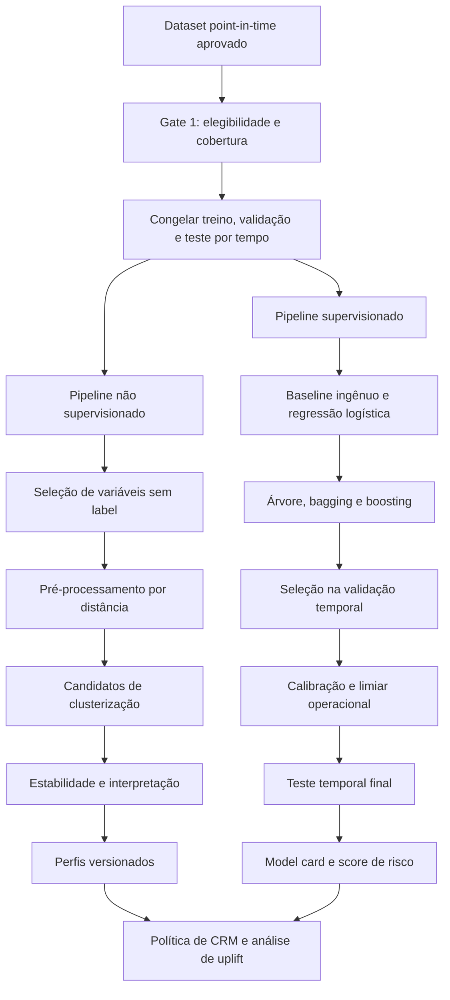
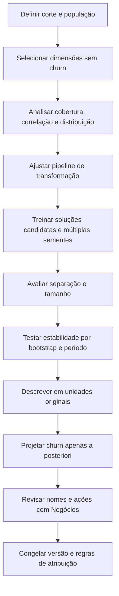
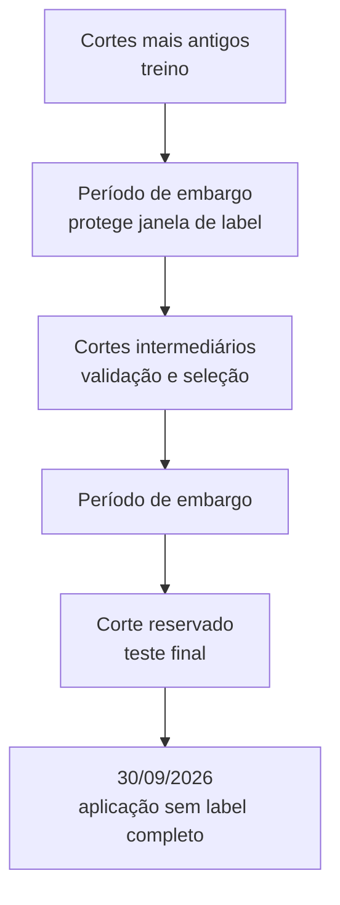
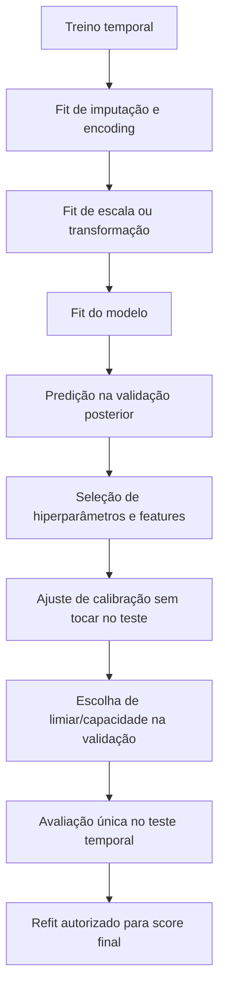

# 📈 Clusterização e modelagem supervisionada de churn

> **Módulo 2:** IA e Dados para Negócios — Case Vitaliza
>
> **Trilha:** Ciência de Dados e Machine Learning
>
> **Escopo:** segmentação comportamental, classificação de churn em 60 dias, validação temporal e interpretabilidade

[Trilha de Ciência de Dados e ML](./README.md) / Clusterização e churn supervisionado

---

## 🎯 1. Objetivo e pré-condições

Este guia define o protocolo para dois problemas diferentes:

1. formar segmentos comportamentais sem usar churn na construção dos grupos;
2. estimar a probabilidade de saída nos 60 dias seguintes a cada corte histórico elegível.

A modelagem só pode começar após aprovação do [contrato de saneamento e reconstrução](./01_SANEAMENTO_E_RECONSTRUCAO_HISTORICA.md): coorte, estados de assinatura, label, janelas, disponibilidade temporal, catálogo de features e testes point-in-time.

### Status de execução

**Auditado:** fontes, volumes, algumas anomalias de qualidade e a população pagante do snapshot final.

**Ainda será implementado:** datasets de clusterização e supervisionado, pré-processamento, experimentos, validação, calibração, interpretabilidade, análise de erro, model card e score final.

**Nenhum modelo é declarado como treinado.** As métricas deste documento são definições e critérios de avaliação, não resultados do case.

---

## ⚖️ 2. Separação entre os dois problemas

| Aspecto | Clusterização | Classificação supervisionada |
| :--- | :--- | :--- |
| Pergunta | quais perfis de comportamento existem? | quem apresenta maior probabilidade de saída em 60 dias? |
| Alvo | não existe | label histórico de churn 60d |
| Entrada | atributos selecionados para similaridade | atributos disponíveis no corte |
| Saída | `cluster_id` e perfil descritivo | probabilidade calibrada e ranking |
| Validação | separação, estabilidade, tamanho e interpretabilidade | discriminação, calibração, estabilidade e utilidade operacional |
| Uso | desenho de jornadas e leitura da base | priorização de risco, sujeita a uplift e valor |
| Erro comum | formar grupos usando churn | tratar associação como efeito causal |

Um cluster não é uma faixa de risco. Churn pode ser projetado sobre os grupos depois da clusterização para descrição, mas não participa da distância, da escolha de `k` ou da formação dos segmentos.

---

## 📐 3. Topologia do pipeline de modelagem



---

# 🧩 Parte I — Clusterização

## 📋 4. Contrato do dataset de clusterização

### 4.1 População

A população deve ser uma fotografia da coorte pagante ativa em um corte definido. Para evitar misturar comportamento de épocas com cobertura diferente, a solução inicial deve usar um único corte com cobertura suficiente ou construir análises separadas por corte.

O snapshot auditado contém 14.753 pagantes ativos em 30/09/2026, mas o dataset final de clusterização pode ser menor se exigir cobertura mínima. Toda exclusão deve aparecer em uma ponte:

```text
pagantes ativos no corte
- estado temporal ambíguo
- cobertura insuficiente da janela
- ausência estrutural em variáveis obrigatórias
= população clusterizada
```

Ausência de atividade não é motivo automático de exclusão. Pessoas sem treino podem formar um perfil legítimo, desde que a fonte tenha cobertura e o zero seja real.

### 4.2 Unidade e schema

```text
cluster_input
├── user_id_hash
├── cutoff_at
├── coverage_flags
├── engagement
│   ├── workouts_30d
│   ├── workouts_90d
│   ├── active_days_30d
│   ├── minutes_30d
│   ├── sessions_app_last_closed_month
│   └── days_since_last_workout
├── trend
│   ├── workout_delta_30d_vs_prev30d
│   ├── active_days_slope_90d
│   └── consecutive_inactive_weeks
├── preference
│   ├── outdoor_share_90d
│   ├── video_share_90d
│   └── modality_diversity_90d
├── ecosystem
│   ├── has_connected_watch
│   ├── activity_source_mix
│   ├── social_in_degree
│   ├── social_out_degree
│   └── social_reciprocity
└── context_for_description_only
    ├── plan_at_cutoff
    ├── billing_channel_at_cutoff
    └── tenure_days
```

A equipe deve separar variáveis usadas para formar clusters das variáveis usadas apenas para descrevê-los. Plano, canal e tenure podem dominar a solução e produzir segmentos contratuais, não comportamentais. Sua inclusão deve ser justificada e comparada por ablação.

---

## ⚙️ 5. Seleção e preparação de variáveis

### 5.1 Critérios de entrada

Uma variável entra na matriz de distância quando:

- representa uma dimensão relevante do comportamento;
- está disponível para a maior parte da população ou possui tratamento de ausência defensável;
- não é label nem proxy direto da saída;
- não duplica quase perfeitamente outra variável;
- tem escala e distribuição tratáveis;
- pode ser explicada em unidade de negócio depois do ajuste.

### 5.2 Variáveis proibidas ou condicionais

| Variável | Regra |
| :--- | :--- |
| label de churn | proibida na formação |
| evento de cancelamento ou expiração futura | proibido |
| `status_atual` ou `data_fim` pós-corte | proibido |
| pesquisa de saída | proibida para segmentar a coorte pré-churn |
| probabilidade de churn | não usar para formar segmentos comportamentais |
| plano e canal | testar separadamente; podem dominar o perfil |
| texto ou imagem extraídos | somente após validação de qualidade e cobertura |

### 5.3 Transformações

- contagens assimétricas: avaliar `log1p` ou transformação robusta;
- proporções: preservar limites e tratar denominador zero;
- variáveis contínuas: `StandardScaler` ou `RobustScaler`, ajustado na população do corte;
- categorias: usar representação compatível com o algoritmo; não impor distância ordinal inexistente;
- outliers: revisar como comportamento real antes de truncar;
- ausentes: separar indisponibilidade da fonte de ausência semântica.

A preparação deve ficar encapsulada em um pipeline reproduzível. Os centroides ou perfis finais precisam ser apresentados nas unidades originais, não apenas em z-score.

---

## 🧮 6. Algoritmos candidatos

| Método | Quando testar | Limitações |
| :--- | :--- | :--- |
| K-means | matriz numérica padronizada e grupos aproximadamente convexos | sensível a escala, outliers e forma dos grupos |
| K-medoids | necessidade de maior robustez e exemplar real | custo maior em bases grandes |
| clustering hierárquico | exploração de estrutura e dendrograma em amostra | escalabilidade e corte da árvore |
| Gaussian Mixture | sobreposição e pertencimento probabilístico | hipóteses de distribuição e sensibilidade à inicialização |
| HDBSCAN | densidades diferentes e ruído | pode classificar parte da população como ruído; parâmetros menos intuitivos |
| k-prototypes | mistura relevante de numéricas e categóricas | ponderação entre tipos precisa de justificativa |

O método não deve ser escolhido por variedade técnica. A equipe pode começar com K-means como baseline e comparar um método robusto ou adequado a dados mistos se a matriz exigir.

---

## 🔄 7. Sequência experimental da clusterização



### 7.1 Pseudocódigo

```python
for feature_set in candidate_feature_sets:
    for algorithm in candidate_algorithms:
        for params in parameter_grid(algorithm):
            for seed in seeds:
                labels = fit_cluster_pipeline(
                    X=cluster_population[feature_set],
                    algorithm=algorithm,
                    params=params,
                    seed=seed,
                )
                record_internal_metrics(labels)
                record_cluster_sizes(labels)
                record_bootstrap_stability(labels)
                record_period_stability(labels)

shortlist = select_non_dominated_solutions(
    separation=True,
    stability=True,
    minimum_cluster_size=True,
    interpretability=True,
)
```

---

## 📊 8. Avaliação de clusterização

### 8.1 Métricas internas

- silhouette: coesão e separação;
- Davies–Bouldin: similaridade entre clusters;
- Calinski–Harabasz: dispersão entre e dentro dos grupos;
- inércia: apoio ao diagnóstico de `k`, nunca critério isolado.

Não há limiar universal que torne um cluster útil. Métricas internas devem ser lidas com estabilidade, tamanho e interpretação.

### 8.2 Estabilidade

A solução precisa resistir a:

- mudança de semente;
- reamostragem de usuários;
- pequenas alterações de janela;
- comparação entre cortes próximos;
- remoção de uma família de features;
- perturbação de outliers.

Métricas possíveis: Adjusted Rand Index, Normalized Mutual Information e correspondência de centroides após alinhamento dos rótulos.

### 8.3 Utilidade de negócio

Para cada cluster, relatar:

```text
cluster_id e versão
n e participação da população
mediana e intervalo interquartil das features principais
cobertura de fontes
características distintivas contra a população
churn observado a posteriori, com incerteza
canais e planos para descrição, não causalidade
hipótese de ação e risco de estereótipo
```

Nomes de personas devem vir depois da análise, sem linguagem depreciativa e sem inferir intenção não observada. Prefira nomes descritivos como `baixa_recencia_alta_frequencia` a rótulos psicológicos.

### 8.4 Regra de atribuição futura

Se os segmentos forem usados em outro corte, registre:

- pipeline de transformação congelado;
- centroides ou modelo de atribuição;
- distância mínima ou confiança;
- regra para ponto distante de todos os grupos;
- monitoramento de mudança no tamanho e perfil dos clusters.

---

# 📈 Parte II — Modelagem supervisionada

## 🎯 9. Contrato do problema supervisionado

### 9.1 Unidade, população e alvo

```text
unidade: user_id × cutoff_at
população: pagante ativo e elegível no corte
features: informação disponível antes de cutoff_at
label: evento de churn em [cutoff_at, cutoff_at + 60 dias), com cutoff_at como limite exclusivo das features
saída: probabilidade de churn_60d
```

A versão do label deve ser explícita: intenção, saída efetiva ou composto. O desempenho não pode ser comparado entre versões sem recalcular a prevalência e os conjuntos.

### 9.2 Cortes elegíveis

O primeiro passo não é escolher o modelo, mas mapear:

- data mínima de cada fonte;
- janela de lookback exigida por cada feature;
- data máxima de observação do label;
- quantidade de positivos e negativos em cada corte;
- mudanças de política, preço ou produto que afetem estabilidade.

Atividades detalhadas começam em janeiro de 2026; uso mensal começa antes; heatmaps existem em duas datas. Um conjunto de features uniforme pode exigir cortes mais recentes, enquanto um baseline cadastral e mensal pode usar história mais longa. Essas configurações devem ser avaliadas separadamente.

---

## 🕒 10. Divisão temporal e embargo

### 10.1 Por que não embaralhar

Um `train_test_split(shuffle=True)` mistura o futuro no treino e produz uma avaliação incompatível com o uso. A divisão deve avançar no tempo.



### 10.2 Regra de sobreposição

Se o label tem 60 dias, uma observação de treino cujo horizonte invade o início da validação pode vazar informação sobre o período reservado. O splitter deve usar purga ou embargo compatível.

```python
def temporal_split(rows, train_end, valid_start, valid_end, horizon_days=60):
    train = rows[
        (rows.cutoff_at <= train_end)
        & (rows.cutoff_at + days(horizon_days) <= valid_start)
    ]
    valid = rows[
        (rows.cutoff_at >= valid_start)
        & (rows.cutoff_at <= valid_end)
    ]
    return train, valid
```

A regra final depende do calendário de cortes e deve ser testada com datas concretas.

### 10.3 Pessoas repetidas

A mesma pessoa pode aparecer em vários cortes. Isso é coerente com previsão recorrente, mas cria dependência. A avaliação deve:

- manter ordem temporal;
- impedir features e labels sobrepostos indevidamente;
- reportar quantidade de pessoas e quantidade de linhas;
- executar análise de sensibilidade com um corte por pessoa ou blocos por usuário, quando útil;
- usar intervalos de confiança que respeitem a estrutura temporal ou agrupada.

---

## 🧠 11. Baselines e famílias de modelos

### 11.1 Baselines obrigatórios

| Baseline | Propósito |
| :--- | :--- |
| prevalência histórica | provar ganho sobre probabilidade constante |
| regra simples de recência | comparar com heurística operacional transparente |
| regressão logística | referência supervisionada interpretável |

Sem esses pontos, não é possível saber se um ensemble sofisticado acrescenta valor.

### 11.2 Modelos candidatos

| Família | Papel | Controles |
| :--- | :--- | :--- |
| regressão logística regularizada | baseline linear e coeficientes legíveis | escala, colinearidade, regularização e calibração |
| árvore de decisão | regras locais e interações simples | profundidade, folhas mínimas e poda |
| bagging / Random Forest | redução de variância | profundidade, amostragem, estabilidade e calibração |
| gradient boosting | interações e não linearidades | learning rate, número de árvores, early stopping e overfit |

A comparação deve usar a mesma população, os mesmos folds e as mesmas métricas. O teste temporal final é consultado somente depois de selecionar pipeline e hiperparâmetros na validação.

---

## 💻 12. Pipeline supervisionado



### 12.1 Pseudocódigo com pipeline

```python
preprocessor = ColumnTransformer(
    transformers=[
        ("numeric", numeric_pipeline, numeric_features),
        ("categorical", categorical_pipeline, categorical_features),
    ]
)

candidate = Pipeline(
    steps=[
        ("preprocessor", preprocessor),
        ("model", classifier),
    ]
)

for fold in temporal_folds:
    X_train, y_train = materialize(fold.train)
    X_valid, y_valid = materialize(fold.valid)

    candidate.fit(X_train, y_train)
    p_valid = candidate.predict_proba(X_valid)[:, 1]
    evaluate_and_store(fold, y_valid, p_valid)
```

Todas as transformações que aprendem parâmetros devem estar dentro do pipeline. Isso inclui imputação, escala, encoding, seleção de variáveis e, quando supervisionado, target encoding.

---

## 🔧 13. Busca de hiperparâmetros

A busca deve ser pequena o suficiente para auditoria e ampla o suficiente para evitar uma comparação injusta.

```text
Logística:
- C
- penalização compatível com solver
- class_weight como análise de sensibilidade

Árvore:
- max_depth
- min_samples_leaf
- min_samples_split
- criterion

Random Forest:
- n_estimators
- max_depth
- min_samples_leaf
- max_features
- class_weight

Boosting:
- n_estimators ou iterações
- learning_rate
- max_depth ou número de folhas
- subsample
- regularização
```

O critério primário deve ser definido antes da busca, por exemplo PR-AUC média em validação temporal, com requisitos mínimos de calibração e estabilidade. Escolher o campeão depois de examinar muitas métricas sem regra prévia aumenta o risco de seleção oportunista.

---

## 📏 14. Métricas de avaliação

### 14.1 Discriminação

| Métrica | Responde | Limitação |
| :--- | :--- | :--- |
| ROC-AUC | o modelo ordena positivos acima de negativos? | pode parecer boa em classe rara |
| PR-AUC | qual é a troca entre precisão e cobertura do churn? | depende da prevalência |
| lift@k | quanto o topo concentra saídas versus acaso? | depende de `k` e período |
| recall@k | quantas saídas cabem na capacidade de contato? | não mede falsos positivos sozinho |
| precision@k | quantos contatos no topo sairiam? | não mede efeito do contato |

Sempre reportar prevalência, `n`, período e intervalo de confiança.

### 14.2 Probabilidade e calibração

- Brier score;
- log loss, se adotada;
- curva de calibração por decis;
- calibration intercept e slope, quando aplicável;
- Expected Calibration Error com bins documentados;
- comparação antes e depois de Platt, isotônica ou outro calibrador.

Calibração deve ser ajustada em conjunto separado ou por procedimento temporal que evite reusar o teste.

### 14.3 Limiar e capacidade

O limiar não deve ser `0,5` por padrão. A equipe deve selecionar na validação uma regra coerente com a operação:

```text
contatar top 1.500 por probabilidade
ou
contatar casos com valor esperado incremental positivo
ou
atingir recall mínimo sob limite de falsos positivos
```

O score de churn, sozinho, só suporta ranking de risco. Valor esperado exige probabilidade de resposta ao tratamento, margem, custo de contato e custo da oferta.

### 14.4 Incerteza

Para métricas principais, registrar intervalos de confiança. O bootstrap deve respeitar tempo e repetição de usuários; um bootstrap ingênuo de linhas pode subestimar a incerteza.

---

## ⚖️ 15. Desbalanceamento

A prevalência será medida em cada corte após o label ser definido. Antes disso, não se deve assumir taxa ou escolher técnica de balanceamento.

Ordem recomendada:

1. medir prevalência por período e subgrupo;
2. usar métricas adequadas;
3. testar pesos de classe dentro do treino;
4. avaliar subamostragem ou sobreamostragem apenas dentro de cada fold;
5. recalibrar probabilidades quando a técnica alterar a distribuição;
6. manter a validação e o teste com prevalência natural.

SMOTE ou técnicas similares não devem ser aplicadas antes da divisão temporal nem em variáveis cuja geometria não suporte interpolação plausível.

---

## 🛡️ 16. Prevenção de leakage na modelagem

### 16.1 Checklist por feature

- o evento ocorreu antes do corte?
- o valor estava disponível antes do corte?
- a transformação foi ajustada apenas no treino?
- a coluna revela o label ou uma consequência dele?
- o mesmo episódio aparece em treino e validação com janelas sobrepostas?
- uma estatística global inclui validação ou teste?
- uma feature multimodal foi extraída de conteúdo posterior ao corte?

### 16.2 Teste automático de lineage

```python
def assert_point_in_time_safe(feature_rows):
    violations = feature_rows[
        feature_rows.source_available_at >= feature_rows.cutoff_at
    ]
    assert len(violations) == 0
```

### 16.3 Lista de bloqueio

- `status_atual`, `data_fim` e `motivo_fim` quando posteriores ao corte;
- eventos de churn dentro da janela futura;
- pesquisa de saída;
- status final de tickets sem histórico;
- curtidas acumuladas sem timestamp;
- grupo ou engajamento da campanha para previsão em data anterior a 10/08;
- cluster calculado com dados que incluem o futuro do exemplo;
- features selecionadas após examinar o teste.

---

## 🔍 17. Interpretabilidade

### 17.1 Regressão logística

Relatar:

- sinal e magnitude dos coeficientes após considerar a escala;
- odds ratio com intervalo de confiança, quando o procedimento permitir;
- colinearidade e estabilidade entre folds;
- efeito de transformações não lineares ou bins;
- ressalva: coeficiente é associação condicional, não efeito causal.

### 17.2 Árvores e ensembles

Usar mais de uma visão:

- importância por permutação no conjunto temporal reservado;
- SHAP ou explicação equivalente, com cautela em features correlacionadas;
- partial dependence ou ALE para padrões globais;
- regras de árvore somente quando estáveis e suportadas por tamanho de amostra;
- explicações locais para análise de erro, sem apresentar causalidade.

Importância por impureza em árvores pode favorecer variáveis contínuas ou de alta cardinalidade. Não deve ser a única evidência.

### 17.3 Sanidade das explicações

- embaralhar uma feature importante deve reduzir desempenho de forma coerente;
- remover uma família de dados permite verificar dependência excessiva;
- explicações devem ser estáveis entre folds;
- nenhuma explicação pode usar valor pós-corte;
- especialistas de negócio devem revisar padrões estranhos antes de uso.

---

## 🔬 18. Análise de erro e subgrupos

A análise deve separar falsos positivos e falsos negativos por:

- plano mensal ou anual;
- canal de cobrança;
- tempo de casa;
- nível de atividade e cobertura;
- sistema e relógio conectado;
- período de corte;
- presença de cobrança recusada;
- tickets e categorias de suporte, quando válidos.

Para cada subgrupo, reportar `n`, prevalência e incerteza. Diferenças em grupos pequenos não devem gerar conclusão forte.

Perguntas obrigatórias:

1. o modelo perde saídas involuntárias ligadas à cobrança?
2. o ranking depende excessivamente de ausência de atividade?
3. pessoas sem cobertura de uma fonte recebem scores sistematicamente diferentes?
4. a calibração muda por plano ou canal?
5. o desempenho cai em períodos posteriores ao reajuste de preço?
6. algum atributo funciona como proxy indevido de característica sensível?

---

## 🤖 19. Texto, imagem e ablação

Features multimodais só entram depois de validar o extrator contra amostra humana e schema fixo.

### 19.1 Desenho da ablação

| Configuração | Conteúdo |
| :--- | :--- |
| A | somente cadastro, contrato e logs tabulares |
| B | A + texto validado de onboarding, feed e suporte |
| C | B + atributos de imagem dos heatmaps |

As três configurações devem compartilhar:

- população comum quando possível;
- mesmos cortes e labels;
- mesmo algoritmo e busca comparável;
- mesmas métricas;
- relatório de cobertura e custo.

Se a inclusão multimodal reduzir a população, publicar duas leituras: desempenho no subconjunto comum e cobertura no universo total.

### 19.2 Fontes que não podem ser usadas ingenuamente

- pesquisa de saída revela o desfecho e não é feature pré-churn;
- texto de ticket pode conter intenção explícita de cancelar; sua validade depende do objetivo e do instante de decisão;
- curtidas do feed podem refletir acumulação futura;
- heatmap de 30/09 não pode ser usado em corte anterior;
- extração por LLM precisa ter versão do prompt, modelo, schema, custo e taxa de erro.

---

## 🏆 20. Seleção do modelo e critérios de promoção

O campeão não é necessariamente quem tem maior ROC-AUC. A promoção exige uma decisão multicritério:

| Critério | Exigência |
| :--- | :--- |
| PR-AUC | melhora consistente sobre baseline nos folds temporais |
| Calibração | aceitável globalmente e nos principais subgrupos |
| Lift/capacidade | ganho na faixa operacional definida |
| Estabilidade | sem colapso em cortes posteriores |
| Interpretabilidade | sinais revisáveis e sem atalhos óbvios |
| Cobertura | score disponível para parcela conhecida da população |
| Custo | treino e inferência compatíveis com a operação |
| Reprodutibilidade | pipeline, versão e seeds registrados |
| Risco | leakage, privacidade e drift avaliados |

Se o ensemble trouxer ganho pequeno e instável sobre a regressão logística, a solução mais simples pode ser preferível.

---

## 🧪 21. Testes do pipeline de modelagem

### 21.1 Testes unitários

- cada transformação preserva número e ordem das linhas;
- categorias desconhecidas são tratadas sem falha silenciosa;
- `predict_proba` retorna valores em `[0, 1]`;
- calibrador não usa teste;
- atribuição de cluster é determinística com versão e semente fixas;
- cálculo de métricas coincide com casos pequenos conhecidos.

### 21.2 Testes de integração

- pipeline completo treina em um fold e prediz no fold posterior;
- pré-processamento não é ajustado na validação;
- embargo remove observações com label sobreposto;
- modelo serializado reproduz as mesmas probabilidades dentro da tolerância;
- tabela de score mantém uma linha por `user_id × cutoff_at`;
- lineage acompanha features até as fontes.

### 21.3 Testes adversariais

- coluna futura artificial deve ser detectada pelo teste de leakage;
- ID aleatório não pode aparecer como preditor útil;
- embaralhar labels deve derrubar desempenho para o nível esperado;
- remover a feature dominante deve revelar sensibilidade do modelo;
- população sem atividade, mas com cobertura, deve permanecer válida;
- categoria nova no score não deve quebrar a inferência.

### 21.4 Testes de clusterização

- estabilidade entre sementes;
- estabilidade por bootstrap;
- nenhum cluster abaixo do tamanho mínimo sem justificativa;
- centroides reportados nas unidades originais;
- churn não aparece na matriz de formação;
- nomes de persona não alteram o algoritmo nem ocultam sobreposição.

---

## 📁 22. Artefatos esperados

```text
artifacts/modeling/
├── split_manifest.json
├── feature_set.yml
├── cluster_experiments.csv
├── cluster_profile_<version>.csv
├── cluster_assignment_rules.json
├── supervised_experiments.csv
├── calibration_report.json
├── subgroup_metrics.csv
├── error_analysis.md
├── model_card.md
├── model_pipeline_<version>.<format>
└── scoring_manifest_<version>.json
```

O repositório deve publicar somente artefatos compatíveis com privacidade. Atribuições e scores individuais permanecem locais.

### 22.1 Conteúdo mínimo do model card

```text
objetivo e uso pretendido
uso não pretendido
coorte e versão do label
fontes e janela temporal
features incluídas e bloqueadas
splits de treino, validação e teste
métricas com n, prevalência e incerteza
calibração e limiar operacional
análise de subgrupos
interpretabilidade e análise de erro
riscos, limitações e critérios de reavaliação
versões de código, dados e ambiente
```

---

## 📡 23. Monitoramento e reavaliação

Mesmo no contexto acadêmico, a proposta deve definir:

- drift de distribuição das features;
- taxa de categorias desconhecidas;
- cobertura por fonte;
- mudança na prevalência de churn;
- estabilidade de calibração;
- lift na capacidade operacional;
- tamanho e perfil dos clusters;
- impacto de mudanças de preço, produto ou canal;
- prazo ou evento que exige novo treino.

Um score aplicado em 30/09/2026 deve carregar a versão do modelo e do dataset. A avaliação final depende da chegada dos labels completos até 29/11/2026.

---

## ⚠️ 24. Riscos metodológicos

| Risco | Efeito | Mitigação |
| :--- | :--- | :--- |
| escolher `k` só por silhouette | grupos sem ação ou instáveis | estabilidade, tamanho e revisão de negócio |
| persona virar estereótipo | ação inadequada | nomes descritivos e distribuição completa |
| random split | desempenho inflado | validação temporal com purga/embargo |
| classe desbalanceada | acurácia enganosa | PR-AUC, lift e prevalência |
| probabilidade não calibrada | valor esperado errado | avaliação e calibração fora do treino |
| tuning no teste | estimativa otimista | teste final reservado |
| importância como causalidade | decisão incorreta | linguagem associativa e experimentos |
| cobertura multimodal seletiva | viés de seleção | subconjunto comum e relatório de cobertura |
| drift após reajuste ou campanha | queda fora do tempo | folds por período e monitoramento |
| score usado como política | contato pode causar dano | integrar uplift, custo e restrições |

---

## ✅ 25. Definition of Done

### 25.1 Clusterização

- [ ] população, corte e cobertura foram definidos;
- [ ] matriz de formação não contém churn nem proxies futuros;
- [ ] variáveis, transformações e versões estão registradas;
- [ ] pelo menos um baseline e um candidato alternativo foram comparados;
- [ ] múltiplas sementes e reamostragens foram avaliadas;
- [ ] separação, estabilidade, tamanho e cobertura foram reportados;
- [ ] perfis foram traduzidos para unidades originais;
- [ ] nomes e hipóteses de ação foram revisados por Negócios;
- [ ] regra de atribuição futura e tratamento de outliers foram definidos;
- [ ] churn foi usado somente a posteriori e com incerteza.

### 25.2 Modelagem supervisionada

- [ ] versão de coorte e label está congelada;
- [ ] cortes elegíveis respeitam cobertura e horizonte completo;
- [ ] treino, validação, teste e embargos estão documentados;
- [ ] todos os transformadores são ajustados somente no treino;
- [ ] prevalência e baseline ingênuo foram registrados;
- [ ] regressão logística, árvore, bagging e boosting foram comparados de forma justa;
- [ ] seleção de hiperparâmetros ocorreu somente na validação;
- [ ] teste temporal final foi consultado uma única vez após as escolhas;
- [ ] ROC-AUC, PR-AUC, Brier, calibração e métricas em `k` foram reportadas;
- [ ] intervalos de confiança e tamanhos de amostra acompanham as métricas;
- [ ] análise por plano, canal, período e cobertura foi concluída;
- [ ] interpretabilidade e análise de erro passaram por revisão;
- [ ] testes automáticos de leakage retornaram zero violações;
- [ ] ablação multimodal separa ganho, cobertura e custo;
- [ ] model card, pipeline, manifestos e comandos são reproduzíveis;
- [ ] o score final é descrito como previsão, sem afirmar label ainda não observado;
- [ ] nenhuma conclusão causal foi derivada de importância ou correlação.

---

## 🔗 26. Integração com decisão de CRM

A saída desta etapa é uma probabilidade de risco e, separadamente, um perfil comportamental. A política de ação precisa acrescentar:

```text
probabilidade de churn
× efeito incremental esperado do contato
× margem preservada
- custo do canal
- custo da oferta
- risco de efeito negativo
```

A [estratégia de uplift e ROI](../01_trilha_negocios_e_crm/02_ESTRATEGIA_UPLIFT_E_ROI_A2_SEMANA10.md) é o próximo contrato. Alto risco não significa alta persuadibilidade, e uma pessoa com baixo risco pode responder bem a uma ação barata. Manter essas estimativas separadas é parte da governança do projeto.