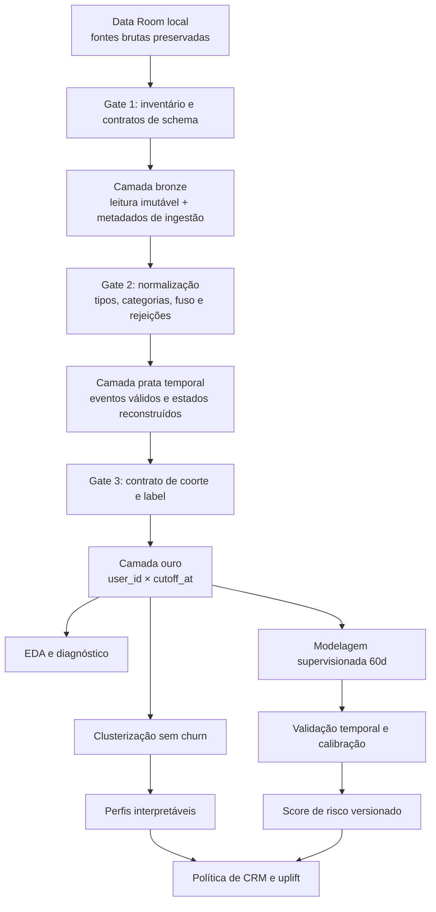
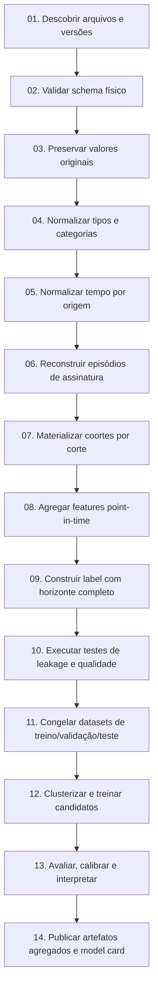
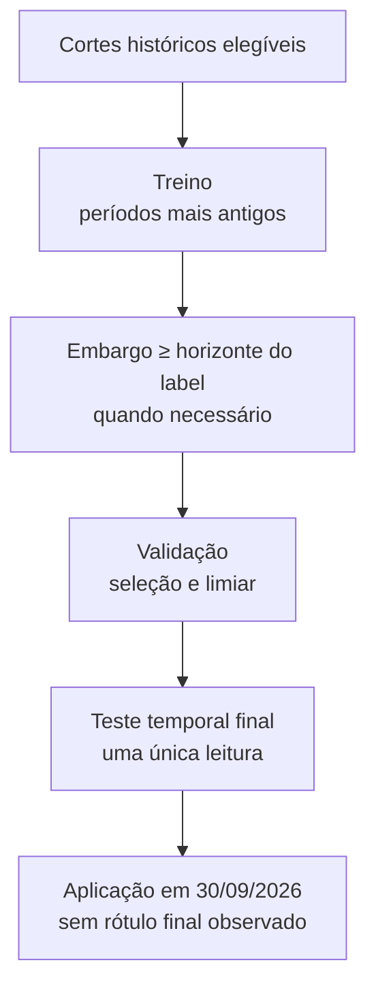

# 💻 Trilha 2: Ciência de Dados e Machine Learning

> **Módulo 2:** IA e Dados para Negócios — Case Vitaliza  
> **Equipe:** Projetos MBA Inteli  
> **Escopo:** engenharia analítica, segmentação de assinantes e previsão de churn em 60 dias

[Comece por aqui](../README.md) / [Mapa das trilhas](../02_MAPA_DAS_TRILHAS.md) / Ciência de Dados e ML

---

## 👋 Bem-vindos à Trilha de Ciência de Dados e Machine Learning!

Esta trilha transforma os arquivos do Data Room em uma **base temporal confiável**, segmentos interpretáveis e previsões de churn avaliadas fora do tempo. O foco não é apenas treinar modelos: é garantir que população, datas, variáveis, rótulos e métricas representem a decisão real da Vitaliza.

| Movimento | O que a equipe faz | O que precisa entregar |
| :--- | :--- | :--- |
| **Sanear** | validar schemas, tipos, categorias, chaves, fusos e registros pós-corte | relatório de qualidade, regras de tratamento e rejeições rastreáveis |
| **Reconstruir o tempo** | reconstituir episódios de assinatura e populações em cada corte | tabela `user_id × cutoff_at`, coortes reconciliadas e contrato de churn |
| **Construir features** | agregar uso, cobrança, social e suporte sem acessar o futuro | catálogo de variáveis com janelas, origem e testes de leakage |
| **Segmentar** | comparar agrupamentos sem usar churn na formação | clusters estáveis, perfis nas unidades originais e insumos para personas |
| **Prever** | comparar logística, árvores, bagging e boosting temporalmente | probabilidades calibradas, métricas, análise de erro e ranking elegível |
| **Consolidar entregas** | publicar código, comandos e evidências agregadas | A1 com preparação/clusterização/baseline e A2 com modelos/ablação/integração |

> 🧭 **Comece por:** [Saneamento e reconstrução histórica](./01_SANEAMENTO_E_RECONSTRUCAO_HISTORICA.md) → [Clusterização e churn supervisionado](./02_CLUSTERIZACAO_E_CHURN_SUPERVISIONADO.md).

---

## 🎯 1. Papel desta trilha no projeto

A trilha de Ciência de Dados e Machine Learning transforma as fontes do Data Room em uma base temporal confiável para responder quatro perguntas:

1. quem era assinante pagante e ativo em cada data de corte;
2. como o comportamento, o vínculo social, a cobrança e o suporte evoluíram antes de cada corte;
3. quais perfis de uso podem ser descritos sem consultar o desfecho de churn;
4. quanto os dados históricos permitem estimar a probabilidade de saída nos 60 dias seguintes.

O trabalho começa pela reconstrução histórica, não pelo algoritmo. `assinaturas.csv` é um retrato exportado em 01/10/2026; ele não informa sozinho quem estava ativo em datas anteriores. Da mesma forma, uma feature calculada em setembro não pode ser usada para simular uma decisão tomada em julho. Cada linha da base analítica precisa representar o que a Vitaliza poderia conhecer naquele instante.

A saída desta trilha alimenta os artefatos de Tecnologia e a política de CRM. O score de churn organiza risco; ele não mede o efeito causal de uma abordagem. A decisão de contatar, oferecer incentivo ou não agir depende também de uplift, custo, margem e restrições operacionais tratadas na [trilha de Negócios e CRM](../01_trilha_negocios_e_crm/README.md).

---

## 🔍 2. Estado atual: evidência auditada e trabalho ainda não executado

Esta distinção evita que um desenho metodológico seja confundido com resultado empírico.

### 2.1 O que já foi auditado

A auditoria reproduzível em [`src/01_auditoria_data_room.py`](../../src/01_auditoria_data_room.py), registrada em [`relatorios/auditoria_exhibits.json`](../../relatorios/auditoria_exhibits.json), verificou:

- os volumes dos 11 CSVs e do arquivo Parquet inventariados;
- ausência de duplicidade nas chaves primárias testadas;
- 14.813 assinaturas ativas no retrato, das quais 14.753 são pagantes e 60 são cortesias;
- registros posteriores ao corte declarado em `usuarios.csv`, `feed_posts.csv`, `amizades.csv` e `atividades.parquet`;
- categorias inconsistentes em sistema operacional e modalidade de treino;
- necessidade de converter explicitamente o valor monetário de pagamentos;
- uso da categoria `nenhum`, e não de nulo, para indicar ausência de relógio conectado.

O relatório tem status `passed_with_warnings`. Isso significa que o inventário básico foi conferido e que há alertas conhecidos. Não significa que a reconstrução histórica, a base de features ou os modelos estejam prontos.

### 2.2 O que permanece como implementação planejada

Ainda precisam ser implementados, testados e executados:

- parser temporal que diferencie eventos UTC das lojas e horários locais do site;
- máquina de estados da assinatura por episódio e data de corte;
- contrato definitivo do label de churn e das regras de reativação, carência, reembolso e chargeback;
- tabela analítica `user_id × cutoff_at` com rastreabilidade de cada feature;
- relatório ampliado de qualidade por fonte, coluna e corte;
- clusterização com análise de estabilidade e interpretação de negócio;
- regressão logística, árvore, bagging e boosting com validação temporal;
- calibração, explicabilidade, análise de erro e avaliação por subgrupos;
- score final no corte de 30/09/2026, que só poderá ser chamado de previsão; o rótulo final até 29/11/2026 não está disponível no pacote auditado.

**Nenhum modelo é declarado como treinado nesta trilha.** Números de desempenho, clusters ou rankings só poderão ser publicados depois de execução reproduzível, revisão e registro das datas de treino, validação e teste.

---

## 📚 3. Mapa dos documentos

| Ordem | Documento | Questão respondida | Saída esperada |
| :---: | :--- | :--- | :--- |
| 1 | [Dossiê dos Exhibits](../05_DOSSIE_EXHIBITS_M2.md) | O que existe e quais anomalias já foram medidas? | inventário e evidência auditada |
| 2 | [Dicionário comentado](../05_DOSSIE_DICIONARIO_DE_DADOS_M2.md) | Qual é a granularidade e a semântica de cada fonte? | catálogo de campos e cuidados de integração |
| 3 | [Saneamento e reconstrução histórica](./01_SANEAMENTO_E_RECONSTRUCAO_HISTORICA.md) | Como formar coortes e features sem usar o futuro? | especificação da base analítica temporal |
| 4 | [Clusterização e churn supervisionado](./02_CLUSTERIZACAO_E_CHURN_SUPERVISIONADO.md) | Como segmentar, treinar, validar e explicar os modelos? | protocolo de modelagem e avaliação |
| Consulta | [Caderno de hipóteses](../06_CADERNO_DE_HIPOTESES_ANALITICAS.md) | Quais mecanismos devem ser testados? | registro de hipóteses, critérios e limitações |

---

## 🗄️ 4. Topologia das fontes e produtos analíticos



### 4.1 Famílias de fontes

| Família | Fontes | Granularidade original | Papel na trilha |
| :--- | :--- | :--- | :--- |
| Cadastro | `usuarios.csv`, `onboarding.csv` | conta e resposta inicial | atributos estáveis ou conhecidos desde a entrada |
| Assinatura | `assinaturas.csv`, `eventos_assinatura.csv` | assinatura atual e evento | reconstrução de episódios, coortes e label |
| Cobrança | `pagamentos.csv` | tentativa de pagamento | fricção financeira e churn involuntário |
| Uso | `uso_mensal.csv`, `atividades.parquet` | usuário-mês e treino | frequência, recência, intensidade e tendência |
| Social | `amizades.csv`, `feed_posts.csv` | relação e post | vínculo, reciprocidade e atividade social |
| Atendimento | `tickets_suporte.csv`, `pesquisa_saida.csv` | ticket e resposta | fricção e motivos declarados, com forte cuidado temporal |
| Experimento | `campanha_ago26.csv` | participante sorteado | efeito causal e análise de heterogeneidade, fora do treino ingênuo |
| Imagem | heatmaps de 31/07 e 30/09 | usuário-data | atributos espaciais condicionados à cobertura disponível |

`user_id` é a chave de ligação predominante, mas não é a chave primária de todas as fontes. Antes do `JOIN`, cada tabela com múltiplas linhas por pessoa deve ser filtrada pelo corte e agregada à granularidade `user_id × cutoff_at`. Esse cuidado impede multiplicação cartesiana e inflação de contagens.

---

## 📐 5. Contrato analítico comum

| Elemento | Contrato proposto | Gate de aceitação |
| :--- | :--- | :--- |
| Unidade | uma linha por `user_id` e `cutoff_at` | chave única e sem duplicidade |
| População | assinatura pagante ativa no corte; cortesias excluídas | ponte entre retrato, eventos, inclusões e exclusões |
| Corte | instante exclusivo em `America/Sao_Paulo` | nenhuma feature com `event_at >= cutoff_at` |
| Janela de features | janelas fechadas antes do corte, por exemplo 30/60/90 dias | início e fim registrados no catálogo |
| Label | saída operacional em `[cutoff_at, cutoff_at + 60 dias)`, com `cutoff_at` como limite exclusivo das features | regra de eventos aprovada e testada |
| Elegibilidade | observação completa do horizonte e cobertura mínima das fontes | motivo de exclusão contabilizado |
| Validação | divisões cronológicas com embargo compatível com o horizonte | nenhum rótulo do treino invade o período reservado |
| Publicação | somente código, schemas e agregados sem dado pessoal | revisão de privacidade concluída |

### 5.1 Datas que não podem ser misturadas

- **01/10/2026:** data de exportação e retrato observado em `assinaturas.csv`.
- **30/09/2026:** corte final de features para a previsão do desafio.
- **29/11/2026:** fim do horizonte de 60 dias do corte final.
- **10/08/2026:** data da campanha randomizada; qualquer análise causal da campanha precisa usar covariáveis anteriores a esse instante.

A população de 14.753 pagantes é uma reconciliação auditada do retrato final. Coortes históricas e populações elegíveis para treinamento podem ter tamanhos diferentes. A documentação deve explicar a diferença, não ajustar os números artificialmente.

---

## ⚙️ 6. Arquitetura lógica do pipeline



### 6.1 Schema mínimo da tabela analítica

```text
assinante_cutoff
├── chaves
│   ├── user_id_hash: string
│   ├── cutoff_at: timestamp[America/Sao_Paulo]
│   └── dataset_version: string
├── elegibilidade
│   ├── is_active_paid: boolean
│   ├── exclusion_reason: string|null
│   └── label_observed: boolean
├── contrato
│   ├── plan_at_cutoff: category
│   ├── billing_channel_at_cutoff: category
│   ├── tenure_days: integer
│   └── auto_renew_at_cutoff: boolean|null
├── comportamento
│   ├── workouts_30d / 60d / 90d: integer
│   ├── active_days_30d / 60d / 90d: integer
│   ├── minutes_30d / 60d / 90d: numeric
│   ├── days_since_last_workout: integer|null
│   └── workout_trend_30d_vs_prev30d: numeric|null
├── fricção e vínculo
│   ├── declined_payments_90d: integer
│   ├── support_tickets_90d: integer
│   ├── social_in_degree_at_cutoff: integer
│   └── social_reciprocity_at_cutoff: numeric|null
├── cobertura
│   ├── has_activity_coverage: boolean
│   ├── has_usage_month_coverage: boolean
│   └── missingness_profile: string
└── alvo
    ├── churn_60d: boolean|null
    ├── churn_event_at: timestamp|null
    └── churn_event_type: category|null
```

O identificador publicável deve ser pseudonimizado. A versão local pode manter a chave técnica necessária para integração, com acesso restrito.

---

## 🛡️ 7. Regras de prevenção de leakage

Uma variável só é elegível quando seu valor e sua data de disponibilidade eram conhecidos no corte simulado. O teste precisa considerar ocorrência e disponibilidade. Um ticket aberto antes do corte pode ter sido resolvido depois; usar o status final da exportação seria vazamento.

### Lista de bloqueio inicial

- `status_atual`, `data_fim` e `motivo_fim` do retrato quando descrevem eventos posteriores ao corte histórico;
- `renovacao_automatica` atual quando não houver reconstrução point-in-time;
- respostas da pesquisa de saída como feature de previsão do próprio churn;
- eventos `cancelamento_web`, `assinatura_expirada`, `reembolso` ou `chargeback` dentro do horizonte futuro;
- curtidas acumuladas sem histórico de quando ocorreram;
- `resolvido_em` e status final de ticket se posteriores ao corte;
- atributos produzidos por extração multimodal em conteúdo criado depois do corte;
- qualquer estatística calculada usando todo o dataset antes da divisão temporal, incluindo imputação, escala, seleção de variáveis e calibração.

---

## 🕒 8. Estratégia de validação

A validação deve simular o uso real: aprender com cortes antigos e prever cortes posteriores. A equipe deve registrar os cortes escolhidos depois de verificar a cobertura mínima de cada fonte.



Para exemplos repetidos da mesma pessoa, a equipe deve medir a dependência entre linhas e evitar que eventos ou janelas sobrepostas criem atalhos. Se o objetivo for avaliar generalização para o futuro da mesma base de clientes, a divisão temporal continua central; análises adicionais por usuário podem medir sensibilidade a repetição.

---

## 📈 9. Métricas e interpretação

### 9.1 Clusterização

- silhouette e, quando aplicável, Davies–Bouldin ou Calinski–Harabasz;
- distribuição de tamanho para evitar microgrupos sem uso operacional;
- estabilidade sob reamostragem, mudança de período e pequenas perturbações;
- distância entre perfis nas unidades originais;
- cobertura e taxa de ausentes por grupo;
- capacidade de Negócios descrever uma ação coerente sem transformar cluster em estereótipo.

### 9.2 Classificação

- ROC-AUC para ordenação geral;
- PR-AUC, sempre acompanhada da prevalência;
- Brier score e curva de calibração para qualidade probabilística;
- precisão, recall e lift em capacidades operacionais, como top `k`;
- matriz de confusão apenas em limiar definido na validação;
- desempenho por plano, canal, período e cobertura de dados;
- intervalo de confiança por bootstrap temporal ou procedimento compatível com a dependência dos dados.

A acurácia isolada não é métrica adequada quando a classe é desbalanceada. Um bom ranking também não prova retorno de CRM. O valor depende da capacidade de intervir e do efeito incremental do contato.

---

## ⚠️ 10. Riscos metodológicos e controles

| Risco | Consequência | Controle obrigatório |
| :--- | :--- | :--- |
| snapshot usado como histórico | população e features incorretas | reconstrução por eventos e reconciliação |
| fuso tratado de forma uniforme | evento deslocado de dia ou mês | parser por origem e testes de fronteira |
| junção muitos-para-muitos | contagens e somas infladas | agregação antes do `JOIN` e teste de cardinalidade |
| ausência confundida com zero | penalização de quem não tem cobertura | indicadores de cobertura e imputação no pipeline |
| label incompleto | falso negativo por censura | excluir ou tratar cortes sem horizonte completo |
| seleção aleatória de linhas | futuro no treino | divisão cronológica e embargo |
| pré-processamento global | leakage estatístico | `fit` somente no treino de cada janela |
| cluster guiado pelo churn | segmento vira faixa de risco disfarçada | excluir label e proxies diretos da formação |
| interpretação causal de importância | ação inadequada | linguagem associativa e validação experimental |
| drift | degradação silenciosa | monitoramento de dados, score e calibração |

---

## 🧪 11. Testes mínimos da trilha

1. **Schema:** colunas, tipos, domínio e nulabilidade esperados.
2. **Chaves:** unicidade de chaves primárias e de `user_id × cutoff_at`.
3. **Cardinalidade:** nenhuma integração aumenta a população sem justificativa.
4. **Tempo:** nenhuma feature usa `event_at >= cutoff_at`.
5. **Fuso:** casos de virada do dia e do mês para loja e site.
6. **Estados:** sequências de início, desligamento, religamento, carência, expiração e reentrada.
7. **Coorte:** cortesias e inativos excluídos conforme contrato.
8. **Label:** horizonte aberto à esquerda e fechado à direita, sem dupla contagem.
9. **Cobertura:** zero, nulo e fonte indisponível permanecem distintos.
10. **Modelagem:** transformadores ajustados apenas no treino.
11. **Reprodutibilidade:** sementes, versões, comandos e hashes registrados.
12. **Privacidade:** nenhum artefato público contém e-mail, texto individual ou identificador direto.

---

## ✅ 12. Definition of Done da trilha

A trilha só pode ser marcada como concluída quando:

- [ ] a topologia das fontes e suas granularidades está versionada;
- [ ] a auditoria pode ser reproduzida a partir de um único comando;
- [ ] o contrato temporal, de coorte e de label foi aprovado pela equipe;
- [ ] a máquina de estados reconcilia os cortes definidos e explica divergências;
- [ ] a tabela analítica tem chave única, catálogo de features e lineage;
- [ ] os testes de qualidade e leakage passam sem exceções silenciosas;
- [ ] a clusterização foi avaliada por separação, estabilidade e uso de negócio;
- [ ] os modelos supervisionados foram comparados na mesma divisão temporal;
- [ ] métricas de discriminação, calibração e capacidade operacional foram reportadas;
- [ ] explicações e análise de erros foram revisadas sem linguagem causal indevida;
- [ ] limitações, riscos, cobertura e critérios de reavaliação constam no model card;
- [ ] somente agregados e artefatos sem dados pessoais foram publicados;
- [ ] links locais, diagramas e formatação Markdown foram validados.

---

## 📁 13. Destinos de entrega

- [Artefato de Tecnologia — Semana 5](../../artefatos_tecnologia/semana_5_A1/ARTEFATO_TECH_SEMANA5_A1.md): auditoria, reconstrução, diagnóstico, clusterização e baseline metodológico.
- [Artefato de Tecnologia — Semana 10](../../artefatos_tecnologia/semana_10_A2/ARTEFATO_TECH_SEMANA10_A2.md): comparação supervisionada, ablação multimodal, calibração e integração com decisão.
- [Frente 01 — Dados e diagnóstico](../../01_gerenciamento_de_tarefas/FRENTE_01_DADOS_E_DIAGNOSTICO_CHURN.md): execução da base temporal.
- [Frente 02 — Clusterização e predição](../../01_gerenciamento_de_tarefas/FRENTE_02_CLUSTERIZACAO_E_PREDICAO_ML.md): execução dos experimentos de modelagem.

👉 **Próximo passo:** [especificar o saneamento e a reconstrução histórica](./01_SANEAMENTO_E_RECONSTRUCAO_HISTORICA.md).
