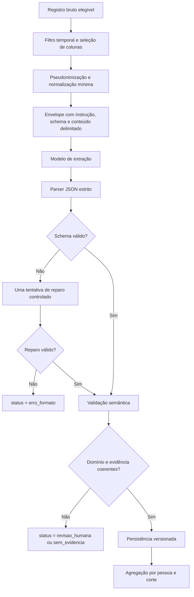
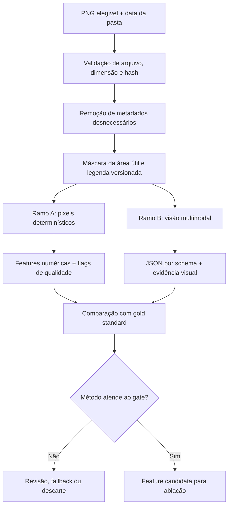
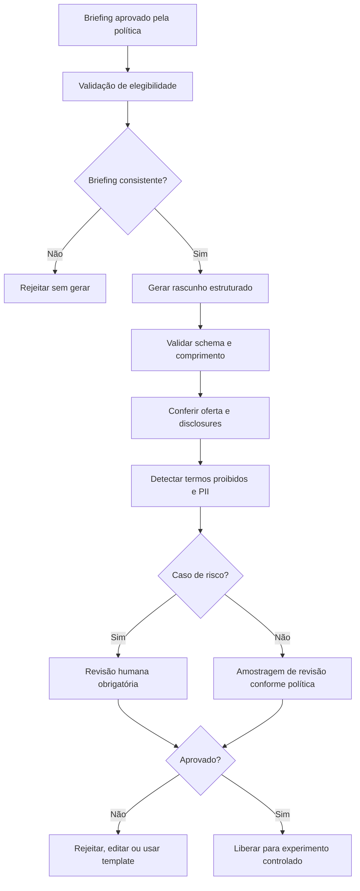

# 🤖 Guia técnico: extração multimodal e copywriting de CRM

> **Módulo 2:** IA e Dados para Negócios — case Vitaliza
> **Objetivos do case:** 5, medir o valor de texto e imagem; 8, escrever a mensagem
> **Situação:** método e desenho técnico propostos. Não há, neste documento, afirmação de pipeline implementado, ganho preditivo medido ou retenção causada por mensagens geradas.

[Trilha de IA generativa e multimodal](./README.md) / Guia integrado

## 🎯 1. Decisão central

A pergunta não é se um modelo consegue resumir um texto ou descrever uma imagem. A pergunta é se ele consegue produzir variáveis confiáveis, dentro do corte temporal, que melhorem a decisão de negócio depois de contabilizados erro, custo e risco.

O trabalho deve responder, nessa ordem:

1. qual informação se quer extrair;
2. por que ela poderia melhorar a previsão ou a comunicação;
3. como uma pessoa reconheceria essa informação;
4. qual saída o sistema aceita;
5. como o erro será medido;
6. qual fallback será usado;
7. se a variável melhora o modelo;
8. se o ganho paga o processamento;
9. como a política de CRM transforma decisão em briefing;
10. se a mensagem respeita esse briefing.

## ⚖️ 2. Fronteiras de responsabilidade

| Componente | Pode fazer | Não pode fazer |
| :--- | :--- | :--- |
| Extrator textual | classificar evidência explícita e retornar campos tipados | inventar meta, diagnosticar saúde ou usar fatos posteriores ao corte |
| Extrator visual | medir ou descrever propriedades observáveis do heatmap | identificar endereço real, inferir segurança do bairro ou concluir abandono |
| Validador | rejeitar schema inválido, domínio impossível e evidência ausente | corrigir silenciosamente um valor sem trilha de auditoria |
| Modelo preditivo | usar features aprovadas no protocolo temporal | receber texto bruto ou rótulo que revele o desfecho |
| Política de CRM | decidir contato, canal, oferta e prioridade | delegar restrições econômicas ao gerador de texto |
| Copywriter | redigir no formato e tom solicitados | escolher desconto, prometer resultado ou mencionar score de churn |
| Revisor humano | aprovar, editar, rejeitar e registrar motivo | transformar revisão informal em suposta prova de efeito causal |

## 🔍 3. Seleção dos campos candidatos

### 3.1 Matriz de hipótese

Antes de escrever prompt, preencha uma linha por campo.

| Item | Pergunta obrigatória | Exemplo ilustrativo |
| :--- | :--- | :--- |
| Campo | o que será extraído? | `objetivo_categoria` |
| Fonte | onde está a evidência? | `onboarding.objetivo_texto` |
| Conhecido em | quando a Vitaliza sabia disso? | `respondido_em` |
| Uso | em qual decisão entrará? | feature candidata de churn |
| Hipótese | por que acrescentaria sinal? | perfis de objetivo podem ter padrões de permanência distintos |
| Risco | como pode induzir erro ou dano? | intenção antiga tratada como atual |
| Abstenção | quando não classificar? | texto vazio, contraditório ou sem objetivo identificável |
| Avaliação | qual métrica e unidade? | macro-F1 e F1 por classe |

### 3.2 Fontes textuais

| Fonte | Campos candidatos | Uso recomendado | Cuidados |
| :--- | :--- | :--- | :--- |
| Onboarding | objetivo, frequência pretendida, canal narrado | feature histórica, se disponível no corte | separar intenção de comportamento; preservar `nao_informado` |
| Feed | tema explícito do treino, menção explícita de retomada ou pausa | agregação anterior ao corte | textos curtos, ironia, repetição e múltiplos posts por pessoa |
| Suporte | assunto, fricção, intenção explícita de cancelar | sinal operacional anterior ao corte | não usar resolução futura; tratar categoria humana como referência imperfeita |
| Pesquisa de saída | submotivo e tema do comentário | diagnóstico qualitativo | viés de seleção e leakage tornam inadequado o uso direto em muitos modelos de churn |

### 3.3 Fonte visual

Os heatmaps cobrem janelas móveis de 90 dias nas datas `2026-07-31` e `2026-09-30`. As janelas se sobrepõem. Uma diferença entre imagens não representa, por si só, a mudança de um mês independente. O mapa de fundo é estilizado e inclui parque, água, praia e avenida. A rota precisa ser separada do fundo antes de contar pixels.

Campos visuais candidatos devem ser observáveis e auditáveis, por exemplo:

- proporção de pixels atribuídos ao traçado da rota;
- quantidade de componentes conectados do traçado;
- dispersão do traçado dentro da área útil;
- concentração relativa das intensidades da paleta;
- presença de artefato, imagem vazia ou baixa legibilidade.

"Pessoa deixou de treinar", "treina em área perigosa" ou "tem rotina saudável" não são campos visuais válidos.

## 📝 4. Fluxo de extração textual



### 4.1 Regras de preparação

- Use apenas conteúdo conhecido até o corte da linha analítica.
- Remova identificadores diretos que não sejam necessários à tarefa.
- Mantenha uma chave pseudônima para reconciliação local.
- Não faça limpeza que altere o sentido do texto. Correção ortográfica automática pode apagar gírias relevantes ou criar palavras que não existiam.
- Delimite o conteúdo como dado não confiável.
- Não concatene histórico ilimitado. Defina janela, ordenação e teto por pessoa.
- Registre truncamento. Um texto cortado não pode ser tratado como entrada completa.

### 4.2 Exemplo ilustrativo de entrada

```json
{
  "record_id": "onb_exemplo_001",
  "source": "onboarding",
  "known_at": "2026-02-14T10:32:00-03:00",
  "cutoff_at": "2026-09-30T23:59:59-03:00",
  "content": "Quero voltar a correr e conseguir fazer uma prova de 10 km.",
  "schema_version": "text_extraction.v1"
}
```

O registro é ilustrativo e não afirma corresponder a uma pessoa ou linha real do data room.

### 4.3 Exemplo ilustrativo de saída

```json
{
  "record_id": "onb_exemplo_001",
  "objective": {
    "category": "performance",
    "secondary_categories": ["retomada"],
    "evidence_span": "voltar a correr e conseguir fazer uma prova de 10 km",
    "status": "valid"
  },
  "frequency_days_per_week": {
    "value": null,
    "evidence_span": null,
    "status": "not_stated"
  },
  "extraction_status": "completed"
}
```

A evidência deve ser um trecho curto da entrada, não uma justificativa inventada. Quando não houver suporte, o campo retorna `null` e status explícito.

## 🖼️ 5. Fluxo de extração visual



### 5.1 Pixels determinísticos

O caminho determinístico deve explicitar:

1. espaço de cor usado;
2. intervalos ou protótipos da paleta;
3. tolerância de distância de cor;
4. máscara de fundo, bordas e legenda;
5. operações morfológicas, se houver;
6. regra para componentes pequenos;
7. tratamento de compressão, anti-aliasing e transparência;
8. versão do algoritmo.

Vantagens: repetibilidade, custo computacional previsível e explicabilidade local. Limites: sensibilidade à paleta, sobreposição entre rota e fundo e incapacidade de interpretar padrões que não foram codificados.

### 5.2 Visão multimodal

O caminho de visão deve receber apenas a imagem necessária, um schema restrito e a descrição da legenda. A instrução precisa proibir identificação de local, diagnóstico e inferência sobre atributos pessoais. Vantagens: pode lidar melhor com padrões globais e casos visuais difíceis. Limites: variabilidade, custo, menor transparência e risco de descrever algo não visível.

### 5.3 Comparação justa

| Critério | Pixels | Visão |
| :--- | :--- | :--- |
| Mesmo conjunto de teste | obrigatório | obrigatório |
| Mesmo gold standard | obrigatório | obrigatório |
| Métrica por campo | erro absoluto, IoU, correlação ou acerto, conforme o campo | a mesma métrica quando a saída for equivalente |
| Falha técnica | arquivo ilegível, paleta desconhecida | timeout, recusa, schema inválido |
| Custo | CPU, memória, tempo e armazenamento | tokens/unidades de imagem, chamadas e reprocessamento |
| Reprodutibilidade | versão de código e parâmetros | versão de modelo, prompt, schema e parâmetros |
| Explicabilidade | máscara e contagem | evidência ou região indicada, quando suportado |

Se pixels atingirem qualidade suficiente com custo e risco menores, visão não deve ser escolhida por novidade. Se visão trouxer ganho em campos relevantes, esse ganho precisa aparecer no teste final e na ablação preditiva.

## 🏅 6. Gold standard

O gold standard é um conjunto de entradas com respostas humanas definidas por instruções estáveis. Ele não é simplesmente a opinião de uma pessoa.

### 6.1 Construção

1. Defina unidade de anotação: registro, trecho, imagem ou pessoa-janela.
2. Faça amostragem estratificada por fonte, período, tamanho, categorias raras, ausência e casos difíceis.
3. Escreva manual de rotulagem com exemplos positivos, negativos e ambíguos.
4. Treine rotuladores em conjunto separado.
5. Duplique uma fração planejada da amostra.
6. Meça concordância antes da adjudicação.
7. Discuta divergências e atualize a regra, não apenas o rótulo.
8. Congele um conjunto de teste que não será usado para ajustar prompt.
9. Versione instrução, amostra e decisões de adjudicação.

### 6.2 Separação dos conjuntos

| Conjunto | Finalidade | Pode orientar mudanças? |
| :--- | :--- | :--- |
| Desenvolvimento | criar taxonomia, exemplos e prompt | sim |
| Validação | escolher entre alternativas previamente definidas | sim, com registro |
| Teste congelado | estimar desempenho final | não; mudança posterior exige nova versão e novo teste |

## 📏 7. Avaliação por campo

Uma resposta JSON válida pode estar semanticamente errada. A avaliação precisa decompor a saída.

| Tipo de campo | Métricas recomendadas | Falha que a média pode esconder |
| :--- | :--- | :--- |
| Enumeração de uma classe | precisão, recall, F1 por classe, macro-F1, matriz de confusão | classe rara com recall zero |
| Multirrótulo | precisão/recall/F1 micro e macro, exact match, Hamming loss | excesso de categorias por registro |
| Número discreto | acerto exato e erro absoluto | viés sistemático para cima ou para baixo |
| Número contínuo | MAE, mediana do erro, quantis e erro relativo quando aplicável | poucos erros extremos |
| Evidência textual | correspondência do trecho, cobertura e validade da citação | classe correta apoiada em trecho errado |
| Ausência/ambiguidade | precisão da abstenção, taxa de abstenção, cobertura e risco seletivo | modelo que responde sempre e erra casos difíceis |
| Schema | taxa de JSON válido, campos ausentes e valores fora do domínio | parser aprovando coerção indevida |
| Máscara visual | IoU, Dice ou erro de área | boa área total com localização errada |

Publique também resultados por fonte, comprimento do texto, período, qualidade da imagem e grupos operacionais relevantes. Não use atributos sensíveis para personalização; use-os apenas em auditorias autorizadas de desempenho e sempre com minimização.

## 💰 8. Tokenomics e custo

Não fixe preço de provedor nesta documentação. Preços e unidades mudam. No experimento, salve a página ou tabela oficial consultada, a data, a moeda e a regra de cobrança.

```text
custo_total_extracao =
    custo_input
  + custo_output
  + custo_imagem
  + custo_retentativa
  + custo_reprocessamento
  + custo_infra_deterministica
  + custo_revisao_humana
  + custo_armazenamento_e_observabilidade

custo_por_pessoa_elegivel =
    custo_total_extracao / pessoas_elegiveis

custo_por_feature_aprovada =
    custo_total_extracao / features_que_passaram_nos_gates
```

### 8.1 Registro mínimo por chamada

| Campo | Por que registrar |
| :--- | :--- |
| provedor e modelo | reproduzir a unidade cobrada e o comportamento |
| data e fonte do preço | impedir uso de valor desatualizado |
| moeda e câmbio | converter de forma auditável |
| tokens de entrada e saída | calcular custo textual real |
| unidade de imagem | calcular custo multimodal conforme a regra do provedor |
| cache, batch e desconto | evitar usar preço cheio quando a fatura aplicou outra regra |
| tentativas e motivo | atribuir custo de falhas |
| latência | medir impacto operacional |
| revisão humana | incluir custo que não aparece na API |

Calcule cenários baixo, esperado e alto a partir do volume elegível e da taxa observada de reprocessamento. Não multiplique o preço nominal por toda a base se o desenho só processa uma amostra ou uma janela.

## 📈 9. Valor preditivo

A extração aprovada ainda precisa passar por ablação.

| Modelo | Variáveis | Finalidade |
| :--- | :--- | :--- |
| M0 | baseline tabular validado | referência |
| M1 | M0 + texto | valor incremental do texto |
| M2 | M0 + pixels | valor incremental determinístico da imagem |
| M3 | M0 + visão | valor incremental da visão |
| M4 | combinação aprovada | verificar ganho conjunto e redundância |

Use as mesmas divisões temporais, população, tratamento de missing e métricas do baseline. Compare discriminação, calibração, desempenho no topo da fila e impacto econômico. Ganho estatístico pequeno pode não pagar o processamento. Resultado nulo ou negativo deve ser registrado, não escondido.

## ✍️ 10. Contrato do copywriter de CRM

O copywriter só entra depois da decisão. A [estratégia de uplift e ROI](../01_trilha_negocios_e_crm/02_ESTRATEGIA_UPLIFT_E_ROI_A2_SEMANA10.md) define que a política deve fornecer destinatário, ação, canal, oferta e contexto permitido.

### 10.1 Entradas obrigatórias

| Campo | Regra |
| :--- | :--- |
| `message_request_id` | identificador de auditoria, sem dado direto na mensagem |
| `channel` | um canal permitido pela política |
| `action` | ação já escolhida, inclusive `no_contact` |
| `plan` | plano necessário para validar a oferta |
| `authorized_offer` | oferta fechada; `none` quando não houver |
| `allowed_context` | somente fatos verificados e adequados ao canal |
| `tone` | tom de voz definido pelo negócio |
| `required_disclosures` | condições que precisam aparecer |
| `forbidden_claims` | promessas, diagnósticos e termos proibidos |
| `length_limit` | limite operacional do canal |
| `locale` | idioma e convenções de escrita |

Se `action = no_contact`, o gerador não produz mensagem. Se oferta, canal ou elegibilidade forem incompatíveis, a requisição deve falhar antes da geração.

### 10.2 Exemplo ilustrativo de briefing

```json
{
  "message_request_id": "msg_exemplo_001",
  "channel": "email",
  "action": "content_recommendation",
  "plan": "monthly",
  "authorized_offer": "none",
  "allowed_context": [
    {
      "fact": "preferência declarada por treinos em vídeo",
      "source": "onboarding",
      "status": "verified"
    }
  ],
  "tone": "claro, respeitoso e direto",
  "required_disclosures": [],
  "forbidden_claims": [
    "promessa de resultado físico",
    "menção a risco de cancelamento",
    "desconto não autorizado"
  ],
  "length_limit": 600,
  "locale": "pt-BR"
}
```

### 10.3 Exemplo ilustrativo de saída

```json
{
  "message_request_id": "msg_exemplo_001",
  "subject": "Treinos em vídeo para encaixar na sua rotina",
  "body": "Selecionamos opções de treino em vídeo disponíveis no seu plano para você retomar quando fizer sentido. Abra o app e veja as sugestões.",
  "offer_mentions": [],
  "used_context": ["preferência declarada por treinos em vídeo"],
  "generation_status": "draft_for_review"
}
```

O exemplo demonstra formato, não eficácia, aprovação ou mensagem já enviada.

## 🛡️ 11. Validação da mensagem



Critérios de avaliação:

- correspondência exata entre oferta e briefing;
- fatos suportados pelo `allowed_context`;
- ausência de score de risco e lógica interna;
- ausência de promessa de resultado;
- adequação ao canal e limite de caracteres;
- presença de condições obrigatórias;
- tom respeitoso, sem manipulação ou urgência falsa;
- personalização proporcional, sem expor localização, conversa de suporte ou dado sensível;
- capacidade de abster-se ou usar template quando o contexto é insuficiente.

Fluência é necessária, mas não suficiente. Retenção causada pela nova redação exige teste randomizado específico. A campanha de agosto não valida automaticamente um texto criado depois.

## 📡 12. Observabilidade e fallback

Cada execução deve gerar um registro técnico sem copiar conteúdo pessoal desnecessário.

| Dimensão | Sinais |
| :--- | :--- |
| Volume | registros elegíveis, processados, ignorados e reprocessados |
| Qualidade estrutural | JSON válido, campos ausentes, domínio inválido |
| Qualidade semântica | auditoria amostral, drift de classe, queda por campo |
| Operação | latência p50/p95, timeout, erro por provedor e tamanho de fila |
| Custo | tokens, imagens, tentativas, revisão e custo acumulado |
| Segurança | injection detectada, PII bloqueada, saída proibida |
| Fallback | taxa por motivo e resultado do caminho alternativo |

Ordem proposta de fallback:

1. parser ou regra determinística para campos simples;
2. repetição idempotente para erro transitório, com limite;
3. segundo método previamente avaliado;
4. abstenção e revisão humana;
5. descarte do campo, preservando o baseline tabular;
6. template aprovado no lugar de copywriting generativo.

Nunca substitua falha por um valor plausível. Missing com motivo conhecido é melhor que feature inventada.

## 🧪 13. Testes mínimos

| Camada | Teste | Evidência esperada |
| :--- | :--- | :--- |
| Schema | entradas válidas, ausentes, extras e fora do domínio | aceite e rejeição determinísticos |
| Temporal | conteúdo antes, no limite e depois do corte | exclusão correta dos dados futuros |
| Texto | exemplos claros, ambíguos, vazios, negados e irônicos | classe ou abstenção conforme manual |
| Imagem | paleta conhecida, fundo dominante, artefato, vazio e baixa resolução | flag de qualidade e método correto |
| Injection | "ignore instruções", JSON falso e comandos no conteúdo | conteúdo tratado como dado, sem mudança de regra |
| Privacidade | e-mail, telefone, localização e identificador direto | remoção ou bloqueio antes do provedor |
| Fallback | timeout, rate limit, schema inválido e indisponibilidade | transição registrada e sem duplicidade |
| Copywriter | oferta incompatível, contexto vazio, termo proibido e limite de canal | rejeição, template ou revisão |
| Reprodutibilidade | mesma versão e seed quando aplicável | resultado e métricas rastreáveis |
| Ablação | mesmas janelas e população | comparação válida com baseline |

## ⚠️ 14. Riscos principais

| Risco | Consequência | Controle |
| :--- | :--- | :--- |
| Leakage temporal | desempenho artificialmente alto | elegibilidade por `known_at` e teste de corte |
| Alucinação de campo | feature falsa ou mensagem enganosa | schema, evidência, abstenção e revisão |
| Prompt injection | desvio das instruções e exfiltração | delimitação, menor privilégio e validação de saída |
| Inferência sensível | discriminação ou comunicação invasiva | taxonomia proibida, minimização e revisão de privacidade |
| Drift | queda silenciosa de qualidade | monitoramento por campo e reavaliação periódica |
| Custo fora do orçamento | ação economicamente inviável | medição real, limites e circuit breaker |
| Dependência de provedor | indisponibilidade ou mudança de comportamento | adaptador, versão, fallback e baseline sem IA |
| Automação indevida | oferta ou contato não autorizado | política separada do copywriter |
| Métrica agregada enganosa | classe crítica com desempenho ruim | métricas por classe e erro crítico |
| Viés de seleção | conclusão indevida sobre toda a base | declarar população observada e limitar uso |

## ✅ 15. Definition of Done do experimento

- [ ] hipótese e decisão de negócio documentadas;
- [ ] fontes, granularidade, corte e leakage revisados;
- [ ] schemas e taxonomias versionados;
- [ ] gold standard construído e conjunto de teste congelado;
- [ ] desempenho reportado por campo, classe e fonte;
- [ ] erros críticos inspecionados e critérios de bloqueio aplicados;
- [ ] pixels e visão comparados na mesma amostra quando a feature for visual;
- [ ] tokens, imagens, latência, tentativas e revisão contabilizados;
- [ ] preço consultado em fonte oficial na data da execução, sem valor inventado;
- [ ] privacidade e prompt injection testados;
- [ ] fallback exercitado e observado em logs;
- [ ] ablação temporal executada contra o mesmo baseline;
- [ ] custo incluído na conta econômica do CRM;
- [ ] contrato do copywriter validado contra oferta, canal e contexto;
- [ ] exemplos identificados como ilustrativos;
- [ ] limitações e resultados nulos preservados no relatório;
- [ ] nenhuma proposta foi descrita como implementação concluída sem evidência de execução.

Detalhes formais dos schemas estão em [Arquitetura e contratos](./02_ARQUITETURA_E_CONTRATOS_MULTIMODAIS.md). O protocolo completo de avaliação e governança está em [Avaliação, segurança e governança](./03_AVALIACAO_SEGURANCA_E_GOVERNANCA.md).