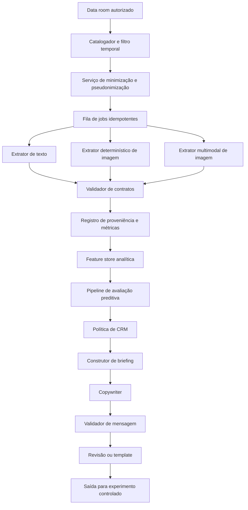
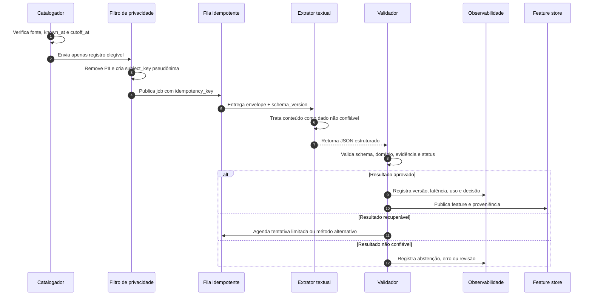
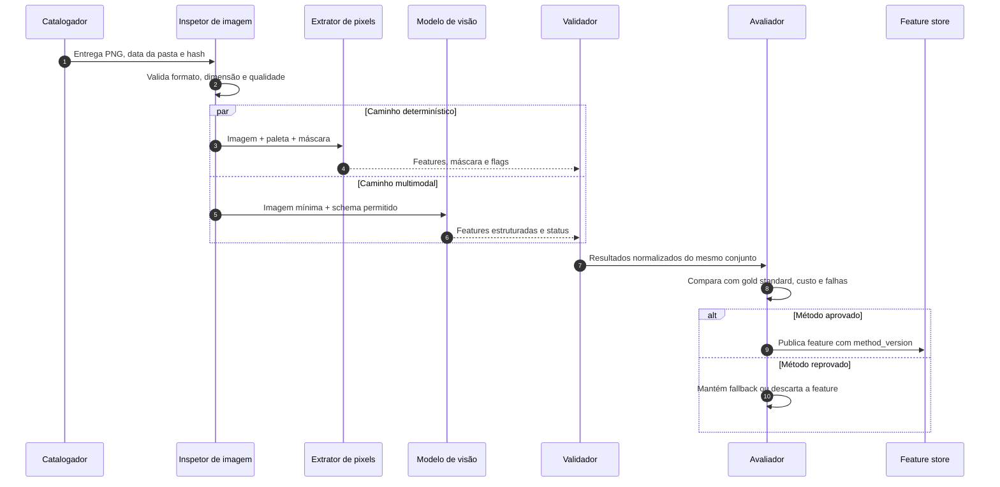
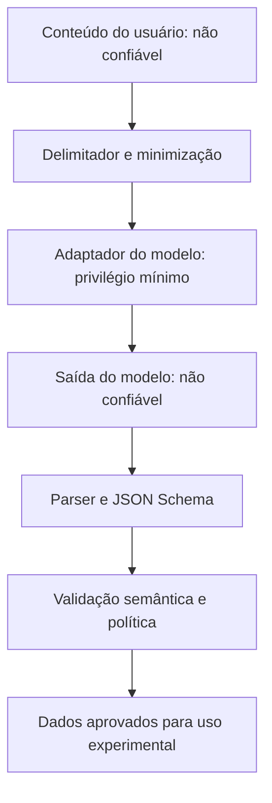

# 📐 Arquitetura e contratos multimodais

> **Módulo 2:** IA e Dados para Negócios — case Vitaliza
> **Escopo:** desenho proposto para extração de texto, extração de imagem e copywriting de CRM
> **Situação:** especificação técnica. Os componentes e contratos abaixo não constituem prova de implementação.

[Trilha](./README.md) / [Guia integrado](./01_EXTRACAO_MULTIMODAL_E_COPYWRITING_CRM.md) / Arquitetura e contratos

## 🧭 1. Princípios arquiteturais

1. **Contrato antes do modelo.** O consumidor define tipos, domínios e estados de falha antes da escolha do provedor.
2. **Dados não são instruções.** Texto do usuário, metadados e conteúdo visual entram como payload não confiável.
3. **Tempo faz parte do dado.** Todo registro precisa de `known_at`, corte e regra de elegibilidade.
4. **Abstenção é resultado válido.** O sistema não preenche lacunas com inferência plausível.
5. **Extração e decisão ficam separadas.** O extrator cria variável; a política decide ação; o copywriter redige.
6. **Determinístico primeiro quando suficiente.** Regras e pixels são preferíveis quando atingem o gate com menor custo e risco.
7. **Toda promoção exige evidência.** Schema válido, teste de qualidade, segurança, custo e fallback são gates separados.
8. **Observabilidade por desenho.** Cada saída aponta para versão de dados, contrato, prompt, modelo e execução.

## 🏗️ 2. Visão de componentes



### 2.1 Portas lógicas

| Porta | Entrada | Saída | Invariante |
| :--- | :--- | :--- | :--- |
| `SourceCatalog` | referência da fonte e corte | registros elegíveis | nenhum registro posterior ao corte |
| `PrivacyFilter` | registro elegível | payload mínimo pseudonimizado | nenhum identificador direto desnecessário |
| `TextExtractor` | envelope textual | `TextExtractionResult` | saída validável pelo schema |
| `PixelExtractor` | imagem e legenda | `ImageFeatureResult` | mesma versão de paleta e máscara |
| `VisionExtractor` | imagem mínima e contrato | `ImageFeatureResult` | nenhuma inferência fora do domínio permitido |
| `ContractValidator` | resultado bruto | resultado aceito ou erro tipado | não corrigir semanticamente em silêncio |
| `FeaturePublisher` | resultado aprovado | feature por pessoa-corte | proveniência completa |
| `BriefingBuilder` | decisão da política | `MessageBrief` | oferta e canal já decididos |
| `Copywriter` | briefing válido | `MessageDraft` | não alterar a decisão |
| `MessageValidator` | rascunho e briefing | aprovado, revisão ou rejeitado | correspondência exata com restrições |

## 📝 3. Sequência de extração de texto



## 🖼️ 4. Sequência de extração de imagem



## 📦 5. Envelope comum de execução

### 5.1 Schema conceitual

| Campo | Tipo | Obrigatório | Regra |
| :--- | :--- | :--- | :--- |
| `job_id` | string | sim | identificador único da tentativa |
| `idempotency_key` | string | sim | estável para fonte, registro, corte e versão |
| `subject_key` | string | sim | pseudônimo; não usar e-mail ou telefone |
| `source` | enum | sim | fonte permitida |
| `record_id` | string | sim | chave local do registro |
| `known_at` | datetime | sim | momento em que o conteúdo ficou disponível |
| `cutoff_at` | datetime | sim | corte da linha analítica |
| `schema_version` | string | sim | versão do contrato de saída |
| `prompt_version` | string ou null | conforme método | nulo em método sem prompt |
| `model_version` | string ou null | conforme método | modelo efetivamente usado |
| `method_version` | string | sim | versão do código ou adaptador |
| `content_hash` | string | sim | hash para rastrear entrada sem logar conteúdo bruto |
| `payload` | objeto | sim | conteúdo mínimo necessário |

### 5.2 Exemplo ilustrativo

```json
{
  "job_id": "job_exemplo_001_attempt_1",
  "idempotency_key": "onboarding:onb_exemplo_001:2026-09-30:text_extraction.v1",
  "subject_key": "subject_pseudo_001",
  "source": "onboarding",
  "record_id": "onb_exemplo_001",
  "known_at": "2026-02-14T10:32:00-03:00",
  "cutoff_at": "2026-09-30T23:59:59-03:00",
  "schema_version": "text_extraction.v1",
  "prompt_version": "text_extract.ptbr.v1",
  "model_version": "provider/model-version-recorded-at-runtime",
  "method_version": "text-adapter.v1",
  "content_hash": "sha256:valor_ilustrativo",
  "payload": {
    "content": "Quero voltar a correr e fazer uma prova de 10 km."
  }
}
```

## 🔤 6. Contrato de extração textual

### 6.1 JSON Schema proposto

```json
{
  "$schema": "https://json-schema.org/draft/2020-12/schema",
  "$id": "https://vitaliza.example/schemas/text-extraction.v1.json",
  "title": "TextExtractionResult",
  "type": "object",
  "additionalProperties": false,
  "required": [
    "record_id",
    "source",
    "schema_version",
    "fields",
    "extraction_status"
  ],
  "properties": {
    "record_id": { "type": "string", "minLength": 1 },
    "source": {
      "type": "string",
      "enum": ["onboarding", "feed_post", "support_ticket", "exit_survey"]
    },
    "schema_version": { "const": "text_extraction.v1" },
    "fields": {
      "type": "object",
      "additionalProperties": false,
      "required": ["objective_category", "frequency_days_per_week"],
      "properties": {
        "objective_category": { "$ref": "#/$defs/categoricalField" },
        "frequency_days_per_week": { "$ref": "#/$defs/integerField" }
      }
    },
    "extraction_status": {
      "type": "string",
      "enum": ["completed", "partial", "abstained", "failed"]
    },
    "error_codes": {
      "type": "array",
      "items": { "$ref": "#/$defs/errorCode" },
      "uniqueItems": true
    }
  },
  "$defs": {
    "fieldStatus": {
      "type": "string",
      "enum": ["valid", "not_stated", "ambiguous", "not_applicable", "error"]
    },
    "categoricalField": {
      "type": "object",
      "additionalProperties": false,
      "required": ["value", "status", "evidence_span"],
      "properties": {
        "value": {
          "type": ["string", "null"],
          "enum": ["performance", "wellbeing", "social", "weight_management", "return_to_activity", "other", "not_informed", null]
        },
        "status": { "$ref": "#/$defs/fieldStatus" },
        "evidence_span": { "type": ["string", "null"], "maxLength": 280 }
      }
    },
    "integerField": {
      "type": "object",
      "additionalProperties": false,
      "required": ["value", "status", "evidence_span"],
      "properties": {
        "value": { "type": ["integer", "null"], "minimum": 1, "maximum": 7 },
        "status": { "$ref": "#/$defs/fieldStatus" },
        "evidence_span": { "type": ["string", "null"], "maxLength": 120 }
      }
    },
    "errorCode": {
      "type": "string",
      "enum": [
        "CONTENT_EMPTY",
        "CONTENT_TRUNCATED",
        "SCHEMA_INVALID",
        "OUT_OF_DOMAIN",
        "EVIDENCE_MISMATCH",
        "PROMPT_INJECTION_SUSPECTED",
        "PROVIDER_TIMEOUT",
        "PROVIDER_UNAVAILABLE"
      ]
    }
  }
}
```

O domínio de categorias é ilustrativo e precisa ser validado no manual de rotulagem. Alterar taxonomia exige nova versão do schema.

### 6.2 Invariantes semânticas

- `status = valid` exige `value` e `evidence_span` não nulos.
- `status = not_stated` exige `value = null`.
- Evidência deve ocorrer no conteúdo original após normalização conservadora.
- `frequency_days_per_week` só aceita número explicitamente informado ou regra de parsing documentada, como "três vezes".
- Uma categoria sensível não prevista no contrato deve retornar `other` ou abstenção, nunca um novo campo espontâneo.
- O modelo não recebe a variável alvo nem eventos posteriores ao corte.

## 🎨 7. Contrato de extração visual

### 7.1 JSON Schema proposto

```json
{
  "$schema": "https://json-schema.org/draft/2020-12/schema",
  "$id": "https://vitaliza.example/schemas/image-feature.v1.json",
  "title": "ImageFeatureResult",
  "type": "object",
  "additionalProperties": false,
  "required": [
    "record_id",
    "image_date",
    "method",
    "schema_version",
    "quality",
    "features",
    "extraction_status"
  ],
  "properties": {
    "record_id": { "type": "string" },
    "image_date": { "type": "string", "format": "date" },
    "method": { "type": "string", "enum": ["pixels", "vision"] },
    "schema_version": { "const": "image_feature.v1" },
    "quality": {
      "type": "object",
      "additionalProperties": false,
      "required": ["readable", "artifact_detected", "notes"],
      "properties": {
        "readable": { "type": "boolean" },
        "artifact_detected": { "type": "boolean" },
        "notes": { "type": ["string", "null"], "maxLength": 280 }
      }
    },
    "features": {
      "type": "object",
      "additionalProperties": false,
      "required": [
        "route_pixel_ratio",
        "route_component_count",
        "route_dispersion_ratio",
        "intensity_entropy"
      ],
      "properties": {
        "route_pixel_ratio": { "type": ["number", "null"], "minimum": 0, "maximum": 1 },
        "route_component_count": { "type": ["integer", "null"], "minimum": 0 },
        "route_dispersion_ratio": { "type": ["number", "null"], "minimum": 0, "maximum": 1 },
        "intensity_entropy": { "type": ["number", "null"], "minimum": 0 }
      }
    },
    "extraction_status": {
      "type": "string",
      "enum": ["completed", "partial", "abstained", "failed"]
    },
    "error_codes": {
      "type": "array",
      "items": {
        "type": "string",
        "enum": [
          "FILE_INVALID",
          "IMAGE_UNREADABLE",
          "UNKNOWN_PALETTE",
          "BACKGROUND_COLLISION",
          "SCHEMA_INVALID",
          "VISION_UNSUPPORTED_INFERENCE",
          "PROVIDER_TIMEOUT"
        ]
      },
      "uniqueItems": true
    }
  }
}
```

Os campos visuais também são propostas. O gold standard deve confirmar se podem ser anotados com consistência e se representam algo útil.

### 7.2 Invariantes visuais

- `method` distingue resultados de pixels e visão; não combine sem preservar origem.
- Métricas proporcionais devem usar a mesma área útil.
- Imagem ilegível não produz zeros. Produz `null` e status de falha ou abstenção.
- Ausência do arquivo não é equivalente a zero de rota.
- Comparações entre datas devem carregar as janelas de 90 dias e a sobreposição.
- Nenhuma saída pode conter endereço, bairro ou identidade inferida.

## 🗄️ 8. Contrato de publicação de features

```json
{
  "subject_key": "subject_pseudo_001",
  "feature_time": "2026-09-30T23:59:59-03:00",
  "feature_name": "onboarding_objective_category",
  "feature_value": "performance",
  "value_type": "category",
  "source": "onboarding",
  "source_record_ids": ["onb_exemplo_001"],
  "known_at_max": "2026-02-14T10:32:00-03:00",
  "schema_version": "text_extraction.v1",
  "method_version": "text-adapter.v1",
  "quality_status": "approved_for_experiment",
  "run_id": "run_exemplo_001"
}
```

Regras:

- uma feature publicada nunca perde `feature_time` e `known_at_max`;
- a agregação por pessoa é versionada;
- `quality_status` separa rascunho, avaliação e uso experimental;
- reprocessamento cria nova versão ou `run_id`, sem sobrescrever a trilha anterior;
- features reprovadas continuam no relatório de avaliação, mas não entram na matriz analítica.

## 📋 9. Contrato do briefing de CRM

### 9.1 JSON Schema proposto

```json
{
  "$schema": "https://json-schema.org/draft/2020-12/schema",
  "$id": "https://vitaliza.example/schemas/message-brief.v1.json",
  "title": "MessageBrief",
  "type": "object",
  "additionalProperties": false,
  "required": [
    "message_request_id",
    "subject_key",
    "action",
    "channel",
    "plan",
    "authorized_offer",
    "allowed_context",
    "tone",
    "forbidden_claims",
    "length_limit",
    "locale"
  ],
  "properties": {
    "message_request_id": { "type": "string", "minLength": 1 },
    "subject_key": { "type": "string", "minLength": 1 },
    "action": {
      "type": "string",
      "enum": ["no_contact", "challenge", "discount", "content_recommendation", "pause_offer", "cs_contact"]
    },
    "channel": {
      "type": "string",
      "enum": ["none", "push", "email", "whatsapp", "cs_script"]
    },
    "plan": { "type": "string", "enum": ["monthly", "annual"] },
    "authorized_offer": {
      "type": "string",
      "enum": ["none", "monthly_30pct_3_months", "annual_1_month_free", "pause_up_to_60_days", "personalized_content"]
    },
    "allowed_context": {
      "type": "array",
      "maxItems": 5,
      "items": {
        "type": "object",
        "additionalProperties": false,
        "required": ["fact", "source", "status"],
        "properties": {
          "fact": { "type": "string", "maxLength": 240 },
          "source": { "type": "string" },
          "status": { "const": "verified" }
        }
      }
    },
    "tone": { "type": "string", "maxLength": 160 },
    "required_disclosures": {
      "type": "array",
      "items": { "type": "string", "maxLength": 240 },
      "uniqueItems": true
    },
    "forbidden_claims": {
      "type": "array",
      "items": { "type": "string", "maxLength": 240 },
      "minItems": 1,
      "uniqueItems": true
    },
    "length_limit": { "type": "integer", "minimum": 20, "maximum": 5000 },
    "locale": { "const": "pt-BR" }
  }
}
```

### 9.2 Regras de consistência

| Condição | Resultado |
| :--- | :--- |
| `action = no_contact` | `channel = none`, `authorized_offer = none`, não chamar o copywriter |
| ação de desconto mensal | plano precisa ser `monthly` e oferta `monthly_30pct_3_months` |
| ação de desconto anual | plano precisa ser `annual` e oferta `annual_1_month_free` |
| `authorized_offer = none` | mensagem não pode conter desconto, gratuidade ou pausa |
| contexto não verificado | remover do briefing ou encaminhar para revisão |
| canal WhatsApp | respeitar capacidade e custo definidos pela política |
| `length_limit` inválido | rejeitar antes de gerar |

## ✍️ 10. Contrato da saída do copywriter

```json
{
  "$schema": "https://json-schema.org/draft/2020-12/schema",
  "$id": "https://vitaliza.example/schemas/message-draft.v1.json",
  "title": "MessageDraft",
  "type": "object",
  "additionalProperties": false,
  "required": [
    "message_request_id",
    "channel",
    "subject",
    "body",
    "offer_mentions",
    "used_context",
    "generation_status"
  ],
  "properties": {
    "message_request_id": { "type": "string" },
    "channel": { "type": "string", "enum": ["push", "email", "whatsapp", "cs_script"] },
    "subject": { "type": ["string", "null"], "maxLength": 120 },
    "body": { "type": "string", "minLength": 1, "maxLength": 5000 },
    "offer_mentions": {
      "type": "array",
      "items": { "type": "string" },
      "uniqueItems": true
    },
    "used_context": {
      "type": "array",
      "items": { "type": "string" },
      "uniqueItems": true
    },
    "generation_status": {
      "type": "string",
      "enum": ["draft_for_review", "template_fallback", "rejected"]
    },
    "rejection_reasons": {
      "type": "array",
      "items": { "type": "string" }
    }
  }
}
```

O validador compara `offer_mentions` e `used_context` com o briefing. O corpo também precisa de checagem textual; listas declaradas pelo modelo não são prova de aderência.

## ⚠️ 11. Códigos de estado e erro

| Código | Camada | Ação padrão |
| :--- | :--- | :--- |
| `TEMPORAL_INELIGIBLE` | catálogo | não processar |
| `PII_BLOCKED` | privacidade | remover ou bloquear job |
| `CONTENT_EMPTY` | entrada | abster-se |
| `PROMPT_INJECTION_SUSPECTED` | segurança | manter conteúdo como dado, aumentar revisão |
| `SCHEMA_INVALID` | contrato | uma tentativa de reparo controlado |
| `EVIDENCE_MISMATCH` | semântica | rejeitar campo ou revisão humana |
| `UNKNOWN_PALETTE` | pixels | usar visão avaliada ou revisão |
| `PROVIDER_TIMEOUT` | adaptador | retentativa limitada e idempotente |
| `BUDGET_LIMIT_REACHED` | custo | circuit breaker e baseline sem IA |
| `OFFER_MISMATCH` | mensagem | rejeitar sem envio |
| `FORBIDDEN_CLAIM` | mensagem | rejeitar ou template |
| `MANUAL_REVIEW_REQUIRED` | governança | fila humana com motivo |

## 🔄 12. Idempotência, versionamento e reprocessamento

A chave idempotente deve combinar fonte, registro, corte, schema e método. Uma nova tentativa técnica mantém a mesma chave e recebe novo `job_id`. Mudança de taxonomia, prompt, modelo relevante ou algoritmo cria nova versão de execução.

| Mudança | Nova tentativa | Nova versão |
| :--- | :---: | :---: |
| timeout sem alterar configuração | sim | não |
| JSON truncado, mesma chamada repetida | sim | não |
| novo prompt | não | sim |
| novo modelo | não | sim |
| nova paleta ou limiar de pixels | não | sim |
| correção no manual de rotulagem | não | sim |
| alteração de corte temporal | não | sim |

Reprocessamento em massa precisa de orçamento, amostra canário e comparação de distribuição antes de substituir uma versão aprovada.

## 🛡️ 13. Segurança no desenho

### 13.1 Fronteiras de confiança



O modelo não recebe ferramenta de envio, escrita na feature store ou acesso direto ao CRM. Adaptadores determinísticos fazem essas operações depois das validações.

### 13.2 Retenção de dados

Defina por ambiente:

- quais campos podem sair da infraestrutura local;
- se o provedor retém prompts e imagens;
- prazo de retenção de payload, resultado e logs;
- criptografia em trânsito e repouso;
- controle de acesso por função;
- procedimento de exclusão e reprocessamento;
- contrato e região de processamento, quando aplicável.

Não copie texto bruto para logs de aplicação. Prefira hash, tamanho, fonte, status e amostra redigida somente em ambiente controlado.

## 📡 14. Contratos de observabilidade

```json
{
  "run_id": "run_exemplo_001",
  "job_id": "job_exemplo_001_attempt_1",
  "event": "extraction_completed",
  "occurred_at": "2026-10-25T12:00:00-03:00",
  "source": "onboarding",
  "method": "text_model",
  "schema_version": "text_extraction.v1",
  "prompt_version": "text_extract.ptbr.v1",
  "model_version": "provider/model-version-recorded-at-runtime",
  "latency_ms": 0,
  "usage": {
    "input_tokens": 0,
    "output_tokens": 0,
    "image_units": 0
  },
  "result": {
    "status": "completed",
    "fallback_used": false,
    "error_codes": []
  }
}
```

Os zeros são ilustrativos e não representam medição. Em execução real, preencha valores retornados pelo provedor ou medidos pelo adaptador.

## ✅ 15. Definition of Done da arquitetura

- [ ] componentes têm responsabilidade e fronteira de confiança definidas;
- [ ] fluxos de texto, pixels, visão e mensagem estão documentados;
- [ ] schemas rejeitam propriedades extras e valores fora do domínio;
- [ ] invariantes temporais, semânticas e de elegibilidade têm testes;
- [ ] idempotência diferencia retentativa de nova versão;
- [ ] erros e fallbacks são tipados;
- [ ] o copywriter não possui autoridade para decidir ação ou oferta;
- [ ] logs preservam proveniência sem expor conteúdo desnecessário;
- [ ] circuit breaker de custo e baseline sem IA estão previstos;
- [ ] exemplos permanecem rotulados como ilustrativos;
- [ ] nenhuma seção afirma execução sem evidência verificável.

O protocolo para testar estes contratos está em [Avaliação, segurança e governança](./03_AVALIACAO_SEGURANCA_E_GOVERNANCA.md).