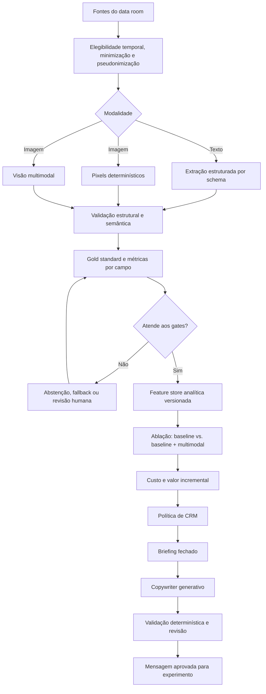

# 🤖 Trilha 3: IA Generativa, Extração Multimodal e Copywriting de CRM

> **Módulo 2:** IA e Dados para Negócios — case Vitaliza
> **Escopo:** objetivos 5 e 8 do case
> **Situação:** arquitetura, contratos e protocolo de avaliação propostos. Este repositório não afirma que o pipeline esteja implementado ou validado em produção.

[Comece por aqui](../README.md) / [Mapa das trilhas](../02_MAPA_DAS_TRILHAS.md) / IA generativa e multimodal

---

## 👋 Bem-vindos à Trilha de IA Generativa e Multimodal!

Esta trilha avalia quando texto, imagens e modelos generativos **realmente melhoram a decisão**, quanto custam e quais controles precisam existir. A IA extrai sinais com schema e evidência; a política de CRM decide a ação; o copywriter redige a mensagem sem escolher público, canal ou oferta.

| Movimento | O que a equipe faz | O que precisa entregar |
| :--- | :--- | :--- |
| **Definir contratos** | escolher campos úteis, tipos, categorias, proveniência e abstenção | schemas versionados para texto, imagem e mensagens |
| **Criar referência humana** | amostrar, rotular, medir concordância e adjudicar divergências | gold standard congelado e instruções de anotação |
| **Comparar extrações** | executar pixels determinísticos e visão multimodal nas mesmas imagens | métricas por campo, erros, cobertura, latência e custo |
| **Testar segurança** | verificar leakage, prompt injection, privacidade e conteúdo proibido | relatório de riscos, bloqueios, fallbacks e critérios de promoção |
| **Medir valor** | comparar o baseline com e sem variáveis multimodais | ablação reproduzível e conta de ganho versus custo |
| **Gerar mensagens** | redigir a partir de briefing fechado pela política | mensagens estruturadas, validadas e revisáveis para experimento |
| **Consolidar entrega** | integrar arquitetura, avaliação e custos | A2 de Tecnologia e insumos econômicos para A2 de Negócios |

> 🧭 **Comece por:** [Extração multimodal e copywriting](./01_EXTRACAO_MULTIMODAL_E_COPYWRITING_CRM.md) → [Arquitetura e contratos](./02_ARQUITETURA_E_CONTRATOS_MULTIMODAIS.md) → [Avaliação, segurança e governança](./03_AVALIACAO_SEGURANCA_E_GOVERNANCA.md).

---

## 🎯 1. O problema que esta trilha resolve

A Vitaliza tem conteúdo que não chega pronto para um modelo preditivo: respostas livres do onboarding, posts do feed, mensagens ao suporte e imagens dos mapas de calor de rotas. O objetivo 5 do case pergunta se esse conteúdo melhora a previsão de churn o bastante para justificar o custo de processá-lo. O objetivo 8 usa IA generativa em outro papel: redigir a mensagem depois que a política de CRM decidiu quem contatar, em qual canal e com qual oferta.

Esses dois usos compartilham modelos generativos, mas não o mesmo contrato.

| Uso | Entrada | Saída | Autoridade do modelo | Evidência de qualidade |
| :--- | :--- | :--- | :--- | :--- |
| Extração de texto | conteúdo livre disponível no corte | campos tipados, evidência e status | classificar ou abster-se | comparação com gold standard humano por campo |
| Extração de imagem | PNG do heatmap e metadados permitidos | medidas visuais tipadas | descrever o que está visível, sem diagnosticar comportamento | comparação com anotação humana e método determinístico |
| Copywriting de CRM | briefing fechado pela política | mensagem no formato do canal | redigir, sem escolher público, canal ou oferta | aderência ao briefing, segurança e revisão humana |

A trilha não começa pelo prompt. Ela começa pela decisão que a variável deve apoiar, pelo schema de saída e pelo conjunto de casos que permitirá medir erro.

## 📦 2. Resultado esperado

Ao concluir a trilha, a equipe deve conseguir entregar um pacote auditável com:

1. inventário das fontes e campos candidatos;
2. regras de elegibilidade temporal e privacidade;
3. schemas versionados para texto, imagem e mensagens;
4. gold standard humano com protocolo de adjudicação;
5. avaliação por campo, classe e fonte;
6. comparação entre pixels determinísticos e visão multimodal;
7. tokenomics e custo total calculados com consumo observado e tabela oficial do provedor na data do experimento;
8. guardrails contra prompt injection, vazamento e personalização invasiva;
9. logs, fallback e critérios de reprocessamento;
10. teste de ablação do modelo preditivo com e sem variáveis multimodais;
11. contrato do copywriter subordinado à política de CRM;
12. riscos, testes e Definition of Done.

Nenhum desses itens, isoladamente, prova ganho de retenção. O valor precisa aparecer em três níveis: extração correta, ganho preditivo e ganho econômico líquido.

## 📐 3. Arquitetura da trilha

O diagrama representa uma arquitetura proposta. A equipe deve registrar separadamente o que foi desenhado, implementado, executado e validado.

## 🗄️ 4. Fontes do case e limites de uso

| Fonte | Granularidade | Informação candidata | Limite principal |
| :--- | :--- | :--- | :--- |
| `onboarding.csv` | uma resposta por conta | objetivo declarado, origem narrada, meta de frequência | intenção inicial pode estar desatualizada; ausência não equivale a desinteresse |
| `feed_posts.csv` | um post por linha | tema do treino e manifestações explícitas | não inferir saúde, emoção ou diagnóstico sem evidência textual explícita |
| `tickets_suporte.csv` | um chamado por linha | assunto, fricção e intenção explicitamente declarada | `status` e `resolvido_em` podem revelar informação posterior ao corte histórico |
| `pesquisa_saida.csv` | uma resposta voluntária | motivo declarado e subtema | forte viés de seleção e risco de leakage; em regra, fonte diagnóstica, não feature principal |
| `heatmaps_90d/` | uma imagem por pessoa e data | área visual ocupada, intensidade e diversidade de traçados | o fundo é estilizado; ausência de imagem não prova abandono; janelas de 90 dias se sobrepõem |

O [dossiê do dicionário de dados](../05_DOSSIE_DICIONARIO_DE_DADOS_M2.md) detalha granularidade, cobertura e campos. O enunciado oficial define que o custo de IA sai do orçamento mensal de CRM e pede a comparação entre leitura de pixels e visão multimodal.

## 📚 5. Documentos da trilha

| Ordem | Documento | Pergunta respondida |
| :--- | :--- | :--- |
| 01 | [Extração multimodal e copywriting de CRM](./01_EXTRACAO_MULTIMODAL_E_COPYWRITING_CRM.md) | como conduzir o trabalho do problema de negócio à mensagem avaliada? |
| 02 | [Arquitetura e contratos](./02_ARQUITETURA_E_CONTRATOS_MULTIMODAIS.md) | quais componentes, fluxos, schemas e invariantes devem reger o pipeline? |
| 03 | [Avaliação, segurança e governança](./03_AVALIACAO_SEGURANCA_E_GOVERNANCA.md) | como construir o gold standard, medir qualidade e custo, testar riscos e decidir se o uso pode avançar? |

## 🧭 6. Percurso recomendado

### Etapa 1 — Formule a hipótese

Escolha um campo que possa mudar uma decisão. Exemplo ilustrativo: extrair `objetivo_categoria` do onboarding para testar se a informação acrescenta sinal à previsão de churn. Escreva antes do experimento:

- a definição do campo;
- valores permitidos;
- regra de ausência e ambiguidade;
- data em que o conteúdo se torna conhecido;
- uso permitido;
- hipótese de ganho;
- risco de dano ou leakage.

### Etapa 2 — Feche o contrato

Defina JSON Schema, proveniência, versão, códigos de erro e regra de abstenção. O modelo não deve devolver texto livre quando o consumidor espera uma enumeração. Evidência e confiança declarada pelo modelo ajudam na auditoria, mas não substituem rótulo humano.

### Etapa 3 — Crie o gold standard

Faça amostragem estratificada, dupla rotulagem em parte do conjunto, adjudicação e congelamento de um teste final. Separe exemplos usados no desenvolvimento daqueles usados na avaliação. Registre divergências: elas revelam problemas na taxonomia antes de revelar problemas no modelo.

### Etapa 4 — Execute e meça

Meça validade estrutural, desempenho por campo e classe, abstenção, latência, tokens, chamadas repetidas e custo. Em imagem, rode pixels e visão sobre o mesmo conjunto. Não compare métodos em amostras diferentes.

### Etapa 5 — Teste valor incremental

Inclua somente campos que passaram pelos gates de qualidade. Compare o modelo preditivo base com o mesmo protocolo acrescido das novas variáveis. A população, as janelas temporais e a métrica devem permanecer iguais. Um campo bem extraído pode não melhorar a previsão.

### Etapa 6 — Gere mensagens sob controle da política

A política de CRM escolhe destinatário, canal, oferta e restrições. O copywriter recebe um briefing fechado e devolve uma mensagem estruturada. Validações determinísticas verificam oferta, termos proibidos, campos obrigatórios e tamanho do canal antes da revisão humana.

## 🚦 7. Gates de progressão

| Gate | Evidência mínima | Resultado se falhar |
| :--- | :--- | :--- |
| G1 — contrato | schema válido, taxonomia e exemplos-limite | não executar em escala |
| G2 — referência | gold standard versionado e acordo entre rotuladores | revisar instrução e categorias |
| G3 — extração | métricas por campo e erros críticos abaixo do limite definido | ajustar, usar fallback ou abandonar o campo |
| G4 — segurança | testes de injection, privacidade e vazamento aprovados | bloquear promoção |
| G5 — valor preditivo | ablação temporal reproduzível | não integrar a feature se não houver ganho útil |
| G6 — valor econômico | custo total incluído no orçamento e cenário conservador aceitável | reduzir escopo ou não usar IA |
| G7 — redação | aderência ao briefing e revisão dos casos de risco | manter template ou revisão humana obrigatória |

Os limiares numéricos devem ser definidos antes do teste final conforme a criticidade de cada campo. Esta documentação não inventa um número universal de aceite.

## 🛡️ 8. O que esta trilha não autoriza

- usar conteúdo posterior ao corte para prever o passado;
- inferir condição de saúde, diagnóstico, vulnerabilidade ou estado emocional a partir de texto ou rota;
- enviar imagem, e-mail, identificador direto ou texto desnecessário ao provedor;
- aceitar instruções encontradas dentro do conteúdo do usuário;
- usar a autoconfiança do modelo como medida de acurácia;
- deixar o copywriter escolher desconto, público ou frequência de contato;
- afirmar que uma mensagem gerada reteve clientes sem experimento causal próprio;
- publicar preço de API sem fonte oficial, data, moeda e unidade;
- tratar proposta arquitetural, notebook demonstrativo ou teste unitário como pipeline operacional.

## 🔗 9. Integração com as outras trilhas

| Dependência | Entrada para esta trilha | Saída desta trilha |
| :--- | :--- | :--- |
| [Ciência de dados e ML](../02_trilha_ciencia_de_dados_e_ml/README.md) | corte temporal, população, baseline e protocolo de validação | features aprovadas, documentação de ablação e custo por pessoa |
| [Negócios e CRM](../01_trilha_negocios_e_crm/README.md) | política, capacidade, elegibilidade, canal e oferta | briefing de copywriting, custo de IA e mensagens avaliadas |
| [A2 de Tecnologia](../../artefatos_tecnologia/semana_10_A2/ARTEFATO_TECH_SEMANA10_A2.md) | formato de entrega técnica | arquitetura, contratos, avaliação e testes |
| [A2 de Negócios](../../artefatos_negocios/semana_10_A2/ARTEFATO_NEGOCIOS_SEMANA10_A2.md) | conta de valor e restrições do CRM | custo total e limitações de personalização |

## ✅ 10. Definition of Done da trilha

A trilha está pronta para incorporação acadêmica quando:

- [ ] cada campo proposto tem definição, tipo, domínio, proveniência e regra de abstenção;
- [ ] os fluxos de texto, imagem e copywriting estão documentados sem afirmar implementação inexistente;
- [ ] o gold standard tem amostragem, instrução, dupla rotulagem e conjunto final congelado;
- [ ] métricas são apresentadas por campo, classe, fonte e subgrupo relevante;
- [ ] pixels determinísticos e visão foram comparados nas mesmas imagens;
- [ ] tokens, chamadas, reprocessamento, latência e custo foram medidos com fonte oficial de preço;
- [ ] privacidade, prompt injection, leakage e personalização invasiva têm controles e testes;
- [ ] logs permitem rastrear versão de dados, schema, prompt, modelo e decisão de fallback;
- [ ] a ablação preditiva usa o mesmo protocolo temporal do baseline;
- [ ] o copywriter recebe briefing fechado e não toma decisões de CRM;
- [ ] exemplos estão rotulados como ilustrativos;
- [ ] riscos residuais, responsáveis e critérios de bloqueio estão registrados;
- [ ] links locais e formatação Markdown foram validados.

👉 **Próximo passo:** [comece pelo guia integrado](./01_EXTRACAO_MULTIMODAL_E_COPYWRITING_CRM.md).
