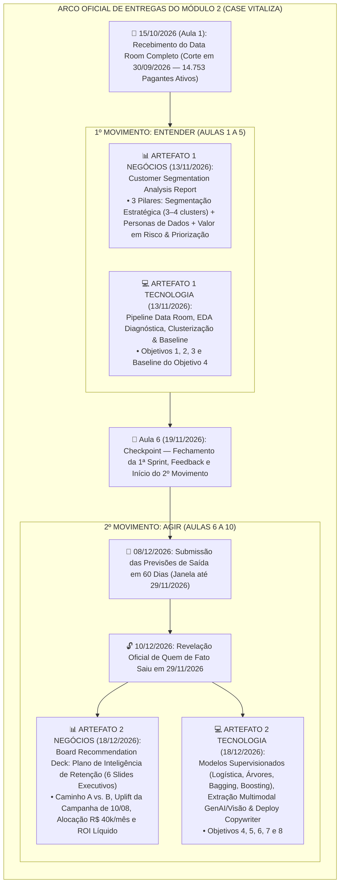

# 🗓️ Visão Detalhada dos Entregáveis — Semana 5 (A1) vs. Semana 10 (A2)

> **Módulo 2:** Inteligência de Mercado e Modelagem Preditiva para Crescimento — Case Vitaliza  
> **Equipe:** Equipe de Projetos MBA Inteli  
> **Foco deste documento:** Especificação Oficial dos 4 Artefatos (Negócios & Tecnologia na Semana 5 e na Semana 10), Marcos de Datas e Conexão com os 8 Objetivos

[🔰 Comece por Aqui](../README.md) / Entregas da Semana 5 (A1) e da Semana 10 (A2)

---

## 🎯 1. O Arco das 10 Semanas e os Marcos Oficiais de Entrega

Conforme estabelecido nas Aulas 1 de Negócios (Prof. Fábio Cássio Souza) e de Tecnologia (Prof. Cesar Almiñana), o Módulo 2 é dividido em **dois movimentos estratégicos**:
* **1º Movimento — ENTENDER (Semanas 1 a 5 | Entrega A1 em `13/11/2026`):** *Primeiro entender, depois agir.* Quem são os usuários, o que os dados reais dizem sobre a subida do churn em 2026, quais segmentos/personas existem e como o baseline enxerga o risco.
* **2º Movimento — AGIR (Semanas 6 a 10 | Previsão 60d em `08/12`, Revelação do Gabarito em `10/12`, Entrega Final A2 em `18/12/2026`):** Quais variáveis não-estruturadas (texto e imagem) entram no modelo, qual modelo supervisionado vence, quem atacar com base em Uplift (sem acordar *Sleeping Dogs*), com qual intervenção/mensagem gerada por IA e qual o ROI líquido esperado para o Conselho.

---

## 🛠️ 2. SEMANA 5 (Artefato 1 — Entrega `13/11/2026`): Especificação Detalhada

### 📊 2.1. Artefato 1 de Negócios: *Customer Segmentation Analysis Report*
👉 **Arquivo no repositório:** [`artefatos_negocios/semana_5_A1/ARTEFATO_NEGOCIOS_SEMANA5_A1.md`](../../artefatos_negocios/semana_5_A1/ARTEFATO_NEGOCIOS_SEMANA5_A1.md)

Conforme os Slides 32 a 35 da Aula 1 de Negócios, a análise de churn sozinha não é um entregável estratégico; o documento deve conectar os dados à decisão sobre **3 Pilares Obrigatórios**:

| Pilar Oficial do Artefato 1 | O Que Deve Conter | Boas Práticas Exigidas (Slide 35) |
| :--- | :--- | :--- |
| **Pilar 01 — Segmentação Estratégica** | • Identificação e descrição de **pelo menos 3 a 4 clusters** baseados em **comportamento revelado de uso** (e não apenas demografia). • Qualificação de cada grupo por: tamanho (% e volume nos 14.753 pagantes), *churn rate* histórico e receita gerada. • Output: Tabela executiva de segmentos com atributos-chave. | Nomear cada cluster com **intenção estratégica** (ex.: *"O Entusiasta Frustrado"*, *"Corredor Social de Parque"*, *"Pagante Inerte / Sleeping Dog"*), nunca com rótulos genéricos ("Cluster 0, Cluster 1"). |
| **Pilar 02 — Criação de Personas de Dados** | • Diferenciar *Persona de Dados* de *Persona de Marketing* inventada. • Estrutura por persona: **quem é**, **o que faz no app**, **por que sai** (hipótese de driver de churn por segmento) e **custo financeiro da perda**. • Variáveis âncora: frequência de treino, ticket/plano, *tenure* (tempo de casa), uso de relógio e rede social. | Todo atributo descrito na persona **deve ter uma variável correspondente comprovada na análise exploratória (EDA)**. |
| **Pilar 03 — Valor Estratégico, Diagnóstico & Limitações** | • Confronto entre as hipóteses iniciais dos executivos e os dados reais sobre a subida do churn de 5,6% (2025) para 6,6% (2026) e pico de 8,1% em abril. • Cálculo explícito do **Valor em Risco (`Churn Rate × Receita Média`)** por segmento. • **Matriz de Priorização (`Impacto × Acionabilidade`):** quais segmentos merecem intervenção imediata vs. quais devem ficar apenas em monitoramento (ou em silêncio, no caso de *Sleeping Dogs*). • **Seção Obrigatória de Limitações da Análise:** assimetria de canal (70,22% nas lojas sem pesquisa de saída), viés de seleção em `pesquisa_saida.csv`, cobertura temporal distinta entre arquivos e ausência de desfecho pós-30/09. | Sempre incluir a **receita em risco** e redigir com linguagem e visual diretamente acessíveis para C-Level e Produto. |

---

### 💻 2.2. Artefato 1 de Tecnologia: *Pipeline do Data Room, EDA, Clusterização & Baseline*
👉 **Arquivo no repositório:** [`artefatos_tecnologia/semana_5_A1/ARTEFATO_TECH_SEMANA5_A1.md`](../../artefatos_tecnologia/semana_5_A1/ARTEFATO_TECH_SEMANA5_A1.md)

| Entrega Técnica (Semana 5) | Objetivos do Case | Requisitos Técnicos e de Reprodutibilidade |
| :--- | :--- | :--- |
| **1. Saneamento, Qualidade e Reconstrução da Base** | **Objetivo 1** | • Filtrar registros pós-corte (`> 30/09/2026`: 119 usuários, 122 posts, 273 amizades). • Padronizar categorias (`android`/`Android`, `ios`/`iOS`/`IOS`, modalidades em PT/EN e `relogio_conectado = 'nenhum'`). • Converter timestamps `UTC ("Z")` das lojas para `America/Sao_Paulo` em `eventos_assinatura.csv`. • Reconciliar as `14.813` assinaturas ativas em **`14.753` pagantes ativos** + `60` cortesias e reconstruir a série histórica mensal. |
| **2. Análise Exploratória Diagnóstica (EDA)** | **Objetivo 2** | • Testar estatisticamente as hipóteses do caderno (`H-PRICE-01` reajuste de março, `H-CHANNEL-01` lojas vs. site, `H-ENGAGEMENT-01` queda de uso, `H-SOCIAL-01` amizades e `H-SUPPORT-01` falha de cobrança/tickets), declarando que cruzamento bivariado não prova causa isolada. |
| **3. Feature Engineering & Clusterização Não-Supervisionada** | **Objetivo 3** | • Agregar `uso_mensal.csv`, `atividades.parquet` (1.254.475 treinos) e `amizades.csv` por `user_id` até o corte. • Padronizar escala das variáveis e treinar algoritmo de clusterização **sem usar a variável de saída (`churn`)**. |
| **4. Baseline Supervisionado de Churn (60 Dias)** | **Objetivo 4 (Inicial)** | • Definir contrato temporal sem *Data Leakage* em cortes históricos com janela de 60 dias observada e treinar o modelo de referência (**Regressão Logística**). |

---

## 🏆 3. SEMANA 10 (Artefato 2 — Entrega Final `18/12/2026`): Especificação Detalhada

### 📊 3.1. Artefato 2 de Negócios: *Board Recommendation Deck: Plano de Inteligência de Retenção*
👉 **Arquivo no repositório:** [`artefatos_negocios/semana_10_A2/ARTEFATO_NEGOCIOS_SEMANA10_A2.md`](../../artefatos_negocios/semana_10_A2/ARTEFATO_NEGOCIOS_SEMANA10_A2.md)

Conforme os Slides 34 e 36 da Aula 1 de Negócios, o entregável final simula a apresentação de **Camila Ferraz ao Conselho de Administração da Vitaliza** estruturada em **6 Slides/Seções Executivas Obrigatórias**:

| Slide / Bloco Executivo | Título Oficial | O Que Deve Ser Respondido com Dados Reais |
| :--- | :--- | :--- |
| **Slide 1** | **Diagnóstico do Problema** | Sangria mensal de receita recorrente, evolução do churn (5,6% $\rightarrow$ 6,6%, pico de 8,1% em abril), impacto no LTV/CAC para a Série B e ausência anterior de política estruturada de retenção. |
| **Slide 2** | **O Que os Dados Nos Dizem Sobre Quem Cancela** | Síntese dos clusters comportamentais em linguagem de negócio (ex.: *Early Droppers*, *Desengajados*, *Sleeping Dogs*), a cegueira de 70,22% nas lojas (App Store/Google Play) e por que perfis distintos exigem abordagens distintas. |
| **Slide 3** | **As Duas Apostas e o Que Cada Uma Entrega (Caminho A vs. Caminho B)** | Comparação estruturada entre **Caminho A (Win-Back Reativo)** — rápido, mas cego para quem sai pelas lojas ou sem clicar — e **Caminho B (Engagement Forecasting Preditivo Contínuo)** — exige engenharia e governança de Uplift, mas antecipa o risco e garante paridade competitiva frente ao anúncio do **Strava Premium**. |
| **Slide 4** | **A Recomendação Estratégica (Política Prescritiva de Uplift)** | Recomendação fundamentada combinando o score preditivo (Obj. 4 + Obj. 5) com o resultado causal do **Experimento Controlado de 10/08/2026 (`campanha_ago26.csv`)**, isolando os clientes **Persuadíveis** e protegendo a margem contra descontos em **Garantidos**, desperdício em **Perdidos** e acordamento de **Sleeping Dogs**. |
| **Slide 5** | **Plano de Ação (10 Semanas), Playbooks GenAI & ROI da Retenção** | Alocação cirúrgica dos canais (**máx. 1.500 WhatsApps a R$ 0,40**, **máx. 300 CS a R$ 18,00**, E-mail a R$ 0,01 e Push máx. 1/semana) e das 4 ofertas dentro do teto de **R$ 40.000/mês** (incluindo descontos e tokens de IA), demonstrando o **Lucro Líquido Incremental em R$** (Obj. 7) e os KPIs de acompanhamento. |
| **Slide 6** | **Riscos, Incertezas Reconhecidas e Plano de Contingência** | Reconhecimento explícito das limitações (censura temporal, diferença entre abrir mensagem e reter, risco de *Sleeping Dogs*, atraso de pipeline ou taxa de conversão abaixo do esperado) e gatilhos de contingência para cada cenário. |

---

### 💻 3.2. Artefato 2 de Tecnologia: *Modelos Supervisionados (60d), Extração Multimodal & Copywriter*
👉 **Arquivo no repositório:** [`artefatos_tecnologia/semana_10_A2/ARTEFATO_TECH_SEMANA10_A2.md`](../../artefatos_tecnologia/semana_10_A2/ARTEFATO_TECH_SEMANA10_A2.md)

| Entrega Técnica (Semana 10) | Objetivos do Case | Requisitos Técnicos e de Avaliação |
| :--- | :--- | :--- |
| **1. Extração Multimodal de Texto e Imagem com IA Generativa e Visão** | **Peça 2 / Objetivo 5** | • Extrair variáveis estruturadas via schema fixo de `onboarding.csv`, `pesquisa_saida.csv`, `feed_posts.csv` e `tickets_suporte.csv` (respeitando o corte temporal). • Extrair variáveis espaciais de `heatmaps_90d/` (`2026-07-31` e `2026-09-30`) comparando **contagem de pixels por cor** (verde=parque, azul=água, areia=praia, amarelo=avenida) contra **modelo de visão multimodal**. • Validar contra amostra rotulada à mão, medir o custo em R$ por assinante e realizar o **teste de ablação** (comparar modelos preditivos **com vs. sem** variáveis de texto e imagem). |
| **2. Classificação Supervisionada Completa de Churn em 60 Dias (até `29/11/2026`)** | **Peça 3 / Objetivo 4** | • Comparar **Regressão Logística**, **Árvores de Decisão** (regras legíveis), **Bagging (Random Forest)** e **Boosting (XGBoost / LightGBM)** em validação fora do tempo. • Avaliar discriminação (ROC-AUC, PR-AUC, Lift no topo `k`), calibração (Brier Score) e **Lucro Líquido gerado pela regra de decisão** (Verbeke et al., 2012). • Gerar a lista ordenada de risco para submissão em `08/12/2026` e análise pós-revelação do gabarito (`10/12/2026`). |
| **3. Deploy da Regra Prescritiva & Redator Generativo de Mensagens de CRM** | **Peças 4 e 5 / Objetivos 6, 7 e 8** | • Implementar a função de decisão que recebe um assinante, cruza score de risco + segmento + uplift esperado + elegibilidade e retorna a ação ótima dentro dos limites de CRM. • Gerar com IA Generativa a mensagem final individualizada seguindo o briefing de negócio, tom de voz, fatos reais do assinante e oferta autorizada. |

---

## 🔗 4. Checklist de Coerência Entre os 4 Artefatos (A1 e A2)

1. **Mesma População e Denominador:** Tanto Negócios quanto Tecnologia partem dos **14.753 pagantes ativos** no corte de `30/09/2026` (separando explicitamente as 60 contas de cortesia).
2. **Mesma Definição Operacional de Saída:** Conforme o Slide 35 da Aula 1 de Tecnologia, na previsão de 60 dias até `29/11/2026`, **saída** é estar com a renovação automática desligada ou sem assinatura vigente em `29/11/2026` (incluindo falha de pagamento não recuperada, reembolso e chargeback).
3. **Alinhamento de Personas e Ofertas:** Os clusters gerados sem vazamento de churn em Tecnologia (A1) são exatamente os mesmos grupos traduzidos em Personas e priorizados em Negócios (A1 e A2).
4. **Conta Financeira Única:** O custo de tokens de IA da Peça 2 (extração) e da Peça 5 (redação) calculado em Tecnologia entra na mesma trava orçamentária de **R$ 40.000,00/mês** do plano de CRM em Negócios.
