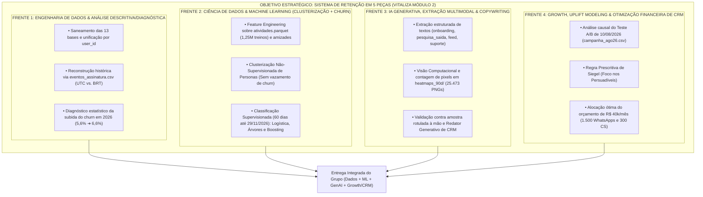

# Mapa Geral das Frentes Estratégicas de Atuação — Inteli MBA (Módulo 2)

> **Projeto:** Sistema Integrado de Predição de Churn, Extração Multimodal e Retenção Prescritiva — Vitaliza  
> **Atribuição:** Equipe de Projetos MBA Inteli  
> **Arquivo:** `00_MAPA_GERAL_FRENTES_DE_ATUACAO.md`  

---

## 🧭 1. Visão Holística dos Blocos de Atuação

Para organizar a execução dos **8 Objetivos do Case Vitaliza** e as entregas da **Semana 5 (A1)** e da **Semana 10 (A2)**, o trabalho da equipe está estruturado em **4 Grandes Frentes Interdisciplinares**:

---

## 📊 2. Matriz Consolidada das Frentes, Objetivos e Entregáveis

| Frente de Atuação | Objetivos do Case | Perfil Recomendado | Principais Entregáveis Tangíveis |
| :--- | :--- | :--- | :--- |
| **Frente 1** | **Objetivos 1 e 2** | Dados / BI / Negócios | Base unificada no corte `30/09/2026`, série histórica de churn conciliada e teste de hipóteses da alta de 2026. |
| **Frente 2** | **Objetivos 3 e 4** | Ciência de Dados / ML | Segmentação de personas acionáveis e lista ordenada de probabilidade de churn em 60 dias sem *Data Leakage*. |
| **Frente 3** | **Objetivos 5 e 8** | Engenharia de IA / GenAI | Features extraídas de texto e imagem validadas, cálculo de custo de tokens e gerador de mensagens de retenção. |
| **Frente 4** | **Objetivos 6 e 7** | Growth / Finanças / CRM | Cálculo de Uplift da campanha de agosto, regra prescritiva de contato e DRE do lucro incremental líquido. |

---

## 📂 3. Organização dos Arquivos de Detalhamento

Esta estrutura de tarefas está mantida diretamente nesta pasta para cada membro do grupo:

* 📄 [**`00_MAPA_GERAL_FRENTES_DE_ATUACAO.md`**](./00_MAPA_GERAL_FRENTES_DE_ATUACAO.md) — Este índice e visão macro das 4 frentes interdisciplinares.
* 📄 [**`FRENTE_01_DADOS_E_DIAGNOSTICO_CHURN.md`**](./FRENTE_01_DADOS_E_DIAGNOSTICO_CHURN.md) — Detalhamento de saneamento das 13 bases, fuso UTC/BRT, reconciliação dos `14.753` pagantes e diagnóstico da alta de 2026 (Objetivos 1 e 2).
* 📄 [**`FRENTE_02_CLUSTERIZACAO_E_PREDICAO_ML.md`**](./FRENTE_02_CLUSTERIZACAO_E_PREDICAO_ML.md) — Detalhamento de Feature Engineering sobre `atividades.parquet`, Clusterização das 4 Personas sem vazamento e Classificação de Churn em 60 dias (Objetivos 3 e 4).
* 📄 [**`FRENTE_03_IA_GENERATIVA_TEXTO_E_IMAGEM.md`**](./FRENTE_03_IA_GENERATIVA_TEXTO_E_IMAGEM.md) — Detalhamento de extração JSON estruturada de textos, contagem de pixels vs. Visão em `heatmaps_90d/`, teste de ablação e Redator de CRM com Briefing Fechado (Objetivos 5 e 8).
* 📄 [**`FRENTE_04_GROWTH_UPLIFT_E_ORCAMENTO_CRM.md`**](./FRENTE_04_GROWTH_UPLIFT_E_ORCAMENTO_CRM.md) — Detalhamento do experimento causal de `10/08/2026`, Matriz de Siegel (*Sleeping Dogs* vs. *Persuadíveis*), alocação de R$ 40k/mês (`1.500` WA e `300` CS) e Lucro Incremental em R$ (Objetivos 6 e 7).
* 📄 [**`MATRIZ_DE_TAREFAS_E_ESPECIFICACOES.md`**](./MATRIZ_DE_TAREFAS_E_ESPECIFICACOES.md) — 8 Tarefas Principais (Objetivos 1 a 8) e 37 Especificações Executáveis.
