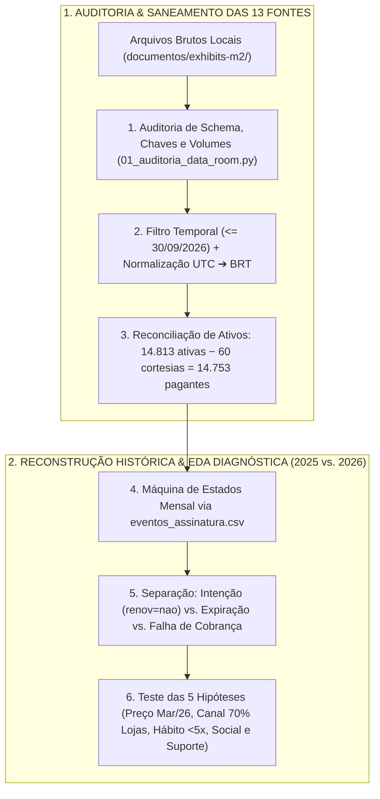

# Detalhamento de Tarefas — Frente 01: Engenharia de Dados, Reconstrução da Base & Diagnóstico de Churn (Objetivos 1 e 2)

> **Frente:** 1 — Engenharia Analítica, Saneamento Point-in-Time & Análise Descritiva/Diagnóstica  
> **Módulo 2:** Case Vitaliza — Inteli MBA  
> **Objetivo:** Reconciliar a população pagante ativa (`14.753` assinantes), reconstruir a série histórica de churn sem vazamento temporal e diagnosticar estatisticamente as causas da subida de 5,6% (2025) para 6,6% (2026)  
> **Entrega Principal:** Semana 5 (Artefato 1 — Negócios e Tecnologia)  
> **Arquivo:** `FRENTE_01_DADOS_E_DIAGNOSTICO_CHURN.md`  

---

## 🎯 1. Escopo de Execução & Entregável Esperado

1. **Auditoria e Saneamento do Data Room (Objetivo 1):**
   * Conferir integridade das 4 tabelas (`usuarios.csv`, `assinaturas.csv`, `amizades.csv`, `campanha_ago26.csv`) e dos 4 logs (`eventos_assinatura.csv`, `pagamentos.csv`, `uso_mensal.csv`, `atividades.parquet`).
   * Converter timestamps `UTC ("Z")` das lojas em `eventos_assinatura.csv` para `Horário de Brasília` e reconstruir a situação de cada assinante em cada mês até `30/09/2026` (14.753 ativos).
2. **Análise Exploratória e Teste de Hipóteses da Subida de 2026 (Objetivo 2):**
   * Investigar o salto do churn de **5,6% (2025)** para **6,6% (2026)** e o pico de **8,1% em abril de 2026**.
   * Cruzar reajuste do plano mensal (`01/03/2026`), plano (`mensal` vs. `anual`), canal (`app_store`, `google_play`, `web_cartao`, `web_pix`), safra, frequência de treino e falha de cobrança (`pagamentos.csv`).

---

## 📋 2. Checklist Granular de Tarefas

### 2.1 Auditoria de Qualidade e Saneamento Físico (Objetivo 1 — Especificações 1.1 e 1.2)
- [ ] **Verificação de Volumes e Chaves Primárias:** Executar `src/01_auditoria_data_room.py` validando a ausência de duplicidades nas chaves nativas dos 11 CSVs e do arquivo `atividades.parquet` (`1.254.475` treinos).
- [ ] **Bloqueio de Registros Pós-Corte (`> 30/09/2026`):** Filtrar as anomalias temporais detectadas na auditoria (`119` cadastros em `usuarios.csv`, `122` posts em `feed_posts.csv` e `273` conexões em `amizades.csv`) para impedir vazamento de futuro.
- [ ] **Normalização de Fusos Horários (`UTC` vs. `America/Sao_Paulo`):** Converter timestamps terminados em `"Z"` (eventos oriundos da App Store e Google Play em `eventos_assinatura.csv` e `34` treinos na primeira hora de `01/10 UTC` em `atividades.parquet`) para o fuso oficial do corte (`UTC-3`).
- [ ] **Padronização Categórica e Tipagem Monetária:** Unificar grafias divergentes de sistema operacional (`android`/`Android`, `ios`/`iOS`/`IOS`), vocabulário bilíngue de modalidades (`corrida`/`run`, `caminhada`/`walk`, `forca`/`strength`, `pedal`/`ride`), mapear `relogio_conectado = 'nenhum'` como ausência de smartwatch e converter `valor` em `pagamentos.csv` para decimal explícito.

### 2.2 Reconstrução Histórica de Assinaturas e Série de Churn (Objetivo 1 — Especificações 1.3 a 1.5)
- [ ] **Reconciliação da Fotografia no Corte (`30/09/2026`):** Isolar as `60` contas de cortesia (`plano_atual = 'cortesia'`, `canal_cobranca = 'interno'`) das `14.813` assinaturas ativas, cravando a população oficial de **`14.753` pagantes ativos** (`8.478` no anual [57,47%] e `6.275` no mensal [42,53%]).
- [ ] **Reconstrução Point-in-Time de Episódios:** Como `assinaturas.csv` reflete apenas o estado sobrescrito em `01/10/2026`, reconstituir quem estava ativo no início de cada mês (`jan/2025` a `set/2026`) a partir da sequência de eventos de `eventos_assinatura.csv`.
- [ ] **Separação Operacional de Eventos de Saída:** Distinguir analiticamente (a) **intenção de saída já contratada** (`2.250` pagantes ativos em `30/09/2026` com `renovacao_automatica = 'nao'`), (b) **término efetivo de acesso** (`assinatura_expirada`) e (c) **churn involuntário** por falha de pagamento não recuperada no `periodo_carencia` (`pagamentos.csv`).
- [ ] **Série Mensal por Plano e Canal:** Consolidar a tabela histórica de churn mensal comparando 2025 (média `5,6%`) e jan–set/2026 (média `6,6%`, pico de `8,1%` em abril/2026) aberta por plano e canal (`70,22%` lojas vs. `29,78%` site).

### 2.3 Diagnóstico Estatístico da Alta de 2026 (Objetivo 2 — Especificações 2.1 a 2.5)
- [ ] **Teste `H-PRICE-01` (Choque do Reajuste de Março/2026):** Avaliar o impacto da subida do plano mensal de R$ 34,90 para R$ 39,90 (+14,3% em `01/03/2026`) comparando a curva de saída do mensal vs. anual antes e depois de março, ponderando o viés de cobertura de `pesquisa_saida.csv` (`41,06%` de menções a preço, restrito ao site).
- [ ] **Teste `H-CHANNEL-01` e Safra de Aquisição:** Analisar a retenção por coorte de entrada (`inicio`) e `canal_aquisicao` (crescimento de 68% da base ativa entre jan/2025 e set/2026) e quantificar a cegueira estrutural dos `70,22%` de pagantes via App Store e Google Play.
- [ ] **Teste `H-ENGAGEMENT-01`, `H-SOCIAL-01` e `H-SUPPORT-01`:** Cruzar a frequência mensal de treinos (`≥5` treinos com `1,60%` de desligamento vs. `1–4` treinos com `15,19%` vs. `0` treinos com `56,98%`), posse de relógio conectado, grau de amizade em `amizades.csv` e tickets abertos/sem resposta em `tickets_suporte.csv` (`34,03%`).

---

## 📄 3. Estrutura dos Documentos Finais a Serem Alimentados

Os resultados auditados desta frente compõem diretamente:
1. **Negócios (Semana 5 — A1):** Seções 1 e 2 de [`artefatos_negocios/semana_5_A1/ARTEFATO_NEGOCIOS_SEMANA5_A1.md`](../artefatos_negocios/semana_5_A1/ARTEFATO_NEGOCIOS_SEMANA5_A1.md) e guias em [`00_comece_por_aqui/01_trilha_negocios_e_crm/`](../00_comece_por_aqui/01_trilha_negocios_e_crm/).
2. **Tecnologia (Semana 5 — A1):** Seções 1 e 2 de [`artefatos_tecnologia/semana_5_A1/ARTEFATO_TECH_SEMANA5_A1.md`](../artefatos_tecnologia/semana_5_A1/ARTEFATO_TECH_SEMANA5_A1.md) e [`relatorios/auditoria_exhibits.json`](../relatorios/auditoria_exhibits.json).
