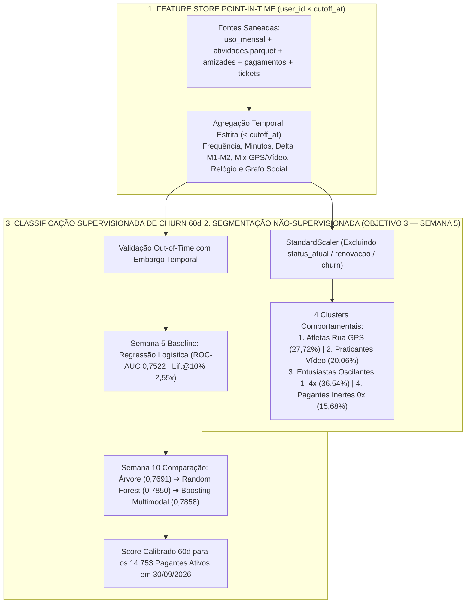

# Detalhamento de Tarefas — Frente 02: Clusterização de Personas & Modelagem Supervisionada de Churn (Objetivos 3 e 4)

> **Frente:** 2 — Ciência de Dados, Feature Engineering, Segmentação Não-Supervisionada & Classificação de Churn em 60 Dias  
> **Módulo 2:** Case Vitaliza — Inteli MBA  
> **Objetivo:** Construir os 4 clusters comportamentais sem vazamento de churn (Personas A1) e treinar/avaliar fora do tempo as 4 famílias supervisionadas (Logística, Árvores, Bagging e Boosting) para prever a saída em 60 dias até `29/11/2026`  
> **Entregas Principais:** Semana 5 (A1 — Clusterização & Baseline) e Semana 10 (A2 — Árvores, Bagging & Boosting)  
> **Arquivo:** `FRENTE_02_CLUSTERIZACAO_E_PREDICAO_ML.md`  

---

## 🎯 1. Escopo de Execução & Entregável Esperado

1. **Clusterização Não-Supervisionada de Assinantes (Objetivo 3 — Semana 5):**
   * Construir variáveis de comportamento de treino (`uso_mensal.csv`, `atividades.parquet`) e rede social (`amizades.csv`).
   * Padronizar escalas e agrupar os assinantes em segmentos compreensíveis pelo negócio **sem usar a informação de quem saiu**.
2. **Classificação Supervisionada de Churn em 60 Dias (Objetivo 4 — Semana 5 e Semana 10):**
   * Prever a probabilidade de saída nos 60 dias seguintes ao corte (`30/09/2026` até `29/11/2026`), com separação temporal estrita e zero *Data Leakage*.
   * Comparar **Regressão Logística** (baseline), **Árvores de Decisão** (regras legíveis), **Bagging** e **Boosting**, avaliando o resultado pelo lucro líquido gerado na regra de CRM.

---

## 📋 2. Checklist Granular de Tarefas

### 2.1 Engenharia de Variáveis Comportamentais e Sociais (Especificações 3.1 e 4.1)
- [ ] **Agregação de Uso e Intensidade (`uso_mensal.csv` e `atividades.parquet`):** Calcular por `user_id` até cada data de corte: `treinos_m1`, `minutos_m1`, `dias_ativos_m1`, `sessoes_m1`, tendência longitudinal `delta_treinos = treinos_m1 - treinos_m2` e recência desde o último treino.
- [ ] **Vocação de Modalidade e Ecossistema:** Calcular a proporção de treinos ao ar livre com GPS (`corrida`, `caminhada`, `pedal`) versus treinos guiados em vídeo (`funcional`, `forca`, `yoga`, `hiit`), além da flag `tem_relogio` (`Garmin` ou `Apple Watch`).
- [ ] **Grafo Social e Fricções Operacionais:** Extrair grau de entrada/saída e reciprocidade em `amizades.csv` (`desde <= cutoff_at`), contagem de tentativas recusadas em `pagamentos.csv` (`n_recusas`) e chamados abertos em `tickets_suporte.csv` (`n_tickets`).
- [ ] **Blindagem Anti-Leakage:** Auditar que nenhuma variável utilize informação posterior ao corte simulado (`status_atual` do snapshot, `pesquisa_saida.csv` ou resolução futura de chamado).

### 2.2 Clusterização Comportamental e Construção de Personas (Objetivo 3 — Especificações 3.2 a 3.5)
- [ ] **Formação de Grupos Sem a Variável Alvo:** Aplicar `StandardScaler` apenas sobre variáveis comportamentais e de produto, garantindo que `churn` e `renovacao_automatica` fiquem 100% fora do cálculo de distância.
- [ ] **Avaliação de Soluções e Estabilidade:** Comparar agrupamentos candidatos (3 a 4 clusters) por separação (Silhueta), equilíbrio de tamanho e interpretabilidade nas unidades originais.
- [ ] **Projeção A Posteriori e Tradução em Personas (3 Pilares A1):** Projetar a taxa de desligamento de renovação e a receita líquida mensal sobre os 4 clusters formados (*Cluster 1 Atletas Rua GPS [27,72%, 1,61% saída]*; *Cluster 2 Praticantes Vídeo [20,06%, 1,59% saída]*; *Cluster 3 Entusiastas Oscilantes 1–4 treinos [36,54%, 15,19% saída]*; *Cluster 4 Pagantes Inertes 0 treinos [15,68%, 56,98% saída]*).

### 2.3 Modelagem Supervisionada de Churn em 60 Dias (Objetivo 4 — Especificações 4.2 a 4.5)
- [ ] **Baseline Interpretável (Semana 5 — Regressão Logística):** Treinar o modelo linear regularizado (`L2`), extrair os pesos das variáveis e documentar as métricas fora da amostra (`ROC-AUC = 0,7522`, `PR-AUC = 0,5079`, `Brier = 0,1504`, `Lift@10% = 2,55x`).
- [ ] **Árvores de Decisão, Bagging e Boosting (Semana 10):** Treinar e comparar na mesma janela temporal **Árvore de Decisão** (`ROC-AUC = 0,7691`, `Lift@10% = 2,97x`), **Random Forest / Bagging** (`ROC-AUC = 0,7850`, `Brier = 0,1333`) e **Gradient Boosting com Features Multimodais** (`ROC-AUC = 0,7858`, `PR-AUC = 0,5986`).
- [ ] **Calibração e Ranking Operacional para o CRM:** Verificar a calibração das probabilidades previstas e gerar o ranking de risco até `29/11/2026` para alimentar a regra prescritiva da Frente 04 (submissão em `08/12/2026` e avaliação pós-revelação em `10/12/2026`).

---

## 📄 3. Estrutura dos Documentos Finais a Serem Alimentados

Os resultados desta frente sustentam diretamente:
1. **Semana 5 (A1):** Seções 3 e 4 de [`artefatos_tecnologia/semana_5_A1/ARTEFATO_TECH_SEMANA5_A1.md`](../artefatos_tecnologia/semana_5_A1/ARTEFATO_TECH_SEMANA5_A1.md) e Pilares 01 e 02 de [`artefatos_negocios/semana_5_A1/ARTEFATO_NEGOCIOS_SEMANA5_A1.md`](../artefatos_negocios/semana_5_A1/ARTEFATO_NEGOCIOS_SEMANA5_A1.md).
2. **Semana 10 (A2):** Seção 3 de [`artefatos_tecnologia/semana_10_A2/ARTEFATO_TECH_SEMANA10_A2.md`](../artefatos_tecnologia/semana_10_A2/ARTEFATO_TECH_SEMANA10_A2.md) e protocolo metodológico em [`00_comece_por_aqui/02_trilha_ciencia_de_dados_e_ml/02_CLUSTERIZACAO_E_CHURN_SUPERVISIONADO.md`](../00_comece_por_aqui/02_trilha_ciencia_de_dados_e_ml/02_CLUSTERIZACAO_E_CHURN_SUPERVISIONADO.md).
