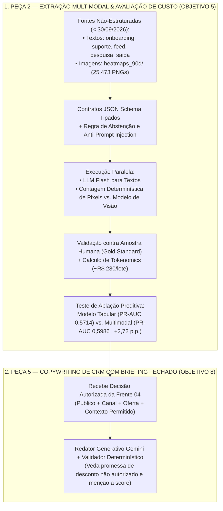

# Detalhamento de Tarefas — Frente 03: IA Generativa, Extração Multimodal (Texto/Imagem) & Copywriting (Objetivos 5 e 8)

> **Frente:** 3 — Engenharia de IA Generativa, Visão Computacional, Avaliação de Valor Incremental & Copywriting Controlado  
> **Módulo 2:** Case Vitaliza — Inteli MBA  
> **Objetivo:** Transformar textos livres e 25.473 imagens de mapas de calor em variáveis estruturadas auditadas (Peça 2), aferir se o ganho preditivo supera o custo de processamento e operar o Redator de CRM subordinado a um briefing fechado (Peça 5)  
> **Entrega Principal:** Semana 10 (Artefato 2 — Tecnologia e Negócios)  
> **Arquivo:** `FRENTE_03_IA_GENERATIVA_TEXTO_E_IMAGEM.md`  

---

## 🎯 1. Escopo de Execução & Entregável Esperado

1. **Extração Estruturada de Texto e Imagem (Peça 2 / Objetivo 5):**
   * Converter `onboarding.csv`, `pesquisa_saida.csv`, `feed_posts.csv` e `tickets_suporte.csv` em variáveis categóricas e numéricas usando LLM com schema pré-definido.
   * Extrair variáveis das 25.473 imagens de `heatmaps_90d/` (`2026-07-31/` e `2026-09-30/`) comparando **contagem de pixels por cor** vs. **modelo de visão**.
   * Validar acurácia contra amostra rotulada à mão, medir o custo em R$ por assinante (abatido dos R$ 40.000/mês) e comparar os modelos de churn **com e sem** essas variáveis.
2. **Redação Personalizada de Mensagens (Peça 5 / Objetivo 8):**
   * Gerar o texto final para cada assinante selecionado pela regra de decisão, seguindo o briefing de negócio, tom, perfil extraído e oferta alocada.

---

## 📋 2. Checklist Granular de Tarefas

### 2.1 Extração Estruturada de Textos Livres e Gold Standard (Objetivo 5 — Especificações 5.1 e 5.2)
- [ ] **Definição de Contratos JSON Schema Versionados:** Especificar os campos tipados, enumerações permitidas e regras de abstenção para `onboarding.csv` (`motivacao_onboarding`, `tem_meta_prazo`), `tickets_suporte.csv` (`suporte_intencao_cancelar`, `suporte_falha_tecnica_gps`, `suporte_ticket_sem_resposta`) e `feed_posts.csv` (`feed_mencao_lesao_ou_dor`, `feed_sentimento_ultimo_post`).
- [ ] **Construção da Amostra de Referência Humana (*Gold Standard*):** Selecionar amostra estratificada de textos e imagens, realizar rotulagem humana com critérios explícitos de adjudicação e aferir precisão/F1 por campo extraído.
- [ ] **Segurança, Privacidade e Prevenção de Leakage:** Garantir pseudonimização antes da chamada de inferência, delimitação do texto do usuário como dado não confiável (*Anti-Prompt Injection*) e filtro estrito de registros posteriores ao corte (`30/09/2026`).

### 2.2 Processamento de Mapas de Calor e Teste de Ablação (Objetivo 5 — Especificações 5.3 a 5.5)
- [ ] **Comparação entre Contagem de Pixels e Visão Computacional (`heatmaps_90d/`):** Extrair a proporção cromática da paleta estilizada (`verde` = parque, `azul` = água, `areia` = praia, `amarelo` = avenida e intensidade do traçado) nos pacotes de `2026-07-31` (`12.426` PNGs) e `2026-09-30` (`13.047` PNGs), confrontando custo (`R$ 0,00` local vs. API de visão) e acurácia.
- [ ] **Experimento de Ablação Supervisionada:** Comparar na mesma divisão temporal o algoritmo campeão (**Gradient Boosting**) **sem** variáveis multimodais (`ROC-AUC = 0,7798`, `PR-AUC = 0,5714`) e **com** variáveis multimodais (`ROC-AUC = 0,7858`, `PR-AUC = 0,5986`, ganho de **`+2,72 p.p.`**).
- [ ] **Apuração de Tokenomics dentro do Orçamento de CRM:** Contabilizar o custo de extração em lote e redação de mensagens (~R$ 280,00 a R$ 420,00/mês) deduzindo-o integralmente do teto global de **R$ 40.000,00/mês**.

### 2.3 Redação Personalizada Subordinada à Política de CRM (Objetivo 8 — Especificações 8.1 a 8.3)
- [ ] **Estruturação do Briefing Fechado de Comunicação:** Garantir que o gerador receba exclusivamente a decisão já tomada pela política de CRM (`canal_alocado`, `oferta_autorizada`, `persona` e fatos permitidos do histórico).
- [ ] **Validação Determinística Pós-Geração:** Verificar automaticamente comprimento do texto por canal, ausência de ofertas não autorizadas, ausência de termos proibidos (como mencionar que o assinante possui "alto score de cancelamento") e acionar template de contingência em caso de divergência.

---

## 📄 3. Estrutura dos Documentos e Código Final a Serem Alimentados

Os entregáveis técnicos desta frente estão consolidados em:
1. **Artefato Oficial de Tecnologia (Semana 10 — A2):** Seções 2 e 4 de [`artefatos_tecnologia/semana_10_A2/ARTEFATO_TECH_SEMANA10_A2.md`](../artefatos_tecnologia/semana_10_A2/ARTEFATO_TECH_SEMANA10_A2.md).
2. **Guias de Arquitetura e Governança Multimodal:** [`00_comece_por_aqui/03_trilha_ia_generativa_e_multimodal/`](../00_comece_por_aqui/03_trilha_ia_generativa_e_multimodal/).
3. **Script Executável de Integração Gemini:** [`src/02_pipeline_gemini_multimodal_crm.py`](../src/02_pipeline_gemini_multimodal_crm.py).
