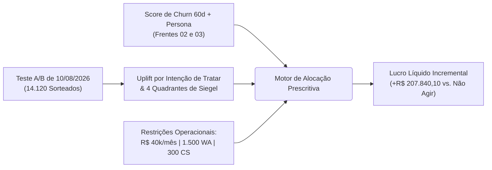

# Detalhamento de Tarefas — Frente 04: Growth, Uplift Modeling & Otimização Orçamentária de CRM (Objetivos 6 e 7)

> **Frente:** 4 — Experimentação Causal, Modelagem de Uplift (Siegel), Alocação de Capacidade & Retorno Líquido Incremental  
> **Módulo 2:** Case Vitaliza — Inteli MBA  
> **Objetivo:** Mensurar o efeito causal da campanha controlada de `10/08/2026`, isolar os assinantes *Persuadíveis* (protegendo os *Sleeping Dogs* e a margem nos *Garantidos*) e alocar o orçamento de R$ 40.000/mês (`1.500` WhatsApps e `300` atendimentos CS) para maximizar o lucro líquido incremental em reais  
> **Entrega Principal:** Semana 10 (Artefato 2 — Negócios)  
> **Arquivo:** `FRENTE_04_GROWTH_UPLIFT_E_ORCAMENTO_CRM.md`  

---

## 🎯 1. Escopo de Execução & Entregável Esperado

1. **Avaliação do Experimento Controlado de Agosto e Uplift (Objetivo 6):**
   * Analisar `campanha_ago26.csv` (14.120 pagantes sorteados em `desafio`, `cupom`, `conteudo` e `controle`) e medir o efeito causal incremental (*Uplift*) de cada tratamento.
   * Separar os assinantes nos **4 Quadrantes de Siegel** (*Persuadíveis, Garantidos, Perdidos e Não Perturbe*).
2. **Regra Prescritiva de Contato e Retorno Líquido em Reais (Objetivos 6 e 7):**
   * Alocar canais (**máx. 1.500 WhatsApps a R$ 0,40**, **máx. 300 CS a R$ 18,00**, E-mail a R$ 0,01 e Push máx. 1/semana) e ofertas (**30% off 3m = R$ 35,91**, **1 mês grátis anual = R$ 25,00**, **Pausa 60d**, **Treino personalizado = R$ 0**) respeitando o teto de **R$ 40.000,00/mês**.
   * Calcular o **Lucro Líquido Incremental em R$** da ação comparada a não fazer nada.

---

## 📋 2. Checklist Granular de Tarefas

### 2.1 Avaliação Causal do Experimento de Agosto (`campanha_ago26.csv` — Especificações 6.1 e 6.2)
- [ ] **Estimativa por Intenção de Tratar (*Intention-to-Treat*):** Avaliar todos os `14.120` participantes originalmente sorteados (`3.579` Controle, `3.515` Desafio, `3.472` Cupom, `3.554` Conteúdo), sem filtrar apenas quem abriu ou clicou na mensagem.
- [ ] **Mensuração de Efeito Heterogêneo por Plano:** Demonstrar que no **Plano Mensal**, o tratamento `cupom` reduziu a saída/desligamento de `17,99%` (Controle) para **`10,63%` (`-7,36 p.p.` de ganho)** e o tratamento `desafio` (custo de oferta R$ 0) reduziu para **`12,98%` (`-5,01 p.p.` de ganho)**.
- [ ] **Identificação Empírica dos 4 Quadrantes de Siegel:** Comprovar nos dados que acionar assinantes inativos (`0` treinos em jul/2026) produziu efeito negativo severo (**de `51,86%` no Controle para `57,95%` a `61,02%` nos tratamentos — `+6,09 a +9,16 p.p.` de saída induzida nos *Sleeping Dogs***), enquanto o ganho positivo concentra-se nos **Persuadíveis (`1 a 4` treinos/mês)**.

### 2.2 Desenho da Política Prescritiva e Alocação de Capacidade (Objetivo 6 — Especificações 6.3 a 6.5)
- [ ] **Regra de Abstenção e Proteção de Margem:** Instituir trava determinística que veda qualquer comunicação para *Sleeping Dogs* (`0` treinos + `renovacao_automatica = 'sim'`) e veda concessão de cupom para *Garantidos* (`≥5` treinos/mês).
- [ ] **Tratamento da Assimetria de Canal (`70,22%` Lojas):** Priorizar a atuação preventiva por queda de engajamento para os `10.359` clientes de App Store e Google Play, além de atuar na janela entre `renovacao_automatica_desligada` e `assinatura_expirada`.
- [ ] **Alocação Cirúrgica de Canais e Orçamento:** Distribuir os **`300` atendimentos de CS** (`R$ 5.400,00`), as **`1.500` mensagens de WhatsApp** (`R$ 600,00`) e a cobertura de E-mail/Push entre os Persuadíveis ordenados por valor incremental esperado, mantendo o desembolso total (`R$ 26.441,90/mês`, incluindo descontos e IA) dentro do teto de **R$ 40.000,00/mês**.

### 2.3 Apuração do Retorno Líquido em Reais e Contingências (Objetivo 7 — Especificações 7.1 a 7.4)
- [ ] **Cálculo de Receita Líquida e Margem de Contribuição:** Descontar o *take rate* de cada canal (`15%` lojas, `3,5%` cartão, `0,99%` Pix) e o custo de servir (`R$ 4,20/assinante/mês`) para apurar a margem real preservada no horizonte.
- [ ] **Contabilização Integral de Custos da Política:** Subtrair custos de canal (`R$ 6.112,40`), custo de tokens de IA (`R$ 420,00`) e custo integral dos descontos concedidos (`R$ 19.909,50`, incluindo os aceites de quem renovaria sem estímulo).
- [ ] **Simulação de Sensibilidade e Matriz de Contingência (Board Deck):** Demonstrar o lucro líquido incremental (**`+R$ 207.840,10`** vs. não agir) e estabelecer gatilhos de proteção (*Kill-Switch* de inatividade e trava orçamentária de cupons).

---

## 📄 3. Estrutura dos Documentos Finais a Serem Alimentados

O trabalho desta frente consolida-se diretamente em:
1. **Artefato Oficial de Negócios (Semana 10 — A2):** Slides 3, 4, 5 e 6 de [`artefatos_negocios/semana_10_A2/ARTEFATO_NEGOCIOS_SEMANA10_A2.md`](../artefatos_negocios/semana_10_A2/ARTEFATO_NEGOCIOS_SEMANA10_A2.md).
2. **Guia de Estratégia de Uplift e Retorno:** [`00_comece_por_aqui/01_trilha_negocios_e_crm/02_ESTRATEGIA_UPLIFT_E_ROI_A2_SEMANA10.md`](../00_comece_por_aqui/01_trilha_negocios_e_crm/02_ESTRATEGIA_UPLIFT_E_ROI_A2_SEMANA10.md).
