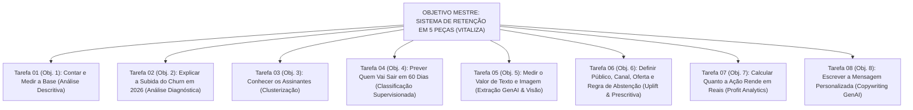

# Matriz de Tarefas & Especificações de Execução — Case Vitaliza (Módulo 2)

> **Projeto:** Sistema de Predição de Churn, Extração Multimodal e Decisão Prescritiva de Retenção — Vitaliza  
> **Módulo 2:** Ciência de Dados, Machine Learning Preditivo e IA Generativa (Inteli MBA)  
> **Equipe de Trabalho:** Equipe de Projetos MBA Inteli  
> **Arquivo:** `MATRIZ_DE_TAREFAS_E_ESPECIFICACOES.md`  

---

## 🧭 1. Estrutura Mestra de Execução (Os 8 Objetivos do Case)

O plano de trabalho do grupo segue exatamente os **8 Objetivos Oficiais do Enunciado da Vitaliza** (metodologia CRISP-DM, evoluindo da análise descritiva à prescritiva):

---

## 📑 2. Detalhamento das Tarefas & Especificações Executáveis

---

### 🟢 TAREFA 01 (Objetivo 1): Contar e Medir a Base (Análise Descritiva)
* **Pergunta de Negócio:** Quantos assinantes pagantes ativos a Vitaliza tinha no corte (`30/09/2026`)? Quanto perde por mês, e como isso varia por plano e por canal?
* **Especificações Executáveis:**
  - **Especificação 1.1:** Auditar a qualidade e integridade dos 13 arquivos do Data Room (chaves nulas, duplicidades, categorias divergentes e formatos de data).
  - **Especificação 1.2:** Normalizar os fusos horários de `eventos_assinatura.csv` (convertendo os eventos das lojas em `UTC "Z"` para `Horário de Brasília`).
  - **Especificação 1.3:** Reconstruir a situação histórica de cada assinante no início de cada mês e em `30/09/2026` combinando `eventos_assinatura.csv` e `assinaturas.csv`, reconciliando os **14.753 pagantes ativos** no corte.
  - **Especificação 1.4:** Cruzar `eventos_assinatura.csv` com `pagamentos.csv` para separar o churn voluntário do churn involuntário (recusas de cobrança e chargebacks).
  - **Especificação 1.5:** Construir a tabela descritiva da taxa de churn mensal (2025 vs. 2026) aberta por plano (`mensal` 43% vs. `anual` 57%) e por canal (`app_store` 36,6%, `google_play` 33,6%, `web_cartao` 20,3%, `web_pix` 9,5%).

---

### 🟢 TAREFA 02 (Objetivo 2): Explicar a Subida do Churn em 2026 (Análise Diagnóstica)
* **Pergunta de Negócio:** O que mudou entre 2025 (média 5,6%) e 2026 (média 6,6%, pico de 8,1% em abril), e para quem?
* **Especificações Executáveis:**
  - **Especificação 2.1:** Testar a hipótese do reajuste de preço do plano mensal (de R$ 34,90 para R$ 39,90 em `01/03/2026`) comparando a curva de saída mensal vs. anual antes e depois de março.
  - **Especificação 2.2:** Testar a hipótese de safra (*cohort analysis*) e canal de aquisição (`canal_aquisicao` em `usuarios.csv`), avaliando se o crescimento acelerado de 68% da base trouxe usuários menos engajados.
  - **Especificação 2.3:** Cruzar a queda de frequência de treino (`uso_mensal.csv` e `atividades.parquet`) e posse de relógio conectado (`Garmin` / `Apple Watch`) com a taxa de cancelamento.
  - **Especificação 2.4:** Avaliar o efeito de rede social (`amizades.csv` e `treino_com` em `atividades.parquet`) sobre a retenção dos assinantes.
  - **Especificação 2.5:** Documentar o diagnóstico deixando claro o limite metodológico: cruzamentos bivariados apontam suspeitos e correlações, mas não provam causalidade isolada.

---

### 🟢 TAREFA 03 (Objetivo 3): Conhecer os Assinantes (Clusterização Não-Supervisionada)
* **Pergunta de Negócio:** Quem são os assinantes da Vitaliza, divididos em grupos (personas) que qualquer área da empresa entenda?
* **Especificações Executáveis:**
  - **Especificação 3.1:** Selecionar e padronizar a escala (*StandardScaler / MinMaxScaler*) das variáveis comportamentais e cadastrais (treinos ao ar livre vs. vídeo, minutos, dias ativos, conexões sociais, dispositivo).
  - **Especificação 3.2:** Garantir que a informação de quem saiu (**variável de churn**) **NÃO seja usada** na construção dos clusters.
  - **Especificação 3.3:** Executar e comparar algoritmos de clusterização (ex.: *K-Means*, *Agrupamento Hierárquico*), determinando o número ótimo de segmentos (Método do Cotovelo / Silhueta).
  - **Especificação 3.4:** Nomear e descrever cada persona com linguagem executiva de negócio (perfil médio, modalidade preferida, engajamento social e sensibilidade a preço).
  - **Especificação 3.5:** Conectar cada segmento às ofertas e mensagens mais aderentes do catálogo do CRM.

---

### 🟢 TAREFA 04 (Objetivo 4): Prever Quem Vai Sair em 60 Dias (Classificação Supervisionada)
* **Pergunta de Negócio:** Qual a probabilidade de cada assinante ativo em `30/09/2026` sair nos 60 dias seguintes ao corte (até `29/11/2026`)?
* **Especificações Executáveis:**
  - **Especificação 4.1:** Estruturar as janelas temporais de treino e validação (*Out-of-Time Validation*), garantindo zero *Data Leakage* posterior à data de corte de cada janela.
  - **Especificação 4.2:** Treinar o modelo de referência (**Regressão Logística**) e interpretar os coeficientes de impacto de cada variável.
  - **Especificação 4.3:** Treinar modelos de **Árvores de Decisão** (extraindo regras legíveis de negócio) e modelos de ensemble (**Bagging / Random Forest** e **Boosting / XGBoost / LightGBM**).
  - **Especificação 4.4:** Avaliar discriminação e calibração (ROC-AUC, PR-AUC, Curva de Ganho/Lift e Matriz de Confusão em dados fora da amostra de treino).
  - **Especificação 4.5:** Gerar a lista ordenada de risco (`score_churn_60d`) para os 14.753 assinantes pagantes ativos em `30/09/2026`.

---

### 🟢 TAREFA 05 (Objetivo 5): Medir o Valor de Texto e Imagem (Extração GenAI & Visão)
* **Pergunta de Negócio:** Os textos livres (`onboarding`, `pesquisa_saida`, `feed_posts`, `tickets_suporte`) e os mapas de calor (`heatmaps_90d/`) melhoram a previsão de churn o bastante para pagar o custo de processá-los?
* **Especificações Executáveis:**
  - **Especificação 5.1:** Definir o contrato JSON/Schema de extração com IA Generativa para converter os textos de onboarding, posts e chamados de suporte em variáveis estruturadas (apenas com dados até a data de corte).
  - **Especificação 5.2:** Construir uma amostra rotulada à mão (*Gold Standard*) para aferir a taxa de acerto da extração da IA Generativa e calcular o custo de tokens por assinante.
  - **Especificação 5.3:** Processar as imagens de `heatmaps_90d/` (`2026-07-31/` e `2026-09-30/`) comparando a contagem determinística de pixels por cor (verde/parque, azul/água, areia/praia, amarelo/avenida) contra a leitura por modelo de visão.
  - **Especificação 5.4:** Retreinar os modelos supervisionados do Objetivo 4 incluindo as variáveis extraídas de texto e imagem.
  - **Especificação 5.5:** Comparar a performance e o retorno financeiro líquido do modelo **com vs. sem** variáveis multimodais, descontando o custo de IA do orçamento de R$ 40.000/mês.

---

### 🟢 TAREFA 06 (Objetivo 6): Definir Público, Canal, Oferta e Regra de Abstenção (Análise Prescritiva & Uplift)
* **Pergunta de Negócio:** Quais assinantes devemos contatar, por qual canal, com qual mensagem/oferta, e para quais perfis preservar a abstenção de contato?
* **Especificações Executáveis:**
  - **Especificação 6.1:** Analisar o experimento controlado de `10/08/2026` (`campanha_ago26.csv`, 14.120 sorteados), medindo a diferença causal de saída entre `desafio`, `cupom`, `conteudo` e o grupo `controle`.
  - **Especificação 6.2:** Estimar o efeito incremental (*Uplift*) por perfil/segmento, classificando a base nos 4 grupos de Siegel: **Persuadíveis**, **Garantidos**, **Perdidos** e **Não Perturbe (*Sleeping Dogs*)**.
  - **Especificação 6.3:** Tratar especificamente a diferença de canal de pagamento: agir preventivamente nos 70% das lojas (App Store / Google Play) e aproveitar a janela entre `renovacao_automatica_desligada` e `assinatura_expirada`.
  - **Especificação 6.4:** Formular a regra de alocação otimizada respeitando os tetos de **1.500 mensagens de WhatsApp/mês**, **300 atendimentos CS/mês**, E-mail (R$ 0,01) e Push (máx. 1/semana).
  - **Especificação 6.5:** Garantir que a soma dos custos de canal + descontos concedidos + processamento de IA respeite o teto global de **R$ 40.000,00/mês**.

---

### 🟢 TAREFA 07 (Objetivo 7): Calcular Quanto a Ação Rende em Reais (Profit-Driven Analytics)
* **Pergunta de Negócio:** Quanto a Vitaliza ganha com a regra de contato, em reais, comparada a não fazer nada?
* **Especificações Executáveis:**
  - **Especificação 7.1:** Calcular a receita líquida por assinante retido por causa do contato, descontando o *take rate* do canal (15% lojas, 3,5% cartão, 0,99% Pix) e o custo de servir (R$ 4,20/mês).
  - **Especificação 7.2:** Contabilizar rigorosamente os custos da campanha: envios de canal (WhatsApp R$ 0,40, CS R$ 18,00, E-mail R$ 0,01), descontos concedidos (R$ 35,91 no mensal / R$ 25,00 no anual — inclusive para assinantes que renovariam organicamente sem incentivo) e custo de IA Generativa.
  - **Especificação 7.3:** Comparar os modelos preditivos pelo **lucro líquido em reais** gerado pela régua (Verbeke et al., 2012), e não apenas por métricas estatísticas abstratas.
  - **Especificação 7.4:** Simular cenários de sensibilidade para o planejamento de novembro e dezembro de 2026.

---

### 🟢 TAREFA 08 (Objetivo 8): Escrever a Mensagem Personalizada (Copywriting com IA Generativa)
* **Pergunta de Negócio:** O que dizer individualmente a cada pessoa contatada pela regra de decisão?
* **Especificações Executáveis:**
  - **Especificação 8.1:** Estruturar o *System Prompt* e o briefing de negócio (tom de voz da Vitaliza, ofertas permitidas por plano e restrições do que não dizer).
  - **Especificação 8.2:** Injetar no prompt os dados reais do assinante (segmento do Objetivo 3, variáveis extraídas do Objetivo 5, modalidade de treino favorita, canal e oferta definida no Objetivo 6).
  - **Especificação 8.3:** Gerar o lote final de mensagens personalizadas e auditáveis, fechando o sistema de ponta a ponta (*entra um assinante $\rightarrow$ saem o risco, a decisão e a mensagem*).
