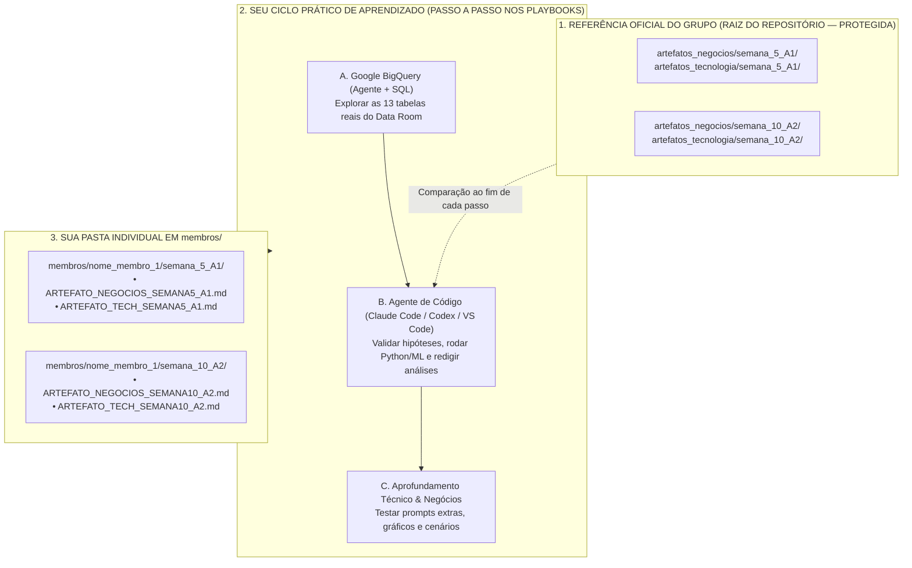

# 00 · Cronograma e preparação do ambiente — Case Vitaliza (Módulo 2)

> **Objetivo:** cada integrante do grupo, de qualquer área de origem, refaz sozinho a análise da **Semana 5 (A1)** e da **Semana 10 (A2)** e escreve os próprios artefatos de Negócios e Tecnologia. No caminho, aprende a usar **Google BigQuery**, **SQL analítico**, **Machine Learning supervisionado e não supervisionado**, **extração multimodal com IA generativa (Gemini)** e **agentes de código (Claude Code / Codex / VS Code)**.

---

## 1. Como o grupo vai trabalhar

Os quatro entregáveis oficiais já estão prontos. Cada integrante refaz, na própria pasta, o caminho que levou a eles, para entender de onde vem cada número e por que cada decisão foi tomada:

1. **Entregáveis oficiais (`artefatos_negocios/` e `artefatos_tecnologia/`):**
   * Os 4 entregáveis do módulo, revisados pelo grupo. Use-os para comparar o seu resultado ao fim de cada passo, não como ponto de partida.
2. **Sua pasta individual (`membros/nome_membro_1/`):**
   * Cada integrante segue os 2 playbooks e escreve os próprios artefatos dentro da sua pasta em `membros/`.
   * Em cada passo você consulta as tabelas no BigQuery, roda o SQL, lê os scripts Python e usa o agente de código para montar as seções dos documentos.



### 1.1 O case em cinco minutos

Leia esta parte antes de abrir qualquer tabela. Sem ela, os números dos passos não têm a quem responder.

* **A empresa:** a Vitaliza é um aplicativo brasileiro de assinatura para quem treina (corrida, caminhada e pedal com GPS, aulas em vídeo e rede social com relógios Garmin e Apple Watch). Modelo *freemium*: o uso básico é gratuito e o Premium é pago, no plano **Mensal (R$ 39,90, reajustado em 01/03/2026 a partir de R$ 34,90)** ou **Anual (R$ 299,90)**.
* **O problema:** o churn mensal médio (percentual de assinantes que cancelam em um mês) subiu de **5,6% em 2025 para 6,6% em jan–set de 2026**, com pico de **8,1% em abril de 2026**.
* **A pressão:** a empresa está perto de captar a **Série B** (rodada de investimento) e o concorrente **Strava Premium** anunciou modelos de previsão de desengajamento no Brasil.
* **A data de corte:** todo o Data Room retrata a base em **30/09/2026**. Qualquer registro posterior é vazamento (informação do futuro) e precisa ser excluído.
* **A regra entre as duas fontes do case:** cálculos, modelos e contas financeiras usam o **Data Room** (`documentos/exhibits-m2/` e BigQuery). A narrativa executiva responde ao dilema da diretoria descrito no deck de negócios. O deck traz números ilustrativos de 2025 que **não** devem ser misturados com os do Data Room.
* **Os dois movimentos do módulo:**

| Movimento | Pergunta que responde | Entregáveis | Datas |
| :--- | :--- | :--- | :--- |
| **A1 — Entender** (Semana 5) | Quem são os assinantes, quem está saindo, por quê e quanto isso custa? | Relatório de segmentação de clientes (Negócios) e relatório de engenharia de dados e modelo baseline (Tecnologia) | Entrega `13/11/2026` |
| **A2 — Agir** (Semana 10) | Em quem a Vitaliza deve investir os R$ 40.000/mês de retenção, com qual ação, e quanto lucro isso gera? | 6 slides ao Conselho (Negócios) e relatório de modelos, extração multimodal e uplift (Tecnologia) | Previsão 60 dias `08/12`, revelação `10/12`, entrega `18/12/2026` |

A2 depende de A1: os segmentos, as personas e o modelo baseline da Semana 5 são a base das decisões da Semana 10. Por isso os números precisam ser idênticos entre os dois.

### 1.2 Quem lê os artefatos: os personagens do case

Dois tipos de persona aparecem neste módulo e não devem ser confundidos:

1. **Personagens do case:** os executivos da Vitaliza que leem e julgam a recomendação. Eles definem o que cada seção precisa responder.
2. **Personas de dados:** perfis de assinantes construídos a partir dos clusters no Passo 04 do Playbook 1. Eles descrevem clientes, não executivos.

| Personagem | Cargo | Posição no dilema | Pergunta que fará ao grupo | Onde a resposta é construída |
| :--- | :--- | :--- | :--- | :--- |
| **Camila Ferraz** | VP de Crescimento e Retenção | Precisa levar uma recomendação única ao Conselho | Qual é o plano, por que ele é melhor que as alternativas e quanto ele rende? | Playbook 2, todos os passos (ela apresenta os 6 slides) |
| **Patrícia** | Head de CS | Defende o **Caminho A**: oferta de retenção (*win-back*) no momento em que o cliente clica em "Cancelar" | A oferta na tela de cancelamento resolve? | Playbook 1, Passo 01 (70,22% pagam pelas lojas e cancelam fora do app); Playbook 2, Passo 01 |
| **Marcelo** | Head de Produto | Defende o **Caminho B**: score preditivo diário de queda de engajamento | Prever quem vai sair é suficiente para decidir quem acionar? | Playbook 1, Passo 05 (baseline); Playbook 2, Passos 03 e 04 (modelos e uplift) |
| **Diego Almeida** | CTO | Alerta para o esforço de engenharia em 13 fontes desconectadas e com fusos diferentes | Os dados são confiáveis e quanto custa integrá-los? | Playbook 1, Passo 02 (7 anomalias); Playbook 2, Passo 02 (custo de IA) |
| **Rita Fontes** | CFO | Exige retorno financeiro comprovado dentro do orçamento | O plano cabe em R$ 40.000/mês, 1.500 WhatsApps e 300 atendimentos de CS, e qual é o lucro incremental? | Playbook 2, Passo 05 |
| **Conselho** | Investidores e conselheiros | Decide antes da Série B | Por que este plano, quais os riscos e como interromper se der errado? | Playbook 2, Passo 05 (riscos e *kill-switch*) |

Ao escrever qualquer seção, pergunte: **qual destes personagens vai ler isto e que decisão ele toma com esta informação?** Se a resposta não estiver clara, a seção ainda não está pronta.

### 1.3 Como cada passo foi construído

Os artefatos oficiais foram feitos seguindo sempre a mesma sequência. Os playbooks reproduzem essa sequência em cada passo, no bloco **Raciocínio do passo** e nas Ações 1 a 4:

| # | Etapa | O que fazer | Onde está no playbook |
| :-: | :--- | :--- | :--- |
| 1 | **Pergunta de negócio** | Escrever em uma frase o que se quer saber e quem pergunta | Raciocínio do passo |
| 2 | **Onde olhar** | Identificar as tabelas, as colunas e o documento do case que define a regra (preço, taxa, data de corte) | Raciocínio do passo |
| 3 | **Raciocínio** | Decidir, em ordem, o que filtrar, o que excluir, como agrupar e o que calcular, sabendo o porquê de cada decisão | Raciocínio do passo e Ação 1 |
| 4 | **Conferir** | Verificar se os totais fecham, se os percentuais somam 100% e se o número bate com o de outros passos | Ação 2 |
| 5 | **Escrever** | Montar a seção com título em forma de conclusão, o número principal, a tabela de apoio e a implicação para a decisão | Ação 3 |
| 6 | **Comparar** | Só então abrir o artefato oficial, listar as diferenças e entender a origem de cada uma | Ação 3 (final) |

Duas regras valem para todos os passos:

* **Um número só entra no artefato se você souber de qual consulta ou documento ele veio.** O agente de código ajuda a redigir, mas a origem do número é responsabilidade de quem escreve.
* **O artefato oficial é para comparar, não para copiar.** Se o seu resultado for diferente, a diferença é a parte mais útil do exercício: geralmente revela um filtro esquecido ou uma regra do case lida de outra forma.

---

## 2. Ferramentas

Os playbooks usam quatro ferramentas:

| Ferramenta | O que é | Como Usamos no Case Vitaliza | Link / Onde Acessar |
| :--- | :--- | :--- | :--- |
| **1. Google BigQuery + Agente Gemini** | Banco de dados analítico do Google que guarda as 13 tabelas do case (incluindo `atividades.parquet` com 1,25 milhão de treinos) e permite conversar com os dados em linguagem natural ou rodar SQL em segundos. | Para auditar os dados, limpar pegadinhas, calcular churn, segmentar clientes e analisar o experimento A/B de agosto sem travar o computador. | [**Abrir Dataset `vitaliza_inteli_modulo_2` no BigQuery**](https://console.cloud.google.com/bigquery?ws=!1m4!1m3!3m2!1sthermal-origin-470820-e7!2svitaliza_inteli_modulo_2) |
| **2. Agente de Código (`Claude Code`, `Codex`, `Cursor` ou `VS Code`)** | Um assistente que lê todas as pastas e documentos do nosso repositório, conversa com você sobre o case e preenche os seus relatórios. | Para transformar as respostas do BigQuery nas seções estruturadas dos seus artefatos dentro de `membros/` e debater os documentos das trilhas de estudo. | No seu computador (Desktop App ou VS Code). |
| **3. NotebookLM do Case** | Caderno de IA alimentado exclusivamente com os PDFs oficiais (Enunciado, Dicionário de Dados e Slides das Aulas) e dossiês do projeto. | Para tirar dúvidas conceituais sobre regras do case, preços, taxas de canal e teoria das aulas (Siegel, Kotler, CRISP-DM). | [**Abrir Caderno Oficial no NotebookLM**](https://notebook.google.com/notebook/7201a470-3cf5-42e0-b859-7036086280ac) |
| **4. Git & GitHub (`main` e `develop`)** | Sistema de controle de versão onde o repositório do grupo vive na nuvem. | Para você aprender na prática a clonar o projeto, puxar atualizações (`git pull`), salvar seus artefatos na sua pasta individual (`git commit`) e compartilhar na branch `develop` (`git push` / `git merge`). | [**Repositório `02-mba-modulo-2` no GitHub**](https://github.com/leomaquiaveli/02-mba-modulo-2) |

---

## 3. A pasta `membros/` e por que ela evita conflitos no Git

Se 5 pessoas editarem ao mesmo tempo o arquivo `artefatos_negocios/semana_5_A1/ARTEFATO_NEGOCIOS_SEMANA5_A1.md`, quando a segunda pessoa tentar subir para o GitHub vai ocorrer **conflito de merge** (porque dois computadores mexeram na mesma linha do mesmo arquivo).

Para que cada pessoa escreva os 4 artefatos sem conflito no Git, cada integrante trabalha na sua própria subpasta dentro de [`membros/`](../../membros/):

```text
membros/
├── 00_geral/                                      <-- Anotações e arquivos compartilhados
├── nome_membro_1/                                 <-- Pasta-modelo pronta (você duplica com seu nome!)
│   ├── README.md                                  <-- Seu painel de controle individual
│   ├── semana_5_A1/
│   │   ├── ARTEFATO_NEGOCIOS_SEMANA5_A1.md        <-- Seu relatório de Negócios A1 (construído no Playbook 1)
│   │   └── ARTEFATO_TECH_SEMANA5_A1.md            <-- Seu relatório de Tecnologia A1 (construído no Playbook 1)
│   └── semana_10_A2/
│       ├── ARTEFATO_NEGOCIOS_SEMANA10_A2.md       <-- Sua apresentação ao Board A2 (construída no Playbook 2)
│       └── ARTEFATO_TECH_SEMANA10_A2.md           <-- Seu relatório de Tecnologia A2 (construído no Playbook 2)
└── nome_membro_2/                                 <-- Pasta isolada de outro integrante
```

### Passo Inicial no Seu Agente de Código (Faça Isso Antes do Passo 01):
Abra o projeto no seu **Claude Code / Codex / VS Code** e mande este primeiro comando para preparar o seu espaço pessoal:

```text
Vou começar os playbooks do case Vitaliza.
1. Verifique se estou na branch `develop` (e faça `git pull origin develop` para garantir que tenho a versão mais recente).
2. Duplique a pasta-modelo `membros/nome_membro_1/` criando uma nova pasta chamada `membros/<coloque_seu_identificador_aqui>/` (mantendo a subpasta `semana_5_A1/` e `semana_10_A2/` lá dentro).
3. Me confirme a árvore de arquivos criada na minha pasta individual e me diga que estamos prontos para o Passo 01 do Playbook 1.
```

---

## 4. Três formas de consultar o BigQuery

Ao abrir o nosso dataset [**`vitaliza_inteli_modulo_2` no BigQuery**](https://console.cloud.google.com/bigquery?ws=!1m4!1m3!3m2!1sthermal-origin-470820-e7!2svitaliza_inteli_modulo_2), você verá no painel esquerdo todas as **13 tabelas** do case (`amizades`, `assinaturas`, `atividades`, `campanha_ago26`, `eventos_assinatura`, `feed_posts`, `gym_churn_us`, `onboarding`, `pagamentos`, `pesquisa_saida`, `tickets_suporte`, `uso_mensal`, `usuarios`).

Você pode explorar essas tabelas de **3 formas diferentes** em cada Passo dos Playbooks:

1. **Forma 1 — Pelo Agente Conversacional (`Conversations` / `Ask a question`):**
   * Clique em uma tabela (ex.: `assinaturas`) ou clique em **`Conversations`** no menu esquerdo para selecionar **várias tabelas ao mesmo tempo** (ex.: `assinaturas` + `uso_mensal` + `usuarios`).
   * Cole o **💬 Prompt para o Agente do BigQuery** do Playbook: o Agente gera a consulta, calcula a tabela e desenha o gráfico.
2. **Forma 2 — Pelo `Data canvases` (Cruzamento Visual + Gráficos):**
   * Clique em **`Data canvases`** no menu esquerdo, adicione duas ou mais tabelas na tela, clique em **Join** (unindo por `user_id` ou `assinatura_id`) e peça análises ou gráficos comparativos na caixa de prompt.
3. **Forma 3 — Pelo Editor SQL (`Queries`):**
   * Em todos os Passos dos Playbooks deixamos também a **💻 Query SQL Completa**. Mesmo que você use o Agente Conversacional, recomendamos colar e rodar a Query SQL no editor para **aprender a ler como o SQL filtra datas (`WHERE`), agrupa (`GROUP BY`), cruza tabelas (`JOIN`) e cria faixas (`CASE WHEN`)**.

---

## 5. Roteiro: 10 passos em 2 playbooks

Você pode avançar no seu ritmo (por exemplo, **1 Passo por dia** em ~25 minutos, ou fazer tudo num fim de semana). Cada Passo tem começo, meio e fim e deixa uma seção inteira do seu entregável pronta:

### Fase 1: Construindo os Entregáveis da Semana 5 (A1)
👉 **Abra o arquivo:** [**`01_PLAYBOOK_SEMANA_05_A1.md`**](./01_PLAYBOOK_SEMANA_05_A1.md)

| Passo | O Que Você Vai Aprender a Fazer | Quais Tabelas Você Vai Dominar | O Que Fica Pronto na Sua Pasta `semana_5_A1/` |
| :--- | :--- | :--- | :--- |
| **Passo 01** | Reconciliar uma base de assinaturas, isolar contas não-pagantes (`cortesia`), calcular Receita Líquida (MRR) descontando *take rate* e medir churn contratado (`renovacao_automatica = 0`). | `assinaturas` (`32.643` linhas) | **Negócios A1:** Seção 1 e 1.1<br>**Tech A1:** Seção 1 |
| **Passo 02** | Fazer auditoria de *Data Quality*: detectar vazamento temporal pós-corte (`> 30/09/2026`), converter fuso horário `UTC ("Z")` para Brasília (`BRT`), padronizar strings (`android`/`iOS`) e unificar vocabulário PT/EN em 1,25 milhão de linhas. | `usuarios`, `eventos_assinatura`, `atividades`, `feed_posts`, `amizades` | **Tech A1:** Seção 2 (As 7 Anomalias)<br>**Negócios A1:** Seção 5.2 (Limitações) |
| **Passo 03** | Conduzir uma Análise Exploratória Diagnóstica (EDA) testando 5 hipóteses de negócio (`H1` Reajuste de preço, `H2` Canal Loja vs Site, `H3` Frequência de treino, `H4` Rede social/Smartwatch e `H5` Falha de pagamento/Suporte). | `eventos_assinatura`, `pesquisa_saida`, `uso_mensal`, `amizades`, `pagamentos`, `tickets_suporte` | **Negócios A1:** Seção 2 Completa (Matriz `H1` a `H5`) |
| **Passo 04** | Criar uma Segmentação Comportamental sem *Data Leakage* (4 Clusters), traduzir clusters em **Personas Baseadas em Dados** e calcular a **Matriz de Receita em Risco** separando inativos que já cancelaram (`4A`) dos *Sleeping Dogs* (`4B`). | `assinaturas` + `uso_mensal` + `usuarios` | **Negócios A1:** Seções 3, 4 e 5.1<br>**Tech A1:** Seção 3 Completa |
| **Passo 05** | Construir uma visão consolidada de variáveis de risco (`M-1` vs `M-2`, `delta_treinos`) e entender como funciona o modelo baseline de **Regressão Logística** (`ROC-AUC`, `PR-AUC`, `Brier Score` e `Lift@10%`). | Todas as fontes tabulares unificadas por `user_id` no BigQuery | **Tech A1:** Seção 4 Completa *(Fechamento 100% da Semana 5!)* |

---

### Fase 2: Construindo os Entregáveis da Semana 10 (A2)
👉 **Abra o arquivo:** [**`02_PLAYBOOK_SEMANA_10_A2.md`**](./02_PLAYBOOK_SEMANA_10_A2.md)

| Passo | O Que Você Vai Aprender a Fazer | Quais Tabelas / Scripts Você Vai Dominar | O Que Fica Pronto na Sua Pasta `semana_10_A2/` |
| :--- | :--- | :--- | :--- |
| **Passo 01** | Estruturar uma defesa executiva para Conselho de Administração (Série B) e comparar arquiteturas de produto (*Win-Back Reativo* vs. *Engagement Forecasting* vs. *Política Prescritiva de Uplift* frente ao Strava). | `assinaturas`, `uso_mensal`, `usuarios` | **Negócios A2:** Slides 1, 2 e 3<br>**Tech A2:** Seção 1 |
| **Passo 02** | Extrair variáveis estruturadas de textos livres (`onboarding`, `suporte`, `feed`), entender a análise dos `25.473` mapas de calor (`heatmaps_90d/`), calcular o custo de IA e analisar o **Teste de Ablação**. | `onboarding`, `tickets_suporte`, `feed_posts` no BigQuery + Dossiê Multimodal | **Tech A2:** Seção 2 Completa (Subseções 2.1, 2.2 e 2.3) |
| **Passo 03** | Comparar 4 famílias de algoritmos supervisionados para predição em 60 dias (**Regressão Logística, Árvore de Decisão, Random Forest e Gradient Boosting Multimodal**) e extrair regras não-lineares de risco. | Feature Store Completa (Tabular + Multimodal) | **Tech A2:** Seção 3 Completa |
| **Passo 04** | Analisar um **Experimento Controlado A/B (`campanha_ago26.csv`)**, calcular **Uplift (Efeito Causal Heterogêneo)** por plano e por engajamento prévio e provar matematicamente os **4 Quadrantes de Siegel** (*Persuadíveis*, *Garantidos*, *Perdidos* e *Sleeping Dogs*). | `campanha_ago26` + `assinaturas` + `uso_mensal` (mês `2026-07`) | **Negócios A2:** Slide 4 Completo (Tabelas 4.1 e 4.2)<br>**Tech A2:** Seção 4.1 (Árvore de Decisão em 5 Regras) |
| **Passo 05** | Otimizar um orçamento real de CRM (**R$ 40.000/mês**, **300 CS**, **1.500 WhatsApps**), calcular a DRE de **Lucro Líquido Incremental (`+R$ 207.840,10`)**, desenhar travas de contingência (*Kill-Switch*) e gerar mensagens personalizadas de CRM com **Briefing Fechado**. | Base Ativa no BigQuery + Documentos da Trilha 1 e 3 | **Negócios A2:** Slides 5 e 6<br>**Tech A2:** Seção 4.2 *(Fechamento 100% da Semana 10!)* |

---

## 6. Git: atualizar e salvar o seu trabalho

Sempre que você quiser atualizar seu computador com as novidades da branch `develop` ou salvar o que construiu na sua pasta em `membros/`, você pode pedir direto para o seu **Agente de Código** ou rodar estes comandos:

1. **Para trazer a branch `develop` (onde estão estes Playbooks) para o seu computador:**
   ```bash
   git fetch origin
   git checkout develop
   git pull origin develop
   ```
2. **Se você estiver na `main` e quiser puxar (fazer o merge) do que está na `develop`:**
   ```bash
   git checkout main
   git pull origin develop
   ```
3. **Para salvar os artefatos que você construiu na sua pasta `membros/`:**
   ```bash
   git add membros/
   git commit -m "feat(membros): avanca na construcao dos artefatos praticos"
   git pull --rebase origin develop
   git push origin develop
   ```
