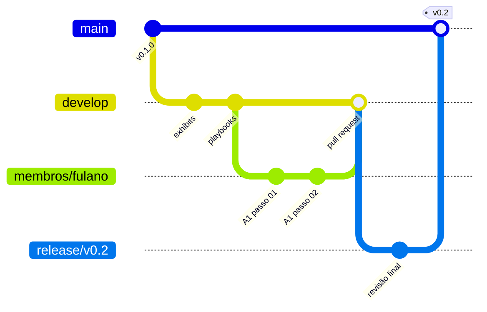

# 03 · Guia de Git do grupo

> **Para quem é:** todo integrante que vai salvar o próprio trabalho no repositório.
> **O que você aprende:** como o repositório se organiza em branches (Gitflow), como escrever um commit no padrão do grupo e os comandos do dia a dia.
> **Se preferir não usar o terminal:** todos os comandos deste guia podem ser pedidos ao seu agente de código. O prompt pronto está na seção 9.

---

## 1. Como o repositório se organiza: Gitflow

Uma *branch* é uma linha de trabalho paralela. Cada pessoa trabalha na sua, sem atrapalhar as outras, e o trabalho só se junta ao do grupo depois de revisado.

| Branch | Para que serve | Quem escreve nela |
| :--- | :--- | :--- |
| `main` | Versão entregue e estável. É o que o professor e quem visita o repositório veem primeiro. | Ninguém escreve direto. Recebe apenas versões fechadas vindas de uma `release`. |
| `develop` | Versão de trabalho do grupo. Junta os trabalhos já revisados. | Ninguém escreve direto. Recebe as branches de trabalho por *pull request*. |
| `release/vX.Y` | Preparação de uma entrega (exemplo: `release/v0.2`). Só recebe correções finais antes de ir para a `main`. | Quem coordena a entrega. |
| `membros/<seu_nome>` | A sua branch de trabalho. É onde você faz os commits dos seus artefatos. | Só você. |

O caminho de um trabalho até a entrega:



**Por que não escrever direto na `develop`:** se cinco pessoas enviam commits para a mesma branch, cada envio pode recusar o do outro e gerar conflito. Com uma branch por pessoa, cada um envia quando quiser, e a junção acontece no *pull request*, onde dá para ver exatamente o que entra.

---

## 2. Primeira vez: clonar e criar a sua branch

```bash
git clone https://github.com/leomaquiaveli/02-mba-modulo-2.git
cd 02-mba-modulo-2
git switch develop                     # passa para a branch de trabalho do grupo
git switch -c membros/<seu_nome>       # cria a sua branch a partir da develop
```

Use o seu primeiro nome em minúsculas e sem acento (exemplo: `membros/fulano`). É o mesmo nome da sua pasta em `membros/`.

---

## 3. Já clonou antes? Traga a `develop` nova sem perder o que fez

Se você já tinha clonado o repositório e trabalhado na `develop`, a `develop` do GitHub mudou desde então. Veja em qual situação você está com `git status` e `git log --oneline -5`.

**Situação A — você não fez nenhum commit:**

```bash
git switch develop
git pull origin develop                # baixa a develop nova
git switch -c membros/<seu_nome>       # cria a sua branch a partir dela
```

**Situação B — você fez commits na sua `develop` local (só dentro da sua pasta em `membros/`):**

```bash
git switch -c membros/<seu_nome>       # cria a sua branch levando os seus commits
git fetch origin                       # baixa as novidades do GitHub, sem mexer nos seus arquivos
git merge origin/develop               # junta a develop nova na sua branch
git branch -f develop origin/develop   # deixa a sua develop local igual à do GitHub
```

Por que funciona: o primeiro comando guarda os seus commits numa branch com o seu nome. O `merge` traz o que mudou no grupo. Como você só mexeu na sua pasta, não há conflito. O último comando alinha a sua `develop` local com a do GitHub, e os seus commits continuam salvos na sua branch.

**Se tiver arquivos alterados e ainda não commitados**, faça o commit antes (seção 4) ou peça ajuda. Não descarte trabalho para seguir o exemplo.

---

## 4. O dia a dia na sua branch

```bash
git status                                    # 1. o que mudou?
git add membros/<sua_pasta>/                  # 2. separa só a sua pasta para o commit
git commit -m "docs(membros): escreve passo 01 do A1 de <seu_nome>"   # 3. registra
git push origin membros/<seu_nome>            # 4. envia a sua branch para o GitHub
```

O que observar em cada comando:

1. **`git status`:** só devem aparecer arquivos dentro de `membros/<sua_pasta>/`. Se aparecer algo de `artefatos_negocios/`, `artefatos_tecnologia/` ou de outro lugar, veja a seção 8.
2. **`git add`:** adicione só a sua pasta. Não use `git add .` nem `git add -A`, porque eles incluem tudo o que mudou no repositório, inclusive o que você alterou sem querer.
3. **`git commit`:** um commit por passo do playbook. O prompt da Ação 3 de cada passo já pede esse commit ao agente, com a mensagem `docs(membros): passo 0N do A1 de <seu_nome>`. Assim o histórico da sua branch mostra o avanço passo a passo. O padrão da mensagem está na seção 6.
4. **`git push`:** envia para a sua branch no GitHub. Na primeira vez, use `git push -u origin membros/<seu_nome>`; depois, `git push` basta. Se aparecer `Permission denied` ou erro 403, você ainda não foi adicionado como colaborador do repositório: avise quem coordena o grupo.

---

## 5. Pull request e atualização da sua branch

**Abrir o pull request.** Depois do push, abra o repositório no GitHub. Vai aparecer um aviso com o botão **Compare & pull request**. Escolha como destino (*base*) a `develop` e como origem (*compare*) a sua branch. Na descrição, responda:

1. O que mudou?
2. Como você conferiu os números?
3. Ficou alguma dúvida ou pendência?

Quem coordena revisa e junta à `develop`. Enquanto o pull request está aberto, novos pushes na sua branch entram nele automaticamente.

**Trazer para a sua branch o que os colegas já juntaram na `develop`:**

```bash
git fetch origin
git merge origin/develop
git push
```

Este guia usa `merge`, e não `rebase`, de propósito: o `merge` não reescreve os commits que você já enviou, então o push seguinte funciona sem `--force`.

---

## 6. Padrão de commit

O grupo usa o padrão *Conventional Commits*: `tipo(escopo): resumo`.

| Tipo | Quando usar | Exemplo |
| :--- | :--- | :--- |
| `feat` | Conteúdo ou funcionalidade nova | `feat(membros): cria pasta e artefatos iniciais de fulano` |
| `fix` | Correção de erro (número, link, fórmula) | `fix(membros): corrige receita do cluster 3 no A1 de fulano` |
| `docs` | Texto e documentação | `docs(membros): escreve passo 03 do A1 de fulano` |
| `chore` | Organização sem mudar conteúdo (renomear, mover, limpar) | `chore(membros): renomeia arquivos da pasta de fulano` |
| `refactor` | Reestruturar código ou documento sem mudar o resultado | `refactor(src): separa a extração de pixels em uma função` |

Regras:

- **Escopo** é a parte do repositório afetada: `membros`, `playbook`, `artefatos`, `src`, `data-room`.
- **Resumo** no presente, em minúsculas, sem ponto final e com até 72 caracteres: diz o que o commit faz.
- **Corpo** (opcional) em linhas que começam com `-`, quando o resumo não basta:

  ```bash
  git commit -m "docs(membros): escreve passo 04 do A1 de fulano" \
    -m "- tabela dos 4 clusters com centroides" \
    -m "- personas com numero e coluna de origem"
  ```

- Evite mensagens como `update`, `ajustes`, `final` ou `coisas novas`. Daqui a um mês, ninguém sabe o que elas mudaram.

---

## 7. O que nunca entra num commit

- Senhas, tokens, chaves de API e arquivos `.env`.
- Dados pessoais de clientes: e-mail, texto livre copiado das tabelas, identificador junto com informação sensível. Para citar um cliente, use só o `user_id`.
- Arquivos de dados novos (CSV, Parquet, ZIP) sem combinar com o grupo. Os exhibits oficiais já estão em `documentos/exhibits-m2/`.
- Alterações nos artefatos oficiais (`artefatos_negocios/` e `artefatos_tecnologia/`) feitas na sua branch de trabalho. Sugestões para eles vão como comentário no pull request.
- Números sem fonte ou resultados que você não rodou.

---

## 8. Quando algo dá errado

| Situação | O que fazer |
| :--- | :--- |
| `git status` mostra arquivo fora da sua pasta | Não adicione. Se você não pretendia alterá-lo, desfaça com `git restore <caminho_do_arquivo>`. Esse comando apaga a mudança local naquele arquivo; use só em arquivos que não são seus. |
| Fez commit na `develop` em vez da sua branch | Siga a Situação B da seção 3. Os commits vão junto para a sua branch. |
| `git merge` mostrou `CONFLICT` em arquivo da sua pasta | Abra o arquivo, escolha o texto certo entre as marcas `<<<<<<<`, `=======` e `>>>>>>>`, apague as marcas, salve e rode `git add <arquivo>` e `git commit`. |
| `CONFLICT` em arquivo fora da sua pasta | Rode `git merge --abort` e peça ajuda no grupo. Isso indica que você alterou algo que não devia. |
| Push recusado com `rejected (fetch first)` | Alguém enviou algo para a sua branch (ou você enviou de outro computador). Rode `git pull` e depois `git push`. |
| Push recusado com `Permission denied` ou 403 | Você ainda não é colaborador do repositório. Avise quem coordena. |

**Nunca use `git push --force`.** Ele substitui o histórico do GitHub pelo seu e apaga o que não estiver na sua máquina.

---

## 9. Prompt para o agente de código

```text
Quero salvar no GitHub o trabalho da minha pasta `membros/<minha_pasta>/` seguindo o `01_gerenciamento_de_tarefas/roteiro_execucao_pratica/03_GUIA_GIT.md`. Siga estes passos e pare para me mostrar o resultado de cada um:
1. Rode `git status` e `git branch --show-current`. Se eu não estiver na branch `membros/<meu_nome>`, me explique em qual situação da seção 3 do guia eu estou antes de fazer qualquer coisa.
2. Se houver arquivo modificado ou novo fora da minha pasta em `membros/`, NÃO o inclua e me pergunte o que fazer.
3. Adicione apenas a minha pasta (`git add membros/<minha_pasta>/`), nunca `git add .`, e mostre o `git status` de novo.
4. Proponha uma mensagem de commit no padrão da seção 6 do guia e espere a minha aprovação antes de fazer o commit.
5. Rode `git push origin membros/<meu_nome>`. Nunca use `git push --force`.
6. Me diga como abrir o pull request para a `develop` no GitHub.
```

---

## 10. Referência rápida

| Comando | O que faz |
| :--- | :--- |
| `git clone <url>` | Baixa o repositório para o seu computador pela primeira vez. |
| `git status` | Mostra em que branch você está e o que mudou. |
| `git switch <branch>` | Muda de branch. |
| `git switch -c <branch>` | Cria uma branch nova a partir da atual e muda para ela. |
| `git add <caminho>` | Separa arquivos para o próximo commit. |
| `git commit -m "<mensagem>"` | Registra os arquivos separados, com uma mensagem. |
| `git push origin <branch>` | Envia a branch para o GitHub. |
| `git fetch origin` | Baixa as novidades do GitHub sem mexer nos seus arquivos. |
| `git pull` | Baixa e junta as novidades da branch atual (`fetch` + `merge`). |
| `git merge origin/develop` | Junta na sua branch o que está na `develop` do GitHub. |
| `git log --oneline -10` | Mostra os últimos 10 commits. |
| `git restore <arquivo>` | Descarta a mudança local num arquivo. |
