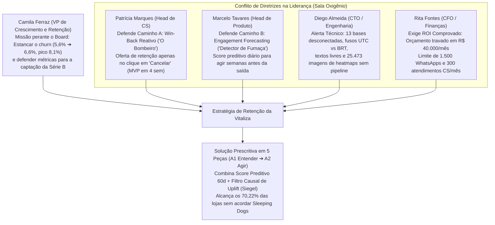
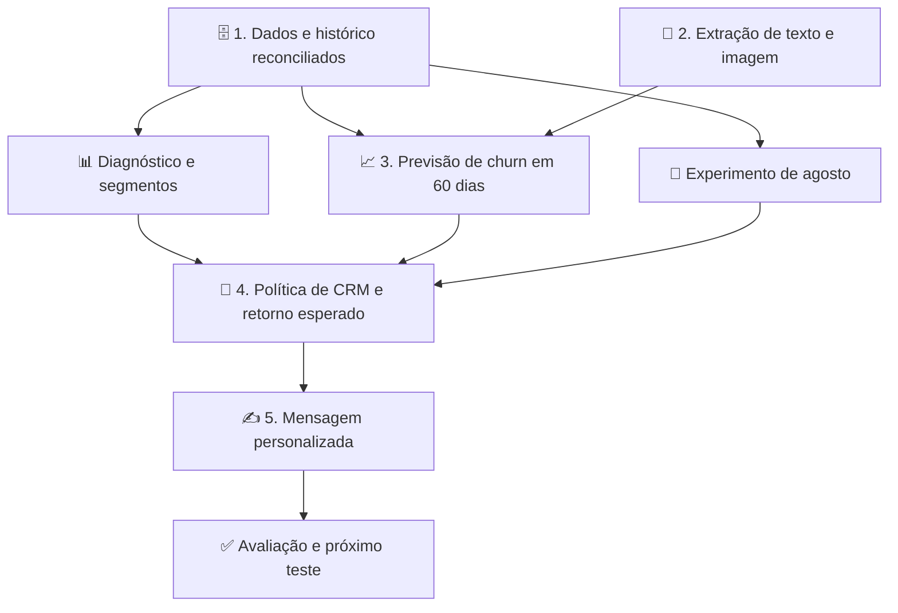
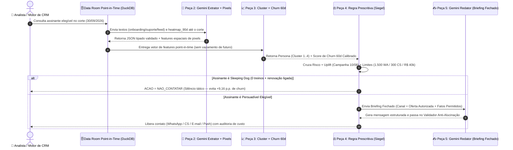
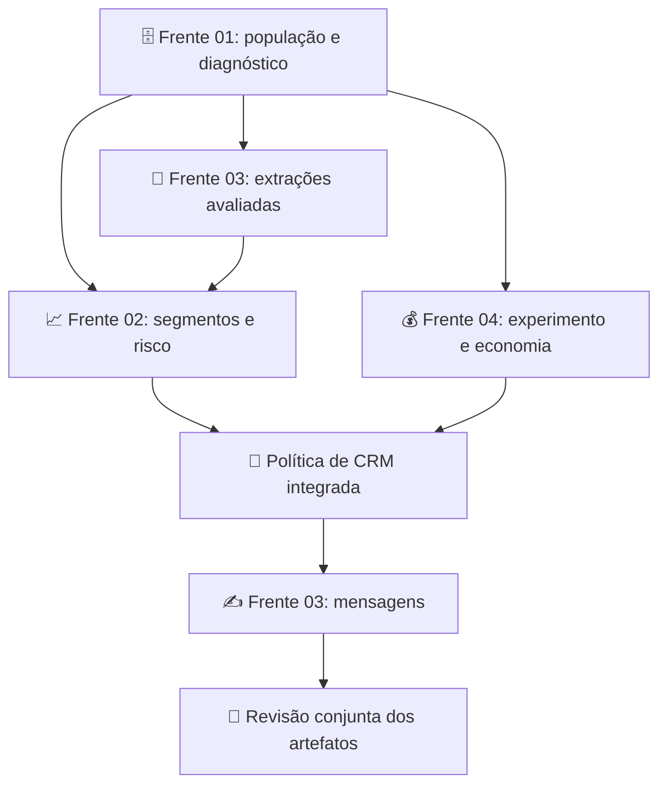

# 🎓 Inteli MBA — IA e Dados para Negócios (Módulo 2)

> **Módulo 2:** Inteligência de Mercado e Modelagem Preditiva para Crescimento<br>
> **Instituição:** Inteli — Instituto de Tecnologia e Liderança  
> **Business Case:** Vitaliza — Predição de Churn, Extração Multimodal, Uplift & Decisão Prescritiva de CRM  
> **Equipe de Trabalho:** Equipe de Projetos MBA Inteli  
> **Corte do Data Room:** `30/09/2026` · **14.753 pagantes ativos** · Previsão de saída em **60 dias**

---

## 👋 Bem-vindos ao Repositório da Equipe!

Este repositório reúne a documentação de negócios, ciência de dados, machine learning e IA generativa desenvolvida para o estudo de caso da **Vitaliza** no MBA do Inteli. O objetivo do projeto é estruturar uma decisão de retenção de assinantes financeiramente sustentável diante da elevação do churn mensal de **5,6% (2025) para 6,6% (jan–set/2026, com pico de 8,1% em abril)** sobre a base de **14.753 pagantes ativos** (`30/09/2026`). A análise concilia a assimetria de canais de cobrança (**70,22% via App Store e Google Play**, onde o cancelamento ocorre fora do aplicativo) com a modelagem prescritiva de **Uplift**, combinando preparação *point-in-time* das 13 fontes do Data Room, extração multimodal de texto e imagem, segmentação comportamental de personas, predição de saída em 60 dias e alocação otimizada de canais e ofertas dentro do orçamento mensal de **R$ 40.000,00** (**1.500 mensagens de WhatsApp** e **300 atendimentos de Customer Success**).

Aqui a equipe encontrará o material organizado para estudo e acompanhamento das entregas do **Artefato 1 (A1 — Semana 5, 13/11/2026)** e **Artefato 2 (A2 — Semana 10, 18/12/2026)**.

---

## 🔰 Guia Rápido para Iniciantes (Não-Técnicos)

- **[🧭 Como navegar no GitHub](./00_comece_por_aqui/00_para_nao_tecnicos/00_COMO_NAVEGAR_NO_GITHUB.md)** — Como localizar documentos, abrir pastas e acompanhar o trabalho da equipe.
- **[🛠️ Como contribuir](./00_comece_por_aqui/00_para_nao_tecnicos/01_GUIA_DE_CONTRIBUICAO_E_COMMITS.md)** — Como propor alterações e enviar conteúdo para revisão.
- **[📋 Resumo Executivo do Case](./00_comece_por_aqui/01_RESUMO_EXECUTIVO_DO_CASE.md)** — O problema da Vitaliza, as restrições e o resultado esperado.
- **[🗺️ Mapa das Trilhas de Conhecimento](./00_comece_por_aqui/02_MAPA_DAS_TRILHAS.md)** — Onde cada perfil pode estudar e contribuir.

---

## 🗺️ Guia de Navegação por Trilhas & Módulos

Escolha a área mais próxima do seu perfil. As trilhas organizam o conhecimento; as frentes de trabalho organizam a execução.

| Trilha / Módulo | Acesso | O que você encontra |
| :--- | :--- | :--- |
| 🔰 **Comece por Aqui** | [Guia de entrada](./00_comece_por_aqui/README.md) | Contexto inicial, roteiro de leitura, fontes e orientação para novos integrantes. |
| 📊 **Negócios, Growth & CRM** | [Trilha de Negócios](./00_comece_por_aqui/01_trilha_negocios_e_crm/README.md) | Diagnóstico de churn, análise dos exhibits, personas, experimento, uplift e retorno. |
| 💻 **Ciência de Dados & Machine Learning** | [Trilha de Dados e ML](./00_comece_por_aqui/02_trilha_ciencia_de_dados_e_ml/README.md) | Saneamento, reconstrução histórica, features, clusterização e previsão de churn. |
| 🤖 **IA Generativa & Multimodal** | [Trilha de IA](./00_comece_por_aqui/03_trilha_ia_generativa_e_multimodal/README.md) | Extração de texto e imagem, avaliação, custos, segurança e copywriting de CRM. |
| 📋 **Gestão de Tarefas** | [Mapa das Frentes](./01_gerenciamento_de_tarefas/00_MAPA_GERAL_FRENTES_DE_ATUACAO.md) | Quatro frentes, oito tarefas, dependências e critérios de execução. |
| 📚 **Fontes & Evidências** | [Documentos](./documentos/README.md) | Enunciado, dicionário, aulas, Data Room e relatórios de auditoria. |
| 👥 **Espaço da Equipe** | [Notas e Rascunhos](./membros/00_geral/README.md) | Conteúdo em elaboração antes da integração aos artefatos oficiais. |

---

## 📁 Artefatos Oficiais de Negócios & Tecnologia

O trabalho do módulo é organizado em quatro artefatos complementares. Negócios explica a decisão; Tecnologia demonstra como os dados e modelos sustentam essa decisão.

| Marco | Artefato | Conteúdo principal | Resultado esperado |
| :--- | :--- | :--- | :--- |
| **A1 · Negócios** | [Customer Segmentation Analysis Report](./artefatos_negocios/semana_5_A1/ARTEFATO_NEGOCIOS_SEMANA5_A1.md) | diagnóstico, hipóteses, segmentos e personas | explicar o que aconteceu, para quem e quais hipóteses merecem teste |
| **A1 · Tecnologia** | [Preparação, Clusterização & Baseline](./artefatos_tecnologia/semana_5_A1/ARTEFATO_TECH_SEMANA5_A1.md) ([Guia A1](./artefatos_tecnologia/semana_5_A1/README.md)) | auditoria, base temporal, clusterização e referência supervisionada | demonstrar como a população e as variáveis foram construídas |
| **A2 · Negócios** | [Board Recommendation Deck](./artefatos_negocios/semana_10_A2/ARTEFATO_NEGOCIOS_SEMANA10_A2.md) | alternativas de CRM, efeito, orçamento, retorno e contingências | recomendar uma política de retenção economicamente justificável |
| **A2 · Tecnologia** | [Modelos, Multimodal & Redator de CRM](./artefatos_tecnologia/semana_10_A2/ARTEFATO_TECH_SEMANA10_A2.md) ([Guia A2](./artefatos_tecnologia/semana_10_A2/README.md)) | modelos de 60 dias, ablação multimodal, decisão e mensagens | integrar previsão, extração, avaliação e comunicação controlada |

> Os artefatos são documentos vivos estruturados com um **Baseline Inicial (`v0.1.0`)** sobre os dados reais de `documentos/exhibits-m2/`. Afirmações finais precisam estar ligadas a código, parâmetros, métricas e saídas reproduzíveis.

---

## 🎯 Cronograma de 10 Semanas & Posição do Projeto

```text
┌─────────────────────────────────────────────────────────────────────────────┐
│                 CRONOGRAMA DE 10 SEMANAS DO MÓDULO 2 (INTELI MBA)           │
└──────────────────────────────────────┬──────────────────────────────────────┘
                                       │
   SEMANA 1 (Posição Atual): Entendimento do negócio, fontes e perguntas 📍 [ONDE ESTAMOS]
   SEMANA 2: Limpeza, população pagante (14.753) e análise exploratória
   SEMANA 3: Clusterização comportamental e avaliação dos grupos
   SEMANA 4: Visualização, interpretação e construção de personas
   SEMANA 5: Integração e entrega da A1 — 13/11/2026 ➔ 1º Movimento: ENTENDER
   ───────────────────────────────────────────────────────────────────────────
   SEMANA 6: Regressão Logística, Árvores e incorporação do feedback da A1
   SEMANA 7: Avaliação temporal, calibração e decisão orientada por custo
   SEMANA 8: Bagging, Boosting, extração multimodal e IA Generativa
   MARCOS:   Previsão 60d em 08/12/2026 · Revelação Oficial em 10/12/2026
   SEMANA 9: Uplift, orçamento (R$ 40k/mês), política de CRM e retorno incremental
   SEMANA 10: Integração e entrega da A2 — 18/12/2026 ➔ 2º Movimento: AGIR
```

O detalhamento semanal está no guia [A1 versus A2](./00_comece_por_aqui/04_contexto_extra/01_VISAO_DETALHADA_SEMANA5_VS_SEMANA10.md). O cronograma organiza o trabalho da equipe; os requisitos oficiais dos materiais da disciplina continuam sendo a referência de avaliação.

---

<a id="negocio-vitaliza"></a>

## 🏃 1. O Negócio da Vitaliza & O Problema de Retenção

### ⚔️ A Matriz de Conflito dos Executivos na Sala de Reunião Oxigênio (Aula 1)

O projeto pacifica o embate estratégico entre as lideranças da Vitaliza diante da pressão da Série B e do lançamento preditivo do concorrente **Strava Premium** no Brasil:



### 📱 O que a empresa oferece

A **Vitaliza** é um aplicativo brasileiro fictício, lançado em setembro de 2020, com três componentes:

1. **🏃 Treinos ao ar livre com GPS:** corrida, caminhada e pedal.
2. **🎬 Treinos guiados em vídeo:** funcional, força e yoga.
3. **👥 Rede social:** posts, comentários, seguidores e compartilhamento de atividades.

O aplicativo conecta relógios Garmin e Apple Watch. O modelo é **freemium**: registrar treino é grátis; o Premium é pago, com planos mensal e anual e teste inicial de sete dias. A base reúne contas gratuitas, assinaturas históricas e pagantes ativos — populações que precisam ser distinguidas nas análises.

### 📊 Os números que dimensionam o desafio

| Indicador | Referência | Leitura para o projeto |
| :--- | :--- | :--- |
| Contas no arquivo de usuários | **64.948** | total de registros do arquivo, incluindo datas que exigem tratamento |
| Assinaturas históricas no retrato exportado | **32.643** | uma conta pode ter mais de um episódio de assinatura |
| Pagantes ativos em 30/09/2026 | **14.753** | referência do enunciado, reconciliada no retrato local |
| Plano anual entre os pagantes ativos | **8.478 — 57,47%** | o fim do acesso depende do ciclo anual |
| Plano mensal entre os pagantes ativos | **6.275 — 42,53%** | maior frequência de renovação e exposição ao reajuste |
| Churn mensal médio em 2025 | **5,6%** | referência histórica informada no case |
| Churn mensal médio de jan–set/2026 | **6,6%** | piora de **1 ponto percentual** |
| Pico de churn em abril/2026 | **8,1%** | 1.154 perdas sobre 14.237 ativos no início do mês |

```text
Churn mensal = perdas, no mês, de assinaturas ativas no início do mês
               ÷ assinantes ativos no início do mês
```

A base cresceu de 8.540 ativos no início de janeiro/2025 para 14.319 no início de setembro/2026, cerca de 68%, segundo o enunciado. Com uma população maior, o número de perdas pode subir mesmo que a taxa fique estável. **O diagnóstico precisa comparar taxas com denominadores consistentes.**

### 🚨 As quatro lacunas da empresa

| Lacuna | Situação descrita no case | Resposta que o projeto deve construir |
| :--- | :--- | :--- |
| **Por que o churn subiu?** | reajuste de preço, mudanças de uso e composição da base ainda precisam ser investigados | hipóteses testadas por plano, canal, safra e comportamento |
| **Por que cada assinante saiu?** | pesquisa de saída opcional, limitada ao site | diagnóstico que reconheça a cobertura parcial e o viés de seleção |
| **A campanha de agosto funcionou?** | houve sorteio entre quatro grupos, sem análise de retenção concluída | comparação dos tratamentos ao controle e avaliação econômica |
| **Quem vale a pena contatar?** | capacidade de CRM é limitada e ofertas custam dinheiro | política que combine efeito esperado, margem, elegibilidade e capacidade |

### 🏪 Por que o canal de cobrança muda a estratégia

| Canal | Pagantes ativos | Participação |
| :--- | ---: | ---: |
| App Store | 5.395 | 36,57% |
| Google Play | 4.964 | 33,65% |
| Cartão no site | 2.994 | 20,29% |
| Pix no site | 1.400 | 9,49% |

**70,22% pagam pelas lojas.** Nesses canais, a pessoa pode desligar a renovação fora do aplicativo, continuar usando o período pago e só depois ter a assinatura expirada. Uma oferta na tela de cancelamento do site não alcança esse público.

> 💡 **Distinção fundamental:** desligar a renovação revela intenção de saída; expirar a assinatura encerra o acesso pago. Os dois eventos podem ocorrer em datas diferentes e não devem ser tratados como a mesma métrica sem uma regra explícita.

👉 **Aprofundamento:** [📋 Resumo Executivo](./00_comece_por_aqui/01_RESUMO_EXECUTIVO_DO_CASE.md) · [📄 Enunciado Oficial](<./documentos/enunciado_e_guias/Vitaliza - Enunciado do case.pdf>).

---

<a id="objetivos"></a>

## 🎯 2. Os Oito Objetivos do Case — O Que Precisamos Responder

Os objetivos avançam da **descrição do que aconteceu** para a **decisão sobre o que fazer**. Cada resposta precisa de uma entrega observável.

| Objetivo | Pergunta de negócio | Caminho de análise | Saída esperada |
| :--- | :--- | :--- | :--- |
| **1 · Contar e medir a base** | quantos pagantes estão ativos e quanto perdemos? | qualidade, integração e reconstrução histórica | população reconciliada e churn por mês, plano e canal |
| **2 · Explicar a alta de 2026** | o que mudou e para quem? | análise exploratória e comparação de hipóteses | evidências sobre fatores associados à piora e seus limites |
| **3 · Conhecer os assinantes** | quais perfis de uso existem? | clusterização sem usar a informação de saída | segmentos interpretáveis e personas apoiadas nos dados |
| **4 · Prever quem vai sair** | quem tende a sair nos próximos 60 dias? | logística, árvores, bagging e boosting | probabilidades e ranking avaliados fora do tempo |
| **5 · Medir o valor de texto e imagem** | as novas variáveis compensam seu custo? | extração, referência humana e comparação com/sem os sinais | qualidade, ganho preditivo e custo por assinante |
| **6 · Decidir quem contatar** | qual pessoa, canal e oferta merecem prioridade? | experimento, uplift e restrições de CRM | política de ação, incluindo a opção de não contato |
| **7 · Calcular quanto a ação rende** | quanto ganhamos a mais em relação a não agir? | margem, custos e simulação de políticas | retorno incremental em reais e análise de sensibilidade |
| **8 · Escrever a mensagem** | o que dizer a cada pessoa selecionada? | redação generativa com briefing fechado | mensagem compatível com canal, oferta e contexto permitido |

**A relação entre os objetivos importa:** a população do objetivo 1 sustenta os demais; as personas do objetivo 3 ajudam a interpretar os perfis; o risco do objetivo 4 informa a decisão, mas não substitui o efeito do contato do objetivo 6; o redator do objetivo 8 recebe uma política já definida.

👉 **Especificações executáveis:** [📋 Matriz de Tarefas & Especificações](./01_gerenciamento_de_tarefas/MATRIZ_DE_TAREFAS_E_ESPECIFICACOES.md).

---

<a id="solucao"></a>

## 📐 3. A Solução em Cinco Peças — Dados, Extração, Previsão, Decisão & Mensagem



| Peça | O que recebe | O que produz | Como saber se está adequada |
| :--- | :--- | :--- | :--- |
| **🗄️ Dados** | arquivos com formatos, chaves e tempos diferentes | histórico e base por pessoa/corte | reconciliação, qualidade e disponibilidade temporal verificadas |
| **🤖 Extração** | conteúdo textual e imagens disponíveis no corte | campos com nome, tipo e categorias definidos | avaliação contra referência humana e custo registrado |
| **📈 Previsão** | variáveis históricas e desfechos observados | probabilidade de churn em 60 dias | discriminação, calibração e desempenho em períodos reservados |
| **🎯 Decisão** | risco, efeito esperado, margem e limites | canal, oferta ou não contato | retorno esperado e respeito às restrições |
| **✍️ Mensagem** | decisão, briefing e contexto permitido | texto individualizado | aderência à oferta, aos fatos e ao tom de voz |

### 🔗 Como as peças se conectam na prática

Para um assinante elegível, a base reúne o que era conhecido até o corte; os modelos descrevem seu segmento e estimam seu risco; a política compara as ações disponíveis com a alternativa de não contatar; se houver contato, o redator recebe o canal e a oferta escolhidos.

**Exemplo ilustrativo de fluxo:** uma pessoa com preferência declarada por treinos em vídeo só deve receber uma mensagem personalizada depois que a política definir a ação. Se a oferta autorizada for conteúdo, o gerador não pode acrescentar desconto. O exemplo demonstra o contrato entre as peças e não representa um resultado já obtido.

### 💻 Os 4 Níveis de Abstração Tecnológica & Diagrama de Sequência (Gemini + ML + CRM)

Seguindo o padrão arquitetural do MBA, conectamos a visão **Macro de Negócios** com a **Ciência de Dados e Engenharia de IA** em 4 níveis encadeados:

```text
┌─────────────────────────────────────────────────────────────────────────────┐
│           OS 4 NÍVEIS DE ARQUITETURA ANALÍTICA E DECISÃO PRESCRITIVA        │
└──────────────────────────────────────┬──────────────────────────────────────┘
                                       │
   [NÍVEL 1: PROCESSO DECISÓRIO DE NEGÓCIO (CRISP-DM & GOVERNANÇA DE CRM)]
   • Conecta Diagnóstico (A1) ➔ Predição 60d + Uplift (A2) sob teto de R$ 40k/mês
   • Separa risco preditivo de efeito causal e protege contra acordar Sleeping Dogs
                                       │
                                       ▼
   [NÍVEL 2: ARQUITETURA DE DADOS POINT-IN-TIME (DUCKDB / BRONZE-PRATA-OURO)]
   • Saneamento das 13 fontes locais (corte 30/09/2026, normalização UTC vs BRT)
   • Reconciliação dos 14.753 pagantes ativos e prevenção estrita de Data Leakage
                                       │
                                       ▼
   [NÍVEL 3: PIPELINE MULTIMODAL & MODELAGEM (GEMINI FLASH + SKLEARN/BOOSTING)]
   • Peça 2: Extração JSON estruturada de textos (onboarding/suporte/feed) + pixels de heatmaps
   • Peça 3 e 4: Clusterização (4 Personas), Classificação 60d e Motor de Uplift (Siegel)
                                       │
                                       ▼
   [NÍVEL 4: EXECUÇÃO EM CÓDIGO & COPYWRITING CONTROLADO (PYTHON / SRC)]
   • Scripts reproduzíveis: src/01_auditoria_data_room.py e src/02_pipeline_gemini_multimodal_crm.py
   • Peça 5: Redator Gemini com Briefing Fechado e validador determinístico anti-alucinação
```



👉 **Aprofundamento:** [💻 Trilha de Dados e ML](./00_comece_por_aqui/02_trilha_ciencia_de_dados_e_ml/README.md) · [🤖 Trilha de IA Generativa](./00_comece_por_aqui/03_trilha_ia_generativa_e_multimodal/README.md).

---

<a id="economia-crm"></a>

## 💰 4. Premissas Econômicas & Regras de CRM

As premissas abaixo vêm do **enunciado da Vitaliza**, para o planejamento de novembro e dezembro de 2026. São parâmetros do case, não preços de mercado a serem atualizados.

### 💵 Preço, receita líquida e custo de servir

| Premissa | Valor | Aplicação na análise |
| :--- | :--- | :--- |
| Plano mensal atual | **R$ 39,90/mês** | vigente desde 01/03/2026 |
| Plano mensal anterior | **R$ 34,90/mês** | referência para investigar o reajuste |
| Plano anual | **R$ 299,90/ano** | equivalente mensal de aproximadamente R$ 24,99 |
| Anual com cupom de influenciador | **R$ 239,90 no primeiro ano** | preço cheio a partir da renovação |
| Taxa de App Store / Google Play | **15%** | mensalidade líquida de R$ 33,92; anuidade líquida de R$ 254,92 |
| Taxa de cartão no site | **3,5%** | mensalidade líquida de R$ 38,50 |
| Taxa de Pix | **0,99%** | mensalidade líquida de R$ 39,50 |
| Custo de servir | **R$ 4,20 por assinante/mês** | deduzir da margem durante a permanência adicional |
| CAC médio de 2026 | **R$ 118 por novo assinante** | contexto de aquisição, sem tratá-lo automaticamente como economia da retenção |

### 📱 Canais disponíveis

| Canal | Custo unitário | Restrição do case |
| :--- | ---: | :--- |
| Push | desprezível | no máximo um por assinante/semana |
| E-mail | R$ 0,01 | sem limite prático de volume no enunciado |
| WhatsApp | R$ 0,40 | até **1.500 mensagens/mês** |
| CS — ligação ou chat ativo | R$ 18,00 | até **300 atendimentos/mês** |

Usar toda a capacidade de WhatsApp custa R$ 600/mês; usar toda a capacidade de CS custa R$ 5.400/mês. A escolha dos destinatários continua sendo crítica: um contato consumido sem benefício deixa de atender outra pessoa.

### 🎁 Catálogo de ofertas

| Oferta | Elegibilidade | Efeito econômico a considerar |
| :--- | :--- | :--- |
| 30% de desconto por três meses | plano mensal | R$ 11,97/mês; R$ 35,91 no ciclo completo |
| Um mês grátis no fim do ciclo | plano anual | R$ 25 de receita abatida |
| Pausa de até 60 dias | ambos os planos | receita adiada e impacto no horizonte da análise |
| Treino ou conteúdo personalizado | ambos os planos | sem custo direto de oferta; IA usada para gerá-lo pode ter custo |

> 💰 **Orçamento total: R$ 40.000 por mês**, incluindo canais, descontos e processamento de IA. O custo de extração de texto, visão e redação faz parte da mesma conta.

### 🧮 Como interpretar o retorno incremental

```text
Valor incremental esperado de uma ação ≈
    aumento estimado da probabilidade de retenção × margem adicional no horizonte
    − custo do contato
    − custo esperado da oferta
    − custo de IA alocado
```

A fórmula é uma aproximação de planejamento. A equipe precisa declarar horizonte, convenção de receita, uso de ofertas e incerteza do efeito. Descontos concedidos a quem ficaria sem contato também custam; anuidade recebida não equivale à margem de um único mês; um desconto já deduzido da receita não deve ser descontado novamente.

**Políticas a comparar:** não contatar, priorizar apenas risco, usar efeito médio do experimento e usar efeito estimado por perfil. A recomendação deve explicar o benefício e a incerteza da política escolhida sob as mesmas premissas.

👉 **Roteiro completo:** [💰 Estratégia de Uplift, CRM & Retorno A2](./00_comece_por_aqui/01_trilha_negocios_e_crm/02_ESTRATEGIA_UPLIFT_E_ROI_A2_SEMANA10.md).

---

<a id="exhibits"></a>

## 🗄️ 5. Data Room & Catálogo dos Exhibits

O inventário físico dos dados é **11 arquivos CSV + 1 Parquet + 2 ZIPs de heatmaps**. O dicionário organiza esse conteúdo em 13 fontes lógicas, pois trata os mapas de calor como uma coleção. O ZIP original de distribuição também está guardado localmente; ele empacota o material e não deve ser contado como uma nova fonte analítica.

**Data Room local canônico:** `documentos/exhibits-m2/`. O diretório `documentos/data_room/` permanece apenas como redirecionamento histórico e não deve receber uma segunda cópia dos arquivos.

### 📚 Inventário das fontes

| Fonte | Volume de referência | Uma linha ou item representa… | Papel no projeto |
| :--- | ---: | :--- | :--- |
| `usuarios.csv` | 64.948 | uma conta | cadastro, aquisição, dispositivo e relógio |
| `assinaturas.csv` | 32.643 | um episódio de assinatura | início, plano, cobrança e retrato do estado atual |
| `amizades.csv` | 113.480 | uma relação direcionada de seguir | seguidores, seguindo e reciprocidade |
| `campanha_ago26.csv` | 14.120 | um participante sorteado | tratamento atribuído e engajamento com a campanha |
| `eventos_assinatura.csv` | 275.565 | um evento do ciclo de assinatura | reconstrução do estado e definição de saída |
| `pagamentos.csv` | 165.548 | uma tentativa de cobrança | receita, recusas, retentativas e estornos |
| `uso_mensal.csv` | 591.662 | uma combinação de pessoa e mês | frequência, minutos, dias ativos e sessões |
| `atividades.parquet` | 1.254.475 | um treino | modalidade, duração, recência, GPS e companhia |
| `onboarding.csv` | 63.929 | uma resposta de entrada | objetivo declarado e intenção de frequência |
| `pesquisa_saida.csv` | 643 | uma resposta à pesquisa | motivo declarado entre respondentes do site |
| `feed_posts.csv` | 119.309 | um post | contexto textual e atividade social |
| `tickets_suporte.csv` | 4.422 | um chamado | problema relatado, categoria e resolução |
| `heatmaps/heatmaps_2026-07-31.zip` | 12.426 imagens esperadas | uma imagem por pessoa no corte de julho | padrão espacial das rotas nos 90 dias anteriores |
| `heatmaps/heatmaps_2026-09-30.zip` | 13.047 imagens esperadas | uma imagem por pessoa no corte de setembro | padrão espacial das rotas nos 90 dias anteriores |

As contagens dos CSVs e do Parquet constam da [auditoria existente](./relatorios/auditoria_exhibits.json). Os dois ZIPs ficam em `documentos/exhibits-m2/heatmaps/`; `heatmaps_90d/` é o nome lógico usado no dicionário. Os volumes de imagem são **esperados conforme o catálogo**, não contagens certificadas pelo relatório. A presença dos ZIPs não comprova integridade, extração de pixels ou avaliação visual dos PNGs.

### 🔑 Chaves, granularidade e integração

`user_id` identifica a conta e conecta grande parte das fontes. Entretanto, assinatura, pagamento, post e ticket têm seus próprios identificadores; amizades usam `seguidor_id` e `seguido_id`. Uma pessoa pode aparecer muitas vezes em vários arquivos.

**Exemplo do cuidado necessário:** cruzar diretamente dez treinos com três tickets pode produzir trinta linhas para a mesma pessoa. A preparação precisa agregar cada fonte à granularidade desejada antes do cruzamento, preservando as contagens e os períodos.

### 🕒 Cobertura temporal que afeta o projeto

| Fonte ou recorte | Referência temporal | Consequência |
| :--- | :--- | :--- |
| Exportação do pacote | 01/10/2026, com corte declarado em 30/09 | aplicar filtros reais, pois existem anomalias pós-corte |
| Histórico de eventos | desde 01/07/2024 | complementar episódios anteriores quando necessário |
| Uso mensal | jan/2025 a set/2026 | um agregado mensal completo não existia no meio daquele mês |
| Atividades detalhadas | 2026 | janelas antigas não têm a mesma cobertura de treino |
| Pesquisa de saída | desde junho/2026, apenas site | cobertura parcial e voluntária |
| Experimento | sorteio em 10/08/2026 | variáveis de ajuste devem anteceder o tratamento |
| Heatmaps | 31/07 e 30/09/2026 | cada imagem resume 90 dias; as janelas se sobrepõem |

### 🗂️ Como consultar os materiais

- **[📖 Dicionário Oficial](<./documentos/enunciado_e_guias/Vitaliza - Dicionário de dados.pdf>):** origem dos arquivos e significado das colunas.
- **[🗄️ Dicionário Comentado](./00_comece_por_aqui/05_DOSSIE_DICIONARIO_DE_DADOS_M2.md):** aplicação das fontes, esquema de campos e cuidados de integração.
- **[🔍 Dossiê dos Exhibits](./00_comece_por_aqui/05_DOSSIE_EXHIBITS_M2.md):** o que foi observado na auditoria local.
- **[📦 Instruções dos Exhibits](./documentos/exhibits-m2/README.md):** organização física e uso local dos arquivos.

---

<a id="auditoria"></a>

## 🔍 6. Auditoria Inicial — O Que Já Sabemos Sobre os Arquivos

O dossiê registra a auditoria de **24/10/2026**. O [relatório JSON existente](./relatorios/auditoria_exhibits.json) apresenta `passed_with_warnings`: há conferências realizadas e avisos que exigem tratamento antes da modelagem.

### ⚖️ A reconciliação da base ativa

```text
14.813 assinaturas ativas no retrato
−   60 cortesias
=14.753 assinaturas pagantes (mensal ou anual)
```

A diferença explica por que contar apenas `status_atual = ativa` não produz o total de pagantes. **Essa reconciliação é do retrato exportado**; reconstruir quem estava ativo em cada mês continua exigindo a sequência de eventos.

### ⚠️ Principais achados e implicações

| Achado documentado | Por que muda a análise | Tratamento esperado |
| :--- | :--- | :--- |
| **119 cadastros pós-corte**, com datas até abril/2027 | 64.948 registros não equivalem automaticamente a contas válidas em 30/09 | aplicar data e regra de elegibilidade |
| **122 posts e 273 relações de amizade pós-corte** | informações futuras podem contaminar variáveis | filtrar os timestamps de cada fonte |
| **34 atividades na primeira hora de 01/10** | parte da diferença pode vir de fuso horário | verificar origem e converter antes de decidir exclusão |
| Sistemas e modalidades com grafias diferentes | categorias equivalentes podem ser tratadas como distintas | mapear categorias e preservar valor original |
| Valor de pagamento inferido como texto | cálculos podem usar tipo ou separador incorretos | converter decimal explicitamente e registrar valores inválidos |
| `relogio_conectado = nenhum` | checar apenas nulo classificaria ausência como relógio conectado | mapear a categoria de ausência corretamente |
| Assinaturas com estado atual | o presente pode ser confundido com o passado | reconstruir cada corte usando eventos |

As chaves testadas de usuários, assinaturas, campanha, pagamentos, onboarding, pesquisa, posts, tickets e atividades não apresentaram duplicidade na auditoria registrada. Isso não substitui as verificações das bases derivadas e dos cruzamentos.

### 🔎 Evidências descritivas que orientam perguntas

- **📝 Pesquisa de saída:** preço aparece em 264 das 643 respostas, **41,06%**. O resultado descreve respondentes do site e sustenta uma hipótese; não representa todos os cancelamentos.
- **🎧 Suporte:** dos 4.422 tickets, 65,97% estavam resolvidos, 22,18% abertos e 11,85% sem resposta na exportação. Usar esses estados no passado exige conferir quando eram conhecidos.
- **🏃 Atividades:** o Parquet contém 1.254.475 treinos de 36.551 usuários, com origens app, Garmin e Apple Health. Usuários com atividade não são necessariamente a mesma população dos pagantes no corte.
- **📣 Campanha:** o cupom tem o maior clique bruto, 16,45%. O dado mede engajamento com a campanha; as estimativas de retenção escritas nos artefatos precisam ser acompanhadas de execução reproduzível.

👉 **Critérios e detalhes:** [🔍 Dossiê dos Exhibits](./00_comece_por_aqui/05_DOSSIE_EXHIBITS_M2.md) · [🛠️ Saneamento & Reconstrução Histórica](./00_comece_por_aqui/02_trilha_ciencia_de_dados_e_ml/01_SANEAMENTO_E_RECONSTRUCAO_HISTORICA.md).

---

<a id="hipoteses-experimento"></a>

## 🧪 7. Hipóteses Analíticas & Experimento de Agosto

### 🔬 O que investigar primeiro

| Hipótese do caderno | Pergunta | Comparação ou evidência necessária |
| :--- | :--- | :--- |
| **H-PRICE-01** | o reajuste do mensal contribuiu para a alta? | mensal vs. anual antes/depois, considerando coorte e canal |
| **H-ENGAGEMENT-01** | a queda de uso antecede a saída? | recência, frequência e tendência antes do desfecho |
| **H-CHANNEL-01** | lojas e site têm riscos e janelas diferentes? | saída por plano, canal e tempo de assinatura |
| **H-SOCIAL-01** | vínculo social se associa a maior retenção? | conexões e companhia, considerando engajamento e tempo |
| **H-SUPPORT-01** | suporte e falhas de cobrança antecipam churn? | eventos de fricção anteriores à saída |
| **H-CAMPAIGN-01** | algum tratamento aumentou retenção? | grupos sorteados comparados ao controle |
| **H-MULTIMODAL-01** | texto e imagem melhoram a decisão? | extração validada, ganho fora do tempo e custo |

Safras e canais de aquisição também fazem parte do diagnóstico previsto na tarefa 02. Novas hipóteses devem usar o modelo do caderno, com pergunta, população, janela, método, critério e limitações.

### 🎲 Como foi organizado o experimento

Em **10/08/2026**, a Vitaliza sorteou **14.120 pagantes** em quatro grupos:

| Grupo | Pessoas no arquivo | Tratamento | Clique bruto documentado |
| :--- | ---: | :--- | ---: |
| Controle | 3.579 | sem mensagem | 0,00% |
| Desafio | 3.515 | push + e-mail com desafio de seis semanas | 14,31% |
| Cupom | 3.472 | push + e-mail com oferta compatível com o plano | 16,45% |
| Conteúdo | 3.554 | push + e-mail com treino personalizado | 14,91% |

**Fonte dos agregados:** [Dossiê dos Exhibits, campanha de agosto](./00_comece_por_aqui/05_DOSSIE_EXHIBITS_M2.md). Clique mede resposta à mensagem, não retenção. Para estimar efeito, é necessário reconstruir o desfecho nos eventos de assinatura e publicar a comparação com o controle, com sua janela e incerteza. O relatório JSON de auditoria não registra essa avaliação de retenção.

A análise deve comparar **todos os sorteados de cada grupo**, inclusive quem não abriu ou clicou, preservando o desenho original. Selecionar apenas quem clicou muda a população depois do tratamento.

```text
Uplift de retenção = taxa de retenção no tratamento − taxa de retenção no controle
```

A diferença precisa vir acompanhada de período, definição de saída, tamanho dos grupos e incerteza. Como há três tratamentos comparados ao mesmo controle, a interpretação dos testes também deve considerar essas múltiplas comparações.

### 🧩 O que significam os quatro tipos de resposta ao contato

| Tipo conceitual | Sem contato | Com contato | Implicação de negócio |
| :--- | :--- | :--- | :--- |
| **Persuadível** | sairia | ficaria | ação pode criar retenção |
| **Garantido** | ficaria | ficaria | oferta pode consumir margem sem ganho |
| **Perdido** | sairia | sairia | ação pode consumir recursos sem reter |
| **Não perturbe (*Sleeping Dog*)** | ficaria | sairia | contato pode produzir efeito negativo |

Esses tipos explicam o problema de decisão. **Não observamos os dois desfechos na mesma pessoa**; a política usa efeito estimado e incerteza, sem tratar uma classificação individual como fato comprovado.

### 🕒 Limites que afetam a conclusão

- Sessenta dias após o sorteio de 10/08 ultrapassam o corte de 30/09. A avaliação precisa usar acompanhamento observado ou declarar e tratar censura.
- Os pacotes testados usaram **push + e-mail**. O experimento não isola o efeito de WhatsApp, CS ou de uma nova mensagem generativa.
- A pesquisa de saída é voluntária e do site: suas 643 respostas não correspondem a 643 pessoas que já haviam perdido acesso no corte. O dicionário registra 289 respostas de pessoas ainda no período pago.

👉 **Plano dos testes:** [🧪 Caderno de Hipóteses](./00_comece_por_aqui/06_CADERNO_DE_HIPOTESES_ANALITICAS.md) · [💰 Experimento, Uplift & Retorno](./00_comece_por_aqui/01_trilha_negocios_e_crm/02_ESTRATEGIA_UPLIFT_E_ROI_A2_SEMANA10.md).

---

<a id="gerenciamento"></a>

## 📋 8. Gerenciamento — Quatro Frentes, Oito Tarefas & 37 Especificações

A execução está organizada em **4 frentes interdisciplinares**, conectadas aos **8 objetivos do case**. A matriz existente detalha **37 especificações**, distribuídas entre as oito tarefas.

### 🧩 As quatro frentes de execução

| Frente | Objetivos | Responsabilidade principal | Resultado que outras frentes utilizam |
| :--- | :--- | :--- | :--- |
| **[01 · Dados & Diagnóstico](./01_gerenciamento_de_tarefas/FRENTE_01_DADOS_E_DIAGNOSTICO_CHURN.md)** | 1 e 2 | auditar, reconstruir a população e investigar a alta do churn | base reconciliada, série histórica e evidências diagnósticas |
| **[02 · Clusterização & Predição](./01_gerenciamento_de_tarefas/FRENTE_02_CLUSTERIZACAO_E_PREDICAO_ML.md)** | 3 e 4 | construir variáveis, segmentos e modelos supervisionados | personas e risco avaliado fora do tempo |
| **[03 · IA Generativa](./01_gerenciamento_de_tarefas/FRENTE_03_IA_GENERATIVA_TEXTO_E_IMAGEM.md)** | 5 e 8 | avaliar extrações e gerar mensagens conforme briefing | novas variáveis, custos e comunicação revisável |
| **[04 · Growth, Uplift & CRM](./01_gerenciamento_de_tarefas/FRENTE_04_GROWTH_UPLIFT_E_ORCAMENTO_CRM.md)** | 6 e 7 | avaliar o experimento e alocar ações e orçamento | política de contato, retorno e briefing para o redator |

### ✅ O que cada tarefa precisa produzir

| Tarefa | Especificações | Entrega concreta para revisão |
| :--- | :--- | :--- |
| **01 · Contar e medir** | 1.1 a 1.5 | auditoria, normalização temporal, reconciliação, separação de tipos de perda e série de churn |
| **02 · Diagnosticar a alta** | 2.1 a 2.5 | testes de preço, safra/aquisição, engajamento e rede social, com limites de interpretação |
| **03 · Segmentar assinantes** | 3.1 a 3.5 | variáveis e escalas, comparação de agrupamentos, personas e hipóteses de relacionamento |
| **04 · Prever saída** | 4.1 a 4.5 | cortes históricos, baseline, modelos comparados, métricas e ranking da população elegível |
| **05 · Avaliar texto/imagem** | 5.1 a 5.5 | schema, referência humana, comparação visual, ablação preditiva e avaliação de custo |
| **06 · Definir contatos** | 6.1 a 6.5 | efeito experimental, resposta por perfil, estratégia por canal e política dentro dos limites |
| **07 · Calcular retorno** | 7.1 a 7.4 | margem, custos, comparação econômica e sensibilidade para novembro/dezembro |
| **08 · Redigir mensagens** | 8.1 a 8.3 | briefing, contexto permitido e mensagens individualizadas avaliáveis |

### 🔄 Dependências e trabalho em paralelo



### 📝 Como assumir e acompanhar uma tarefa

1. **Escolha a tarefa e o recorte:** por exemplo, especificação 1.2 para normalização de fuso.
2. **Registre responsável, revisor e dependências:** a distribuição nominal é combinada pela equipe.
3. **Defina o critério de aceite:** qual resultado permite afirmar que a tarefa foi atendida?
4. **Associe código, fonte e artefato:** deixe claro onde está a evidência e quem a utilizará.
5. **Atualize a situação:** use `planejado → em execução → em revisão → concluído`.

👉 **Documentos de gestão:** [📋 Mapa Geral das Frentes](./01_gerenciamento_de_tarefas/00_MAPA_GERAL_FRENTES_DE_ATUACAO.md) · [✅ Matriz de Tarefas & Especificações](./01_gerenciamento_de_tarefas/MATRIZ_DE_TAREFAS_E_ESPECIFICACOES.md).

---

<a id="metodo"></a>

## 🔬 9. Método de Análise & Critérios de Qualidade

### 🔄 CRISP-DM aplicado à Vitaliza

| Etapa | Aplicação no projeto |
| :--- | :--- |
| Entendimento do negócio | formular decisão, premissas, orçamento e métrica de sucesso |
| Entendimento dos dados | inventariar fontes, cobertura, granularidade e limitações |
| Preparação | reconstruir população, tratar qualidade e criar variáveis temporais |
| Modelagem | segmentar, prever e estimar efeito conforme a pergunta |
| Avaliação | verificar qualidade estatística, utilidade e retorno esperado |
| Aplicação e acompanhamento | integrar política e mensagem e definir o próximo teste |

### 🕒 Contrato temporal e prevenção de vazamento

- **Unidade analítica:** pessoa e data de corte, após tratar episódios de assinatura.
- **População de referência:** pagantes ativos, excluindo cortesias; filtros adicionais geram uma coorte elegível que precisa ser reconciliada separadamente.
- **Features:** somente informações conhecidas até o corte de cada exemplo.
- **Alvo:** evento de saída explicitamente definido nos 60 dias seguintes; desligamento de renovação, expiração e casos especiais precisam de regras.
- **Treino e avaliação:** cortes históricos com acompanhamento completo. As janelas dos rótulos também precisam respeitar a separação entre períodos.
- **Aplicação final:** risco em 30/09 para saída até 29/11.

### 📈 Previsão: o que comparar nos modelos

| Dimensão | Medida possível | Pergunta respondida |
| :--- | :--- | :--- |
| Discriminação | ROC-AUC | o modelo ordena potenciais saídas acima de permanências? |
| Classe de interesse | PR-AUC | como precisão e cobertura se comportam na prevalência observada? |
| Capacidade de contato | precisão, recall e lift no topo `k` | quantas saídas potenciais estão no volume que o CRM atende? |
| Calibração | Brier e curva de calibração | probabilidades previstas correspondem às frequências observadas? |
| Utilidade da política | resultado incremental esperado | a ação cria valor depois de efeito e custos? |

### 🤖 Texto e imagem: três níveis de avaliação

1. **Qualidade da extração:** o campo está correto frente à amostra humana? O schema é válido? Como o método trata ambiguidade e ausência?
2. **Ganho preditivo:** nas mesmas pessoas e janelas, o modelo melhora com texto/imagem?
3. **Valor econômico:** o ganho esperado compensa o custo de extrair, reprocessar e redigir?

### ✅ Checklist comum de evidência

- [ ] Pergunta e decisão associada estão claras.
- [ ] População, período, evento de saída e denominador estão explícitos.
- [ ] Fonte, regra de transformação e método são reproduzíveis.
- [ ] Comparação pertinente, métrica e incerteza foram apresentadas.
- [ ] Vazamento temporal e cobertura das fontes foram revisados.
- [ ] Hipótese, resultado observado e projeção estão diferenciados.
- [ ] Limitação e próxima decisão acompanham a conclusão.

👉 **Fundamentos:** [🎓 Guia da Aula 1](./00_comece_por_aqui/03_GUIA_AULA_01_NEGOCIOS_E_TECNOLOGIA.md) · [📈 Modelagem](./00_comece_por_aqui/02_trilha_ciencia_de_dados_e_ml/02_CLUSTERIZACAO_E_CHURN_SUPERVISIONADO.md) · [🤖 Avaliação Multimodal](./00_comece_por_aqui/03_trilha_ia_generativa_e_multimodal/01_EXTRACAO_MULTIMODAL_E_COPYWRITING_CRM.md).

---

<a id="estado-atual"></a>

## 📍 10. Como Ler as Evidências — Fontes, Resultados & Propostas

Uma afirmação sobre o case pode vir do enunciado, de uma execução local ou de uma proposta da equipe. Esses níveis têm funções diferentes e devem permanecer identificados ao longo das entregas.

| Tipo de conteúdo | Onde consultar | O que permite afirmar |
| :--- | :--- | :--- |
| **Premissas do case** | [Enunciado oficial](<./documentos/enunciado_e_guias/Vitaliza - Enunciado do case.pdf>) | contexto fictício, objetivos, preços, canais, ofertas e limites de CRM |
| **Definição das fontes** | [Dicionário oficial](<./documentos/enunciado_e_guias/Vitaliza - Dicionário de dados.pdf>) | granularidade, significado dos campos e cobertura descrita no pacote |
| **Verificações executadas** | [Relatório da auditoria](./relatorios/auditoria_exhibits.json) e [script](./src/01_auditoria_data_room.py) | contagens, chaves testadas, reconciliação do retrato e avisos de qualidade |
| **Interpretação descritiva** | [Dossiê dos exhibits](./00_comece_por_aqui/05_DOSSIE_EXHIBITS_M2.md) | leitura dos agregados e perguntas decorrentes da auditoria, sem prova automática de causalidade |
| **Propostas e resultados declarados** | [Artefatos de negócios](./artefatos_negocios/README.md) e [tecnologia](./artefatos_tecnologia/README.md) | material de trabalho a revisar e vincular à execução correspondente |

**Limite da evidência disponível:** o relatório de auditoria registra `passed_with_warnings`. Não certifica saneamento concluído, modelos treinados, personas validadas, heatmaps processados, custo de IA medido ou lucro incremental realizado. Valores de AUC, uplift, ablação e retorno presentes em outros documentos não são reproduzidos por esse relatório.

Os materiais de aula podem apresentar uma narrativa executiva ou um recorte diferente da base tabular. Antes de combinar números, registre fonte, população, data e definição da métrica. Neste README, as premissas quantitativas do case seguem o enunciado e o dicionário; contagens locais são identificadas como auditoria ou agregados documentados.

👉 **Organização da revisão:** [📋 Gestão das Frentes](./01_gerenciamento_de_tarefas/00_MAPA_GERAL_FRENTES_DE_ATUACAO.md).

---

<a id="execucao"></a>

## 💻 11. Código, Ambiente & Execução Local

Execute os comandos na raiz do repositório, com os dados locais disponíveis e `uv` instalado. A rotina abaixo faz auditoria de arquivos; não treina modelos nem valida heatmaps. O parâmetro `--json` grava ou substitui o relatório indicado.

### ▶️ 1. Executar a auditoria do Data Room no diretório padrão

```bash
uv run --with duckdb --with pytz \
  python src/01_auditoria_data_room.py \
  --json relatorios/auditoria_exhibits.json
```

O script procura por padrão os arquivos em **`documentos/exhibits-m2/`**, imprime o resumo no terminal e grava o relatório no caminho indicado por `--json`.

### 📂 2. Usar outra localização temporária dos dados

```bash
uv run --with duckdb --with pytz \
  python src/01_auditoria_data_room.py \
  --data-dir /caminho/local/para/os/exhibits \
  --json relatorios/auditoria_data_room.json
```

### 🤖 3. Executar a Simulação da Integração Gemini (Extração Multimodal + Regra de Uplift + Copywriter CRM)

Para testar ponta a ponta a integração com o **Google Gemini** (ou seu fallback determinístico calibrado localmente sem chave de API) cobrindo a **Peça 2 (Extração JSON de texto + pixels de heatmaps)**, **Peça 4 (Regra Prescritiva de Siegel)** e **Peça 5 (Redator de CRM com Briefing Fechado)**:

```bash
# Modo Local Determinístico (ou com GEMINI_API_KEY exportada no ambiente)
uv run --with duckdb --with pillow \
  python src/02_pipeline_gemini_multimodal_crm.py \
  --json relatorios/simulacao_gemini_crm.json
```

👉 **Implementação:** [💻 Script de Auditoria](./src/01_auditoria_data_room.py) · [🤖 Pipeline Gemini & CRM](./src/02_pipeline_gemini_multimodal_crm.py) · [📄 Relatório Existente](./relatorios/auditoria_exhibits.json).

---

<a id="colaboracao"></a>

## 🤝 12. Colaboração, Organização dos Arquivos & Revisão

### 👥 Contribuições possíveis para diferentes perfis

| Você pode contribuir com… | Exemplo de resultado útil |
| :--- | :--- |
| Negócios e produto | hipótese testável e decisão que ela altera |
| Finanças | conta de margem, horizonte e cenário de sensibilidade |
| Dados e engenharia | regra de preparação ou análise reproduzível |
| IA e conteúdo | schema, referência humana ou revisão de mensagem |
| Gestão e comunicação | dependência registrada, fonte conferida ou narrativa integrada |

Rascunhos e notas podem começar em [membros/00_geral/](./membros/00_geral/README.md). Depois de revisão, a contribuição deve ser incorporada ao guia, código ou artefato correspondente.

### 🏷️ Como registrar uma alteração

```text
docs(negocios): esclarece hipótese do reajuste de preço
feat(dados): reconstrói estado da assinatura por corte
fix(auditoria): corrige tratamento de uma categoria
analysis(churn): compara retenção entre coortes
```

### 🔒 O que compartilhar no repositório

| Publicar como parte do projeto | Manter fora da publicação |
| :--- | :--- |
| Markdown, diagramas e contratos | CSVs, Parquet e ZIPs brutos |
| Scripts e notebooks revisados | registros individuais em células de saída |
| Gráficos, tabelas e relatórios agregados | e-mails, textos individuais e identificadores completos |
| Métodos e exemplos explicitamente ilustrativos | credenciais, tokens e arquivos `.env` |

👉 **Regras completas:** [🤝 CONTRIBUTING.md](./CONTRIBUTING.md) · [🛠️ Guia de Contribuição](./00_comece_por_aqui/00_para_nao_tecnicos/01_GUIA_DE_CONTRIBUICAO_E_COMMITS.md) · [📱 Menu para WhatsApp](./00_comece_por_aqui/07_MENU_WHATSAPP.md).

---

<a id="estrutura-biblioteca"></a>

## 📂 13. Estrutura do Repositório & Biblioteca de Aprofundamento

### 🗂️ Mapa das pastas

```text
.
├── README.md                              # guia completo do case e navegação da equipe
├── CONTRIBUTING.md                        # regras de colaboração
├── requirements.txt                       # bibliotecas para o trabalho analítico
├── 00_comece_por_aqui/
│   ├── README.md                          # roteiros de entrada por necessidade
│   ├── 00_para_nao_tecnicos/               # GitHub, edição e contribuição
│   ├── 01_RESUMO_EXECUTIVO_DO_CASE.md      # contexto, dilema e premissas da Vitaliza
│   ├── 02_MAPA_DAS_TRILHAS.md              # navegação por perfil e área
│   ├── 03_GUIA_AULA_01_NEGOCIOS_E_TECNOLOGIA.md
│   ├── 01_trilha_negocios_e_crm/           # diagnóstico, uplift e retorno
│   ├── 02_trilha_ciencia_de_dados_e_ml/    # preparação, segmentos e previsão
│   ├── 03_trilha_ia_generativa_e_multimodal/
│   ├── 04_contexto_extra/                 # visão detalhada de A1 e A2
│   ├── 05_DOSSIE_DICIONARIO_DE_DADOS_M2.md
│   ├── 05_DOSSIE_EXHIBITS_M2.md
│   ├── 06_CADERNO_DE_HIPOTESES_ANALITICAS.md
│   ├── 07_MENU_WHATSAPP.md
│   └── assets/                            # recursos visuais dos guias
├── 01_gerenciamento_de_tarefas/            # quatro frentes e matriz de execução
├── artefatos_negocios/
│   ├── README.md                          # guia executivo dos entregáveis de negócios
│   ├── semana_5_A1/                       # diagnóstico e segmentação de negócios
│   └── semana_10_A2/                      # proposta executiva de retenção
├── artefatos_tecnologia/
│   ├── README.md                          # guia técnico de arquitetura e execução
│   ├── semana_5_A1/                       # Pipeline, clusters e baseline logístico
│   └── semana_10_A2/                      # Modelos 60d, ablação multimodal e redator CRM
├── documentos/
│   ├── enunciado_e_guias/                 # PDFs oficiais do case
│   ├── exhibits-m2/                       # dados locais usados pela auditoria
│   ├── data_room/                         # redirecionamento histórico para exhibits-m2
│   └── midia_e_audios/                    # roteiro de síntese executiva
├── membros/                               # espaço de colaboração e notas da equipe
│   ├── README.md                          # guia de convivência e compartilhamento
│   └── 00_geral/                          # notas e rascunhos da equipe
├── relatorios/                            # evidências agregadas de execução
└── src/                                   # código reproduzível (Auditoria + Pipeline Gemini)
```

### 🎓 Fontes oficiais e aula

| Material | Conteúdo |
| :--- | :--- |
| [Enunciado Oficial da Vitaliza](<./documentos/enunciado_e_guias/Vitaliza - Enunciado do case.pdf>) | contexto, oito objetivos e premissas econômicas |
| [Dicionário Oficial de Dados](<./documentos/enunciado_e_guias/Vitaliza - Dicionário de dados.pdf>) | origem, campos e particularidades dos arquivos |
| [Aula 1 — Negócios](./documentos/MBA_IA_Dados_Aula1_Fabio.pdf) | formulação do problema, hipóteses, CREATE e evidência |
| [Aula 1 — Tecnologia](./documentos/trilha-tech-mba-aula-1_compressed.pdf) | CRISP-DM, tipos de análise, dados e aprendizado |
| [Síntese Integrada da Aula 1](./00_comece_por_aqui/03_GUIA_AULA_01_NEGOCIOS_E_TECNOLOGIA.md) | conexão dos conteúdos com o trabalho da equipe |
| [Roteiro da Síntese Executiva](./documentos/midia_e_audios/TRANSCRICAO_AUDIO_SINTESE_EXECUTIVA.md) | texto de apoio para apresentação do case |
| [Catálogo de Documentos](./documentos/README.md) | acesso às fontes e organização do data room |

---

<a id="glossario"></a>

## 📖 14. Glossário — Os Termos que Conectam Negócios & Tecnologia

| Termo | Significado no projeto |
| :--- | :--- |
| **Churn** | saída definida pela análise; na métrica mensal do case, perdas entre assinantes ativos no início do mês |
| **Coorte / safra** | grupo que compartilha uma condição ou momento de entrada, comparado sob regras comuns |
| **Tenure** | tempo de relacionamento ou assinatura, conforme a definição adotada |
| **Corte temporal** | instante que delimita a informação disponível para uma análise ou previsão |
| **Feature** | variável explicativa construída a partir de informação disponível no corte |
| **Label / alvo** | resposta que o modelo aprende a prever, como saída em 60 dias |
| **Data leakage** | uso de informação que não estaria disponível na decisão simulada, contaminando a avaliação |
| **Censura** | ausência de acompanhamento suficiente para conhecer o desfecho completo de uma observação |
| **Baseline** | referência inicial contra a qual medir ganho de um método mais elaborado |
| **Cluster** | grupo formado por semelhança entre variáveis; não é automaticamente uma categoria de risco |
| **Persona** | interpretação de negócio de um perfil observado, com características e limites explícitos |
| **Calibração** | correspondência entre probabilidades previstas e frequências de resultado observadas |
| **Lift** | concentração do evento de interesse em uma seleção comparada à referência da população |
| **Uplift** | efeito incremental estimado do tratamento sobre um desfecho; aqui, principalmente retenção |
| **Intenção de tratar** | comparação segundo o grupo sorteado originalmente, mesmo sem abertura ou clique |
| **Ablação** | comparação removendo ou acrescentando um componente, como features de texto/imagem |
| **Schema** | contrato de campos, tipos e valores permitidos de uma saída estruturada |
| **Margem incremental** | contribuição econômica adicional atribuída à ação, na convenção e horizonte declarados |
| **CAC** | custo de aquisição de um novo cliente; no case, média de R$ 118 em 2026 |
| **CRM / CS** | gestão de relacionamento com clientes / time de Customer Success |
| **Artefato** | documento de entrega que reúne método, resultados, interpretação e referências |

---

## 🚀 Seu Próximo Passo no Projeto

**Se você chegou agora:** escolha sua [trilha de conhecimento](./00_comece_por_aqui/02_MAPA_DAS_TRILHAS.md).<br>
**Se já conhece o case:** escolha uma [tarefa e suas especificações](./01_gerenciamento_de_tarefas/MATRIZ_DE_TAREFAS_E_ESPECIFICACOES.md).<br>
**Se está preparando a entrega:** confira os [contratos de integração entre A1 e A2](./00_comece_por_aqui/04_contexto_extra/01_VISAO_DETALHADA_SEMANA5_VS_SEMANA10.md).

[🔰 Comece por Aqui](./00_comece_por_aqui/README.md) · [📋 Gestão do Trabalho](./01_gerenciamento_de_tarefas/00_MAPA_GERAL_FRENTES_DE_ATUACAO.md)
