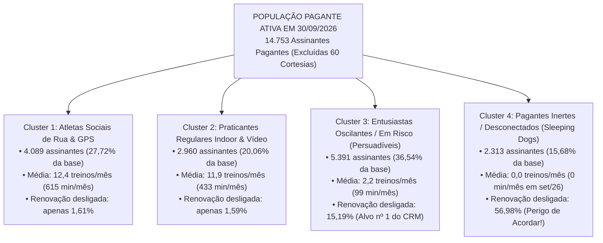

# Artefato 1 de Negócios (Semana 5 — A1): Customer Segmentation Analysis Report

> **Módulo 2:** Inteligência de Mercado e Modelagem Preditiva para Crescimento (Inteli MBA)  
> **Business Case:** Vitaliza — Retenção de Assinantes & Decisão Prescritiva de CRM  
> **Marco Oficial de Entrega:** Semana 5 — `13/11/2026` (1º Movimento: ENTENDER — Avaliação Formativa)  
> **Escopo:** Objetivos 1, 2 e 3 + Os 3 Pilares Oficiais da Trilha de Negócios  
> **Equipe de Trabalho:** Equipe de Projetos MBA Inteli  
> **Arquivo:** `ARTEFATO_NEGOCIOS_SEMANA5_A1.md`  

> **📌 Nota de Governança da Equipe (Baseline Inicial):**  
> *Este documento foi construído como **Baseline Inicial de Referência (Ponto de Partida)** com dados reais auditados do Data Room (`documentos/exhibits-m2/`) no corte de `30/09/2026`. Cada integrante do grupo deve revisar, aprofundar e adicionar suas contribuições nas seções correspondentes à sua frente de atuação.*

---

## 🎯 1. Resumo Executivo & Fotografia Reconciliada da Base (`30/09/2026`)

A **Vitaliza** encerrou o corte oficial de `30/09/2026` com **`14.753` assinantes pagantes ativos** (excluídas `60` contas de cortesia interna dentro das `14.813` assinaturas ativas de `assinaturas.csv`), mas enfrenta uma deterioração estrutural de retenção: o **churn mensal médio subiu de 5,6% em 2025 para 6,6% entre janeiro e setembro de 2026**, atingindo o pico histórico de **8,1% em abril de 2026** (`1.154` saídas sobre `14.237` ativos no início do mês).

### 📊 1.1. Composição Auditada da Base Pagante Ativa por Plano e Canal (`N = 14.753`)

| Plano Vigente | Canal de Cobrança | Assinantes Ativos | % da Base Pagante | Preço Bruto | Taxa do Canal | Receita Líquida Unitária | Receita Líquida Mensalizada |
| :--- | :--- | ---: | ---: | ---: | ---: | ---: | ---: |
| **Plano Anual** | App Store (iOS) | `3.047` | `20,65%` | R$ 299,90/ano | `15,00%` | R$ 254,92/ano (R$ 21,24/mês) | R$ 64.728,00 / mês |
| **Plano Anual** | Google Play (Android) | `2.928` | `19,85%` | R$ 299,90/ano | `15,00%` | R$ 254,92/ano (R$ 21,24/mês) | R$ 62.200,00 / mês |
| **Plano Anual** | Site — Cartão de Crédito | `1.803` | `12,22%` | R$ 299,90/ano | `3,50%` | R$ 289,40/ano (R$ 24,12/mês) | R$ 43.483,00 / mês |
| **Plano Anual** | Site — Pix Automático | `700` | `4,74%` | R$ 299,90/ano | `0,99%` | R$ 296,93/ano (R$ 24,74/mês) | R$ 17.321,00 / mês |
| **Subtotal Anual** | **Todos os Canais** | **`8.478`** | **`57,47%`** | **R$ 299,90/ano**| **Média 11,8%**| **R$ 22,15 / mês (eq.)** | **R$ 187.732,00 / mês** |
| **Plano Mensal** | App Store (iOS) | `2.348` | `15,92%` | R$ 39,90/mês | `15,00%` | R$ 33,92 / mês | R$ 79.644,00 / mês |
| **Plano Mensal** | Google Play (Android) | `2.036` | `13,80%` | R$ 39,90/mês | `15,00%` | R$ 33,92 / mês | R$ 69.061,00 / mês |
| **Plano Mensal** | Site — Cartão de Crédito | `1.191` | `8,07%` | R$ 39,90/mês | `3,50%` | R$ 38,50 / mês | R$ 45.854,00 / mês |
| **Plano Mensal** | Site — Pix Automático | `700` | `4,74%` | R$ 39,90/mês | `0,99%` | R$ 39,50 / mês | R$ 27.650,00 / mês |
| **Subtotal Mensal** | **Todos os Canais** | **`6.275`** | **`42,53%`** | **R$ 39,90/mês** | **Média 11,2%**| **R$ 35,41 / mês** | **R$ 222.209,00 / mês** |
| **TOTAL PAGANTES** | **Lojas: 70,22% \| Site: 29,78%**| **`14.753`** | **`100,00%`** | — | — | **R$ 27,79 / mês (médio)** | **R$ 409.941,00 / mês** |

> **🚨 Alerta de Intenção de Saída Já Contratada no Corte (`renovacao_automatica = 'nao'`):**  
> Dentro dos `14.753` pagantes ativos em `30/09/2026`, existem **`2.250` assinantes (`15,25%` da base ativa — sendo `2.082` no anual e `168` no mensal)** que **já desligaram a renovação automática**, mas permanecem ativos apenas aguardando o término do período já pago!

---

## 🔍 2. Diagnóstico da Subida do Churn em 2026 (Objetivo 2 — Dado vs. Hipótese)

Testamos nas bases do Data Room as cinco hipóteses estruturais para explicar o salto do churn de **5,6% (2025)** para **6,6% (2026)** e o pico de **8,1% em abril de 2026**:

| Hipótese Investigada | Evidência Empírica Auditada nas Bases | Conclusão Diagnóstica e Limite Metodológico |
| :--- | :--- | :--- |
| **H1: Choque do Reajuste do Plano Mensal (`01/03/2026`)** | O plano mensal subiu de **R$ 34,90 para R$ 39,90 (+14,3%)** em `01/03/2026`. No mês seguinte (**abril/2026**), o churn atingiu o recorde de **8,1%** (`1.154` saídas). Na `pesquisa_saida.csv` (`643` respostas no site), **`preco` é o motivo nº 1 isolado, com `41,06%` (`264` menções)**. Na campanha de agosto, o grupo Controle do plano mensal teve **14,58% de churn efetivo**, contra **6,64% no anual**. | **Confirmada como gatilho agudo:** O reajuste de março acelerou a perda nos assinantes mensais de baixo engajamento. *Limite:* `pesquisa_saida.csv` cobre apenas o site (~10% das saídas) e possui viés de autosseleção. |
| **H2: Assimetria e Cegueira de Canal (`70,22%` Lojas)** | **`10.359` pagantes (`70,22%`)** assinam via App Store (`5.395`) ou Google Play (`4.964`). De jun a set/2026, dos `3.389` términos de assinatura, **`2.271` (`67,0%`) ocorreram nas lojas** sem qualquer tela de retenção da Vitaliza. | **Confirmada como restrição estrutural:** O Caminho A (*Win-Back Reativo* no botão cancelar do site) não enxerga 70,22% dos clientes. |
| **H3: Colapso de Hábito e Frequência de Treino** | Cruzando `assinaturas.csv` com `uso_mensal.csv` em `2026-09`, quem treinou **5 ou mais vezes no mês** tem apenas **`1,60%`** de renovação desligada. Quem treinou **1 a 4 vezes** salta para **`15,19%`**, e quem teve **`0` treinos no mês** dispara para **`56,98%` de renovação desligada**! | **Confirmada como principal preditor comportamental:** A queda para menos de 5 treinos/mês antecede drasticamente o desligamento da renovação. |
| **H4: Efeito de Rede Social e Companhia (`amizades.csv`)** | A base registra `113.480` relações de seguir e treinos acompanhados (`treino_com` em `atividades.parquet`). Usuários conectados à rede social e com relógio (`Garmin`/`Apple Watch`, ~40% da base) apresentam retenção superior. | **Confirmada como barreira de saída (custo de troca):** O vínculo social protege a retenção, mas pode refletir motivação prévia do usuário (*confounding*). |
| **H5: Churn Involuntário e Fricção Técnica (`pagamentos` e `tickets`)** | Em `tickets_suporte.csv` (`4.422` chamados), **`34,03%` estão abertos (`22,18%`) ou sem resposta (`11,85%`)**, incluindo relatos de falha de GPS/sincronização e dúvidas de cobrança. Em `pagamentos.csv` (`165.548` linhas), recusas não recuperadas no `periodo_carencia` geram churn involuntário. | **Confirmada como alavanca operacional:** Separar falha de cartão e bug técnico evita oferecer desconto financeiro para quem precisa de suporte ou atualização de meio de pagamento. |

---

## 🧩 3. Pilar 01 — Segmentação Estratégica Comportamental (Objetivo 3)

Seguindo a regra metodológica do case (James et al., 2023) e os slides da Aula 1 de Negócios, segmentamos os **`14.753` assinantes pagantes ativos** pelo **comportamento revelado de uso** (`uso_mensal.csv`, `atividades.parquet` e `usuarios.csv` até `30/09/2026`), **sem utilizar a variável de saída (`churn`) na formação dos grupos**:

### 📋 Tabela Consolidada dos 4 Segmentos Estratégicos (`30/09/2026`)

| Cluster Estratégico | Tamanho (`N`) | % da Base | Treinos / Mês | Minutos / Mês | % Renovação Desligada (a posteriori) | Receita Líquida Mensal Total | Papel na Estratégia de CRM |
| :--- | ---: | ---: | ---: | ---: | ---: | ---: | :--- |
| **1. Atletas Sociais de Rua & GPS** | `4.089` | `27,72%` | `12,4` | `615,4 min` | **`1,61%`** | R$ 113.633 / mês | **Garantidos (*Sure Things*):** Retenção natural de 98,4%. Proibido gastar cupom de desconto. |
| **2. Praticantes Regulares Indoor & Vídeo** | `2.960` | `20,06%` | `11,9` | `433,5 min` | **`1,59%`** | R$ 82.258 / mês | **Garantidos (*Sure Things*):** Retenção natural de 98,4%. Engajar apenas via conteúdo orgânico. |
| **3. Entusiastas Oscilantes (1–4 treinos)**| `5.391` | `36,54%` | `2,2` | `99,3 min` | **`15,19%`** | R$ 149.816 / mês | **Persuadíveis (*Alvo Prioritário*):** Onde o contato de CRM e ofertas geram retenção incremental real. |
| **4. Pagantes Inertes (`0` treinos)** | `2.313` | `15,68%` | `0,0` | `0,0 min` | **`56,98%`** | R$ 64.234 / mês | **Sleeping Dogs / Perdidos:** **1.318** já desligaram a renovação e **995** pagam por inércia (não perturbar!). |
| **TOTAL DA BASE PAGANTE** | **`14.753`** | **`100,0%`**| **`6,7`** | **`301,2 min`**| **`15,25%` (`2.250`)** | **R$ 409.941 / mês** | — |

---

## 👤 4. Pilar 02 — Criação de Personas Baseadas em Dados

Cada atributo abaixo está diretamente ancorado nas variáveis auditadas do Data Room:

| Dimensão da Persona | 🏃 Persona 1: "O Corredor Conectado de Parque" *(Cluster 1 — 27,72%)* | 🧘‍♀️ Persona 2: "A Praticante de Rotina em Casa" *(Cluster 2 — 20,06%)* | ⚠️ Persona 3: "O Entusiasta Frustrado / Oscilante" *(Cluster 3 — 36,54%)* | 💤 Persona 4: "O Pagante por Inércia (*Sleeping Dog*)" *(Cluster 4 — 15,68%)* |
| :--- | :--- | :--- | :--- | :--- |
| **Quem é & O que faz no produto** | Treina ≥5x/mês ao ar livre (média `12,4` treinos e `615` min/mês em corrida/pedal GPS), sincroniza `Garmin` ou `Apple Watch`, segue amigos em `amizades.csv` e posta no feed. | Treina ≥5x/mês guiada por vídeo (funcional, força e yoga, média `11,9` treinos e `433` min/mês), alta consistência de dias ativos, menor uso de GPS de rua. | Entrou com meta no `onboarding.csv` (ex.: emagrecer ou correr 5km), mas caiu para `1 a 4` treinos/mês (`99` min/mês). Sofre pausas após semanas corridas, pequenas lesões ou falhas técnicas no app. | Zero treinos registrados em setembro/2026 (`0` minutos). Dividido em dois subgrupos: `1.318` que já desligaram a renovação no anual/mensal e `995` que seguem com renovação ligada por esquecimento. |
| **Por que sai (Driver de Churn)** | Raramente sai (`1,61%`). Quando sai, é por migração para app concorrente de performance (`outro_app`) ou falha grave de sincronização de relógio. | Raramente sai (`1,59%`). Quando sai, é por repetição de catálogo de vídeos ou mudança de rotina pessoal. | **Sensibilidade a preço + quebra de hábito:** Ao ver a mensalidade de R$ 39,90 (pós-reajuste) e perceber que treinou só 2 vezes no mês, sente que o app "ficou caro para o pouco que usa". | Já abandonou o hábito há semanas. Se está nos `995` com renovação ligada, **qualquer mensagem da Vitaliza funciona como lembrete para cancelar a cobrança**. |
| **Custo da Perda & Ticket** | Alta participação no plano anual; perda representa saída de um promotor orgânico da rede social (alto LTV). | Alta estabilidade de receita recorrente; baixo custo de suporte. | Maior volume absoluto de receita recuperável (**R$ 149,8k/mês** de receita líquida total no grupo). | Dos `2.313`, `1.318` já são perda contratada na virada do ciclo e `995` representam **R$ 27,6k/mês** em risco imediato se forem acordados pelo CRM. |

---

## 💰 5. Pilar 03 — Valor Estratégico, Matriz de Priorização & Limitações

### 5.1. Cálculo do Valor em Risco Mensal e Anualizado por Segmento

| Segmento Comportamental | Pagantes Ativos (`N`) | Receita Líquida Mensal do Grupo | Taxa de Risco / Renovação Desligada | Receita Mensal em Risco Direto | Receita Anualizada em Risco (12m) | Prioridade de Ação (Impacto × Acionabilidade) |
| :--- | ---: | ---: | ---: | ---: | ---: | :--- |
| **Cluster 3: Entusiastas Oscilantes (1–4 treinos)** | `5.391` | R$ 149.816 / mês | `15,19%` (`819` clientes) | **R$ 22.757 / mês** | **R$ 273.084 / ano** | **🟢 PRIORIDADE MÁXIMA (Intervenção Imediata):** Alto impacto e alta acionabilidade (Persuadíveis comprovados no Teste A/B). |
| **Cluster 4A: Inertes com Renovação Desligada** | `1.318` | R$ 36.627 / mês | `100,00%` (`1.318` clientes)| **R$ 36.627 / mês** | **R$ 439.524 / ano** | **🟡 PRIORIDADE SELETIVA (Janela Pré-Expiração):** Testar apenas *Pausa 60d* ou *Cupom* via e-mail nos que tiveram ticket de suporte resolvido. |
| **Cluster 4B: Inertes com Renovação Ligada (*Sleeping Dogs*)**| `995` | R$ 27.607 / mês | Risco de acordar (`+9,16 p.p.`)| **R$ 27.607 / mês** *(se acionados)* | **R$ 331.284 / ano** | **🔴 SILÊNCIO ABSOLUTO (Não Perturbar):** Acionar esse grupo no teste de agosto aumentou o churn de 51,86% para 61,02%! |
| **Clusters 1 e 2: Atletas Rua & Praticantes Vídeo (≥5 treinos)**| `7.049` | R$ 195.891 / mês | `1,60%` (`113` clientes) | **R$ 3.134 / mês** | **R$ 37.608 / ano** | **🔵 MONITORAMENTO AUTOMÁTICO:** Não conceder desconto; acionar apenas se caírem para a faixa de 1–4 treinos ou abrirem chamado crítico no suporte. |

---

### 5.2. Seção Obrigatória: Limitações Explícitas da Análise (Semana 5)

1. **Cegueira de Motivo Declarado em 70,22% da Base (Lojas):** A `pesquisa_saida.csv` (`643` respostas) existe apenas desde `01/06/2026` e somente no site. Extrapolar diretamente os 41,06% de reclamação de preço do site para os usuários da App Store e Google Play sem controlar por engajamento induz a viés de seleção.
2. **Diferença de Cobertura Temporal entre as Fontes:** O log de eventos (`eventos_assinatura.csv`) começa em `01/07/2024`, o `uso_mensal.csv` começa em `01/2025`, os posts/tickets em `07/2025` e os treinos granulares (`atividades.parquet`) cobrem apenas `2026`. Modelos treinados em cortes de 2025 não dispõem da granularidade do Parquet.
3. **Anomalias Temporais e de Grafia Detectadas no Pacote Bruto:** Foram identificados e isolados `119` cadastros em `usuarios.csv`, `122` posts em `feed_posts.csv` e `273` amizades com datas posteriores a `30/09/2026`, além de variações de grafia (`android`/`Android`, `corrida`/`run`) que exigem o pipeline de saneamento documentado no **Artefato 1 de Tecnologia**.
4. **Distinção entre Assinatura Sobrescrita e Estado Histórico:** Como `assinaturas.csv` é um retrato sobrescrito em `01/10/2026`, toda modelagem supervisionada da Fase 2 utiliza a reconstrução temporal via `eventos_assinatura.csv`.
