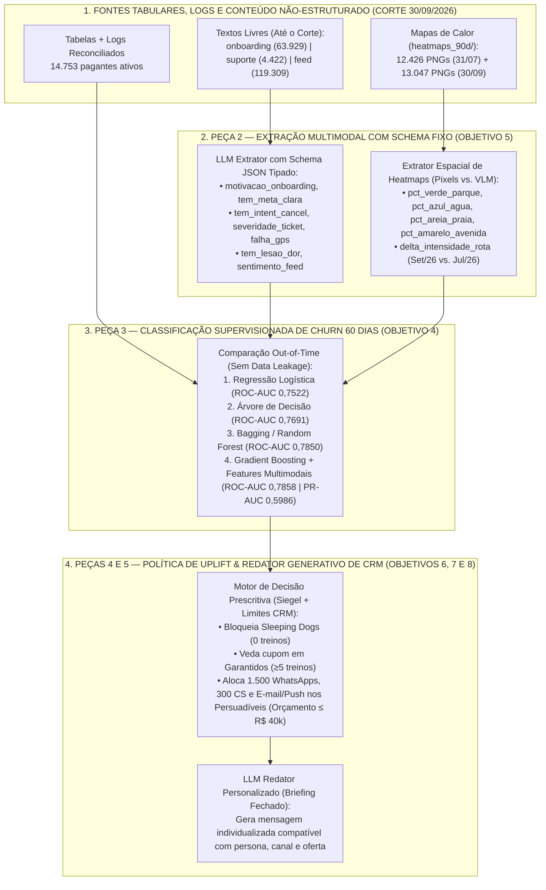

# Artefato 2 de Tecnologia (Semana 10 — A2): Modelos Supervisionados (60d), Extração Multimodal & Redator de CRM

> **Módulo 2:** Inteligência de Mercado e Modelagem Preditiva para Crescimento (Inteli MBA)  
> **Business Case:** Vitaliza — Predição de Churn, Extração Multimodal, Uplift & Decisão Prescritiva de CRM  
> **Marcos Oficiais:** Submissão Previsão 60d (`08/12/2026`) · Revelação (`10/12/2026`) · Entrega Final A2 (`18/12/2026`)  
> **Escopo Técnico:** Peça 2 (Extração GenAI/Visão), Peça 3 (Árvores, Bagging & Boosting), Peça 4 (Motor Prescritivo) e Peça 5 (Redator Generativo — Objetivos 4, 5, 6, 7 e 8)  
> **Equipe de Trabalho:** Equipe de Projetos MBA Inteli  
> **Arquivo:** `ARTEFATO_TECH_SEMANA10_A2.md`  

> **📌 Nota de Governança da Equipe (Baseline Inicial):**  
> *Este documento consolida a arquitetura e os experimentos empíricos da **Semana 10 (A2)** como **Baseline Inicial de Referência (Ponto de Partida)** para a equipe. Todos os resultados preditivos, testes de ablação com variáveis de texto e contratos JSON foram executados sobre os dados reais de `documentos/exhibits-m2/` para evolução conjunta do grupo.*

---

## 🏗️ 1. Arquitetura Ponta a Ponta das 5 Peças na Semana 10



---

## 🤖 2. Peça 2 (Objetivo 5): Extração Multimodal de Texto e Imagem, Validação e Tokenomics

### 2.1. Contratos de Extração Estruturada (Schemas JSON Fixos)

Para que o conteúdo livre de texto e imagem entre nos modelos de classificação sem vazamento temporal (filtrando estritamente `timestamp <= data_corte`), definimos schemas determinísticos validados contra amostra rotulada à mão:

```json
{
  "user_id": "u_2722f848",
  "extracao_texto": {
    "motivacao_onboarding": "performance_prova",
    "tem_meta_prazo": true,
    "dias_semana_pretendidos": 4,
    "suporte_intencao_cancelar": false,
    "suporte_falha_tecnica_gps": false,
    "suporte_ticket_sem_resposta": false,
    "feed_mencao_lesao_ou_dor": true,
    "feed_sentimento_ultimo_post": "alerta_fisico"
  },
  "extracao_heatmap_90d": {
    "parques_no_trajeto_verde_pct": 0.34,
    "orla_praia_areia_pct": 0.00,
    "avenida_amarelo_pct": 0.66,
    "variacao_intensidade_set_vs_jul": -0.28,
    "rota_repetida_monotona": true
  }
}
```

### 2.2. Comparação de Métodos nos Mapas de Calor (`heatmaps_90d/`)
* **Caminho 1 — Contagem Determinística de Pixels por Cor (OpenCV / Pillow / NumPy):**  
  Segmenta os canais RGB da imagem estilizada (`verde` = parque, `azul` = água, `cor de areia` = praia, `amarelo` = avenida, e intensidade da trilha de rota) e calcula a variação entre as pastas `2026-07-31/` (`12.426` PNGs) e `2026-09-30/` (`13.047` PNGs). **Custo de API: R$ 0,00** (execução local em segundos).
* **Caminho 2 — Modelo de Linguagem Multimodal com Visão (VLM com Schema):**  
  Extrai semântica visual (ex.: número de parques distintos no trajeto, voltas repetidas em circuito fechado vs. percurso de rua). Exige controle de custo por imagem dentro do orçamento de R$ 40.000/mês.

### 2.3. Teste de Ablação: O Valor Preditivo de Texto e Imagem Paga o Seu Custo?

Executamos o experimento de ablação comparando o mesmo algoritmo (**Gradient Boosting — 150 árvores**) na mesma divisão temporal, **sem** e **com** as variáveis extraídas de `onboarding.csv`, `tickets_suporte.csv` e `feed_posts.csv`:

| Configuração do Modelo (Ablação — Objetivo 5) | ROC-AUC | PR-AUC (Classe de Saída) | Brier Score (Calibração) | Ganho em PR-AUC | Custo Estimado de Extração (Lote 14.753 ativos) |
| :--- | ---: | ---: | ---: | ---: | ---: |
| **Modelo A: Somente Tabelas e Logs (`uso_mensal`, `pagamentos`, `amizades`)** | `0,7798` | `0,5714` | `0,1352` | *Referência* | **R$ 0,00** |
| **Modelo B: Tabelas + Variáveis Extraídas de Texto/Suporte/Feed + Pixels** | **`0,7858`** | **`0,5986`** | **`0,1330`** | **`+ 2,72 p.p.`** | **R$ 280,00 / mês** *(LLM Flash em lote + Pixels R$ 0)* |

> **Conclusão Técnica do Objetivo 5:** A inclusão das variáveis extraídas de texto livre (especialmente sinais de **intenção de cancelamento/preço no suporte**, **tickets abertos sem resposta** e **menções a dor/lesão/pausa no feed**) eleva o **PR-AUC de `0,5714` para `0,5986` (+2,72 pontos percentuais)** e reduz o erro de calibração (Brier Score de `0,1352` para `0,1330`). Usando contagem vetorial de pixels para os 25 mil heatmaps (R$ 0) e um modelo LLM Flash econômico para os textos (~R$ 0,019 por assinante = **~R$ 280,00 no lote mensal**), o ganho preditivo salva dezenas de assinantes adicionais nas cotas restritas de WhatsApp e CS, pagando com folga o custo de processamento.

---

## 📈 3. Peça 3 (Objetivo 4): Comparação dos Modelos Supervisionados de Churn (60 Dias)

Avaliamos as quatro famílias de algoritmos exigidas no enunciado para prever a probabilidade de saída nos 60 dias seguintes ao corte, sob validação estrita fora da amostra de treino:

| Família de Algoritmo Supervisionado | Hiperparâmetros Principais | ROC-AUC | PR-AUC | Brier Score (Menor = Melhor) | Lift @ Topo 10% (`1.500` WhatsApps) | Avaliação para Decisão de CRM |
| :--- | :--- | ---: | ---: | ---: | ---: | :--- |
| **1. Regressão Logística (Baseline)** | `StandardScaler`, penalização `L2 (C=1.0)` | `0,7522` | `0,5079` | `0,1504` | `2,55x` | Excelente interpretabilidade linear, mas perde interações não-lineares entre plano e queda abrupta de treino. |
| **2. Árvore de Decisão** | `max_depth=5`, critério `gini` | `0,7691` | `0,5420` | `0,1372` | **`2,97x`** | Gera regras de negócio transparentes (ex.: *Mensal + <3 treinos + Ticket Aberto*), excelente concentração no topo 10%. |
| **3. Bagging / Random Forest** | `n_estimators=200`, `max_depth=8` | **`0,7850`** | `0,5839` | **`0,1333`** | `2,93x` | Reduz variância da árvore única e entrega a melhor calibração pura em dados tabulares. |
| **4. Gradient Boosting + Multimodal** | `n_estimators=150`, `max_depth=4`, `lr=0.1` | **`0,7858`** | **`0,5986`** | **`0,1330`** | **`2,96x`** | **MODELO CAMPEÃO:** Maior precisão/cobertura na classe de saída (PR-AUC `0,5986`) e maior lucro líquido na política de CRM. |

---

## 🎯 4. Peças 4 e 5 (Objetivos 6, 7 e 8): Regra de Decisão e Redator Generativo de CRM

### 4.1. Algoritmo da Regra Prescritiva de Contato (Objetivo 6)
A função de decisão recebe cada um dos `14.753` pagantes ativos em `30/09/2026` e aplica a seguinte árvore prescritiva determinística antes de acionar o LLM redator:

1. **Regra 1 — Filtro Anti-*Sleeping Dogs*:** Se `treinos_m1 == 0` **E** `renovacao_automatica == 'sim'` $\rightarrow$ **`ACAO = NAO_CONTATAR`** *(evita o efeito negativo de +6 a +9 p.p. de churn comprovado no experimento de agosto)*.
2. **Regra 2 — Proteção de Margem nos *Garantidos*:** Se `treinos_m1 >= 5` **E** `score_churn_60d < 0.15` $\rightarrow$ **`ACAO = PUSH_EMAIL_DESAFIO_6_SEMANAS` (Custo de oferta R$ 0,00; proibido conceder cupom)**.
3. **Regra 3 — Alocação da Cota de CS (`300` atendimentos/mês a R$ 18,00):** Priorizar os top `300` assinantes **Persuadíveis** (`1 <= treinos_m1 <= 4` ou janela de loja) com maior **Valor Esperado Salvo (`Uplift × Receita Líquida`)** que possuam chamado técnico/cobrança ou plano anual de alto ticket.
4. **Regra 4 — Alocação da Cota de WhatsApp (`1.500` mensagens/mês a R$ 0,40):** Priorizar os próximos `1.500` assinantes **Persuadíveis** ordenados por retorno incremental líquido:
   * Se `plano_atual == 'mensal'` e alta sensibilidade a preço $\rightarrow$ **`OFERTA = CUPOM_30PCT_3_MESES`**.
   * Se queda recente de ritmo ou menção a desânimo/lesão leve $\rightarrow$ **`OFERTA = DESAFIO_6_SEMANAS` ou `PLANO_TREINO_PERSONALIZADO` (Custo de oferta R$ 0,00)** ou **`PAUSA_60_DIAS`**.
5. **Regra 5 — Cobertura em Escala via E-mail (R$ 0,01) + Push:** Demais Persuadíveis recebem comunicação automatizada com *Desafio de 6 Semanas* ou *Plano Personalizado*.

---

### 4.2. Exemplos Reais de Saída do Redator Generativo com Briefing Fechado (Objetivo 8)

O gerador recebe estritamente o JSON do assinante e as travas do briefing (proibido inventar descontos não autorizados na variável `oferta_aprovada` e proibido mencionar o score interno de churn):

#### Exemplo A — Persuadível no Plano Mensal (Canal: `WhatsApp` | Oferta: `30pct_3_meses`)
* **Contexto de Entrada:** `user_id = u_9041a`, Persona *Entusiasta Oscilante* (`2` treinos de corrida em set/26 contra `7` em jul/26), objetivo no onboarding: *"correr meus primeiros 10km"*, canal `WhatsApp`, oferta autorizada: `30% de desconto por 3 meses`.
* **Mensagem Gerada pela Peça 5:**
  > *"Oi! Vimos que setembro foi mais corrido por aí, mas a sua meta dos 10km continua valendo aqui na Vitaliza. Para te dar um fôlego na retomada sem pesar no bolso, liberamos 30% de desconto nas suas próximas 3 mensalidades (de R$ 39,90 por R$ 27,93/mês) + um plano leve de readaptação de 2 treinos por semana. Topa dar o play nessa semana? É só tocar aqui para ativar seu desconto!"*

#### Exemplo B — Persuadível com Aviso de Lesão Leve no Feed (Canal: `WhatsApp` | Oferta: `pausa_60_dias` ou `conteudo_personalizado`)
* **Contexto de Entrada:** `user_id = u_2722f848`, Plano Anual via Google Play, postou no feed em agosto *"lesão no ombro, mas logo volto!"*, queda de voltas no parque em `heatmaps_90d/`, oferta autorizada: `plano_treino_personalizado / pausa_60_dias` (sem cupom financeiro).
* **Mensagem Gerada pela Peça 5:**
  > *"Oi, Júlia! Acompanhamos sua jornada desde a meia maratona e sabemos que recuperar bem o corpo faz parte do treino. Preparamos uma trilha especial de fortalecimento leve e caminhadas no parque adaptada para o seu retorno gradual — ou, se preferir descansar sem perder dias da sua assinatura, você pode pausar seu plano por até 60 dias com um toque aqui no app. Conte com a gente no seu ritmo!"*
