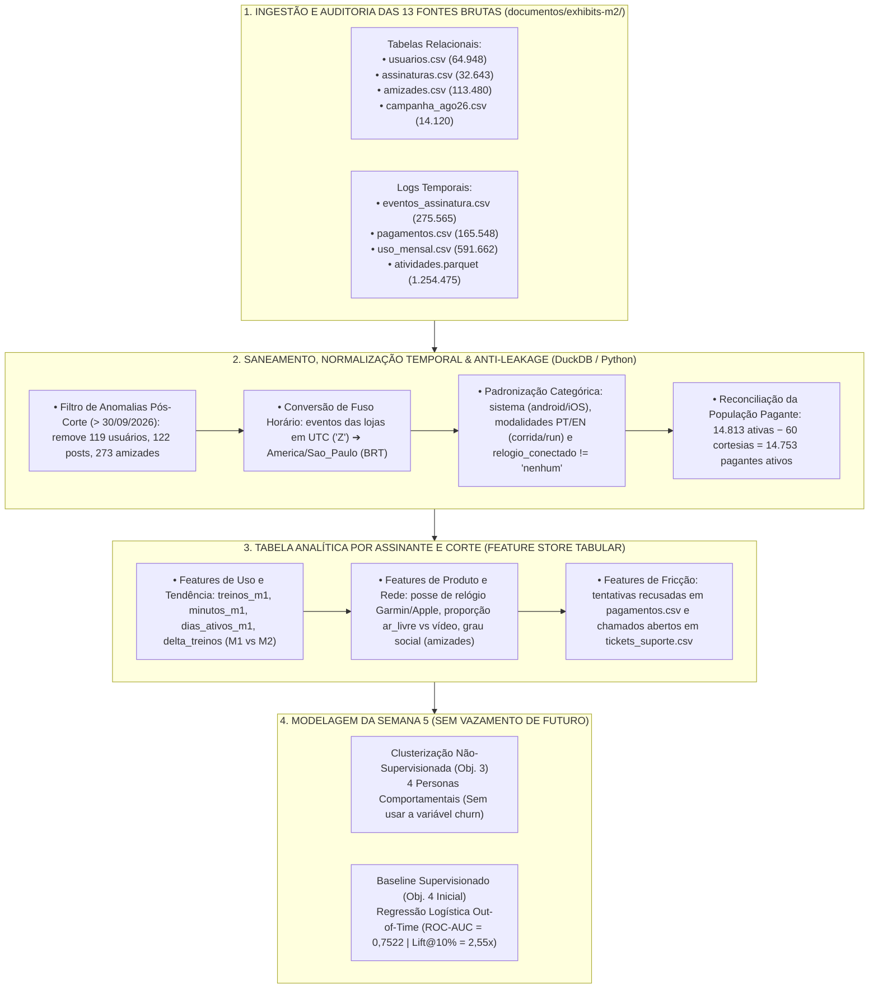

# Artefato 1 de Tecnologia (Semana 5 — A1): Pipeline do Data Room, EDA, Clusterização & Baseline

> **Módulo 2:** Inteligência de Mercado e Modelagem Preditiva para Crescimento (Inteli MBA)  
> **Business Case:** Vitaliza — Predição de Churn, Extração Multimodal, Uplift & Decisão Prescritiva de CRM  
> **Marco Oficial de Entrega:** Semana 5 — `13/11/2026` (1º Movimento: ENTENDER — Avaliação Formativa)  
> **Escopo Técnico:** Peça 1 (Dados) e Peça 3 Inicial (Clusterização Não-Supervisionada & Baseline Supervisionado — Objetivos 1, 2, 3 e 4)  
> **Equipe de Trabalho:** Equipe de Projetos MBA Inteli  
> **Arquivo:** `ARTEFATO_TECH_SEMANA5_A1.md`  

> **📌 Nota de Governança da Equipe (Baseline Inicial):**  
> *Este documento técnico foi estruturado como **Baseline Inicial de Referência (Ponto de Partida)** com base na auditoria real executada sobre `documentos/exhibits-m2/` (`relatorios/auditoria_exhibits.json`). Serve como base reproduzível para revisão, validação e contribuição de todos os integrantes da equipe.*

---

## 🏗️ 1. Arquitetura do Pipeline de Engenharia e Saneamento do Data Room (Objetivo 1)

O Data Room da Vitaliza foi exportado em `01/10/2026` com data de corte oficial em **`30/09/2026`**, totalizando **13 fontes de dados** heterogêneas (4 tabelas relacionais, 4 logs temporais incluindo `atividades.parquet` com `1.254.475` linhas e 5 bases de texto/imagem).

---

## 🔍 2. Relatório de Auditoria Técnica e Tratamento de Anomalias (`src/01_auditoria_data_room.py`)

A execução do script reproduzível [`src/01_auditoria_data_room.py`](../../src/01_auditoria_data_room.py) sobre os arquivos brutos identificou **7 anomalias estruturais** que contaminariam qualquer análise se não fossem tratadas antes da modelagem:

| # | Anomalia Detectada na Auditoria (`auditoria_exhibits.json`) | Volume Afetado | Regra de Engenharia Implementada no Pipeline |
| :--- | :--- | ---: | :--- |
| **1** | **Assinaturas de Cortesia Misturadas às Ativas** | `60 linhas` em `assinaturas.csv` | Filtrar `plano_atual IN ('mensal', 'anual')` e `canal_cobranca != 'interno'`, reconciliando exatamente **`14.753` pagantes ativos** sobre as `14.813` ativas. |
| **2** | **Registros com Carimbo de Tempo Posterior ao Corte (`> 30/09/2026`)** | `119` usuários, `122` posts, `273` amizades | Aplicar trava temporal estrita `timestamp <= '2026-09-30 23:59:59'` em todas as tabelas antes de agregar variáveis. |
| **3** | **Mistura de Fusos Horários (`UTC` vs. `Horário de Brasília`)** | `275.565` eventos + `34` treinos em `01/10` | Converter timestamps terminados em `"Z"` (App Store e Google Play) de `UTC` para `America/Sao_Paulo (UTC-3)`. Os 34 treinos na 1ª hora de `01/10 UTC` ocorreram na noite de `30/09 BRT`. |
| **4** | **Despadronização de Sistema Operacional (`usuarios.csv`)** | `64.948 linhas` | Mapear `LOWER(TRIM(sistema))`: unifica `android` (`28.027`) + `Android` (`7.124`) = **`35.151`**; e `ios` (`20.854`) + `iOS` (`7.463`) + `IOS` (`1.480`) = **`29.797`**. |
| **5** | **Modalidades de Treino Bilíngues (`atividades.parquet`)** | `1.254.475 treinos` | Unificar vocabulário PT/EN: `corrida` (`223.818`) + `run` (`162.108`) = **`385.926`**; `caminhada` (`118.024`) + `walk` (`88.509`) = **`206.533`**; `forca` (`112.704`) + `strength` (`85.548`) = **`198.252`**; `pedal` (`53.740`) + `ride` (`40.765`) = **`94.505`**; `funcional` (`145.476`); `yoga` (`113.849`); `hiit` (`109.934`). |
| **6** | **String `'nenhum'` em `relogio_conectado`** | `usuarios.csv` | Não usar `IS NOT NULL` simples; aplicar `LOWER(relogio_conectado) NOT IN ('nenhum', '')` para criar a flag `tem_relogio`. |
| **7** | **Estado Sobrescrito em `assinaturas.csv` vs. Histórico Real** | `32.643 assinaturas` | Utilizar `eventos_assinatura.csv` para reconstruir a situação da assinatura em cortes históricos (ex.: `31/07/2026` e `10/08/2026`). |

---

## 🧩 3. Engenharia de Variáveis e Clusterização Não-Supervisionada (Objetivo 3)

### 3.1. Protocolo de Prevenção de Vazamento na Segmentação
* **Variáveis de Entrada Padronizadas (`StandardScaler`):** `treinos_mes`, `minutos_mes`, `dias_ativos`, `sessoes_app`, `prop_ar_livre` (`atividades_ar_livre / atividades`), `tem_relogio` e `grau_amizades`.
* **Restrição Estrita:** A variável de saída (`status_atual` / `renovacao_automatica` / `churn`) **não entra** no cálculo de distância dos clusters. A taxa de desligamento de renovação é projetada sobre os grupos **apenas a posteriori** para validação de negócio:

| ID Cluster | Nome Técnico & Persona Associada | Assinantes (`N`) | % da Base | Centróide: Treinos/Mês | Centróide: Minutos/Mês | Vocação Dominante | Taxa de Renovação Desligada (Observada a Posteriori) |
| :--- | :--- | ---: | ---: | ---: | ---: | :--- | ---: |
| **Cluster 1** | `Atletas_Ar_Livre_GPS` (*Corredor Conectado de Parque*) | `4.089` | `27,72%` | `12,4` | `615,4 min` | Corrida, Caminhada e Pedal GPS + Relógio | **`1,61%`** |
| **Cluster 2** | `Praticantes_Indoor_Video` (*Praticante de Rotina em Casa*) | `2.960` | `20,06%` | `11,9` | `433,5 min` | Funcional, Força, Yoga e HIIT em vídeo | **`1,59%`** |
| **Cluster 3** | `Baixo_Engajamento_Oscilante` (*Entusiasta Frustrado — Persuadível*) | `5.391` | `36,54%` | `2,2` | `99,3 min` | Uso irregular (1 a 4 treinos/mês) | **`15,19%`** |
| **Cluster 4** | `Inativos_Zero_Treinos` (*Pagante Inerte / Sleeping Dog*) | `2.313` | `15,68%` | `0,0` | `0,0 min` | Sem atividade registrada no mês | **`56,98%`** |

---

## 📈 4. Baseline Supervisionado de Predição de Churn em 60 Dias (Objetivo 4 Inicial)

Para construir e validar o baseline de **Regressão Logística** sem *Data Leakage* (Kaufman et al., 2012), implementamos uma janela histórica onde todas as variáveis explicativas (`X`) são calculadas **estritamente até `31/07/2026`** (corte anterior à campanha de agosto) e o alvo (`y = target_saida`) mede a saída ou desligamento de renovação nos **60 dias seguintes**:

### 4.1. Conjunto de Variáveis do Baseline Tabular (`X` conhecido até o corte)
* **Contrato e Canal:** `is_mensal` (1 se mensal, 0 se anual), `is_loja` (1 se App Store/Google Play, 0 se Site).
* **Engajamento e Tendência Longitudinal:** `treinos_m1`, `minutos_m1`, `dias_ativos_m1`, `sessoes_m1` (mês `M-1`), `treinos_m2` (mês `M-2`) e `delta_treinos = treinos_m1 - treinos_m2` (captura a desaceleração recente de hábito).
* **Ecossistema e Fricção:** `tem_relogio` (Garmin/Apple Watch), `n_amigos` (vínculos em `amizades.csv` até o corte), `n_tickets` (chamados em `tickets_suporte.csv` até o corte) e `n_recusas` (cobranças recusadas em `pagamentos.csv` até o corte).

### 4.2. Desempenho Fora da Amostra do Baseline (Regressão Logística)

| Modelo Supervisionado (Semana 5 Baseline) | ROC-AUC (Discriminação) | PR-AUC (Precisão/Recall) | Brier Score (Calibração) | Lift no Topo 10% (Cota de 1.500 WhatsApps) |
| :--- | ---: | ---: | ---: | ---: |
| **Regressão Logística (`StandardScaler`, `L2`)** | **`0,7522`** | **`0,5079`** | **`0,1504`** | **`2,55x`** *(concentra 2,55x mais saídas que o acaso)* |

* **Principais Pesos Interpretáveis da Regressão Logística:** Os maiores coeficientes positivos para o risco de saída são a **queda de frequência (`delta_treinos < 0` e `dias_ativos_m1` baixo)**, a **modalidade `is_mensal = 1`** (exposta ao reajuste de R$ 39,90), a **presença de recusas de pagamento (`n_recusas`)** e a **ausência de relógio conectado (`tem_relogio = 0`)**.
